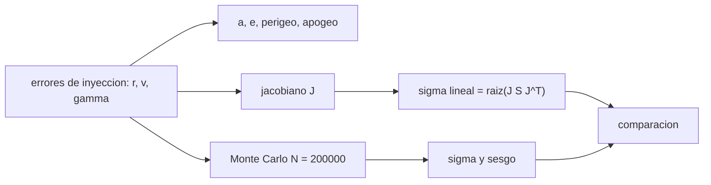

# B77-C13 — Inyección y dispersión orbital

<!-- nav:top -->
[🏠 Programa](../../../../README.md) · [📚 Bloque B77](../../../tronco-comun/B77-dinamica-de-lanzamiento-y-reentrada.md) · [← Anterior: B77-C12 — Perfil de ascenso orbital](../B77-C12-perfil-de-ascenso-orbital/CLASE.md) · [Siguiente: B77-C14 — Dinámica de reentrada →](../B77-C14-dinamica-de-reentrada/CLASE.md)
<!-- /nav -->

## 1. Ubicación, nivel y alcance

Clase 13 del bloque B77. Nivel N3. Ningún lanzador entrega exactamente el estado de inyección planeado. Los errores de altitud, velocidad y ángulo de la trayectoria se convierten en errores de semieje, excentricidad, perigeo y apogeo. Aquí los propagas de dos maneras (Monte Carlo y linealización con el jacobiano) y descubres un efecto de segundo orden que la linealización no ve. Usas [C12](../B77-C12-perfil-de-ascenso-orbital/CLASE.md) para la ecuación vis-viva. Los errores son inventados.

## 2. Por qué esta clase existe

La órbita lograda es una variable aleatoria. La decisión central: **¿cuánto vale la dispersión de cada elemento orbital y cuándo basta la propagación lineal?**

## 3. Lo que podrás hacer al terminar

1. Calcular `a`, `e`, perigeo y apogeo a partir de `(r, v, γ)`.
2. Calcular el jacobiano por diferencias centrales.
3. Propagar la dispersión con `J Σ Jᵀ` y con Monte Carlo (semilla fija).
4. Comparar ambas desviaciones estándar con una tolerancia declarada.
5. Explicar el sesgo del perigeo como efecto de segundo orden.
6. Separar lo consultado (radio) de lo no consultado (`μ`) y de lo inventado (errores).

La evidencia es la **ficha de dispersión de inyección** del ejercicio 12 (sección 20).

## 4. Con qué llegas y cómo comprobarlo

1. ¿Qué es una desviación estándar?
2. ¿Qué es un jacobiano?
3. ¿Qué es el método de Monte Carlo?
4. ¿Qué es la ecuación vis-viva?
5. ¿Qué es una semilla aleatoria?

<details>
<summary>Ver respuestas</summary>

1. Una medida de la dispersión de una variable aleatoria, en sus mismas unidades. 2. La matriz de derivadas parciales de las salidas respecto de las entradas. 3. Muestrear entradas aleatorias y calcular estadísticas de la salida. 4. `v² = μ(2/r − 1/a)`. 5. El valor que fija la secuencia pseudoaleatoria para repetir el cálculo.
</details>

Con cuatro o cinco aciertos, sigue; si no, repasa los prerrequisitos.

## 5. Un caso de contexto y casos de referencia

Una órbita nominal sintética de `200 × 600 km` se inyecta en el perigeo (`v = 7898,3 m/s`) con errores inventados de `1 km`, `3 m/s` y `0,05°`. La dispersión del apogeo es `11,40 km` y la del perigeo `1,00 km`. Monte Carlo con `200 000` muestras la reproduce al `0,64 %` y revela un sesgo del perigeo de `-87,4 m`. Es el **ejemplo conductor**; los errores son **inventados**.

## 6. Vocabulario

La **inyección** es el estado en que la etapa final suelta la carga. El **jacobiano** `J` mapea errores de entrada a errores de salida. La **propagación lineal** usa `Σ_y = J Σ_x Jᵀ`. El **Monte Carlo** muestrea entradas y calcula estadísticas. El **sesgo de segundo orden** es el desplazamiento de la media por la curvatura `½ H σ²`.

## 7. Modelo mental



*Descripción textual:* los errores de inyección se propagan a los elementos por linealización (jacobiano) y por Monte Carlo; ambas desviaciones se comparan y la diferencia de la media revela el efecto de segundo orden.

Analogía: lanzar una moneda a un blanco con la mano temblorosa: la mayor parte del error cae donde predice la pendiente local, pero si el blanco está en un máximo, el temblor solo puede empeorar la puntería en promedio. Límite: se suponen errores independientes y gaussianos, y solo dos cuerpos.

## 8. La explicación, paso a paso

### 8.1 De estado a elementos

`ε = v²/2 − μ/r`, `a = −μ/(2ε)`, `h = r v cos γ`, `e = √(1 + 2εh²/μ²)`, perigeo `= a(1 − e) − R_E`, apogeo `= a(1 + e) − R_E`. Nominal: `a = 6778,137 km`, `e = 0,02951`.

### 8.2 Jacobiano

Por diferencias centrales (filas: `a`, `e`, perigeo, apogeo; columnas: `r` [m/m], `v` [m/(m/s)], `γ` [m/rad]):

| Elemento | `∂/∂r` | `∂/∂v` | `∂/∂γ` |
|---|---|---|---|
| `a` | 2,1235 | 1820,7 | 0 |
| `e` | 1,565e-07 | 0,0002607 | 0 |
| perigeo | 1 | -0,000163 | 0 |
| apogeo | 3,2469 | 3641,45 | 0 |

El perigeo casi no depende de `v` (inyección en el perigeo) y la derivada respecto de `γ` es 0 en el nominal.

### 8.3 Dispersión: lineal y Monte Carlo

| Elemento | `σ` lineal (km o —) | `σ` Monte Carlo | Diferencia |
|---|---|---|---|
| a | 5,86042 | 5,86198 | 0,027 % |
| e | 0,000797581 | 0,000797369 | 0,027 % |
| perigeo | 1 | 1,00642 | 0,642 % |
| apogeo | 11,3967 | 11,3964 | 0,003 % |

Con `N = 200 000` el error estadístico de la desviación estándar es ~0,16 %; la diferencia mayor es el perigeo, que sube por la curvatura de `γ`.

### 8.4 El sesgo del perigeo

Como `∂rp/∂γ = 0`, la linealización no ve a `γ`; pero `γ ≠ 0` inyecta *después* del perigeo y baja `rp`. La media Monte Carlo cae `-87,38 m`, y la fórmula de segundo orden `½ Σ H σ²` da `-87,39 m`. El error estándar de la media es `2,25 m`. Ninguna muestra bajó de 150 km.

## 9. Magnitudes, símbolos y unidades

| Símbolo | Qué es | Unidad | Valor / nota |
|---|---|---|---|
| `σ_r`, `σ_v`, `σ_γ` | errores de inyección (1σ) | m, m/s, ° | 1000; 3; 0,05 (inventados) |
| `a`, `e` | semieje y excentricidad nominales | km, — | 6778,137; 0,02951 |
| `σ_ra` | dispersión del apogeo | km | 11,40 |
| `σ_rp` | dispersión del perigeo | km | 1,00 |
| `N` | muestras Monte Carlo | — | 200 000 (semilla 11) |
| sesgo del perigeo | media − nominal | m | -87,38 |

## 10. Convenciones y referencias

Plano orbital, dos cuerpos, Tierra esférica de radio 6378,137 km (NASA/NSSDC). `μ` es un valor estándar **no consultado**. Órbita nominal y errores inventados; independencia y normalidad supuestas.

## 11. De dónde sale lo que afirmamos

| ID | Fuente | Localizador | Respalda | Estado |
|---|---|---|---|---|
| S1 | NASA/NSSDC, Earth Fact Sheet — https://nssdc.gsfc.nasa.gov/planetary/factsheet/earthfact.html (consultada 2026-11-10) | ficha completa leída | radio ecuatorial 6378,137 km | Consultada |
| — | Ecuación vis-viva, propagación de covarianza J Σ Jᵀ y método de Monte Carlo | — | las verifica el laboratorio con una segunda vía | No consultada en una fuente concreta |

Límites: no se consultó ninguna guía de usuario de lanzador ni especificación de precisión de inyección; los errores son inventados; `μ` no se consultó en una fuente.

## 12. Cómo ver el resultado

| Magnitud | Valor |
|---|---|
| `σ` del apogeo (lineal; MC) | 11,3967 km; 11,3964 km |
| `σ` del perigeo (lineal; MC) | 1,0000 km; 1,0064 km |
| diferencia máxima | 0,642 % |
| sesgo del perigeo (MC; segundo orden) | -87,38 m; -87,39 m |
| `P(perigeo < 150 km)` | 0,0e+00 |

Descripción larga: la dispersión del apogeo es unas diez veces la del perigeo porque la velocidad entra con coeficiente grande en `a`; el sesgo del perigeo es un efecto de segundo orden.

## 13. Ejemplo trabajado: la dispersión del apogeo por la velocidad

**Paso 1 · Derivada.** `∂r_a/∂v = 3641,45 m/(m/s)`.

**Paso 2 · Error.** `σ_v = 3 m/s` aporta `10,92 km`.

**Paso 3 · Radio.** `∂r_a/∂r = 3,247` con `1 km` aporta `3,25 km`.

**Paso 4 · Suma en cuadratura.** `σ = √(10,92² + 3,25²) = 11,40 km`.

## 14. Distintas formas de describir el resultado

**Por matriz:** `J`. **Por tabla:** `σ` lineal y Monte Carlo. **Por distribución:** histograma del perigeo. **Por riesgo:** probabilidad de perigeo bajo.

## 15. Práctica guiada

**Ejercicio 1 · con los pasos indicados.** Calcula el aporte de `σ_v = 3 m/s` al semieje con `∂a/∂v = 1820,7`. *Pasos:* multiplica.

<details><summary>Solución comentada</summary>

`5462 m = 5,46 km`.
</details>

**Ejercicio 2 · con una pista.** Suma en cuadratura de 5,46 km y 2,12 km. *Pista:* `√(a² + b²)`.

<details><summary>Solución comentada</summary>

`5,86 km`, el `σ_a` del laboratorio.
</details>

**Ejercicio 3 · casi autónomo.** ¿Por qué el perigeo casi no depende de `v` en esta inyección?

<details><summary>Solución comentada</summary>

Porque se inyecta en el perigeo: un cambio de `v` mueve el apogeo, no el perigeo (a primer orden).
</details>

## 16. Práctica autónoma, transferencia e integrador

**Ejercicio 4 · autónomo.** `σ_v` que da una dispersión de apogeo de 5 km.

<details><summary>Solución comentada</summary>

`5000/3641,45 = 1,37 m/s`.
</details>

**Ejercicio 5 · autónomo.** ¿Por qué `∂rp/∂γ = 0`?

<details><summary>Solución comentada</summary>

Porque `rp` es función par de `γ` en `γ = 0`: la derivada primera se anula.
</details>

**Ejercicio 6 · autónomo.** Sesgo del perigeo esperado si `σ_γ` se duplica.

<details><summary>Solución comentada</summary>

Se multiplica por 4: `≈ −350 m`.
</details>

**Ejercicio 7 · autónomo.** Número de muestras para un error estadístico de la `σ` del 0,05 %.

<details><summary>Solución comentada</summary>

El error relativo es `1/√(2N)`: `N = 2·10⁶`.
</details>

**Ejercicio 8 · autónomo.** ¿Qué dispersión tendría el apogeo si los errores de `r` y `v` estuvieran correlacionados?

<details><summary>Solución comentada</summary>

Cambiaría según el signo de la correlación; la fórmula completa necesita `J Σ Jᵀ` con covarianzas.
</details>

**Ejercicio 9 · transferencia.** **Transferencia.** Una guía de usuario real da 'precisión de inyección ±10 km'. ¿Es comparable a este laboratorio?

<details><summary>Solución comentada</summary>

No sin saber qué percentil, qué elemento y qué estado; los errores del laboratorio son inventados.
</details>

**Ejercicio 10 · transferencia.** **Transferencia.** Un colega usa un 3σ lineal sobre el perigeo. ¿Qué riesgo corre?

<details><summary>Solución comentada</summary>

Ignora el sesgo de segundo orden, que aquí es de −87 m: pequeño, pero no nulo; con errores mayores crecería.
</details>

**Ejercicio 11 · transferencia.** **Transferencia.** ¿Qué cambia si la inyección no es en el perigeo?

<details><summary>Solución comentada</summary>

Aparecen derivadas no nulas respecto de `γ` y la excentricidad pasa a depender linealmente del error.
</details>

**Ejercicio 12 · integrador.** **Integrador.** Elabora tu *ficha de dispersión de inyección*: nominal, jacobiano, `σ` lineal y Monte Carlo, sesgo y lista de qué es consultado, no consultado e inventado.

<details><summary>Solución comentada</summary>

Secciones 8.1–8.4 y la salida del laboratorio.
</details>

## 17. Laboratorio: dispersión de la órbita de inyección

El script [dispersion.py](dispersion.py) propaga errores de inyección inventados a `a`, `e`, perigeo y apogeo con Monte Carlo (semilla 11) y con el jacobiano (**comprueba** desviaciones estándar a menos del 3 % y que el sesgo del perigeo coincide con el de segundo orden dentro de 4 errores estándar).

**Datos:** radio consultado; `μ` **no consultado**; errores y órbita nominal **inventados**. **Predice antes de ejecutar:** ¿qué elemento sufre mayor dispersión, el perigeo o el apogeo? (el apogeo: 11,4 km frente a 1,0 km.) **Ejecución del 2026-11-10 (Python 3.12.9):**

```text
Python 3.12.9 (biblioteca estandar)
Inyeccion SINTETICA en el perigeo: r = 6578.137 km, v = 7898.271 m/s; a = 6778.137 km, e = 0.02951, perigeo = 200.000 km, apogeo = 600.000 km
Errores 1-sigma INVENTADOS: r 1000 m, v 3.0 m/s, gamma 0.050 grados; N = 200000, semilla 11
Jacobiano d(a, e, perigeo, apogeo)/d(r, v, gamma) [m/m, m/(m/s), m/rad]:
  a               2.12346         1820.73               0
  e           1.56504e-07     0.000260692               0
  perigeo               1    -0.000162981               0
  apogeo          3.24693         3641.45               0
  magnitud  sigma lineal   sigma Monte Carlo   dif. relativa
  a              5.86042         5.86198       0.027 %   (km)
  e          0.000797581     0.000797369       0.027 %   (adimensional)
  perigeo              1         1.00642       0.642 %   (km)
  apogeo         11.3967         11.3964       0.003 %   (km)
Sesgo medio del perigeo = -87.377 m (error estandar de la media = 2.250 m)
Sesgo previsto por la curvatura de segundo orden (0.5 H sigma^2) = -87.393 m
Fraccion de muestras con perigeo < 150 km = 0.000e+00
Pruebas superadas.
```

```bash
python programa/clases/B77/B77-C13-inyeccion-y-dispersion-orbital/dispersion.py
```

**Límites:** errores independientes y gaussianos, dos cuerpos; la linealización falla donde la derivada primera se anula.

## 18. Errores frecuentes y cómo corregirlos

**Fiarse de la linealización donde la derivada se anula.** Se corrige con 8.4.

**Suponer que la dispersión es la misma para todos los elementos.** Se corrige con 8.3.

**Tomar los errores inventados como la precisión de un lanzador.** Se corrige con la sección 10.

**Usar pocas muestras Monte Carlo sin cuantificar su error.** Se corrige con el ejercicio 7.

## 19. Cómo sabrás que vas bien

Tras la sección 8: ¿qué dispersión esperabas para el apogeo y cuál obtuviste? Si dudas, repasa el ejemplo 13. Tras el laboratorio: ¿qué comprueba? (ver la sección 17).

## 20. Qué entregas y cómo se evalúa

El producto es tu **ficha de dispersión de inyección** (ejercicio 12).

| Criterio | Inicial | En desarrollo | Logrado | Destacado |
|---|---|---|---|---|
| Conceptos | Los confunde | Parciales | Aplica el modelo con sus supuestos | Explica los límites |
| Cálculo | Sin unidades | Con errores | Tablas completas con unidades | Calcula casos nuevos |
| Numérico | Sin comprobar | Un caso | Contraste con una segunda vía | Interpreta las diferencias |
| Fuentes | Sin fuente | Sin fecha | Fuentes con fecha y estado | Declara lo ilustrativo y lo no consultado |
| Límites | No los nombra | Uno | Tres | Discute qué falta del modelo |

**Condiciones críticas (no se compensan con promedio):** rotular los errores como inventados; declarar que `μ` no se consultó; no presentar la dispersión como la de un lanzador real; citar solo lo consultado.

## 21. Ética, seguridad y límites

Clase educativa: los modelos son simplificados y sus datos son sintéticos o ilustrativos; ningún resultado describe un vehículo real ni sustituye al análisis de seguridad, a la certificación o a los documentos del operador. Nada de lo simulado se presenta como observado ni como datos de vuelo. Accesibilidad: tablas equivalentes a las gráficas, fórmulas en texto, ejercicios sin conexión.

## 22. Para cerrar y seguir

Con errores inventados de `1 km`, `3 m/s` y `0,05°`, el apogeo se dispersa `11,4 km` y el perigeo `1,0 km`. Queda una pregunta: ¿qué pasa cuando el vehículo vuelve a entrar en la atmósfera?

**Glosario español–inglés.** inyección · *injection*; dispersión · *dispersion*; jacobiano · *Jacobian*; Monte Carlo · *Monte Carlo*; sesgo · *bias*.

**Continuidad.** [siguiente]

**Referencias:** ver sección 11.

<!-- nav:bottom -->
---

[← Anterior: B77-C12 — Perfil de ascenso orbital](../B77-C12-perfil-de-ascenso-orbital/CLASE.md) · [📚 Bloque B77](../../../tronco-comun/B77-dinamica-de-lanzamiento-y-reentrada.md) · [Siguiente: B77-C14 — Dinámica de reentrada →](../B77-C14-dinamica-de-reentrada/CLASE.md)
<!-- /nav -->
