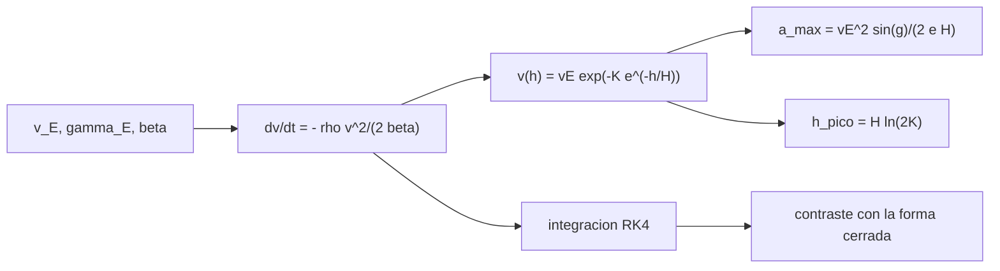

# B77-C14 — Dinámica de reentrada

<!-- nav:top -->
[🏠 Programa](../../../../README.md) · [📚 Bloque B77](../../../tronco-comun/B77-dinamica-de-lanzamiento-y-reentrada.md) · [← Anterior: B77-C13 — Inyección y dispersión orbital](../B77-C13-inyeccion-y-dispersion-orbital/CLASE.md) · [Siguiente: B77-C15 — Calentamiento aerodinámico →](../B77-C15-calentamiento-aerodinamico/CLASE.md)
<!-- /nav -->

## 1. Ubicación, nivel y alcance

Clase 14 del bloque B77. Nivel N3. Un cuerpo que vuelve a la atmósfera a velocidad orbital se frena en unas decenas de segundos y soporta una desaceleración que depende, de forma sorprendente, solo de la velocidad y del ángulo de entrada. Aquí derivas la solución cerrada de Allen–Eggers, la verificas con una integración numérica y ves cuánto la corrigen la gravedad y la curvatura. Usas [C02](../B77-C02-movimiento-en-atmosfera/CLASE.md) para la atmósfera. El cuerpo es sintético.

## 2. Por qué esta clase existe

La desaceleración máxima fija la carga sobre la carga útil y sobre la tripulación. La decisión central: **¿qué ángulo de entrada limita la desaceleración y de qué propiedades del vehículo no depende?**

## 3. Lo que podrás hacer al terminar

1. Escribir la ecuación de movimiento de una entrada balística.
2. Deducir la solución cerrada `v(h) = v_E exp(−K e^(−h/H))`.
3. Obtener `a_max = v_E² sin γ/(2eH)` y la altitud del pico `H ln(2K)`.
4. Comprobar numéricamente que `a_max` no depende del coeficiente balístico.
5. Medir cuánto cambian la gravedad y la curvatura el resultado.
6. Separar lo consultado (resumen del resultado, atmósfera) de lo derivado y lo ilustrativo.

La evidencia es la **ficha de reentrada balística** del ejercicio 12 (sección 20).

## 4. Con qué llegas y cómo comprobarlo

1. ¿Qué es el coeficiente balístico `β`?
2. ¿Qué es una atmósfera exponencial?
3. ¿Qué es el ángulo de entrada?
4. ¿Qué es una desaceleración en g?
5. ¿Qué es separar variables en una ecuación diferencial?

<details>
<summary>Ver respuestas</summary>

1. `m/(Cd·A)`, en kg/m². 2. Un modelo de densidad `ρ₀e^(−h/H)`. 3. El ángulo bajo el horizonte local de la velocidad en la entrada. 4. La aceleración dividida por `g₀ = 9,80665 m/s²`. 5. Pasar todos los términos de cada variable a un lado e integrar.
</details>

Con cuatro o cinco aciertos, sigue; si no, repasa los prerrequisitos.

## 5. Un caso de contexto y casos de referencia

Un cuerpo sintético entra a `7800 m/s` a `120 km`. Con ángulo de entrada de `5°` la desaceleración máxima es `11,70 g` tanto con `β = 100` como con `1000 kg/m²` (la integración da `11,71` y `11,70 g`), pero el pico ocurre a `60,2 km` en el primero y a `40,6 km` en el segundo. Con gravedad y curvatura, `β = 300` y `5°` el máximo sube a `13,33 g`. Es el **ejemplo conductor**; es **ilustrativo**.

## 6. Vocabulario

La **entrada balística** no usa sustentación. El **coeficiente balístico** es `β = m/(Cd A)`. El **ángulo de entrada** `γ_E` se mide bajo el horizonte. La **desaceleración máxima** es el pico de `ρv²/(2β)`. La **altitud del pico** es donde ocurre ese máximo.

## 7. Modelo mental



*Descripción textual:* la entrada, el ángulo y el coeficiente balístico dan la ecuación de movimiento; su solución cerrada da la desaceleración máxima y la altitud del pico, que se contrastan con una integración numérica.

Analogía: una piedra lanzada a un lago: cuanto más rápido y más empinado entra, antes y más fuerte la frena el agua, pero cuánto la frena en el pico no depende de lo pesada que sea; solo de dónde está el agua más densa. Límite: sin gravedad ni sustentación y con atmósfera exponencial.

## 8. La explicación, paso a paso

### 8.1 Ecuación de movimiento

Con trayectoria recta de ángulo `γ_E` (`s = sin γ_E`), sin gravedad: `dv/dt = −ρ(h) v²/(2β)` y `dh/dt = −v s`. Dividiendo, `dv/dh = ρ v/(2β s)`.

### 8.2 Solución cerrada

Con `ρ = ρ₀ e^(−h/H)`: `ln v = −K e^(−h/H) + C`, `K = ρ₀H/(2β s)`, o `v = v_E exp(−K e^(−h/H))` (el término de entrada es despreciable a 120 km). La desaceleración es `a = ρ v²/(2β)`; su máximo ocurre en `e^(−h/H) = 1/(2K)`, es decir `h_pico = H ln(2K)`, con `v_pico = v_E e^(−1/2) = 0,607 v_E` y
`a_max = v_E² s/(2 e H)` — **independiente de `β`**. Esto coincide con lo que dice el resumen del registro NTRS de Allen y Eggers (pico independiente de masa, tamaño y `Cd`).

### 8.3 Numérico

| `γ_E` (°) | `a_max` cerrada (g) | `a_max` numérica, `β` = 100 / 300 / 1000 (g) | `h_pico` cerrada, `β` = 100 / 300 / 1000 (km) |
|---|---|---|---|
| 3 | 7,03 | 7,04 / 7,03 / 7,03 | 64,5 / 55,2 / 44,9 |
| 5 | 11,70 | 11,71 / 11,70 / 11,70 | 60,2 / 50,8 / 40,6 |
| 10 | 23,31 | 23,32 / 23,32 / 23,31 | 54,3 / 45,0 / 34,7 |
| 20 | 45,92 | 45,93 / 45,92 / 45,92 | 48,6 / 39,2 / 29,0 |

El error máximo de la integración es `1,5e-03` y la dispersión del pico entre los tres `β` es `1,3e-03`.

### 8.4 Gravedad y curvatura

Con Tierra esférica y gravedad, `β = 300`: para `5°`, `13,33 g` frente a `11,70 g` (`+13,9 %`); para `10°`, `24,59 g` frente a `23,31 g` (`+5,5 %`). La gravedad empina la trayectoria cuando el cuerpo pierde velocidad; el modelo de Allen–Eggers es mejor para entradas empinadas. Un peso mayor (`β` grande) solo desplaza el pico a menor altitud, donde el calentamiento será más intenso ([C15](../B77-C15-calentamiento-aerodinamico/CLASE.md)).

## 9. Magnitudes, símbolos y unidades

| Símbolo | Qué es | Unidad | Valor / nota |
|---|---|---|---|
| `v_E` | velocidad de entrada | m/s | 7800 (ilustrativa) |
| `γ_E` | ángulo de entrada | ° | 3 a 20 (ilustrativo) |
| `β` | coeficiente balístico | kg/m² | 100; 300; 1000 (ilustrativos) |
| `K` | parámetro `ρ₀H/(2βs)` | — | 198 (β=300, 5°) |
| `a_max` | desaceleración máxima | g | 11,70 (5°) |
| `h_pico` | altitud del pico | km | 50,8 (β=300, 5°) |

## 10. Convenciones y referencias

Plano vertical local; el modelo de Allen–Eggers usa trayectoria recta y no incluye gravedad; la segunda integración usa Tierra esférica con `μ` **no consultado**. `ρ₀` y `H` de la NASA/NSSDC. Entrada, ángulos y `β` ilustrativos.

## 11. De dónde sale lo que afirmamos

| ID | Fuente | Localizador | Respalda | Estado |
|---|---|---|---|---|
| S1 | Allen y Eggers, NACA Report 1381 (1958) — registro NTRS https://ntrs.nasa.gov/citations/19930091020 (consultado 2026-11-10) | resumen del registro | análisis simplificado con Cd constante y densidad exponencial; el pico de desaceleración no depende de masa, tamaño ni Cd (solo el resumen) | Consultada (solo el resumen; el PDF no se leyó) |
| S2 | NASA/NSSDC, Earth Fact Sheet — https://nssdc.gsfc.nasa.gov/planetary/factsheet/earthfact.html (consultada 2026-11-10) | ficha completa leída | ρ₀ = 1,217 kg/m³, altura de escala 8,5 km y radio ecuatorial | Consultada |
| S3 | NASA Glenn, Drag Coefficient — https://www1.grc.nasa.gov/beginners-guide-to-aeronautics/drag-coefficient/ (consultada 2026-11-10) | página completa | D = Cd·q·A | Consultada |
| — | Solución cerrada de Allen–Eggers (derivada aquí) e integración RK4 | — | las verifica el laboratorio con una segunda vía | No consultada en una fuente concreta |

Límites: solo se leyó el resumen del informe de Allen y Eggers; la solución cerrada es una derivación propia verificada numéricamente; `μ` no se consultó; sin sustentación, ablación ni rotación.

## 12. Cómo ver el resultado

| Magnitud | Valor |
|---|---|
| `a_max` (5°) | 11,701 g (cerrada) |
| `a_max` numérica (5°, β=100/1000) | 11,711 / 11,702 g |
| `h_pico` (5°, β=100/1000) | 60,2 / 40,6 km |
| error de la integración | 1,5e-03 |
| con gravedad (5°, β=300) | 13,33 g |

Descripción larga: la desaceleración máxima crece con el seno del ángulo de entrada y no depende del coeficiente balístico; este solo mueve la altitud del pico.

## 13. Ejemplo trabajado: la desaceleración máxima a 5°

**Paso 1 · Seno.** `sin 5° = 0,08716`.

**Paso 2 · Numerador.** `v_E² s = 7800² × 0,08716 = 5,303·10⁶`.

**Paso 3 · Denominador.** `2eH = 2 × 2,71828 × 8500 = 46 210`.

**Paso 4 · Cociente.** `a_max = 114,75 m/s² = 11,70 g`.

## 14. Distintas formas de describir el resultado

**Por fórmula:** `v_E² s/(2eH)`. **Por tabla:** `γ_E` y `a_max`. **Por altitud:** `H ln(2K)`. **Por velocidad:** `0,607 v_E`. **Por corrección:** gravedad.

## 15. Práctica guiada

**Ejercicio 1 · con los pasos indicados.** Calcula `a_max` para `v_E = 7800`, `γ_E = 10°`. *Pasos:* `v² sin γ/(2eH)`.

<details><summary>Solución comentada</summary>

`23,31 g`.
</details>

**Ejercicio 2 · con una pista.** Calcula `K` con `β = 300` y `γ_E = 5°`. *Pista:* `ρ₀H/(2βs)`.

<details><summary>Solución comentada</summary>

`1,217 × 8500/(2 × 300 × 0,08716) = 197,8`.
</details>

**Ejercicio 3 · casi autónomo.** ¿Por qué `a_max` no depende de `β`?

<details><summary>Solución comentada</summary>

Porque `β` entra solo en `K`, que desplaza el pico en altitud; el valor del pico depende de `v_E² s/H`.
</details>

## 16. Práctica autónoma, transferencia e integrador

**Ejercicio 4 · autónomo.** Altitud del pico con `β = 300`, `γ_E = 5°`.

<details><summary>Solución comentada</summary>

`8,5 × ln(395,6) = 50,8 km`.
</details>

**Ejercicio 5 · autónomo.** Velocidad en el pico.

<details><summary>Solución comentada</summary>

`7800 e^(−1/2) = 4731 m/s`.
</details>

**Ejercicio 6 · autónomo.** Ángulo de entrada para limitar `a_max` a 8 g con `v_E = 7800`.

<details><summary>Solución comentada</summary>

`s = 2eH a/v² = 2 × 2,71828 × 8500 × 78,45/60 840 000 = 0,0596` → `3,4°`.
</details>

**Ejercicio 7 · autónomo.** ¿Qué ocurre con el pico si el ángulo se duplica?

<details><summary>Solución comentada</summary>

`a_max` se duplica (aprox., `sin γ`) y la altitud baja `H ln 2 ≈ 5,9 km`.
</details>

**Ejercicio 8 · autónomo.** ¿Cuánto sube `a_max` con `v_E` de 7800 a 11 000 m/s?

<details><summary>Solución comentada</summary>

Un factor `(11 000/7800)² = 1,99`.
</details>

**Ejercicio 9 · transferencia.** **Transferencia.** Un artículo da 4 g para una cápsula con sustentación. ¿Contradice este modelo?

<details><summary>Solución comentada</summary>

No: la sustentación alarga la trayectoria y baja el pico; este modelo es balístico.
</details>

**Ejercicio 10 · transferencia.** **Transferencia.** Un colega diseña con `a_max` independiente de `β` y concluye que `β` no importa. ¿Qué olvida?

<details><summary>Solución comentada</summary>

La altitud del pico y el calentamiento, que sí dependen de `β`.
</details>

**Ejercicio 11 · transferencia.** **Transferencia.** ¿Qué cambia si el cuerpo gira o tiene ablación?

<details><summary>Solución comentada</summary>

`β` deja de ser constante: cambian la masa y el área durante la entrada.
</details>

**Ejercicio 12 · integrador.** **Integrador.** Elabora tu *ficha de reentrada balística*: `a_max`, altitud y velocidad del pico, contraste numérico, efecto de la gravedad y lista de qué es consultado, derivado e ilustrativo.

<details><summary>Solución comentada</summary>

Secciones 8.1–8.4 y la salida del laboratorio.
</details>

## 17. Laboratorio: reentrada balística de Allen–Eggers

El script [reentrada.py](reentrada.py) integra una entrada balística para tres `β` y cuatro ángulos y la contrasta con la solución cerrada; añade una integración con gravedad y Tierra esférica (**comprueba** error de `a_max` < 5e-3 y dispersión entre `β` < 5e-3).

**Datos:** atmósfera, `g₀` y el resumen del resultado de Allen y Eggers consultados; `μ` **no consultado**; entrada y `β` **ilustrativos**. **Predice antes de ejecutar:** ¿cambia `a_max` entre `β = 100` y `1000`? (no: 11,70 g en ambos; cambia la altitud del pico.) **Ejecución del 2026-11-10 (Python 3.12.9):**

```text
Python 3.12.9 (biblioteca estandar)
Entrada SINTETICA: v_E = 7800 m/s a 120 km; atmosfera exponencial rho0 = 1.217, H = 8.5 km
 gamma_E  beta   a_max analitica [g]  a_max numerica [g]  h_pico analitica/numerica [km]  v_pico num [m/s]
   3.0     100           7.026             7.037       64.51/ 64.50        4733.5
   3.0     300           7.026             7.030       55.17/ 55.18        4734.7
   3.0    1000           7.026             7.027       44.94/ 44.94        4733.9
   5.0     100          11.701            11.711       60.17/ 60.17        4731.6
   5.0     300          11.701            11.704       50.83/ 50.81        4726.3
   5.0    1000          11.701            11.702       40.60/ 40.61        4733.3
  10.0     100          23.313            23.323       54.31/ 54.28        4723.3
  10.0     300          23.313            23.316       44.97/ 44.95        4723.2
  10.0    1000          23.313            23.314       34.74/ 34.76        4736.4
  20.0     100          45.917            45.928       48.55/ 48.54        4729.4
  20.0     300          45.917            45.921       39.21/ 39.21        4730.2
  20.0    1000          45.917            45.917       28.98/ 29.04        4746.7
Error relativo maximo de a_max (numerica vs cerrada) = 1.46e-03; dispersion maxima de a_max entre beta = 1.32e-03
Con gravedad y Tierra esferica (la trayectoria se curva hacia abajo al perder velocidad):
  gamma_E = 5 grados, beta = 300: a_max = 13.332 g frente a 11.701 g de Allen-Eggers (+13.9 %); h_pico = 48.9 km
  gamma_E = 10 grados, beta = 300: a_max = 24.590 g frente a 23.313 g de Allen-Eggers (+5.5 %); h_pico = 44.5 km
Pruebas superadas.
```

```bash
python programa/clases/B77/B77-C14-dinamica-de-reentrada/reentrada.py
```

**Límites:** trayectoria recta sin gravedad en el modelo cerrado; atmósfera exponencial; sin sustentación; la integración se detiene al 2 % de `v_E`.

## 18. Errores frecuentes y cómo corregirlos

**Pensar que un cuerpo más pesado desacelera menos en el pico.** Se corrige con 8.2.

**Aplicar Allen–Eggers a entradas muy someras.** Se corrige con 8.4.

**Olvidar que el pico ocurre a menor altitud con `β` grande.** Se corrige con 8.3.

**Tomar la derivación por la fórmula original del informe.** Se corrige con la sección 11.

## 19. Cómo sabrás que vas bien

Tras la sección 8: ¿qué `a_max` esperabas a 5° y cuál obtuviste? Si dudas, repasa el ejemplo 13. Tras el laboratorio: ¿qué comprueba? (ver la sección 17).

## 20. Qué entregas y cómo se evalúa

El producto es tu **ficha de reentrada balística** (ejercicio 12).

| Criterio | Inicial | En desarrollo | Logrado | Destacado |
|---|---|---|---|---|
| Conceptos | Los confunde | Parciales | Aplica el modelo con sus supuestos | Explica los límites |
| Cálculo | Sin unidades | Con errores | Tablas completas con unidades | Calcula casos nuevos |
| Numérico | Sin comprobar | Un caso | Contraste con una segunda vía | Interpreta las diferencias |
| Fuentes | Sin fuente | Sin fecha | Fuentes con fecha y estado | Declara lo ilustrativo y lo no consultado |
| Límites | No los nombra | Uno | Tres | Discute qué falta del modelo |

**Condiciones críticas (no se compensan con promedio):** rotular la entrada y `β` como ilustrativos; declarar que solo se leyó el resumen de Allen y Eggers; no presentar el resultado como una predicción de reentrada real; citar solo lo consultado.

## 21. Ética, seguridad y límites

Clase educativa: los modelos son simplificados y sus datos son sintéticos o ilustrativos; ningún resultado describe un vehículo real ni sustituye al análisis de seguridad, a la certificación o a los documentos del operador. Nada de lo simulado se presenta como observado ni como datos de vuelo. Accesibilidad: tablas equivalentes a las gráficas, fórmulas en texto, ejercicios sin conexión.

## 22. Para cerrar y seguir

A `7800 m/s` y `5°` la desaceleración máxima es `11,7 g` para cualquier `β`, y solo el pico cambia de altitud. Queda una pregunta: ¿cuánto calor recibe el cuerpo mientras se frena?

**Glosario español–inglés.** reentrada balística · *ballistic entry*; coeficiente balístico · *ballistic coefficient*; ángulo de entrada · *entry angle*; desaceleración máxima · *peak deceleration*; altura de escala · *scale height*.

**Continuidad.** [siguiente]

**Referencias:** ver sección 11.

<!-- nav:bottom -->
---

[← Anterior: B77-C13 — Inyección y dispersión orbital](../B77-C13-inyeccion-y-dispersion-orbital/CLASE.md) · [📚 Bloque B77](../../../tronco-comun/B77-dinamica-de-lanzamiento-y-reentrada.md) · [Siguiente: B77-C15 — Calentamiento aerodinámico →](../B77-C15-calentamiento-aerodinamico/CLASE.md)
<!-- /nav -->
