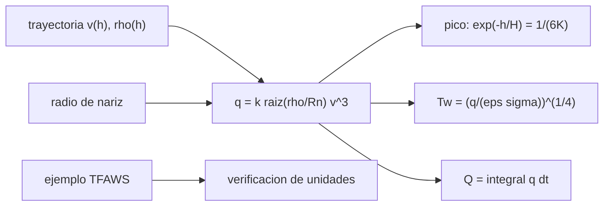

# B77-C15 — Calentamiento aerodinámico

<!-- nav:top -->
[🏠 Programa](../../../../README.md) · [📚 Bloque B77](../../../tronco-comun/B77-dinamica-de-lanzamiento-y-reentrada.md) · [← Anterior: B77-C14 — Dinámica de reentrada](../B77-C14-dinamica-de-reentrada/CLASE.md) · [Siguiente: B77-C16 — Protección térmica →](../B77-C16-proteccion-termica/CLASE.md)
<!-- /nav -->

## 1. Ubicación, nivel y alcance

Clase 15 del bloque B77. Nivel N3. La energía cinética que el vehículo pierde en la entrada se convierte, en parte, en calor que llega a su superficie. Aquí calculas el flujo de calor convectivo en el punto de remanso con la correlación de Sutton–Graves a lo largo de la trayectoria de [C14](../B77-C14-dinamica-de-reentrada/CLASE.md), la temperatura de equilibrio radiativo de la pared y la carga térmica total. Antes validas las unidades con un ejemplo resuelto publicado. La entrada es sintética.

## 2. Por qué esta clase existe

El flujo de calor máximo y la carga total deciden qué material y qué espesor protegen al vehículo, y no se maximizan en el mismo punto que la desaceleración. La decisión central: **¿cuánto vale el flujo de pico, a qué altitud ocurre y cómo escala con el radio de la nariz y el coeficiente balístico?**

## 3. Lo que podrás hacer al terminar

1. Calcular el flujo convectivo de remanso `q̇ = k√(ρ/R_n)·V³`.
2. Obtener la temperatura de equilibrio radiativo `T_w = (q̇/(εσ))^(1/4)`.
3. Verificar unidades y constante con un ejemplo resuelto publicado.
4. Hallar el pico de flujo (`e^(−h/H) = 1/(6K)`) y la carga térmica por integración.
5. Comparar tres coeficientes balísticos y dos radios de nariz.
6. Separar lo consultado (correlación, constante, ejemplo) de lo ilustrativo (entrada, `R_n`, `ε`).

La evidencia es la **ficha de calentamiento de remanso** del ejercicio 12 (sección 20).

## 4. Con qué llegas y cómo comprobarlo

1. ¿Qué es un flujo de calor y en qué unidades se mide?
2. ¿Qué es el punto de remanso?
3. ¿Qué es el equilibrio radiativo?
4. ¿Qué es la emisividad?
5. ¿Qué es una integral en el tiempo de un flujo?

<details>
<summary>Ver respuestas</summary>

1. Potencia por unidad de área, en W/m² (o W/cm²). 2. El punto del cuerpo donde el flujo se detiene, el de mayor presión. 3. Cuando la pared emite tanto como recibe: `q̇ = εσT⁴`. 4. La fracción de la radiación de un cuerpo negro que emite una superficie. 5. La energía por unidad de área recibida, en J/m².
</details>

Con cuatro o cinco aciertos, sigue; si no, repasa los prerrequisitos.

## 5. Un caso de contexto y casos de referencia

En el ejemplo resuelto de TFAWS (`ρ = 3,1459·10⁻⁴ kg/m³`, `V = 3,535 km/s`, `R_n = 1 m`, `ε = 0,8`) la correlación da `13,64 W/cm²` (publicado: 13,6) y `1317 K` (publicado: 1316). Para la entrada sintética de C14 (`β = 300`, `5°`), el pico es `161 W/cm²` con `R_n = 1 m` y `293 W/cm²` con `0,3 m`, a `60,2 km`, con una carga de `100 MJ/m²`. Es el **ejemplo conductor**; la entrada es **ilustrativa**.

## 6. Vocabulario

El **flujo de calor convectivo de remanso** es `q̇ = k√(ρ/R_n)V³` con `k = 1,7415·10⁻⁴` (SI, Tierra). La **temperatura de equilibrio radiativo** es `T_w = (q̇/(εσ))^(1/4)`. La **carga térmica** es `Q = ∫q̇ dt`. El **radio de nariz** `R_n` es el radio de curvatura del punto de remanso. La **pared caliente** (corrección) se desprecia aquí.

## 7. Modelo mental



*Descripción textual:* la trayectoria da densidad y velocidad en cada altitud; con el radio de nariz se obtiene el flujo, de él el pico, la temperatura de pared y la carga total; el ejemplo publicado valida las unidades.

Analogía: la fricción de las manos al frotarlas: cuanto más rápido, mucho más calor (aquí con el cubo de la velocidad), y una nariz más puntiaguda concentra el calor. Límite: la correlación es válida para el punto de remanso con pared fría y en equilibrio químico; su precisión empeora a flujos bajos.

## 8. La explicación, paso a paso

### 8.1 La correlación y su verificación

`q̇ = k√(ρ/R_n)·V³` con `k = 1,7415·10⁻⁴ kg^½/m` da `q̇` en W/m² (÷10⁴ para W/cm²). Con los datos del ejemplo de TFAWS (`ρ = 3,1459·10⁻⁴`, `V = 3535 m/s`, `R_n = 1 m`): `q̇ = 13,645 W/cm²` (13,6 publicado; diferencia 0,33 %, por el redondeo del original). La temperatura `T_w = (13,6·10⁴/(0,8·5,67·10⁻⁸))^(1/4)` da `1317,0 K` (1316 publicado).

### 8.2 Pico y altitud

Con la solución de C14, `q̇ ∝ x^(1/2)·exp(−3Kx)` con `x = e^(−h/H)`; su máximo está en `x = 1/(6K)`, es decir `h = H ln(6K)` y `v = v_E e^(−1/6)`. El pico numérico coincide con el cerrado (error `1e-08`).

### 8.3 Resultados

| `β` (kg/m²) | `R_n` (m) | `q̇_pico` (W/cm²) | `h_pico` (km) | `T_w` (K) | `Q` (MJ/m²) |
|---|---|---|---|---|---|
| 100 | 0,3 | 169,2 | 69,5 | 2471 | 103,5 |
| 100 | 1,0 | 92,7 | 69,5 | 2126 | 56,7 |
| 300 | 0,3 | 293,0 | 60,2 | 2835 | 181,9 |
| 300 | 1,0 | 160,5 | 60,2 | 2439 | 99,6 |
| 1000 | 0,3 | 535,0 | 49,9 | 3296 | 335,0 |
| 1000 | 1,0 | 293,0 | 49,9 | 2835 | 183,5 |

Reducir `R_n` de 1 m a 0,3 m multiplica el flujo por `√(1/0,3) = 1,83`. Un `β` mayor entra a más baja altitud, con más densidad y más flujo.

### 8.4 Carga total y límites

La carga integra `q̇ dt = q̇ dh/(v sin γ)`; la forma cerrada `k√(ρ₀/R_n)·H·v_E²·√(π/(2K))/sin γ` (con la corrección del inicio) coincide con la numérica (error `1e-05`). Esta carga es solo la convectiva: faltan el calentamiento radiativo del gas (importante por encima de ~10 km/s), la corrección de pared caliente y la ablación. El resultado es un orden de magnitud, no un diseño.

## 9. Magnitudes, símbolos y unidades

| Símbolo | Qué es | Unidad | Valor / nota |
|---|---|---|---|
| `k` | constante de Sutton–Graves (Tierra) | kg^½/m | 1,7415·10⁻⁴ (TFAWS) |
| `ρ`, `V` | densidad y velocidad locales | kg/m³, m/s | según altitud |
| `R_n` | radio de nariz | m | 0,3; 1,0 (ilustrativos) |
| `ε`, `σ` | emisividad y constante de Stefan–Boltzmann | —, W/(m² K⁴) | 0,8 (ilustrativa); 5,67·10⁻⁸ (TFAWS) |
| `q̇` | flujo de remanso | W/cm² | 161 (β=300, R_n=1) |
| `Q` | carga térmica | MJ/m² | 100 |

## 10. Convenciones y referencias

`q̇` en W/m²; 1 W/cm² = 10⁴ W/m². Atmósfera exponencial (NASA/NSSDC), trayectoria recta de C14. `k`, `σ` y el ejemplo de TFAWS 2012; entrada, `R_n`, `ε` e `β` ilustrativos.

## 11. De dónde sale lo que afirmamos

| ID | Fuente | Localizador | Respalda | Estado |
|---|---|---|---|---|
| S1 | TFAWS 2012, Aerothermodynamics Course, lección 1 — https://tfaws.nasa.gov/TFAWS12/Proceedings/Aerothermodynamics%20Course.pdf (leído con PyMuPDF el 2026-11-10) | pp. 17 y 29 del PDF | q̇ = k√(ρ/R_n)V³, k = 1,7415·10⁻⁴; ejemplo resuelto 13,6 W/cm² y 1316 K | Consultada |
| S2 | Sutton y Graves, NASA TR R-376 (1971) — registro NTRS https://ntrs.nasa.gov/citations/19720003329 (consultado 2026-11-10) | registro devuelto por la búsqueda | origen de la correlación (solo el registro) | Consultada (solo el registro; el informe no se leyó) |
| S3 | NASA/NSSDC, Earth Fact Sheet — https://nssdc.gsfc.nasa.gov/planetary/factsheet/earthfact.html (consultada 2026-11-10) | ficha completa leída | ρ₀ = 1,217 kg/m³ y altura de escala 8,5 km | Consultada |
| — | Equilibrio radiativo q̇ = εσT⁴ e integral de la carga térmica | — | las verifica el laboratorio con una segunda vía | No consultada en una fuente concreta |

Límites: solo se leyeron las diapositivas de TFAWS y el registro de Sutton y Graves; sin calentamiento radiativo del gas, sin pared caliente ni ablación; la entrada es sintética.

## 12. Cómo ver el resultado

| Magnitud | Valor |
|---|---|
| ejemplo TFAWS | 13,64 W/cm²; 1317 K |
| `q̇_pico` (β=300, R_n=1) | 160,5 W/cm² a 60,2 km |
| `T_w` (β=300, R_n=1) | 2439 K |
| `Q` (β=300, R_n=1) | 99,6 MJ/m² |
| error del pico y de la carga | 1e-08; 1e-05 |

Descripción larga: el flujo máximo ocurre a mayor altitud que el de mayor frenado y crece con el cubo de la velocidad y con la inversa de la raíz del radio de nariz.

## 13. Ejemplo trabajado: el ejemplo de TFAWS

**Paso 1 · Raíz.** `√(3,1459·10⁻⁴/1) = 0,017736`.

**Paso 2 · Cubo.** `3535³ = 4,4176·10¹⁰`.

**Paso 3 · Flujo.** `q̇ = 1,7415·10⁻⁴ × 0,017736 × 4,4176·10¹⁰ = 136447 W/m² = 13,64 W/cm²`.

**Paso 4 · Temperatura.** `T_w = (136447/(0,8 × 5,67·10⁻⁸))^(1/4) = 1317 K`.

## 14. Distintas formas de describir el resultado

**Por fórmula:** `k√(ρ/R_n)V³`. **Por tabla:** `β`, `R_n`, `q̇`, `T_w`. **Por pico:** `H ln(6K)`. **Por energía:** `Q`. **Por unidades:** W/cm².

## 15. Práctica guiada

**Ejercicio 1 · con los pasos indicados.** Calcula `q̇` con `ρ = 10⁻³ kg/m³`, `V = 7000 m/s`, `R_n = 1 m`. *Pasos:* `k√ρ V³`.

<details><summary>Solución comentada</summary>

`1,7415e-4 × 0,031623 × 3,43e11 = 1,889·10⁶ W/m² = 189 W/cm²`.
</details>

**Ejercicio 2 · con una pista.** Convierte 189 W/cm² a W/m². *Pista:* multiplica por 10⁴.

<details><summary>Solución comentada</summary>

`1,89·10⁶ W/m²`.
</details>

**Ejercicio 3 · casi autónomo.** ¿Por qué el pico de `q̇` ocurre a mayor altitud que el de desaceleración?

<details><summary>Solución comentada</summary>

A mayor altitud: `q̇ ∝ v³` pesa más que `a ∝ v²`, así que el pico llega antes (`h = H ln 6K` frente a `H ln 2K`).
</details>

## 16. Práctica autónoma, transferencia e integrador

**Ejercicio 4 · autónomo.** Temperatura de equilibrio para `q̇ = 100 W/cm²`, `ε = 0,8`.

<details><summary>Solución comentada</summary>

`(10⁶/(0,8 × 5,67·10⁻⁸))^(1/4) = 2167 K`.
</details>

**Ejercicio 5 · autónomo.** Factor de `q̇` al reducir `R_n` de 1 a 0,25 m.

<details><summary>Solución comentada</summary>

`√4 = 2`.
</details>

**Ejercicio 6 · autónomo.** Factor de `q̇` al subir `V` un 10 %.

<details><summary>Solución comentada</summary>

`1,1³ = 1,331`.
</details>

**Ejercicio 7 · autónomo.** Altitud del pico con `β = 100`, `5°`.

<details><summary>Solución comentada</summary>

`69,5 km`.
</details>

**Ejercicio 8 · autónomo.** Carga total para `β = 300`, `R_n = 1 m`.

<details><summary>Solución comentada</summary>

`99,6 MJ/m²`.
</details>

**Ejercicio 9 · transferencia.** **Transferencia.** Un informe da 200 W/cm² para una cápsula real. ¿Es comparable?

<details><summary>Solución comentada</summary>

Solo si se conocen `V`, `ρ`, `R_n` y el material; el valor depende de todos.
</details>

**Ejercicio 10 · transferencia.** **Transferencia.** Un colega usa la correlación para una entrada marciana con `k = 1,7415·10⁻⁴`. ¿Qué error?

<details><summary>Solución comentada</summary>

La constante de Marte es distinta (1,9027·10⁻⁴ según TFAWS).
</details>

**Ejercicio 11 · transferencia.** **Transferencia.** ¿Qué cambia por encima de 10 km/s?

<details><summary>Solución comentada</summary>

Aparece un calentamiento radiativo del gas que este modelo no incluye.
</details>

**Ejercicio 12 · integrador.** **Integrador.** Elabora tu *ficha de calentamiento de remanso*: verificación con el ejemplo de TFAWS, pico, altitud, `T_w`, carga y lista de qué es consultado e ilustrativo.

<details><summary>Solución comentada</summary>

Secciones 8.1–8.4 y la salida del laboratorio.
</details>

## 17. Laboratorio: calentamiento de remanso a lo largo de una entrada

El script [calentamiento.py](calentamiento.py) verifica la correlación con el ejemplo de TFAWS y calcula el pico, la altitud, `T_w` y la carga para seis combinaciones de `β` y `R_n` (**comprueba** ejemplo al 0,5 % y 0,2 %, pico < 1e-3 y carga < 1 % frente a la forma cerrada).

**Datos:** correlación, constante y ejemplo de TFAWS consultados; entrada, `R_n` y `ε` **ilustrativos**. **Predice antes de ejecutar:** ¿qué flujo de pico tendrá `β = 300` con `R_n = 1 m`? (unos 160 W/cm² a 60,2 km.) **Ejecución del 2026-11-10 (Python 3.12.9):**

```text
Python 3.12.9 (biblioteca estandar)
Prueba con el ejemplo de TFAWS 2012: q = 13.64 W/cm2 (publicado 13.6; error 3.3e-03); T_w = 1317.0 K (publicado 1316; error 7.3e-04)
Entrada SINTETICA (v_E = 7800 m/s, gamma_E = 5 grados), nariz R_n y beta ILUSTRATIVOS; epsilon = 0.8
 beta   R_n [m]   q_pico [W/cm2]  h_pico num/analit. [km]   T_w [K]   Q [MJ/m2] num / analit.
    100    0.3         169.2      69.51/ 69.51       2471    103.50 / 103.50
    100    1.0          92.7      69.51/ 69.51       2126     56.69 /  56.69
    300    0.3         293.0      60.17/ 60.17       2835    181.88 / 181.88
    300    1.0         160.5      60.17/ 60.17       2439     99.62 /  99.62
   1000    0.3         535.0      49.94/ 49.94       3296    335.02 / 335.02
   1000    1.0         293.0      49.94/ 49.94       2835    183.50 / 183.50
Errores relativos maximos: pico 9.5e-09; carga termica 1.0e-05
Pruebas superadas.
```

```bash
python programa/clases/B77/B77-C15-calentamiento-aerodinamico/calentamiento.py
```

**Límites:** solo flujo convectivo de remanso con pared fría; sin radiación del gas, ablación ni pared caliente; trayectoria recta sin gravedad.

## 18. Errores frecuentes y cómo corregirlos

**Confundir W/cm² con W/m².** Se corrige con 8.1.

**Suponer que el flujo máximo coincide con la desaceleración máxima.** Se corrige con 8.2.

**Usar la constante terrestre en otra atmósfera.** Se corrige con el ejercicio 10.

**Dar `T_w` como la temperatura real del material.** Se corrige con la sección 10.

## 19. Cómo sabrás que vas bien

Tras la sección 8: ¿qué `q̇` esperabas y cuál obtuviste? Si dudas, repasa el ejemplo 13. Tras el laboratorio: ¿qué comprueba? (ver la sección 17).

## 20. Qué entregas y cómo se evalúa

El producto es tu **ficha de calentamiento de remanso** (ejercicio 12).

| Criterio | Inicial | En desarrollo | Logrado | Destacado |
|---|---|---|---|---|
| Conceptos | Los confunde | Parciales | Aplica el modelo con sus supuestos | Explica los límites |
| Cálculo | Sin unidades | Con errores | Tablas completas con unidades | Calcula casos nuevos |
| Numérico | Sin comprobar | Un caso | Contraste con una segunda vía | Interpreta las diferencias |
| Fuentes | Sin fuente | Sin fecha | Fuentes con fecha y estado | Declara lo ilustrativo y lo no consultado |
| Límites | No los nombra | Uno | Tres | Discute qué falta del modelo |

**Condiciones críticas (no se compensan con promedio):** rotular la entrada y los parámetros como ilustrativos; no presentar `T_w` como temperatura real del material; declarar que solo se leyeron las diapositivas y el registro; citar solo lo consultado.

## 21. Ética, seguridad y límites

Clase educativa: los modelos son simplificados y sus datos son sintéticos o ilustrativos; ningún resultado describe un vehículo real ni sustituye al análisis de seguridad, a la certificación o a los documentos del operador. Nada de lo simulado se presenta como observado ni como datos de vuelo. Accesibilidad: tablas equivalentes a las gráficas, fórmulas en texto, ejercicios sin conexión.

## 22. Para cerrar y seguir

La correlación reproduce el ejemplo publicado (`13,6 W/cm²`, `1317 K`) y da `161 W/cm²` y `100 MJ/m²` para la entrada sintética. Queda una pregunta: ¿cómo responde un material a esa carga térmica?

**Glosario español–inglés.** flujo de calor · *heat flux*; punto de remanso · *stagnation point*; equilibrio radiativo · *radiative equilibrium*; carga térmica · *heat load*; radio de nariz · *nose radius*.

**Continuidad.** [siguiente]

**Referencias:** ver sección 11.

<!-- nav:bottom -->
---

[← Anterior: B77-C14 — Dinámica de reentrada](../B77-C14-dinamica-de-reentrada/CLASE.md) · [📚 Bloque B77](../../../tronco-comun/B77-dinamica-de-lanzamiento-y-reentrada.md) · [Siguiente: B77-C16 — Protección térmica →](../B77-C16-proteccion-termica/CLASE.md)
<!-- /nav -->
