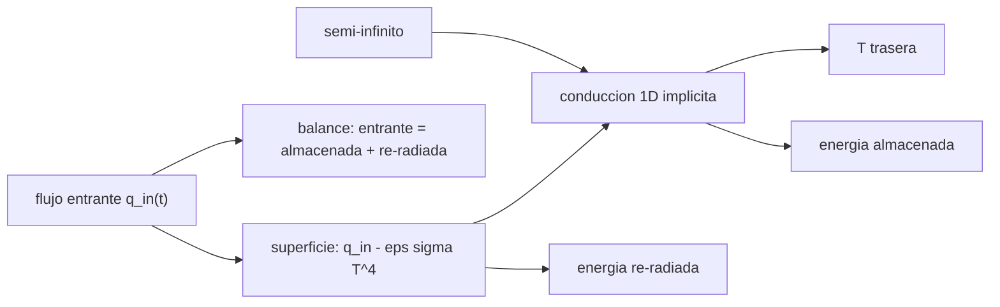

# B77-C16 — Protección térmica

<!-- nav:top -->
[🏠 Programa](../../../../README.md) · [📚 Bloque B77](../../../tronco-comun/B77-dinamica-de-lanzamiento-y-reentrada.md) · [← Anterior: B77-C15 — Calentamiento aerodinámico](../B77-C15-calentamiento-aerodinamico/CLASE.md) · [Siguiente: B77-C17 — Estabilidad durante descenso →](../B77-C17-estabilidad-durante-descenso/CLASE.md)
<!-- /nav -->

## 1. Ubicación, nivel y alcance

Clase 16 del bloque B77. Nivel N3. Un escudo térmico convierte un flujo de calor enorme en una temperatura trasera tolerable por tres vías: re-radia, almacena y conduce lentamente. Aquí resuelves la conducción transitoria unidimensional en un escudo sintético sometido al flujo de remanso de [C15](../B77-C15-calentamiento-aerodinamico/CLASE.md), con y sin re-radiación, y calculas una recesión conceptual. Validas el código con la solución del sólido semi-infinito. El material es inventado.

## 2. Por qué esta clase existe

La temperatura de la cara trasera es la que decide si la estructura sobrevive. La decisión central: **¿cuánto del calor entrante se re-radia, cuánto se almacena y cuánto sube la temperatura trasera con un espesor dado?**

## 3. Lo que podrás hacer al terminar

1. Plantear la conducción 1D transitoria con flujo en la superficie.
2. Resolverla con un esquema implícito y un sistema tridiagonal.
3. Validar el código con el sólido semi-infinito de flujo constante.
4. Incluir la re-radiación `εσ(T⁴ − T₀⁴)` y cerrar el balance de energía.
5. Comparar la temperatura trasera con y sin re-radiación.
6. Estimar una recesión conceptual con una energía de ablación ilustrativa.

La evidencia es la **ficha de respuesta térmica de un escudo** del ejercicio 12 (sección 20).

## 4. Con qué llegas y cómo comprobarlo

1. ¿Qué dice la ley de Fourier?
2. ¿Qué es la difusividad térmica?
3. ¿Qué es un esquema implícito?
4. ¿Qué es una cara adiabática?
5. ¿Qué es la energía de ablación efectiva?

<details>
<summary>Ver respuestas</summary>

1. El flujo de calor es `−k dT/dx`. 2. `α = k/(ρ c)`, en m²/s. 3. Uno que evalúa las incógnitas en el paso nuevo y es estable para pasos grandes. 4. Una frontera sin flujo de calor. 5. La energía absorbida por kg de material eliminado.
</details>

Con cuatro o cinco aciertos, sigue; si no, repasa los prerrequisitos.

## 5. Un caso de contexto y casos de referencia

Un escudo sintético de `3 cm` (`k = 0,5 W/(m·K)`, `ρ = 1500 kg/m³`, `c = 1200 J/(kg·K)`) recibe durante `149 s` el flujo de C15 (pico `161 W/cm²`, `98,5 MJ/m²`). Con re-radiación la superficie llega a `2370 K` y la cara trasera a `333 K`; re-radia `84,5 MJ/m²` y almacena `14,0`. Sin re-radiación la trasera llegaría a `419 K`. Es el **ejemplo conductor**; el material es **inventado**.

## 6. Vocabulario

La **ecuación del calor** es `ρ c ∂T/∂t = k ∂²T/∂x²`. La **difusividad** `α = k/(ρc)`. La **re-radiación** es la emisión de la superficie, `εσ(T⁴ − T₀⁴)`. La **recesión** es el espesor eliminado por ablación. La **cara trasera adiabática** modela una estructura que no conduce el calor hacia fuera.

## 7. Modelo mental



*Descripción textual:* el flujo entrante, menos la re-radiación, entra por la superficie y se conduce hacia la cara trasera; el balance de energía y la solución del sólido semi-infinito validan el código.

Analogía: una olla con un fondo grueso sobre un fuego fuerte: la parte de abajo se pone al rojo (re-irradia), el calor tarda en llegar a la tapa, y mientras más grueso el fondo, más tarda. Límite: aquí se supone material homogéneo, propiedades constantes y sin ablación real.

## 8. La explicación, paso a paso

### 8.1 Esquema numérico

Se discretiza con `120` nodos y `Δt = 0,05 s`; el nodo superficial es un volumen medio con `ρc(Δx/2)·dT/dt = k(T₁ − T₀)/Δx + q_in − q_rad`, donde `q_rad` usa la temperatura del paso anterior. La cara trasera es adiabática. Se resuelve con el algoritmo de Thomas.

### 8.2 Validación

Con flujo constante `10⁵ W/m²`, sin radiación y una losa de `5 cm` durante `10 s`: `T_s = T₀ + 2q₀√(αt/π)/k = 676,126 K` (analítico) frente a `675,946 K` (numérico); el error relativo al salto de temperatura es `4,8e-04`.

### 8.3 Resultados con el flujo de C15

| Caso | `T_s` máx (K) | `T` trasera máx (K) | Entrante (MJ/m²) | Almacenada | Re-radiada |
|---|---|---|---|---|---|
| con `ε = 0,8` | 2370 | 333,0 | 98,46 | 14,00 | 84,46 |
| sin re-radiación | 12571 | 418,7 | 98,46 | 98,46 | 0 |

La re-radiación evacúa el `86 %` de la energía. Sin ella la superficie alcanzaría `12571 K`, físicamente imposible (el material se vaporizaría o ablacionaría): ese caso solo muestra el papel de la re-radiación. El balance de energía cierra a `1e-13`. La cara trasera alcanza su máximo mucho después del pulso (a los `269 s`), cuando el calor almacenado se redistribuye.

### 8.4 Recesión conceptual

Con una energía de ablación efectiva ilustrativa `Q* = 25 MJ/kg`, la energía entrante dividida por `Q*` da `3,94 kg/m²` (≈ `2,6 mm` a `1500 kg/m³`) como cota superior; la ablación real depende de la química, la presión y la pared, que no se modelan. Un escudo ablativo y uno re-irradiante son soluciones distintas: no se comparan con este modelo.

## 9. Magnitudes, símbolos y unidades

| Símbolo | Qué es | Unidad | Valor / nota |
|---|---|---|---|
| `k` | conductividad | W/(m·K) | 0,5 (inventada) |
| `ρ`, `c` | densidad y calor específico | kg/m³, J/(kg·K) | 1500; 1200 (inventados) |
| `ε` | emisividad | — | 0,8 (ilustrativa) |
| espesor | del escudo | m | 0,03 (ilustrativo) |
| `T_s` | temperatura de superficie | K | 2370 (máx) |
| `T_b` | temperatura trasera | K | 333 (máx) |

## 10. Convenciones y referencias

Coordenada desde la superficie hacia el interior; `T₀ = 300 K`; flujo de C15 (β = 300, R_n = 1 m). `σ` y `k` de Sutton–Graves de TFAWS; propiedades del material, espesor y `Q*` inventados.

## 11. De dónde sale lo que afirmamos

| ID | Fuente | Localizador | Respalda | Estado |
|---|---|---|---|---|
| S1 | TFAWS 2012, Aerothermodynamics Course, lección 1 — https://tfaws.nasa.gov/TFAWS12/Proceedings/Aerothermodynamics%20Course.pdf (leído con PyMuPDF el 2026-11-10) | pp. 17 y 29 del PDF | q̇ de Sutton–Graves y σ = 5,67·10⁻⁸ | Consultada |
| S2 | NASA/NSSDC, Earth Fact Sheet — https://nssdc.gsfc.nasa.gov/planetary/factsheet/earthfact.html (consultada 2026-11-10) | ficha completa leída | ρ₀ = 1,217 kg/m³ y altura de escala 8,5 km | Consultada |
| — | Ecuación del calor, solución del sólido semi-infinito y esquema implícito de Euler hacia atrás | — | las verifica el laboratorio con una segunda vía | No consultada en una fuente concreta |

Límites: material, espesor y energía de ablación inventados; no se consultó ningún dato de materiales de protección térmica; sin pirólisis, ablación real, ni conducción lateral.

## 12. Cómo ver el resultado

| Magnitud | Valor |
|---|---|
| validación semi-infinito | 675,95 K frente a 676,13 K |
| `T_s` máx con ε | 2370 K |
| `T_b` máx con ε | 333,0 K a 269 s |
| energía re-radiada | 86 % |
| balance de energía | 1e-13 |

Descripción larga: la superficie se calienta durante el pulso y re-irradia la mayor parte; la cara trasera sube poco y tarde.

## 13. Ejemplo trabajado: la penetración térmica

**Paso 1 · Difusividad.** `α = 0,5/(1500 × 1200) = 2,78·10⁻⁷ m²/s`.

**Paso 2 · Longitud.** En `t = 100 s`, `√(α t) = 5,3 mm`.

**Paso 3 · Comparación.** El espesor de 30 mm es unas seis veces mayor: durante el pulso la cara trasera apenas lo nota.

## 14. Distintas formas de describir el resultado

**Por perfil:** `T(x, t)`. **Por tabla:** `T_s`, `T_b`, energías. **Por balance:** entrante = almacenada + re-radiada. **Por longitud:** `√(αt)`.

## 15. Práctica guiada

**Ejercicio 1 · con los pasos indicados.** Calcula `α` para `k = 1 W/(m·K)`, `ρ = 2000`, `c = 1000`. *Pasos:* `k/(ρc)`.

<details><summary>Solución comentada</summary>

`5·10⁻⁷ m²/s`.
</details>

**Ejercicio 2 · con una pista.** Longitud de penetración en 60 s con ese `α`. *Pista:* `√(αt)`.

<details><summary>Solución comentada</summary>

`5,5 mm`.
</details>

**Ejercicio 3 · casi autónomo.** ¿Por qué el esquema implícito permite pasos de tiempo mayores?

<details><summary>Solución comentada</summary>

Es incondicionalmente estable para la conducción; la precisión, no la estabilidad, limita `Δt`.
</details>

## 16. Práctica autónoma, transferencia e integrador

**Ejercicio 4 · autónomo.** `T_s` por la fórmula semi-infinita para `q₀ = 2·10⁵ W/m²`, 5 s, mismo material.

<details><summary>Solución comentada</summary>

`300 + 2 × 2·10⁵ × √(2,78e-7 × 5/π)/0,5 = 300 + 532 = 832 K`.
</details>

**Ejercicio 5 · autónomo.** Energía re-radiada si `T_s = 2000 K` durante 10 s, `ε = 0,8`.

<details><summary>Solución comentada</summary>

`0,8 × 5,67·10⁻⁸ × (2000⁴ − 300⁴) × 10 = 7,2 MJ/m²`.
</details>

**Ejercicio 6 · autónomo.** Fracción re-radiada en el caso del laboratorio.

<details><summary>Solución comentada</summary>

`86 %`.
</details>

**Ejercicio 7 · autónomo.** ¿Qué pasaría con `T_b` si el espesor fuera 6 cm?

<details><summary>Solución comentada</summary>

Bajaría: el calor tarda más en llegar y se reparte en más masa.
</details>

**Ejercicio 8 · autónomo.** Recesión para `Q* = 50 MJ/kg`.

<details><summary>Solución comentada</summary>

La mitad: `1,97 kg/m²`.
</details>

**Ejercicio 9 · transferencia.** **Transferencia.** Un fabricante da 'conductividad 0,05 W/(m·K)' para un aislante. ¿Cómo cambia `T_b`?

<details><summary>Solución comentada</summary>

Baja mucho: `α` es diez veces menor y el calor penetra `√10` veces menos.
</details>

**Ejercicio 10 · transferencia.** **Transferencia.** Un colega valida el código solo con el balance de energía. ¿Basta?

<details><summary>Solución comentada</summary>

No: el balance cierra aunque la conducción esté mal; por eso se usa el semi-infinito.
</details>

**Ejercicio 11 · transferencia.** **Transferencia.** ¿Qué falta para modelar un escudo ablativo real?

<details><summary>Solución comentada</summary>

Pirólisis, gases de la pared, recesión de la superficie y propiedades dependientes de la temperatura.
</details>

**Ejercicio 12 · integrador.** **Integrador.** Elabora tu *ficha de respuesta térmica de un escudo*: validación, `T_s`, `T_b`, balance, comparación con y sin re-radiación, recesión conceptual y lista de qué es consultado e inventado.

<details><summary>Solución comentada</summary>

Secciones 8.1–8.4 y la salida del laboratorio.
</details>

## 17. Laboratorio: respuesta térmica de un escudo

El script [escudo.py](escudo.py) resuelve la conducción transitoria 1D con re-radiación, la valida con el sólido semi-infinito y cierra el balance de energía (**comprueba** semi-infinito < 5e-3, balance < 1e-3 y que la re-radiación baja `T_s`).

**Datos:** flujo, `σ` y atmósfera de fuentes consultadas; material, espesor, `ε` y `Q*` **inventados**. **Predice antes de ejecutar:** ¿cuánto sube la temperatura trasera con re-radiación? (a unos 333 K, 33 K sobre la inicial.) **Ejecución del 2026-11-10 (Python 3.12.9):**

```text
Python 3.12.9 (biblioteca estandar)
Verificacion con solido semi-infinito (q0 = 1e5 W/m2, 10 s, sin radiacion): T_s numerica = 675.946 K; analitica = 676.126 K; error relativo al salto = 4.79e-04
Escudo SINTETICO: k = 0.5 W/(m K), rho = 1500, cp = 1200, espesor 3 cm, cara trasera adiabatica; entrada de C15 (duracion con v > 0.2 v_E: 148.6 s; q_pico = 160.5 W/cm2)
[con re-radiacion (eps = 0.8)] T_s max = 2370 K (t = 91.4 s); T trasera max = 333.0 K (t = 268.6 s); energia entrante = 98.46 MJ/m2, almacenada = 14.001, re-radiada = 84.458; balance = 1.2e-13
[sin re-radiacion] T_s max = 12571 K (t = 104.3 s); T trasera max = 418.7 K (t = 268.6 s); energia entrante = 98.46 MJ/m2, almacenada = 98.459, re-radiada = 0.000; balance = 3.1e-13
Recesion conceptual con Q* = 25 MJ/kg (ILUSTRATIVO): energia entrante / Q* = 3.938 kg/m2 (2.63 mm de material de 1500 kg/m3) como cota superior sin re-radiacion ni conduccion
Pruebas superadas.
```

```bash
python programa/clases/B77/B77-C16-proteccion-termica/escudo.py
```

**Límites:** propiedades constantes, sin ablación real ni conducción lateral; el caso sin re-radiación es irreal.

## 18. Errores frecuentes y cómo corregirlos

**Tomar el caso sin re-radiación como una predicción.** Se corrige con 8.3.

**Validar el código solo con el balance de energía.** Se corrige con 8.2.

**Esperar que la cara trasera alcance el máximo durante el pulso.** Se corrige con 8.3.

**Presentar el material inventado como uno real.** Se corrige con la sección 10.

## 19. Cómo sabrás que vas bien

Tras la sección 8: ¿qué `T_b` esperabas y cuál obtuviste? Si dudas, repasa el ejemplo 13. Tras el laboratorio: ¿qué comprueba? (ver la sección 17).

## 20. Qué entregas y cómo se evalúa

El producto es tu **ficha de respuesta térmica de un escudo** (ejercicio 12).

| Criterio | Inicial | En desarrollo | Logrado | Destacado |
|---|---|---|---|---|
| Conceptos | Los confunde | Parciales | Aplica el modelo con sus supuestos | Explica los límites |
| Cálculo | Sin unidades | Con errores | Tablas completas con unidades | Calcula casos nuevos |
| Numérico | Sin comprobar | Un caso | Contraste con una segunda vía | Interpreta las diferencias |
| Fuentes | Sin fuente | Sin fecha | Fuentes con fecha y estado | Declara lo ilustrativo y lo no consultado |
| Límites | No los nombra | Uno | Tres | Discute qué falta del modelo |

**Condiciones críticas (no se compensan con promedio):** rotular el material y la energía de ablación como inventados; no presentar el resultado como diseño de un escudo; citar solo lo consultado.

## 21. Ética, seguridad y límites

Clase educativa: los modelos son simplificados y sus datos son sintéticos o ilustrativos; ningún resultado describe un vehículo real ni sustituye al análisis de seguridad, a la certificación o a los documentos del operador. Nada de lo simulado se presenta como observado ni como datos de vuelo. Accesibilidad: tablas equivalentes a las gráficas, fórmulas en texto, ejercicios sin conexión.

## 22. Para cerrar y seguir

En el escudo sintético, la superficie llega a `2370 K` y la cara trasera solo a `333 K`, porque se re-irradia el `86 %` de la energía. Queda una pregunta: ¿cómo se orienta la cápsula durante el descenso?

**Glosario español–inglés.** protección térmica · *thermal protection*; difusividad · *diffusivity*; re-radiación · *re-radiation*; recesión · *recession*; sólido semi-infinito · *semi-infinite solid*.

**Continuidad.** [siguiente]

**Referencias:** ver sección 11.

<!-- nav:bottom -->
---

[← Anterior: B77-C15 — Calentamiento aerodinámico](../B77-C15-calentamiento-aerodinamico/CLASE.md) · [📚 Bloque B77](../../../tronco-comun/B77-dinamica-de-lanzamiento-y-reentrada.md) · [Siguiente: B77-C17 — Estabilidad durante descenso →](../B77-C17-estabilidad-durante-descenso/CLASE.md)
<!-- /nav -->
