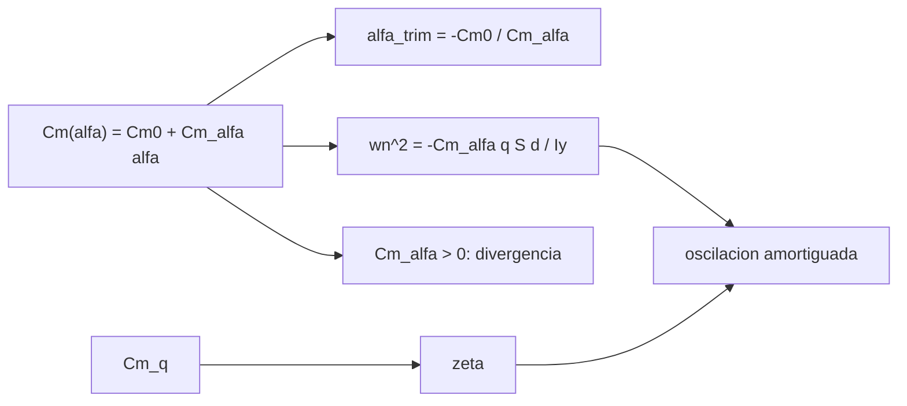

# B77-C17 — Estabilidad durante descenso

<!-- nav:top -->
[🏠 Programa](../../../../README.md) · [📚 Bloque B77](../../../tronco-comun/B77-dinamica-de-lanzamiento-y-reentrada.md) · [← Anterior: B77-C16 — Protección térmica](../B77-C16-proteccion-termica/CLASE.md) · [Siguiente: B77-C18 — Aterrizaje y recuperación →](../B77-C18-aterrizaje-y-recuperacion/CLASE.md)
<!-- /nav -->

## 1. Ubicación, nivel y alcance

Clase 17 del bloque B77. Nivel N3. Una cápsula que desciende por la atmósfera debe volver a su ángulo de equilibrio cuando algo la perturba. Esa propiedad —estabilidad estática— se resume en el signo de la pendiente del momento de cabeceo, y la dinámica que sigue es una oscilación casi sin amortiguamiento. Aquí integras el movimiento de cabeceo, mides el periodo y el decaimiento, y comparas con el caso inestable. Usas [C03](../B77-C03-fuerzas-aerodinamicas/CLASE.md) para `q`. La cápsula es sintética.

## 2. Por qué esta clase existe

Una cápsula inestable no entra con el escudo hacia delante. La decisión central: **¿qué pendiente de momento da una oscilación acotada y cuánto tarda en divergir una inestable?**

## 3. Lo que podrás hacer al terminar

1. Definir estabilidad estática por el signo de `Cm_α`.
2. Calcular el ángulo de equilibrio `α_trim = −Cm₀/Cm_α`.
3. Obtener la frecuencia natural y el amortiguamiento de la oscilación de cabeceo.
4. Medir periodo y decaimiento numéricos y compararlos con los analíticos.
5. Calcular la tasa de divergencia de un caso inestable.
6. Separar lo consultado (criterio de estabilidad) de lo inventado (coeficientes, inercia).

La evidencia es la **ficha de estabilidad de una cápsula** del ejercicio 12 (sección 20).

## 4. Con qué llegas y cómo comprobarlo

1. ¿Qué es un momento de cabeceo?
2. ¿Qué es una oscilación amortiguada?
3. ¿Qué es una raíz característica?
4. ¿Qué es el ángulo de ataque?
5. ¿Qué es un coeficiente congelado?

<details>
<summary>Ver respuestas</summary>

1. Un par que gira el vehículo respecto de su eje transversal. 2. Un movimiento que oscila con amplitud decreciente. 3. Un `s` que cumple `s² + c s + k = 0` y dicta el crecimiento o el decaimiento. 4. El ángulo entre el eje del cuerpo y el flujo relativo. 5. Un coeficiente que se mantiene constante durante un cálculo corto.
</details>

Con cuatro o cinco aciertos, sigue; si no, repasa los prerrequisitos.

## 5. Un caso de contexto y casos de referencia

Una cápsula sintética con `Cm_α = −0,05 /rad` y `Cm₀ = 0,008` (centro de masa desplazado) tiene `α_trim = 9,17°`, `ω_n = 1,393 rad/s` (periodo `4,51 s`) y `ζ = 0,0027`: oscila durante minutos. Con `Cm_α = +0,02 /rad` (inestable) el ángulo diverge a `0,877 1/s`, duplicándose cada `0,79 s`. Es el **ejemplo conductor**; los coeficientes son **inventados**.

## 6. Vocabulario

La **estabilidad estática** exige `Cm_α < 0`: un aumento de `α` genera un par que lo reduce. El **ángulo de equilibrio** (trim) es donde `Cm = 0`. La **frecuencia natural** es `ω_n² = −Cm_α q S d/I_y`. El **amortiguamiento** `ζ` viene de `Cm_q`. La **divergencia** ocurre si `ω_n² < 0`.

## 7. Modelo mental



*Descripción textual:* el momento de cabeceo da el ángulo de equilibrio y la frecuencia natural; `Cm_q` da el amortiguamiento; si `Cm_α` cambia de signo, el equilibrio se vuelve inestable y el ángulo diverge.

Analogía: una bola en un cuenco frente a una bola sobre una colina: en el cuenco vuelve y oscila (casi sin fricción); sobre la colina se aleja cada vez más rápido. Límite: los coeficientes se congelan y la maniobra se supone corta.

## 8. La explicación, paso a paso

### 8.1 Estabilidad estática

La NASA Glenn describe el criterio para cohetes: estable si el centro de presión está por detrás del centro de gravedad (par restaurador). Para una cápsula equivale a `Cm_α < 0`. El momento es `M = q S d (Cm₀ + Cm_α α)`.

### 8.2 Equilibrio y oscilación

El equilibrio es `α_trim = −Cm₀/Cm_α = 9,167°`. La ecuación `I_y α̈ = q S d (Cm₀ + Cm_α α) + (Cm_q q S d²/(2V)) α̇` da `ω_n = 1,3933 rad/s`, `ζ = 0,00272`, `ω_d = 1,3933 rad/s` y un periodo de `4,5097 s`.

### 8.3 Numérico

Con RK4 desde `30°`, el periodo medido por cruces es `4,5097 s` (error `2e-11`) y la envolvente decae a `0,00379 1/s` frente a `ζω_n = 0,00379` (error `7e-06`). La oscilación se centra en el equilibrio (`9,20°` frente a `9,17°`). Con `ζ` tan pequeño, el amortiguamiento aerodinámico solo no basta para acotar la maniobra: en la práctica hay que verificar la dinámica en todo el rango de Mach.

### 8.4 El caso inestable

Con `Cm_α = +0,02 /rad` las raíces de `s² + c s + ω_n² = 0` (con `ω_n² < 0`) dan `λ = 0,8774 1/s`; el crecimiento asintótico duplica el ángulo cada `0,790 s` (medido `0,790 s`, error `2e-04`). Desde el reposo la primera duplicación tarda `1,50 s`. El equilibrio `α = -22,9°` existe pero es inestable.

## 9. Magnitudes, símbolos y unidades

| Símbolo | Qué es | Unidad | Valor / nota |
|---|---|---|---|
| `Cm_α` | pendiente del momento de cabeceo | 1/rad | −0,05 (estable); +0,02 (inestable) |
| `Cm₀` | momento a α = 0 | — | 0,008 (inventado) |
| `I_y` | inercia de cabeceo | kg·m² | 6000 (inventada) |
| `ω_n` | frecuencia natural | rad/s | 1,3933 |
| `ζ` | razón de amortiguamiento | — | 0,00272 |
| `α_trim` | ángulo de equilibrio | ° | 9,167 |

## 10. Convenciones y referencias

Plano de cabeceo, `α = θ − γ` con `γ` fija; `q = 5000 Pa`, `V = 2000 m/s` congelados; SI. Criterio cualitativo de la NASA Glenn; todos los coeficientes, la inercia y las condiciones son inventados.

## 11. De dónde sale lo que afirmamos

| ID | Fuente | Localizador | Respalda | Estado |
|---|---|---|---|---|
| S1 | NASA Glenn, Rocket Stability — https://www1.grc.nasa.gov/beginners-guide-to-aeronautics/rocket-stability/ (consultada 2026-11-10) | página completa | criterio de estabilidad: centro de presión por detrás del centro de gravedad produce un par restaurador | Consultada |
| S2 | NASA Glenn, Drag Coefficient — https://www1.grc.nasa.gov/beginners-guide-to-aeronautics/drag-coefficient/ (consultada 2026-11-10) | página completa | q = ρV²/2 | Consultada |
| — | Ecuación de cabeceo de segundo orden, frecuencia natural y amortiguamiento | — | las verifica el laboratorio con una segunda vía | No consultada en una fuente concreta |

Límites: no se consultó ningún dato aerodinámico de cápsulas reales; los coeficientes se congelan y no varían con Mach; no se modela el acoplamiento con balanceo ni la dinámica de la trayectoria.

## 12. Cómo ver el resultado

| Magnitud | Valor |
|---|---|
| `ω_n`; periodo | 1,3933 rad/s; 4,5097 s |
| `ζ` | 0,00272 |
| periodo numérico | 4,5097 s |
| `α_trim` | 9,167° |
| duplicación asintótica (inestable) | 0,790 s |

Descripción larga: la cápsula estable oscila indefinidamente alrededor del equilibrio con un periodo de unos cuatro segundos y media; la inestable se aleja rápido.

## 13. Ejemplo trabajado: la frecuencia natural

**Paso 1 · Área.** `S = π × 3,9²/4 = 11,946 m²`.

**Paso 2 · Numerador.** `−Cm_α q S d = 0,05 × 5000 × 11,946 × 3,9 = 11 647 N·m`.

**Paso 3 · Raíz.** `ω_n² = 11 647/6000 = 1,941` → `ω_n = 1,3933 rad/s`.

**Paso 4 · Periodo.** `2π/ω_n = 4,51 s`.

## 14. Distintas formas de describir el resultado

**Por signo:** `Cm_α`. **Por ángulo:** `α_trim`. **Por frecuencia:** `ω_n`, `T`. **Por envolvente:** `ζω_n`. **Por divergencia:** `λ` y tiempo de duplicación.

## 15. Práctica guiada

**Ejercicio 1 · con los pasos indicados.** Calcula `α_trim` para `Cm₀ = 0,01` y `Cm_α = −0,04`. *Pasos:* `−Cm₀/Cm_α` y pasa a grados.

<details><summary>Solución comentada</summary>

`0,25 rad = 14,3°`.
</details>

**Ejercicio 2 · con una pista.** Calcula `ω_n` si `I_y` se duplica. *Pista:* `ω_n ∝ I_y^(−1/2)`.

<details><summary>Solución comentada</summary>

`1,3933/√2 = 0,9852 rad/s`.
</details>

**Ejercicio 3 · casi autónomo.** ¿Por qué `Cm_α < 0` es estable?

<details><summary>Solución comentada</summary>

Porque un aumento de `α` produce un momento de signo opuesto que lo disminuye.
</details>

## 16. Práctica autónoma, transferencia e integrador

**Ejercicio 4 · autónomo.** Periodo si `q` baja a 2500 Pa.

<details><summary>Solución comentada</summary>

`T = 4,51 × √2 = 6,38 s`.
</details>

**Ejercicio 5 · autónomo.** `ω_n²` en el caso inestable. *Pista:* `−Cm_α q S d/I_y`.

<details><summary>Solución comentada</summary>

`−0,02 × 5000 × 11,946 × 3,9/6000 = −0,776 s⁻²`.
</details>

**Ejercicio 6 · autónomo.** Tasa de divergencia aproximada con amortiguamiento nulo.

<details><summary>Solución comentada</summary>

`√0,776 = 0,881 1/s`, cercana a los 0,877 con `Cm_q`.
</details>

**Ejercicio 7 · autónomo.** ¿Cuántas oscilaciones tarda la amplitud en caer a la mitad en el caso estable?

<details><summary>Solución comentada</summary>

`ln2/(ζω_n) = 183 s`, es decir ≈ 41 periodos.
</details>

**Ejercicio 8 · autónomo.** ¿Qué le pasa a `ω_n` si la cápsula baja a menor altitud (mayor `q`)?

<details><summary>Solución comentada</summary>

Sube con `√q`: oscila más rápido.
</details>

**Ejercicio 9 · transferencia.** **Transferencia.** Un informe dice que una cápsula 'es estable'. ¿Qué precisión pide?

<details><summary>Solución comentada</summary>

El rango de Mach y de `α`, el centro de gravedad usado y la fuente de los coeficientes.
</details>

**Ejercicio 10 · transferencia.** **Transferencia.** Un colega usa los coeficientes congelados para una entrada completa. ¿Qué error?

<details><summary>Solución comentada</summary>

`Cm_α` cambia con Mach y `q` varía varios órdenes de magnitud; la frecuencia cambia en consecuencia.
</details>

**Ejercicio 11 · transferencia.** **Transferencia.** ¿Qué cambia si el centro de masa se desplaza hacia el escudo?

<details><summary>Solución comentada</summary>

Cambian `Cm₀` y `Cm_α`: normalmente aumenta la estabilidad.
</details>

**Ejercicio 12 · integrador.** **Integrador.** Elabora tu *ficha de estabilidad de una cápsula*: `Cm_α`, `α_trim`, `ω_n`, `ζ`, periodo medido y analítico, caso inestable y lista de qué es consultado e inventado.

<details><summary>Solución comentada</summary>

Secciones 8.1–8.4 y la salida del laboratorio.
</details>

## 17. Laboratorio: oscilación de cabeceo de una cápsula

El script [cabeceo.py](cabeceo.py) integra con RK4 la oscilación de una cápsula sintética estable e inestable y contrasta periodo, decaimiento y tasa de divergencia con las fórmulas (**comprueba** periodo < 5e-3, decaimiento < 2e-2 y divergencia < 1e-2).

**Datos:** el criterio de estabilidad de la NASA Glenn consultado; coeficientes, inercia y condiciones **inventados**. **Predice antes de ejecutar:** ¿cuánto dura una oscilación? (4,51 s.) **Ejecución del 2026-11-10 (Python 3.12.9):**

```text
Python 3.12.9 (biblioteca estandar)
Capsula SINTETICA: d = 3.9 m, S = 11.946 m2, I_y = 6000 kg m2, q = 5000 Pa, V = 2000 m/s (coeficientes congelados)
Caso estable (Cm_alfa = -0.05/rad): wn = 1.3933 rad/s, zeta = 0.00272, wd = 1.3933 rad/s, periodo analitico = 4.5097 s; alfa_trim = 9.167 grados
  oscilacion desde 30 grados: amplitud maxima 30.00 grados; periodo medido = 4.5097 s (error 1.6e-11); decaimiento medido = 0.00379 1/s frente a 0.00379 (error 6.7e-06)
  media de la oscilacion en el ultimo periodo = 9.199 grados (trim = 9.167)
Caso inestable (Cm_alfa = +0.02/rad): trim inestable en -22.92 grados; tasa de divergencia = 0.8774 1/s; tiempo de duplicacion asintotico analitico = 0.790 s; numerico (pendiente entre 10 y 20 s) = 0.790 s (error 2.0e-04); la duplicacion inicial desde el reposo tarda 1.498 s
Pruebas superadas.
```

```bash
python programa/clases/B77/B77-C17-estabilidad-durante-descenso/cabeceo.py
```

**Límites:** coeficientes congelados, cabeceo en un solo plano, sin Mach ni acoplamientos.

## 18. Errores frecuentes y cómo corregirlos

**Confundir estabilidad estática con ausencia de oscilación.** Se corrige con 8.3.

**Olvidar `Cm₀` y esperar que el equilibrio esté en `α = 0`.** Se corrige con 8.2.

**Usar coeficientes congelados para toda la entrada.** Se corrige con el ejercicio 10.

**Dar los coeficientes inventados como los de una cápsula real.** Se corrige con la sección 10.

## 19. Cómo sabrás que vas bien

Tras la sección 8: ¿qué periodo esperabas y cuál obtuviste? Si dudas, repasa el ejemplo 13. Tras el laboratorio: ¿qué comprueba? (ver la sección 17).

## 20. Qué entregas y cómo se evalúa

El producto es tu **ficha de estabilidad de una cápsula** (ejercicio 12).

| Criterio | Inicial | En desarrollo | Logrado | Destacado |
|---|---|---|---|---|
| Conceptos | Los confunde | Parciales | Aplica el modelo con sus supuestos | Explica los límites |
| Cálculo | Sin unidades | Con errores | Tablas completas con unidades | Calcula casos nuevos |
| Numérico | Sin comprobar | Un caso | Contraste con una segunda vía | Interpreta las diferencias |
| Fuentes | Sin fuente | Sin fecha | Fuentes con fecha y estado | Declara lo ilustrativo y lo no consultado |
| Límites | No los nombra | Uno | Tres | Discute qué falta del modelo |

**Condiciones críticas (no se compensan con promedio):** rotular los coeficientes como inventados; no presentar el resultado como estabilidad de una cápsula real; citar solo lo consultado.

## 21. Ética, seguridad y límites

Clase educativa: los modelos son simplificados y sus datos son sintéticos o ilustrativos; ningún resultado describe un vehículo real ni sustituye al análisis de seguridad, a la certificación o a los documentos del operador. Nada de lo simulado se presenta como observado ni como datos de vuelo. Accesibilidad: tablas equivalentes a las gráficas, fórmulas en texto, ejercicios sin conexión.

## 22. Para cerrar y seguir

La cápsula sintética con `Cm_α = −0,05` oscila con periodo `4,51 s` alrededor de `9,2°`; con `Cm_α = +0,02` se duplica cada `0,79 s`. Queda una pregunta: ¿cómo termina el descenso con el vehículo ya lento?

**Glosario español–inglés.** estabilidad estática · *static stability*; ángulo de equilibrio · *trim angle*; frecuencia natural · *natural frequency*; amortiguamiento · *damping*; divergencia · *divergence*.

**Continuidad.** [siguiente]

**Referencias:** ver sección 11.

<!-- nav:bottom -->
---

[← Anterior: B77-C16 — Protección térmica](../B77-C16-proteccion-termica/CLASE.md) · [📚 Bloque B77](../../../tronco-comun/B77-dinamica-de-lanzamiento-y-reentrada.md) · [Siguiente: B77-C18 — Aterrizaje y recuperación →](../B77-C18-aterrizaje-y-recuperacion/CLASE.md)
<!-- /nav -->
