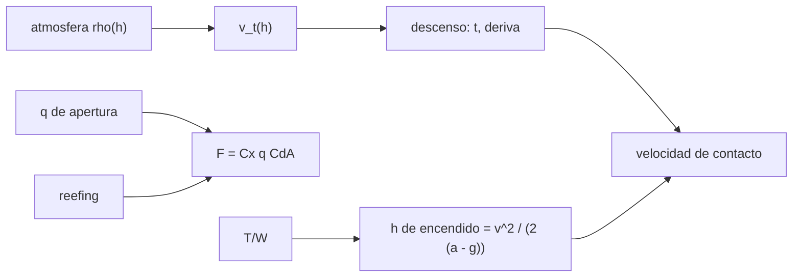

# B77-C18 — Aterrizaje y recuperación

<!-- nav:top -->
[🏠 Programa](../../../../README.md) · [📚 Bloque B77](../../../tronco-comun/B77-dinamica-de-lanzamiento-y-reentrada.md) · [← Anterior: B77-C17 — Estabilidad durante descenso](../B77-C17-estabilidad-durante-descenso/CLASE.md) · [Siguiente: B77-C19 — Seguridad de rango a nivel conceptual →](../B77-C19-seguridad-de-rango-a-nivel-conceptual/CLASE.md)
<!-- /nav -->

## 1. Ubicación, nivel y alcance

Clase 18 del bloque B77. Nivel N3. El último tramo del descenso se frena con paracaídas, con motor o con ambos. Aquí calculas, para una cápsula sintética, la velocidad terminal en función de la altitud, el tiempo y la deriva del descenso, la carga de apertura con y sin reducción de área (reefing) y la altura de encendido de un aterrizaje propulsado. Usas [C02](../B77-C02-movimiento-en-atmosfera/CLASE.md) y [C05](../B77-C05-ecuacion-de-cohete-ideal/CLASE.md). Es conceptual: no se describen sistemas reales.

## 2. Por qué esta clase existe

Un paracaídas grande da un aterrizaje suave pero una apertura brusca; un motor da control pero consume propelente. La decisión central: **¿qué velocidad de contacto, qué carga de apertura y qué altura de encendido resultan de cada opción?**

## 3. Lo que podrás hacer al terminar

1. Calcular la velocidad terminal `v_t = √(2mg/(ρ CdA))` en función de la altitud.
2. Integrar un descenso bajo paracaídas y contrastarlo con el tiempo cuasi-estacionario.
3. Estimar la deriva horizontal por un viento constante.
4. Calcular la carga de apertura con un factor de inflado y la reducción por reefing.
5. Calcular la altura de encendido de un aterrizaje propulsado y verificarla por integración.
6. Separar lo consultado (atmósfera, arrastre) de lo ilustrativo (cápsula, paracaídas, motor).

La evidencia es la **ficha de descenso y aterrizaje** del ejercicio 12 (sección 20).

## 4. Con qué llegas y cómo comprobarlo

1. ¿Qué es la velocidad terminal?
2. ¿Qué es el área de arrastre `CdA`?
3. ¿Qué es la deriva?
4. ¿Qué es la relación empuje–peso?
5. ¿Qué es una cuasi-estacionariedad?

<details>
<summary>Ver respuestas</summary>

1. La velocidad en que el arrastre iguala al peso. 2. El producto del coeficiente de arrastre por el área de referencia, en m². 3. El desplazamiento horizontal causado por el viento durante el descenso. 4. El empuje dividido por el peso. 5. Suponer que el sistema sigue su velocidad de equilibrio local.
</details>

Con cuatro o cinco aciertos, sigue; si no, repasa los prerrequisitos.

## 5. Un caso de contexto y casos de referencia

Una cápsula sintética de `3000 kg` con `CdA = 850 m²` abre a `5000 m` y `80 m/s`. Su velocidad terminal es `10,12 m/s` a esa altitud y `7,54 m/s` en el suelo; el descenso dura `573 s` y un viento de `10 m/s` la desplaza `5,7 km`. La apertura plena daría `81 g` y con reefing de 15 % `12,2 g`. Un aterrizaje propulsado con `T/W = 3` desde `100 m/s` exige encender a `255 m`. Es el **ejemplo conductor**; todo es **ilustrativo**.

## 6. Vocabulario

La **velocidad terminal** local es `v_t(h) = √(2mg/(ρ(h) CdA))`. La **carga de apertura** es `F = Cx·q·CdA`, con `Cx` el factor de inflado. El **reefing** limita el área inicial. La **deriva** es `w·t`. El **encendido tardío** (suicide burn) enciende el motor lo más tarde posible: `h = v²/(2(a − g))`.

## 7. Modelo mental



*Descripción textual:* la atmósfera da la velocidad terminal y, con ella, el tiempo de descenso, la deriva y la velocidad de contacto; la presión dinámica de apertura y el reefing dan la carga; el empuje da la altura de encendido del aterrizaje propulsado.

Analogía: frenar un coche: un freno suave (paracaídas) tarda más y se desvía con el viento; un frenazo tardío (motor) es corto pero exige acertar el punto exacto. Límite: el paracaídas se modela con área constante y sin dinámica de inflado, y el motor con empuje constante y sin control de actitud.

## 8. La explicación, paso a paso

### 8.1 Velocidad terminal

Con `m = 3000 kg`, `CdA = 850 m²` y `ρ₀ = 1,217 kg/m³`: `v_t(0) = √(2·3000·9,80665/(1,217·850)) = 7,542 m/s`. A 5000 m (`ρ = 0,676`): `10,12 m/s`.

### 8.2 Descenso y deriva

El tiempo cuasi-estacionario es `t = (2H/v_t0)(1 − e^(−h₀/(2H))) = 574,36 s`; la integración RK4 da `572,70 s` (error `2,9e-03`) y una velocidad de contacto de `7,543 m/s` (error `1,7e-04` respecto de `v_t(0)`). Con viento de 10 m/s la deriva es `5727 m`. La energía cinética de contacto es `85,3 kJ`.

### 8.3 Carga de apertura

A `5000 m` y `80 m/s`, `q = 2163 Pa`. Con `Cx = 1,3` y área plena, `F = 2390 kN = 81 g`, excesivo; con la fracción de área de 15 % del reefing, `358 kN = 12,2 g`. Por eso las aperturas reales se hacen por etapas. Los valores son ilustrativos.

### 8.4 Aterrizaje propulsado

Con `T/W = 3` (empuje constante) y masa constante, `a = 3g`, desaceleración neta `2g` y la altura de encendido es `h = v²/(2(a − g)) = 100²/(2·2·9,80665) = 254,9 m`; la integración llega al suelo con `0,028 m/s` (error de altura `8e-08`). Con pérdida de masa (`Isp = 300 s`) el vehículo, al aligerarse, frena más y se detiene `6,3 m` sobre el suelo, tras gastar `147 kg`: un encendido real debe cerrar el lazo con altura y velocidad medidas.

## 9. Magnitudes, símbolos y unidades

| Símbolo | Qué es | Unidad | Valor / nota |
|---|---|---|---|
| `m` | masa de la cápsula | kg | 3000 (ilustrativa) |
| `CdA` | área de arrastre del paracaídas | m² | 850 (ilustrativa) |
| `v_t` | velocidad terminal | m/s | 7,54 (suelo) |
| `Cx` | factor de inflado | — | 1,3 (ilustrativo) |
| `T/W` | empuje–peso del aterrizaje | — | 3 (ilustrativo) |
| `h_enc` | altura de encendido | m | 254,9 |

## 10. Convenciones y referencias

Eje vertical local, Tierra plana, `g = 9,80665 m/s²` (NIST); `ρ₀` y `H` de la NASA/NSSDC. Cápsula, paracaídas, viento, `Cx`, reefing y motor son ilustrativos; no se consultó ningún sistema de recuperación.

## 11. De dónde sale lo que afirmamos

| ID | Fuente | Localizador | Respalda | Estado |
|---|---|---|---|---|
| S1 | NASA Glenn, Drag Coefficient — https://www1.grc.nasa.gov/beginners-guide-to-aeronautics/drag-coefficient/ (consultada 2026-11-10) | página completa | D = Cd·q·A | Consultada |
| S2 | NASA/NSSDC, Earth Fact Sheet — https://nssdc.gsfc.nasa.gov/planetary/factsheet/earthfact.html (consultada 2026-11-10) | ficha completa leída | ρ₀ = 1,217 kg/m³ y altura de escala 8,5 km | Consultada |
| S3 | NIST, CODATA 2022, standard acceleration of gravity — https://physics.nist.gov/cgi-bin/cuu/Value?gn (consultada 2026-11-10) | entrada gn | g = 9,80665 m/s² | Consultada |
| S4 | NASA Glenn, Ideal Rocket Equation — https://www1.grc.nasa.gov/beginners-guide-to-aeronautics/ideal-rocket-equation/ (consultada 2026-11-10) | página completa | ecuación de cohete con Isp | Consultada |
| — | Velocidad terminal, carga de apertura con factor de inflado y altura de frenado v²/(2(a−g)) | — | las verifica el laboratorio con una segunda vía | No consultada en una fuente concreta |

Límites: no se consultó ningún manual de paracaídas ni de aterrizaje propulsado; Cx, reefing y empuje son inventados; sin dinámica de inflado, sin control de actitud ni viento variable.

## 12. Cómo ver el resultado

| Magnitud | Valor |
|---|---|
| `v_t` suelo; a 5000 m | 7,54; 10,12 m/s |
| tiempo de descenso | 572,7 s |
| deriva | 5727 m |
| apertura (plena; reefing) | 81 g; 12,2 g |
| altura de encendido | 254,9 m |

Descripción larga: el paracaídas da una velocidad de contacto baja pero un descenso largo con deriva; el aterrizaje propulsado exige encender a unos 250 m y es sensible al consumo de masa.

## 13. Ejemplo trabajado: la altura de encendido

**Paso 1 · Aceleración.** `a = T/m = 3 × 9,80665 = 29,42 m/s²`.

**Paso 2 · Neta.** `a − g = 19,61 m/s²`.

**Paso 3 · Altura.** `h = 100²/(2 × 19,61) = 254,9 m`.

## 14. Distintas formas de describir el resultado

**Por velocidad:** `v_t(h)`. **Por tiempo y deriva:** `t`, `w t`. **Por carga:** `F` en g. **Por altura:** `h_enc`. **Por propelente:** masa gastada.

## 15. Práctica guiada

**Ejercicio 1 · con los pasos indicados.** Calcula `v_t` para `m = 1000 kg`, `CdA = 300 m²`, `ρ = 1,217`. *Pasos:* `√(2mg/(ρ CdA))`.

<details><summary>Solución comentada</summary>

`√(19613/365,1) = 7,33 m/s`.
</details>

**Ejercicio 2 · con una pista.** Calcula `q` a `v = 60 m/s`, `ρ = 0,9`. *Pista:* `ρv²/2`.

<details><summary>Solución comentada</summary>

`1620 Pa`.
</details>

**Ejercicio 3 · casi autónomo.** ¿Por qué la velocidad terminal baja al descender?

<details><summary>Solución comentada</summary>

Porque `ρ` crece y `v_t ∝ ρ^(−1/2)`.
</details>

## 16. Práctica autónoma, transferencia e integrador

**Ejercicio 4 · autónomo.** Tiempo cuasi-estacionario si `h₀ = 3000 m`.

<details><summary>Solución comentada</summary>

`2·8500/7,542·(1 − e^(−3000/17000)) = 365 s`.
</details>

**Ejercicio 5 · autónomo.** Deriva con viento de 6 m/s en ese tiempo.

<details><summary>Solución comentada</summary>

`2188 m`.
</details>

**Ejercicio 6 · autónomo.** Altura de encendido para `T/W = 4`, 80 m/s.

<details><summary>Solución comentada</summary>

`80²/(2 × 3 × 9,80665) = 108,8 m`.
</details>

**Ejercicio 7 · autónomo.** ¿Qué le pasa a `h_enc` si `T/W` baja a 2?

<details><summary>Solución comentada</summary>

Se dispara: `a − g = g`, `h = 100²/(2·9,80665) = 510 m`.
</details>

**Ejercicio 8 · autónomo.** Energía de contacto con 7,54 m/s para 3000 kg.

<details><summary>Solución comentada</summary>

`85,3 kJ`.
</details>

**Ejercicio 9 · transferencia.** **Transferencia.** Un fabricante anuncia 'aterrizaje suave a 5 m/s'. ¿Qué datos pide?

<details><summary>Solución comentada</summary>

Masa, `CdA`, altitud del sitio y densidad: `v_t` depende de todos.
</details>

**Ejercicio 10 · transferencia.** **Transferencia.** Un colega ignora el consumo de masa en el encendido. ¿Qué riesgo?

<details><summary>Solución comentada</summary>

El vehículo se aligera, frena más y puede quedar suspendido o subir; un lazo cerrado lo corrige.
</details>

**Ejercicio 11 · transferencia.** **Transferencia.** ¿Qué cambia en un aterrizaje en Marte?

<details><summary>Solución comentada</summary>

La densidad es ~1 % de la terrestre: `v_t` sube y el paracaídas solo no basta.
</details>

**Ejercicio 12 · integrador.** **Integrador.** Elabora tu *ficha de descenso y aterrizaje*: `v_t(h)`, tiempo, deriva, carga de apertura, altura de encendido y lista de qué es consultado e ilustrativo.

<details><summary>Solución comentada</summary>

Secciones 8.1–8.4 y la salida del laboratorio.
</details>

## 17. Laboratorio: descenso con paracaídas y aterrizaje propulsado

El script [aterrizaje.py](aterrizaje.py) integra un descenso con paracaídas, calcula la carga de apertura y simula un aterrizaje propulsado con masa constante y variable (**comprueba** velocidad de contacto < 2e-2, tiempo < 5e-2 y altura de encendido < 1e-3).

**Datos:** atmósfera, arrastre y `g` consultados; cápsula, paracaídas, viento y motor **ilustrativos**. **Predice antes de ejecutar:** ¿se detiene el vehículo en el suelo si se considera la pérdida de masa? (no: queda a 6,3 m.) **Ejecución del 2026-11-10 (Python 3.12.9):**

```text
Python 3.12.9 (biblioteca estandar)
Capsula SINTETICA: m = 3000 kg, CdA = 850 m2, despliegue a 5000 m con 80 m/s hacia abajo, viento 10 m/s
Velocidad terminal: 10.12 m/s a 5000 m y 7.542 m/s al nivel del suelo
Descenso: t = 572.70 s (cuasi-estacionario 574.36 s, error 2.9e-03); velocidad de contacto = 7.543 m/s (v_t suelo 7.542, error 1.7e-04); deriva = 5727 m
Carga de apertura (q = 2163 Pa, Cx = 1.3): area plena 2390 kN = 81.2 g; con reefing 0.15: 358 kN = 12.18 g
Energia cinetica de contacto bajo paracaidas = 85.3 kJ
Aterrizaje propulsado (T/W = 3, 100 m/s): encendido a 254.9 m; masa constante -> altura final 0.0000 m, velocidad -0.0278 m/s (error relativo 7.7e-08), t = 5.10 s
  con masa variable (Isp 300 s): altura al detenerse = 6.30 m, velocidad = -0.010 m/s; propelente = 147.4 kg
Pruebas superadas.
```

```bash
python programa/clases/B77/B77-C18-aterrizaje-y-recuperacion/aterrizaje.py
```

**Límites:** área constante, sin dinámica de inflado, sin control de actitud, Tierra plana; Marte no se modela.

## 18. Errores frecuentes y cómo corregirlos

**Usar la densidad del suelo para toda la altitud.** Se corrige con 8.1.

**Ignorar el factor de inflado en la carga de apertura.** Se corrige con 8.3.

**Calcular el encendido con masa constante sin avisarlo.** Se corrige con 8.4.

**Presentar el sistema sintético como uno real.** Se corrige con la sección 10.

## 19. Cómo sabrás que vas bien

Tras la sección 8: ¿qué `v_t` esperabas y cuál obtuviste? Si dudas, repasa el ejemplo 13. Tras el laboratorio: ¿qué comprueba? (ver la sección 17).

## 20. Qué entregas y cómo se evalúa

El producto es tu **ficha de descenso y aterrizaje** (ejercicio 12).

| Criterio | Inicial | En desarrollo | Logrado | Destacado |
|---|---|---|---|---|
| Conceptos | Los confunde | Parciales | Aplica el modelo con sus supuestos | Explica los límites |
| Cálculo | Sin unidades | Con errores | Tablas completas con unidades | Calcula casos nuevos |
| Numérico | Sin comprobar | Un caso | Contraste con una segunda vía | Interpreta las diferencias |
| Fuentes | Sin fuente | Sin fecha | Fuentes con fecha y estado | Declara lo ilustrativo y lo no consultado |
| Límites | No los nombra | Uno | Tres | Discute qué falta del modelo |

**Condiciones críticas (no se compensan con promedio):** rotular la cápsula, el paracaídas y el motor como ilustrativos; no describir sistemas de recuperación reales; citar solo lo consultado.

## 21. Ética, seguridad y límites

Clase educativa: los modelos son simplificados y sus datos son sintéticos o ilustrativos; ningún resultado describe un vehículo real ni sustituye al análisis de seguridad, a la certificación o a los documentos del operador. Nada de lo simulado se presenta como observado ni como datos de vuelo. Accesibilidad: tablas equivalentes a las gráficas, fórmulas en texto, ejercicios sin conexión.

## 22. Para cerrar y seguir

La cápsula sintética toca el suelo a `7,5 m/s` tras `573 s`, o se frena con motor desde `255 m`. Queda una pregunta: ¿qué riesgo representa todo esto para las personas bajo la trayectoria?

**Glosario español–inglés.** velocidad terminal · *terminal velocity*; carga de apertura · *opening load*; reefing · *reefing*; deriva · *drift*; aterrizaje propulsado · *propulsive landing*.

**Continuidad.** [siguiente]

**Referencias:** ver sección 11.

<!-- nav:bottom -->
---

[← Anterior: B77-C17 — Estabilidad durante descenso](../B77-C17-estabilidad-durante-descenso/CLASE.md) · [📚 Bloque B77](../../../tronco-comun/B77-dinamica-de-lanzamiento-y-reentrada.md) · [Siguiente: B77-C19 — Seguridad de rango a nivel conceptual →](../B77-C19-seguridad-de-rango-a-nivel-conceptual/CLASE.md)
<!-- /nav -->
