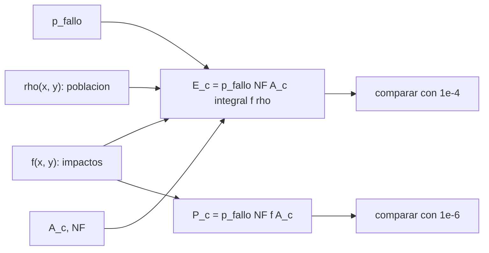

# B77-C19 — Seguridad de rango a nivel conceptual

<!-- nav:top -->
[🏠 Programa](../../../../README.md) · [📚 Bloque B77](../../../tronco-comun/B77-dinamica-de-lanzamiento-y-reentrada.md) · [← Anterior: B77-C18 — Aterrizaje y recuperación](../B77-C18-aterrizaje-y-recuperacion/CLASE.md) · [Siguiente: B77-C20 — Simulación académica de una trayectoria de vuelo →](../B77-C20-simulacion-academica-de-una-trayectoria-de-vuelo/CLASE.md)
<!-- /nav -->

## 1. Ubicación, nivel y alcance

Clase 19 del bloque B77. Nivel N3. La seguridad de rango pregunta cuánto riesgo imponen las fallas de un vuelo a las personas que no participan. A nivel conceptual, ese riesgo es una integral: probabilidad de falla por la distribución de impactos por la población expuesta por el área de víctima. Aquí lo calculas por tres vías con datos **sintéticos** y comparas el orden de magnitud con los criterios de 14 CFR 450,101. No es una evaluación de riesgo ni de cumplimiento; ningún dato corresponde a un lugar real.

## 2. Por qué esta clase existe

Mover el sitio de impacto un par de decenas de kilómetros cambia el riesgo en un factor de varios. La decisión central: **¿cómo se calculan las víctimas esperadas y cuánto depende de dónde cae lo que cae?**

## 3. Lo que podrás hacer al terminar

1. Definir las víctimas esperadas `E_c` como una integral sobre la zona de impactos.
2. Calcularla en forma cerrada (producto de gaussianas), por cuadratura en malla y por Monte Carlo.
3. Calcular un riesgo individual `P_c` en un punto.
4. Comparar el orden de magnitud con los umbrales de 14 CFR 450,101.
5. Medir la sensibilidad a la posición de una zona poblada.
6. Separar lo consultado (umbrales) de lo inventado (probabilidades, poblaciones).

La evidencia es la **ficha conceptual de riesgo de rango** del ejercicio 12 (sección 20).

## 4. Con qué llegas y cómo comprobarlo

1. ¿Qué es una distribución gaussiana 2D?
2. ¿Qué es una densidad de población?
3. ¿Qué es un valor esperado?
4. ¿Qué es una cuadratura numérica?
5. ¿Qué es el área de víctima?

<details>
<summary>Ver respuestas</summary>

1. Una densidad de probabilidad con forma de campana en dos coordenadas, con `σ` distintas. 2. Personas por unidad de área, en personas/km². 3. El promedio ponderado por probabilidad de una variable aleatoria. 4. Aproximar una integral sumando sobre una malla. 5. El área efectiva en que un impacto puede causar una víctima.
</details>

Con cuatro o cinco aciertos, sigue; si no, repasa los prerrequisitos.

## 5. Un caso de contexto y casos de referencia

En un escenario inventado (`p_fallo = 0,02`, impacto gaussiano de `σ = 15 × 5 km`, `50` paquetes de `10 m²`, población rural de `5/km²` y una ciudad de pico `500/km²` a `40 km`) la integral vale `5,6447 personas/km²` en forma cerrada, igual en malla (`2e-09`) y en Monte Carlo (`0,5 σ`). Resulta `E_c = 5,64e-05`, `0,56` del orden de referencia de 14 CFR 450,101 (`1e-4`). Con la ciudad bajo la trayectoria sería `2,5` veces ese orden. Es el **ejemplo conductor**; todo es **inventado**.

## 6. Vocabulario

Las **víctimas esperadas** `E_c` son el valor esperado del número de personas heridas gravemente o muertas. El **riesgo individual** `P_c` es la probabilidad de que una persona resulte víctima. La **zona de impacto** es la distribución de dónde caen los escombros. El **área de víctima** es el área efectiva por fragmento. La **cuadratura** es la suma numérica de la integral.

## 7. Modelo mental



*Descripción textual:* la probabilidad de falla, la distribución de impactos, la población y el área de víctima se combinan en las víctimas esperadas y en el riesgo individual, que se comparan con los umbrales.

Analogía: una lluvia de granizo sobre un barrio: el daño esperado depende de cuánto cae (probabilidad), dónde cae (distribución) y cuánta gente y bienes hay donde cae. Límite: se supone una sola distribución de impactos y una población estática; los análisis reales distinguen fallas, escombros y protección.

## 8. La explicación, paso a paso

### 8.1 Víctimas esperadas

`E_c = p_f·N_F·A_c·∬ f(x,y)·ρ(x,y) dx dy`. La densidad de impactos es `f = N(0, diag(σ_x², σ_y²))`; la población es `ρ = 5 + 500·exp(−½[((x−40)/3)² + ((y−8)/3)²])` personas/km².

### 8.2 Tres vías

- **Cerrada:** la parte rural da `5`; la ciudad es el producto de dos gaussianas, `500·2π·3²·N(40, 8; 0, diag(σ_x² + 9, σ_y² + 9))`. Total `5,644688 personas/km²`.
- **Malla** (0,25 km, 720 × 360 celdas): `5,644688` (error `1,7e-09`).
- **Monte Carlo** (`500 000` muestras, semilla 5): `5,6530 ± 0,0171` (a `0,49 σ` de la cerrada).

### 8.3 Resultados y umbrales

`E_c = 0,02 × 50 × 10⁻⁵ km² × 5,6447 = 5,645e-05`: `5,00e-05` del fondo rural y `6,45e-06` de la ciudad. El resumen de 14 CFR §450,101 menciona, para el público en general, un máximo de `1·10⁻⁴` víctimas esperadas y `1·10⁻⁶` de probabilidad individual por lanzamiento; aquí se comparan solo como orden de magnitud: `E_c` es `0,56` de ese valor y `P_c = 1,7e-10` en el centro de la ciudad, muy por debajo de `10⁻⁶`.

### 8.4 Sensibilidad

| `x_c` de la ciudad (km) | `E_c` | `E_c/10⁻⁴` |
|---|---|---|
| 0 | 2,468e-04 | 2,47 |
| 20 | 1,337e-04 | 1,34 |
| 40 | 5,645e-05 | 0,56 |
| 80 | 5,000e-05 | 0,50 |

Una ciudad bajo la trayectoria (`x_c = 0`) multiplica el riesgo por `4,4` respecto de la ubicada a 40 km. De ahí que en la práctica se controlen los corredores de vuelo, los puntos de impacto y los criterios de terminación; ningún análisis real se reduce a este modelo.

## 9. Magnitudes, símbolos y unidades

| Símbolo | Qué es | Unidad | Valor / nota |
|---|---|---|---|
| `p_f` | probabilidad de falla por lanzamiento | — | 0,02 (inventada) |
| `σ_x`, `σ_y` | dispersión de impactos | km | 15; 5 (inventadas) |
| `A_c`, `N_F` | área de víctima y paquetes | m², — | 10; 50 (inventados) |
| `ρ` | densidad de población | personas/km² | 5 (fondo); 500 (pico), inventadas |
| `E_c` | víctimas esperadas | — | 5,64e-05 |
| `P_c` | riesgo individual (centro de la ciudad) | — | 1,7e-10 |

## 10. Convenciones y referencias

Plano horizontal local en km (x a lo largo de la trayectoria); 1 km² = 10⁶ m². Los umbrales de 14 CFR 450,101 (resumen de la página del LII) se citan como referencia; probabilidades, poblaciones y áreas son inventadas.

## 11. De dónde sale lo que afirmamos

| ID | Fuente | Localizador | Respalda | Estado |
|---|---|---|---|---|
| S1 | 14 CFR §450.101 (copia del Legal Information Institute) — https://www.law.cornell.edu/cfr/text/14/450.101 (consultada 2026-11-10) | apartados (a) y (b) en el resumen devuelto por la herramienta de lectura | criterios de seguridad pública: E_c ≤ 1·10⁻⁴ y P_c ≤ 1·10⁻⁶ por lanzamiento para el público en general | Consultada (resumen de la página) |
| — | Valor esperado como integral de producto, cuadratura en malla y Monte Carlo | — | las verifica el laboratorio con una segunda vía | No consultada en una fuente concreta |

Límites: solo se leyó el resumen de §450,101; el texto completo, sus apéndices y los métodos de análisis permitidos no se consultaron; todo el escenario es inventado y no es una evaluación de cumplimiento.

## 12. Cómo ver el resultado

| Magnitud | Valor |
|---|---|
| integral `f·ρ` (cerrada; malla; MC) | 5,6447; 5,6447; 5,653 |
| `E_c` | 5,64e-05 |
| `E_c`/referencia | 0,56 |
| `P_c` en la ciudad | 1,7e-10 |
| ciudad bajo la trayectoria | 2,5 × referencia |

Descripción larga: el riesgo colectivo sube de forma marcada al acercar una zona poblada al eje de la trayectoria; el riesgo individual en un punto es mucho más pequeño que el colectivo.

## 13. Ejemplo trabajado: la parte rural de las víctimas esperadas

**Paso 1 · Probabilidad de falla y fragmentos.** `0,02 × 50 = 1`.

**Paso 2 · Área.** `A_c = 10 m² = 10⁻⁵ km²`.

**Paso 3 · Población.** `5 personas/km²`.

**Paso 4 · Producto.** `E_c,rural = 1 × 10⁻⁵ × 5 = 5·10⁻⁵`.

## 14. Distintas formas de describir el resultado

**Por fórmula:** `p_f N A_c ∬fρ`. **Por vía:** cerrada, malla, Monte Carlo. **Por componente:** rural y ciudad. **Por cociente:** `E_c/10⁻⁴`. **Por mapa:** `f·ρ`.

## 15. Práctica guiada

**Ejercicio 1 · con los pasos indicados.** Calcula `E_c` si `p_f = 0,01`, `N_F = 10`, `A_c = 10⁻⁵ km²` y `∬fρ = 4`. *Pasos:* producto.

<details><summary>Solución comentada</summary>

`0,01 × 10 × 10⁻⁵ × 4 = 4·10⁻⁶`.
</details>

**Ejercicio 2 · con una pista.** Convierte 25 m² a km². *Pista:* 1 km² = 10⁶ m².

<details><summary>Solución comentada</summary>

`2,5·10⁻⁵ km²`.
</details>

**Ejercicio 3 · casi autónomo.** ¿Por qué el producto de dos gaussianas se integra en forma cerrada?

<details><summary>Solución comentada</summary>

Porque es una gaussiana no normalizada cuya integral conocemos: el valor de la otra evaluado con la suma de varianzas.
</details>

## 16. Práctica autónoma, transferencia e integrador

**Ejercicio 4 · autónomo.** Error estándar de un Monte Carlo con `σ_ρ = 40` y `N = 10⁶`.

<details><summary>Solución comentada</summary>

`40/√10⁶ = 0,04`.
</details>

**Ejercicio 5 · autónomo.** `E_c` si `p_f` se reduce a la mitad.

<details><summary>Solución comentada</summary>

La mitad: `2,82e-05`.
</details>

**Ejercicio 6 · autónomo.** `E_c` solo con el fondo rural.

<details><summary>Solución comentada</summary>

`5,0e-05`.
</details>

**Ejercicio 7 · autónomo.** ¿Cuántas veces más sube `E_c` al mover la ciudad de 40 km a 0 km?

<details><summary>Solución comentada</summary>

`4,4`.
</details>

**Ejercicio 8 · autónomo.** ¿Qué `N_F` hace `E_c = 10⁻⁴` con los demás datos?

<details><summary>Solución comentada</summary>

`N_F = 50 × 10⁻⁴/5,645e-05 = 89`.
</details>

**Ejercicio 9 · transferencia.** **Transferencia.** Un documento afirma 'cumple 450,101'. ¿Qué evidencia se necesita?

<details><summary>Solución comentada</summary>

El análisis completo con los métodos aceptados, no un cociente conceptual como este.
</details>

**Ejercicio 10 · transferencia.** **Transferencia.** Un colega usa una población promedio. ¿Qué sesgo introduce?

<details><summary>Solución comentada</summary>

Ignora la concentración: el riesgo depende del solapamiento entre impactos y población, no del promedio.
</details>

**Ejercicio 11 · transferencia.** **Transferencia.** ¿Qué cambia si los escombros tienen distribución con colas pesadas?

<details><summary>Solución comentada</summary>

Aumenta la probabilidad lejos del centro y puede subir el riesgo sobre zonas distantes.
</details>

**Ejercicio 12 · integrador.** **Integrador.** Elabora tu *ficha conceptual de riesgo de rango*: fórmula, tres vías, `E_c`, `P_c`, sensibilidad a la posición y lista de qué es consultado, inventado y no consultado.

<details><summary>Solución comentada</summary>

Secciones 8.1–8.4 y la salida del laboratorio.
</details>

## 17. Laboratorio: víctimas esperadas conceptuales

El script [rango.py](rango.py) calcula la integral de riesgo por forma cerrada, malla y Monte Carlo y la sensibilidad a la posición de la ciudad (**comprueba** malla < 1e-4 frente a la cerrada y Monte Carlo a menos de 4 σ).

**Datos:** solo los umbrales de 14 CFR 450,101 (resumen) consultados; probabilidades, impactos, población y áreas **inventados**. **Predice antes de ejecutar:** ¿cuánto sube `E_c` si la ciudad está bajo la trayectoria? (unas 4,4 veces: 2,47·10⁻⁴.) **Ejecución del 2026-11-10 (Python 3.12.9):**

```text
Python 3.12.9 (biblioteca estandar)
Escenario SINTETICO: p_fallo = 0.02, impacto gaussiano sigma = (15, 5) km, A_victima = 10 m2 x 50 paquetes, ciudad en (40, 8) km (pico 500/km2), fondo 5/km2
Integral de f*rho [personas/km2]: cerrada = 5.644688; malla = 5.644688 (error 1.7e-09); Monte Carlo = 5.6530 +- 0.0171 (0.49 sigma de la cerrada)
Victimas esperadas E_c = 5.645e-05 (rural 5.000e-05; ciudad 6.447e-06); referencia de 14 CFR 450.101 = 1e-04 -> cociente 0.56
Riesgo individual en el centro de la ciudad P_c = 1.685e-10; referencia = 1e-06 -> cociente 0.000
Sensibilidad a la posicion de la ciudad (x_c en km -> E_c): 0 -> 2.468e-04; 20 -> 1.337e-04; 40 -> 5.645e-05; 80 -> 5.000e-05
Pruebas superadas.
```

```bash
python programa/clases/B77/B77-C19-seguridad-de-rango-a-nivel-conceptual/rango.py
```

**Límites:** una sola distribución de impactos, población estática, fragmentos independientes; no es un análisis de seguridad.

## 18. Errores frecuentes y cómo corregirlos

**Presentar el cociente con el umbral como prueba de cumplimiento.** Se corrige con 8.3.

**Usar una población promedio.** Se corrige con el ejercicio 10.

**Confundir riesgo colectivo con individual.** Se corrige con 8.3.

**Tomar los datos inventados por reales.** Se corrige con la sección 10.

## 19. Cómo sabrás que vas bien

Tras la sección 8: ¿qué `E_c` esperabas y cuál obtuviste? Si dudas, repasa el ejemplo 13. Tras el laboratorio: ¿qué comprueba? (ver la sección 17).

## 20. Qué entregas y cómo se evalúa

El producto es tu **ficha conceptual de riesgo de rango** (ejercicio 12).

| Criterio | Inicial | En desarrollo | Logrado | Destacado |
|---|---|---|---|---|
| Conceptos | Los confunde | Parciales | Aplica el modelo con sus supuestos | Explica los límites |
| Cálculo | Sin unidades | Con errores | Tablas completas con unidades | Calcula casos nuevos |
| Numérico | Sin comprobar | Un caso | Contraste con una segunda vía | Interpreta las diferencias |
| Fuentes | Sin fuente | Sin fecha | Fuentes con fecha y estado | Declara lo ilustrativo y lo no consultado |
| Límites | No los nombra | Uno | Tres | Discute qué falta del modelo |

**Condiciones críticas (no se compensan con promedio):** rotular todo el escenario como inventado; no presentar el resultado como evaluación de cumplimiento ni de riesgo real; citar solo lo consultado.

## 21. Ética, seguridad y límites

Clase educativa: los modelos son simplificados y sus datos son sintéticos o ilustrativos; ningún resultado describe un vehículo real ni sustituye al análisis de seguridad, a la certificación o a los documentos del operador. Nada de lo simulado se presenta como observado ni como datos de vuelo. Accesibilidad: tablas equivalentes a las gráficas, fórmulas en texto, ejercicios sin conexión.

## 22. Para cerrar y seguir

En el escenario inventado, `E_c = 5,6e-05`, y mover la ciudad bajo la trayectoria lo multiplica por `4,4`. Queda una pregunta: ¿cómo se reúne todo el bloque en una simulación completa del vuelo?

**Glosario español–inglés.** víctimas esperadas · *expected casualties*; seguridad de rango · *range safety*; zona de impacto · *impact area*; riesgo individual · *individual risk*; cuadratura · *quadrature*.

**Continuidad.** [siguiente]

**Referencias:** ver sección 11.

<!-- nav:bottom -->
---

[← Anterior: B77-C18 — Aterrizaje y recuperación](../B77-C18-aterrizaje-y-recuperacion/CLASE.md) · [📚 Bloque B77](../../../tronco-comun/B77-dinamica-de-lanzamiento-y-reentrada.md) · [Siguiente: B77-C20 — Simulación académica de una trayectoria de vuelo →](../B77-C20-simulacion-academica-de-una-trayectoria-de-vuelo/CLASE.md)
<!-- /nav -->
