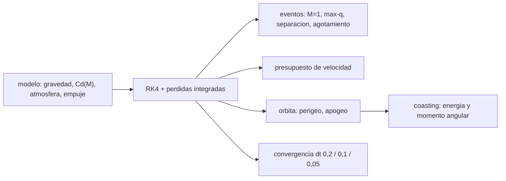

# B77-C20 — Simulación académica de una trayectoria de vuelo

<!-- nav:top -->
[🏠 Programa](../../../../README.md) · [📚 Bloque B77](../../../tronco-comun/B77-dinamica-de-lanzamiento-y-reentrada.md) · [← Anterior: B77-C19 — Seguridad de rango a nivel conceptual](../B77-C19-seguridad-de-rango-a-nivel-conceptual/CLASE.md) · [Siguiente: B77-C21 — Centro de presión y margen estático →](../../../tronco-comun/B77-dinamica-de-lanzamiento-y-reentrada.md#b77-c21)
<!-- /nav -->

## 1. Ubicación, nivel y alcance

Clase 20 del bloque B77. Nivel N3. Esta clase reúne el bloque en una sola simulación académica: un ascenso de dos etapas con atmósfera, número de Mach, giro de gravedad y cierre de la órbita, con un presupuesto de velocidad que separa las pérdidas y un estudio de convergencia. Reutiliza el vehículo de [C12](../B77-C12-perfil-de-ascenso-orbital/CLASE.md) y suma el arrastre dependiente de Mach de [C04](../B77-C04-coeficientes-de-arrastre-y-sustentacion/CLASE.md). El vehículo es sintético y la rotación terrestre no se simula.

## 2. Por qué esta clase existe

Una simulación solo vale si se sabe cuánto error numérico tiene y a dónde va cada metro por segundo. La decisión central: **¿cómo se verifica que una simulación de vuelo es numéricamente fiable y cómo se lee su presupuesto de pérdidas?**

## 3. Lo que podrás hacer al terminar

1. Integrar un ascenso de dos etapas con arrastre `Cd(M)` y velocidad del sonido variable.
2. Registrar eventos: paso a supersónico, max-q, separación y agotamiento.
3. Construir el presupuesto `Δv_ideal = Δ|v| + L_g + L_d + L_dir`.
4. Comprobar la convergencia al reducir el paso (RK4).
5. Verificar la energía y el momento angular en el vuelo balístico posterior.
6. Rotular qué es consultado, no consultado, ilustrativo y no simulado (rotación).

La evidencia es la **informe de simulación de vuelo** del ejercicio 12 (sección 20).

## 4. Con qué llegas y cómo comprobarlo

1. ¿Qué es un integrador RK4?
2. ¿Qué es el número de Mach?
3. ¿Qué es una identidad contable?
4. ¿Qué es la convergencia numérica?
5. ¿Qué es una pérdida por dirección?

<details>
<summary>Ver respuestas</summary>

1. Un método de cuarto orden que combina cuatro evaluaciones de la derivada por paso. 2. La velocidad relativa al aire dividida por la velocidad del sonido. 3. Una igualdad entre cantidades acumuladas que debe cerrar, aunque no pruebe la física. 4. Que el resultado se estabiliza al refinar el paso. 5. La parte del empuje que no acelera a lo largo de la velocidad.
</details>

Con cuatro o cinco aciertos, sigue; si no, repasa los prerrequisitos.

## 5. Un caso de contexto y casos de referencia

El vehículo sintético de C12, con `Cd(M)` (pico `0,45` en `M = 1,1`), alcanza `M > 1` a los `36,5 s`, tiene max-q de `45,5 kPa` a los `56,1 s` (`12,3 km`, Mach `1,91`), separa a los `147,1 s` y agota a los `298,1 s` en una órbita de `217 × 243 km`. De `9461 m/s` ideales, gana `7752` y pierde `1276` por gravedad, `117` por aire y `316` por dirección. Es el **ejemplo conductor**; es **ilustrativo** y no representa ningún vehículo.

## 6. Vocabulario

Una **simulación académica** declara modelo, datos, versión y tolerancias. La **convergencia en el paso** es la estabilización del resultado al reducir `Δt`. El **presupuesto de velocidad** reparte el `Δv` ideal. La **pérdida por dirección** es `∫F(1 − cos δ)/m dt`. Un **evento** es un instante notable (max-q, separación, agotamiento).

## 7. Modelo mental



*Descripción textual:* un modelo con atmósfera, Mach, empuje y gravedad se integra con RK4 junto con las pérdidas; de ahí salen los eventos, el presupuesto, la órbita y las comprobaciones de convergencia y conservación.

Analogía: un balance contable de una empresa: el dinero que entra, lo que gasta en cada rubro y lo que queda; y una auditoría que repite las cuentas con otro método. Límite: la contabilidad cuadra por construcción; la confianza viene de la convergencia y de las comprobaciones independientes.

## 8. La explicación, paso a paso

### 8.1 El modelo

Es el de C12 (coordenadas polares, plano orbital, giro de gravedad en la etapa 1, empuje desviado `δ` en la etapa 2) con arrastre `D = Cd(M)·½ρv²·A`, `M = v/a(h)`, `a(h)` sintética (340 m/s al suelo, 295 m/s desde 11 km) y `Cd(M)` por tramos. La Tierra no rota y el aire está en reposo. `δ` se ajusta por bisección (`δ = -22,2475°`).

### 8.2 Eventos

| Evento | `t` (s) | `h` (km) | Dato |
|---|---|---|---|
| paso a supersónico | 36,5 | — | — |
| max-q | 56,1 | 12,3 | 45,5 kPa, Mach 1,91 |
| separación | 147,1 | 94,8 | 4104 m/s |
| agotamiento | 298,1 | 242,6 | 7752 m/s, `γ` = -0,00° |

### 8.3 Presupuesto de velocidad

`Δv_ideal = 9461,33` m/s se reparte en `Δ|v| = 7751,64`, `L_g = 1276,19`, `L_d = 117,50` y `L_dir = 316,01`. El residuo es `3e-13`: valida la integración de las pérdidas, no el modelo físico. La pérdida gravitacional domina; la aerodinámica es la menor.

### 8.4 Convergencia y conservación

| `dt` (s) | perigeo (km) | apogeo (km) |
|---|---|---|
| 0,20 | 216,9908 | 242,6231 |
| 0,10 | 216,9910 | 242,6229 |
| 0,05 | 216,9910 | 242,6230 |

Al reducir `dt` de 0,2 a 0,1 y a 0,05, el perigeo cambia `0,22 m` y luego `0,05 m`; el apogeo, `0,11` y `0,04 m`: decrece, pero no con el factor 16 teórico de RK4, porque los saltos de empuje y los recortes de paso rompen la suavidad. El vuelo balístico posterior conserva la energía (`9e-16`) y el momento angular (`6e-16`). La rotación terrestre aportaría hasta `409 m/s` de velocidad tangencial en el sitio; no se simula.

## 9. Magnitudes, símbolos y unidades

| Símbolo | Qué es | Unidad | Valor / nota |
|---|---|---|---|
| `Cd(M)` | coeficiente de arrastre según Mach | — | 0,25 a 0,45 (ilustrativo) |
| `a(h)` | velocidad del sonido sintética | m/s | 340 → 295 |
| `δ` | desvío del empuje en la etapa 2 | ° | -22,247 (ajustado) |
| `L_g`, `L_d`, `L_dir` | pérdidas | m/s | 1276; 117; 316 |
| `q_max` | presión dinámica máxima | kPa | 45,5 |
| órbita | perigeo × apogeo | km | 217 × 243 |

## 10. Convenciones y referencias

Plano orbital inercial, Tierra no rotante, aire en reposo, SI; `R_E`, periodo sideral, `ρ₀` y `H` de la NASA/NSSDC; `g₀` del NIST; `μ` **no consultado**. Vehículo, `Cd(M)`, velocidad del sonido y guiado ilustrativos. Python 3.12.9, biblioteca estándar, RK4 con paso 0,05–0,2 s.

## 11. De dónde sale lo que afirmamos

| ID | Fuente | Localizador | Respalda | Estado |
|---|---|---|---|---|
| S1 | NASA/NSSDC, Earth Fact Sheet — https://nssdc.gsfc.nasa.gov/planetary/factsheet/earthfact.html (consultada 2026-11-10) | ficha completa leída | radio ecuatorial, periodo sideral, ρ₀ = 1,217 kg/m³ y altura de escala 8,5 km | Consultada |
| S2 | NIST, CODATA 2022, standard acceleration of gravity — https://physics.nist.gov/cgi-bin/cuu/Value?gn (consultada 2026-11-10) | entrada gn | g₀ = 9,80665 m/s² | Consultada |
| S3 | NASA Glenn, Drag Coefficient — https://www1.grc.nasa.gov/beginners-guide-to-aeronautics/drag-coefficient/ (consultada 2026-11-10) | página completa | D = Cd·q·A; Cd depende de forma, inclinación y flujo | Consultada |
| S4 | NASA Glenn, Ideal Rocket Equation — https://www1.grc.nasa.gov/beginners-guide-to-aeronautics/ideal-rocket-equation/ (consultada 2026-11-10) | página completa | ecuación de cohete ideal | Consultada |
| — | Integración RK4, identidad contable de pérdidas y valor de μ | — | las verifica el laboratorio con una segunda vía | No consultada en una fuente concreta |

Límites: `μ` no consultado en una fuente; la velocidad del sonido y `Cd(M)` son inventados; no se simula la rotación terrestre, el viento ni la dispersión; no se comparó con ningún vuelo real.

## 12. Cómo ver el resultado

| Magnitud | Valor |
|---|---|
| órbita de agotamiento | 217,0 × 242,6 km |
| max-q | 45,5 kPa, Mach 1,91 |
| `Δ|v|` | 7751,6 m/s |
| residuo de la identidad | 3e-13 |
| cambio de perigeo al refinar (m) | 0,22 → 0,05 |

Descripción larga: la gravedad se lleva cerca del 13 % del `Δv` ideal, el aire poco más del 1 %; refinar el paso cambia la órbita en menos de un metro.

## 13. Ejemplo trabajado: el presupuesto de velocidad

**Paso 1 · Ideal.** `Δv = 9461,3 m/s` (dos etapas, `Isp` 300 y 350 s).

**Paso 2 · Pérdidas.** `1276,2 + 117,5 + 316,0 = 1709,7 m/s`.

**Paso 3 · Ganancia.** `Δ|v| = 9461,3 − 1709,7 = 7751,6 m/s`, igual a la simulación.

## 14. Distintas formas de describir el resultado

**Por eventos:** tabla de tiempos. **Por presupuesto:** ideal y pérdidas. **Por órbita:** perigeo y apogeo. **Por convergencia:** `dt` y cambios. **Por conservación:** energía y momento angular.

## 15. Práctica guiada

**Ejercicio 1 · con los pasos indicados.** Suma las tres pérdidas del presupuesto. *Pasos:* `L_g + L_d + L_dir`.

<details><summary>Solución comentada</summary>

`1709,7 m/s`.
</details>

**Ejercicio 2 · con una pista.** ¿Qué fracción del `Δv` ideal es pérdida gravitacional? *Pista:* `L_g/Δv`.

<details><summary>Solución comentada</summary>

`13,5 %`.
</details>

**Ejercicio 3 · casi autónomo.** ¿Por qué el residuo de la identidad no valida la física?

<details><summary>Solución comentada</summary>

Porque la identidad se deduce de las mismas ecuaciones que se integran; cierra aunque el modelo sea erróneo.
</details>

## 16. Práctica autónoma, transferencia e integrador

**Ejercicio 4 · autónomo.** Tiempo desde el paso a supersónico hasta max-q.

<details><summary>Solución comentada</summary>

`19,6 s`.
</details>

**Ejercicio 5 · autónomo.** Cambio relativo del perigeo entre `dt` = 0,1 y 0,05.

<details><summary>Solución comentada</summary>

`2,4e-07`.
</details>

**Ejercicio 6 · autónomo.** ¿Qué indica que el cambio decrezca al refinar `dt`?

<details><summary>Solución comentada</summary>

Que la solución converge; no prueba que converja a la solución correcta del problema físico.
</details>

**Ejercicio 7 · autónomo.** Velocidad que habría de añadir la rotación en el ecuador (radio 6378,137 km).

<details><summary>Solución comentada</summary>

`ω R = 465 m/s` (con `T_sid = 23,9345 h`).
</details>

**Ejercicio 8 · autónomo.** `Cd` a `M = 1,1` frente a `M = 3`.

<details><summary>Solución comentada</summary>

0,45 frente a 0,30: un 50 % más de arrastre en el pico transónico.
</details>

**Ejercicio 9 · transferencia.** **Transferencia.** Un artículo muestra una simulación con otra órbita. ¿Cómo comparar?

<details><summary>Solución comentada</summary>

Solo igualando vehículo, atmósfera, guiado y tolerancias; de lo contrario la diferencia es de datos, no de método.
</details>

**Ejercicio 10 · transferencia.** **Transferencia.** Un colega fija `dt = 1 s` para ahorrar tiempo. ¿Qué haces?

<details><summary>Solución comentada</summary>

Repetir con `dt` menor y medir el cambio de las cantidades de interés antes de aceptar el resultado.
</details>

**Ejercicio 11 · transferencia.** **Transferencia.** ¿Qué faltaría para acercar la simulación a una real?

<details><summary>Solución comentada</summary>

Rotación y acimut, viento, ley de guiado realista, J2, dispersiones y validación con datos de vuelo.
</details>

**Ejercicio 12 · integrador.** **Integrador.** Elabora tu *informe de simulación de vuelo*: modelo y datos, eventos, presupuesto de velocidad, estudio de convergencia, comprobaciones de conservación y límites declarados.

<details><summary>Solución comentada</summary>

Secciones 8.1–8.4 y la salida del laboratorio.
</details>

## 17. Laboratorio: simulación completa de un ascenso

El script [simulacion.py](simulacion.py) integra el ascenso con `Cd(M)`, registra eventos, cierra el presupuesto de pérdidas y estudia la convergencia con tres pasos (**comprueba** residuo < 1e-6, cambios decrecientes y conservación < 1e-8).

**Datos:** radio, periodo sideral, atmósfera, `g₀` y ecuaciones consultados; `μ` **no consultado**; vehículo, `Cd(M)` y sonido **ilustrativos**. **Predice antes de ejecutar:** ¿cuál pérdida domina? (la gravitacional: ≈ 1276 m/s frente a 117,5 m/s de la aerodinámica.) **Ejecución del 2026-11-10 (Python 3.12.9):**

```text
Python 3.12.9 (biblioteca estandar)
Vehiculo SINTETICO de C12 con Cd(M), aire en reposo y Tierra NO rotante; desvio del empuje en la etapa 2 (biseccion) = -22.2475 grados
Eventos: supersonico a t = 36.5 s; max-q = 45.5 kPa a t = 56.1 s, h = 12.3 km, Mach 1.91; separacion t = 147.1 s, h = 94.8 km, v = 4104 m/s; agotamiento t = 298.1 s
Agotamiento: h = 242.62 km, v inercial = 7751.6 m/s, gamma = -0.0000 grados, alcance = 933 km, m = 4500 kg; orbita 217.0 x 242.6 km, e = 0.0019
Presupuesto de velocidad [m/s]:
  Delta_v ideal (cohete)      = 9461.33
  ganancia de |v| inercial    = 7751.64
  perdida gravitacional       = 1276.19
  perdida aerodinamica        = 117.50
  perdida por direccion (empuje desviado) = 316.01
  residuo de la identidad     = 2.5e-13 (relativo al Delta_v ideal)
Convergencia en el paso (dt [s]: perigeo / apogeo [km]):
  dt =  0.20:   216.9908 /   242.6231
  dt =  0.10:   216.9910 /   242.6229
  dt =  0.05:   216.9910 /   242.6230
  |cambio| perigeo: 0.2->0.1 = 0.22 m; 0.1->0.05 = 0.05 m; apogeo: 0.11 m; 0.04 m
Rotacion terrestre NO simulada: la velocidad tangencial de la superficie en el sitio seria 408.7 m/s (omega R cos(phi)); un lanzamiento hacia el este la aprovecharia solo en parte (no se modela el acimut)
Vuelo balistico posterior: energia 8.6e-16; momento angular 5.9e-16
Pruebas superadas.
```

```bash
python programa/clases/B77/B77-C20-simulacion-academica-de-una-trayectoria-de-vuelo/simulacion.py
```

**Límites:** Tierra no rotante, aire en reposo, sin viento ni dispersión; guiado de dos parámetros; vehículo sintético.

## 18. Errores frecuentes y cómo corregirlos

**Tomar la identidad contable como validación del modelo.** Se corrige con 8.3.

**Aceptar un resultado sin estudiar el paso.** Se corrige con 8.4.

**Comparar con una simulación ajena sin igualar los datos.** Se corrige con el ejercicio 9.

**Presentar la simulación como un vuelo real.** Se corrige con la sección 10.

## 19. Cómo sabrás que vas bien

Tras la sección 8: ¿qué pérdida esperabas mayor y cuál fue? Si dudas, repasa el ejemplo 13. Tras el laboratorio: ¿qué comprueba? (ver la sección 17).

## 20. Qué entregas y cómo se evalúa

El producto es tu **informe de simulación de vuelo** (ejercicio 12).

| Criterio | Inicial | En desarrollo | Logrado | Destacado |
|---|---|---|---|---|
| Conceptos | Los confunde | Parciales | Aplica el modelo con sus supuestos | Explica los límites |
| Cálculo | Sin unidades | Con errores | Tablas completas con unidades | Calcula casos nuevos |
| Numérico | Sin comprobar | Un caso | Contraste con una segunda vía | Interpreta las diferencias |
| Fuentes | Sin fuente | Sin fecha | Fuentes con fecha y estado | Declara lo ilustrativo y lo no consultado |
| Límites | No los nombra | Uno | Tres | Discute qué falta del modelo |

**Condiciones críticas (no se compensan con promedio):** declarar modelo, datos, versión y tolerancias; rotular el vehículo como ilustrativo y la rotación como no simulada; no presentar la simulación como vuelo real; citar solo lo consultado.

## 21. Ética, seguridad y límites

Clase educativa: los modelos son simplificados y sus datos son sintéticos o ilustrativos; ningún resultado describe un vehículo real ni sustituye al análisis de seguridad, a la certificación o a los documentos del operador. Nada de lo simulado se presenta como observado ni como datos de vuelo. Accesibilidad: tablas equivalentes a las gráficas, fórmulas en texto, ejercicios sin conexión.

## 22. Para cerrar y seguir

Una simulación sintética de dos etapas llega a `217 × 243 km` con pérdidas de `1276`, `117` y `316 m/s`, y su resultado cambia menos de un metro al refinar el paso. Queda una pregunta: ¿cómo se mantiene estable el vehículo durante el ascenso?

**Glosario español–inglés.** simulación · *simulation*; convergencia · *convergence*; presupuesto de velocidad · *velocity budget*; evento · *event*; pérdida por dirección · *steering loss*.

**Continuidad.** [siguiente]

**Referencias:** ver sección 11.

<!-- nav:bottom -->
---

[← Anterior: B77-C19 — Seguridad de rango a nivel conceptual](../B77-C19-seguridad-de-rango-a-nivel-conceptual/CLASE.md) · [📚 Bloque B77](../../../tronco-comun/B77-dinamica-de-lanzamiento-y-reentrada.md) · [Siguiente: B77-C21 — Centro de presión y margen estático →](../../../tronco-comun/B77-dinamica-de-lanzamiento-y-reentrada.md#b77-c21)
<!-- /nav -->
