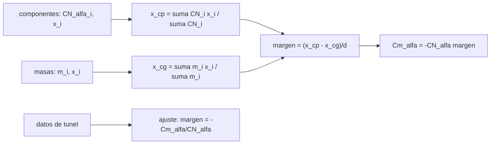

# B77-C21 — Centro de presión y margen estático

<!-- nav:top -->
[🏠 Programa](../../../../README.md) · [📚 Bloque B77](../../../tronco-comun/B77-dinamica-de-lanzamiento-y-reentrada.md) · [← Anterior: B77-C20 — Simulación académica de una trayectoria de vuelo](../B77-C20-simulacion-academica-de-una-trayectoria-de-vuelo/CLASE.md) · [Siguiente: B77-C22 — Centro de masa y su variación con el consumo de propelente →](../B77-C22-centro-de-masa-y-su-variacion-con-el-consumo-de-propelente/CLASE.md)
<!-- /nav -->

## 1. Ubicación, nivel y alcance

Clase 21 del bloque B77. Nivel N3. Un lanzador es estable en ascenso cuando el centro de presión queda detrás del centro de gravedad; la distancia entre ambos, en diámetros del vehículo, es el margen estático. Aquí calculas el centro de presión por componentes, el centro de gravedad por masas, el margen y la pendiente del momento, y ajustas esos coeficientes a datos de túnel **sintéticos**. Usas [C04](../B77-C04-coeficientes-de-arrastre-y-sustentacion/CLASE.md) para los coeficientes. El vehículo es inventado.

## 2. Por qué esta clase existe

Un lanzador sin margen estático positivo se voltea con la primera ráfaga; con demasiado margen es rígido y carga mucho el control. La decisión central: **¿dónde está el centro de presión, cuánto margen hay y qué lo cambia?**

## 3. Lo que podrás hacer al terminar

1. Calcular el centro de presión como promedio de las pendientes de fuerza normal ponderado por posición.
2. Calcular el centro de gravedad por masas.
3. Obtener el margen estático en calibres y `Cm_α`.
4. Ajustar `CN_α` y `Cm_α` a datos sintéticos y estimar el margen con su incertidumbre.
5. Ver el efecto del tamaño de las aletas y del consumo de propelente.
6. Separar lo consultado (criterio de estabilidad) de lo inventado (componentes, masas).

La evidencia es la **ficha de margen estático** del ejercicio 12 (sección 20).

## 4. Con qué llegas y cómo comprobarlo

1. ¿Qué es el centro de presión?
2. ¿Qué es el centro de gravedad?
3. ¿Qué es un calibre?
4. ¿Qué es un momento respecto de un punto?
5. ¿Qué es el ajuste por mínimos cuadrados?

<details>
<summary>Ver respuestas</summary>

1. El punto donde actúa la fuerza aerodinámica normal resultante. 2. El punto de aplicación del peso; alrededor de él rota el vehículo. 3. Un diámetro de referencia del vehículo. 4. La fuerza por la distancia perpendicular al punto. 5. Un método que minimiza la suma de residuos al cuadrado.
</details>

Con cuatro o cinco aciertos, sigue; si no, repasa los prerrequisitos.

## 5. Un caso de contexto y casos de referencia

Un lanzador sintético de `20 m` y `d = 1,5 m` tiene `CN_α = 8,0 /rad` y su centro de presión está a `14,00 m` de la punta; el de gravedad, a `12,90 m`. El margen estático es `0,731` calibres y `Cm_α = -5,849 /rad`. El ajuste a datos de túnel inventados da `0,742 ± 0,008` calibres. Es el **ejemplo conductor**; los componentes son **inventados**.

## 6. Vocabulario

El **margen estático** es `(x_cp − x_cg)/d`, positivo si el centro de presión va detrás. La **pendiente de fuerza normal** `CN_α` es `dCN/dα`. La **pendiente de momento** respecto del centro de gravedad es `Cm_α = −CN_α·margen`. Un **calibre** es un diámetro. El **estable** tiene `Cm_α < 0`.

## 7. Modelo mental



*Descripción textual:* los componentes aerodinámicos dan el centro de presión; las masas dan el de gravedad; su diferencia en calibres es el margen, que fija `Cm_α`; un ajuste a datos de túnel da el mismo margen con incertidumbre.

Analogía: una flecha: las plumas atrás hacen que el centro de presión quede detrás del peso, y por eso la flecha vuela con la punta adelante. Límite: aquí los componentes son valores dados y no se calculan desde la geometría.

## 8. La explicación, paso a paso

### 8.1 Centro de presión y de gravedad

`x_cp = Σ CN_α,i·x_i / Σ CN_α,i = (2,0·1,40 + 0·10 + 6,0·18,2)/8,0 = 14,000 m`. Con las masas (`1500, 9000, 30 000, 6000 kg` en `2, 7, 14, 19 m`) el centro de gravedad es `x_cg = 12,9032 m`.

### 8.2 Margen y pendiente de momento

`margen = (14,000 − 12,903)/1,5 = 0,7312` calibres y `Cm_α = −CN_α·margen = -5,8495 /rad`. Una diferencia finita del momento calculado fuerza por fuerza da `-5,8495`, error `2e-15`. Es una comprobación algebraica; no sustituye a datos de túnel.

### 8.3 Ajuste a datos sintéticos

Con nueve ángulos de ataque (−4° a +4°) y ruido de 0,01: `CN_α = 7,920 ± 0,076`, `Cm_α = -5,873 ± 0,035`, margen `0,742 ± 0,008` calibres, compatible con el exacto `0,731` dentro de 3σ.

### 8.4 Qué mueve el margen

| `CN_α` de las aletas | `x_cp` (m) | Margen (calibres) |
|---|---|---|
| 0 | 1,40 | -7,67 |
| 1 | 7,00 | -3,94 |
| 2 | 9,80 | -2,07 |
| 4 | 12,60 | -0,20 |
| 6 | 14,00 | +0,73 |
| 8 | 14,84 | +1,29 |

Aletas pequeñas dejan el centro de presión cerca de la ojiva y el margen negativo. Además, al consumirse el propelente del tanque inferior el centro de gravedad se mueve a `11,17 m` y el margen sube a `1,89` calibres (más estable, pero más difícil de controlar): el tema de [C22](../B77-C22-centro-de-masa-y-su-variacion-con-el-consumo-de-propelente/CLASE.md). El criterio general es el de la NASA Glenn: estable si el centro de presión queda del lado de la cola respecto del centro de gravedad.

## 9. Magnitudes, símbolos y unidades

| Símbolo | Qué es | Unidad | Valor / nota |
|---|---|---|---|
| `x_cp` | centro de presión (desde la punta) | m | 14,000 |
| `x_cg` | centro de gravedad | m | 12,903 |
| `d` | diámetro de referencia | m | 1,5 (inventado) |
| `CN_α` | pendiente de fuerza normal | 1/rad | 8,0 |
| margen | margen estático | calibres | 0,731 |
| `Cm_α` | pendiente de momento respecto del CG | 1/rad | -5,849 |

## 10. Convenciones y referencias

`x` desde la punta hacia atrás; momentos respecto del centro de gravedad; margen positivo = estable. Criterio de la NASA Glenn; componentes, masas, `d` y datos de túnel (semilla 21) inventados; no se usó la fórmula de Barrowman (no consultada).

## 11. De dónde sale lo que afirmamos

| ID | Fuente | Localizador | Respalda | Estado |
|---|---|---|---|---|
| S1 | NASA Glenn, Rocket Stability — https://www1.grc.nasa.gov/beginners-guide-to-aeronautics/rocket-stability/ (consultada 2026-11-10) | página completa | definiciones de centro de presión y de gravedad y criterio de estabilidad (cp por detrás de cg) | Consultada |
| — | Centro de presión como promedio ponderado, centro de gravedad por masas y ajuste por mínimos cuadrados | — | las verifica el laboratorio con una segunda vía | No consultada en una fuente concreta |

Límites: los componentes aerodinámicos son valores dados, no calculados desde la geometría; no se consultó ningún método de estimación (p. ej. Barrowman) ni datos de vehículos; flujo supuesto lineal en `α` pequeño.

## 12. Cómo ver el resultado

| Magnitud | Valor |
|---|---|
| `x_cp`; `x_cg` | 14,000 m; 12,903 m |
| margen exacto | 0,7312 calibres |
| margen ajustado | 0,742 ± 0,008 |
| `Cm_α` | -5,849 /rad |
| margen sin propelente inferior | 1,89 calibres |

Descripción larga: el centro de presión queda poco más de un metro detrás del centro de gravedad; el tamaño de las aletas y el consumo de propelente mueven el margen en calibres.

## 13. Ejemplo trabajado: el centro de presión

**Paso 1 · Momentos de área.** `2,0 × 1,40 + 6,0 × 18,2 = 112,0`.

**Paso 2 · Suma de pendientes.** `2,0 + 6,0 = 8,0`.

**Paso 3 · Cociente.** `x_cp = 112,0/8,0 = 14,00 m`.

**Paso 4 · Margen.** `(14,00 − 12,903)/1,5 = 0,731` calibres.

## 14. Distintas formas de describir el resultado

**Por posición:** `x_cp`, `x_cg`. **Por calibres:** margen. **Por pendiente:** `Cm_α`. **Por ajuste:** margen con incertidumbre. **Por barrido:** efecto de las aletas.

## 15. Práctica guiada

**Ejercicio 1 · con los pasos indicados.** Calcula `x_cp` con componentes (3 en 2 m) y (5 en 16 m). *Pasos:* promedio ponderado.

<details><summary>Solución comentada</summary>

`(6 + 80)/8 = 10,75 m`.
</details>

**Ejercicio 2 · con una pista.** Calcula el margen si `x_cg = 9 m` y `d = 1,5 m`. *Pista:* `(x_cp − x_cg)/d`.

<details><summary>Solución comentada</summary>

`1,75/1,5 = 1,17` calibres.
</details>

**Ejercicio 3 · casi autónomo.** ¿Por qué el cuerpo cilíndrico aporta 0 a `CN_α` en este modelo?

<details><summary>Solución comentada</summary>

Es una simplificación inventada de la clase; en la práctica un cuerpo cilíndrico aporta poco comparado con la ojiva y las aletas.
</details>

## 16. Práctica autónoma, transferencia e integrador

**Ejercicio 4 · autónomo.** `Cm_α` para margen 1,17 y `CN_α = 8`.

<details><summary>Solución comentada</summary>

`−9,36 /rad`.
</details>

**Ejercicio 5 · autónomo.** ¿Qué le ocurre al margen si se añade lastre en la ojiva?

<details><summary>Solución comentada</summary>

El centro de gravedad avanza y el margen aumenta.
</details>

**Ejercicio 6 · autónomo.** Margen si `CN_α` de las aletas es 4.

<details><summary>Solución comentada</summary>

`-0,20` calibres: inestable.
</details>

**Ejercicio 7 · autónomo.** Incertidumbre relativa del margen ajustado.

<details><summary>Solución comentada</summary>

`1,1 %`.
</details>

**Ejercicio 8 · autónomo.** Posición del centro de gravedad para margen 2,0 con `x_cp = 14 m`.

<details><summary>Solución comentada</summary>

`x_cg = 14 − 2 × 1,5 = 11 m`.
</details>

**Ejercicio 9 · transferencia.** **Transferencia.** Un informe da 'margen 1,5 calibres' sin más datos. ¿Qué falta?

<details><summary>Solución comentada</summary>

En qué instante del vuelo, con qué número de Mach y con qué referencia (diámetro).
</details>

**Ejercicio 10 · transferencia.** **Transferencia.** Un colega mide el centro de presión una vez a Mach 0,3 y lo usa en todo el vuelo. ¿Qué error?

<details><summary>Solución comentada</summary>

El centro de presión se desplaza con el Mach y con el ángulo de ataque; hay que cubrir el rango.
</details>

**Ejercicio 11 · transferencia.** **Transferencia.** ¿Qué cambia si el diámetro de referencia se duplica con el mismo vehículo?

<details><summary>Solución comentada</summary>

Los calibres se reducen a la mitad, aunque el vehículo sea el mismo; hay que declarar `d`.
</details>

**Ejercicio 12 · integrador.** **Integrador.** Elabora tu *ficha de margen estático*: `x_cp`, `x_cg`, margen, `Cm_α`, ajuste con incertidumbre, barrido de aletas y lista de qué es consultado e inventado.

<details><summary>Solución comentada</summary>

Secciones 8.1–8.4 y la salida del laboratorio.
</details>

## 17. Laboratorio: centro de presión y margen estático

El script [margen_estatico.py](margen_estatico.py) calcula `x_cp`, `x_cg`, margen y `Cm_α`, ajusta datos de túnel sintéticos (semilla 21) y barre el tamaño de las aletas (**comprueba** diferencias finitas < 1e-9 y margen ajustado a menos de 3σ del exacto).

**Datos:** el criterio de la NASA Glenn consultado; componentes, masas y datos **inventados**. **Predice antes de ejecutar:** ¿cuántos calibres de margen? (0,73.) **Ejecución del 2026-11-10 (Python 3.12.9):**

```text
Python 3.12.9 (biblioteca estandar)
Vehiculo SINTETICO: d = 1.5 m; componentes (CN_alfa [1/rad], x_cp [m]): ojiva 2.0 en 1.4; cuerpo 0.0 en 10.0; aletas 6.0 en 18.2
CN_alfa total = 8.000 /rad; centro de presion x_cp = 14.0000 m; centro de gravedad x_cg = 12.9032 m
Margen estatico = 0.7312 calibres; Cm_alfa = -5.8495 /rad (por componentes) y -5.8495 (diferencias finitas, error 1.8e-15)
Ajuste a datos SINTETICOS de tunel (semilla 21): CN_alfa = 7.920 +- 0.076; Cm_alfa = -5.873 +- 0.035; margen = 0.742 +- 0.008 calibres
Barrido del CN_alfa de las aletas -> x_cp [m], margen [calibres]: 0 -> 1.40, -7.67; 1 -> 7.00, -3.94; 2 -> 9.80, -2.07; 4 -> 12.60, -0.20; 6 -> 14.00, +0.73; 8 -> 14.84, +1.29
Con el propelente del tanque inferior consumido (queda 1500 kg de estructura): x_cg = 11.167 m; margen = 1.889 calibres
Pruebas superadas.
```

```bash
python programa/clases/B77/B77-C21-centro-de-presion-y-margen-estatico/margen_estatico.py
```

**Límites:** componentes dados, `α` pequeño, sin Mach, sin flexibilidad.

## 18. Errores frecuentes y cómo corregirlos

**Contar el margen en metros sin declarar el diámetro.** Se corrige con el ejercicio 11.

**Olvidar que el centro de gravedad cambia con el vuelo.** Se corrige con 8.4.

**Esperar estabilidad con aletas pequeñas.** Se corrige con 8.4.

**Tomar los componentes inventados por reales.** Se corrige con la sección 10.

## 19. Cómo sabrás que vas bien

Tras la sección 8: ¿qué margen esperabas y cuál obtuviste? Si dudas, repasa el ejemplo 13. Tras el laboratorio: ¿qué comprueba? (ver la sección 17).

## 20. Qué entregas y cómo se evalúa

El producto es tu **ficha de margen estático** (ejercicio 12).

| Criterio | Inicial | En desarrollo | Logrado | Destacado |
|---|---|---|---|---|
| Conceptos | Los confunde | Parciales | Aplica el modelo con sus supuestos | Explica los límites |
| Cálculo | Sin unidades | Con errores | Tablas completas con unidades | Calcula casos nuevos |
| Numérico | Sin comprobar | Un caso | Contraste con una segunda vía | Interpreta las diferencias |
| Fuentes | Sin fuente | Sin fecha | Fuentes con fecha y estado | Declara lo ilustrativo y lo no consultado |
| Límites | No los nombra | Uno | Tres | Discute qué falta del modelo |

**Condiciones críticas (no se compensan con promedio):** rotular los componentes como inventados; declarar que Barrowman no se consultó; no presentar el margen como el de un vehículo real; citar solo lo consultado.

## 21. Ética, seguridad y límites

Clase educativa: los modelos son simplificados y sus datos son sintéticos o ilustrativos; ningún resultado describe un vehículo real ni sustituye al análisis de seguridad, a la certificación o a los documentos del operador. Nada de lo simulado se presenta como observado ni como datos de vuelo. Accesibilidad: tablas equivalentes a las gráficas, fórmulas en texto, ejercicios sin conexión.

## 22. Para cerrar y seguir

El lanzador sintético tiene `0,73` calibres de margen, y las aletas lo hacen estable. Queda una pregunta: ¿cómo cambia el centro de masa mientras se quema el propelente?

**Glosario español–inglés.** centro de presión · *center of pressure*; centro de gravedad · *center of gravity*; margen estático · *static margin*; calibre · *caliber*; pendiente de fuerza normal · *normal-force slope*.

**Continuidad.** [siguiente]

**Referencias:** ver sección 11.

<!-- nav:bottom -->
---

[← Anterior: B77-C20 — Simulación académica de una trayectoria de vuelo](../B77-C20-simulacion-academica-de-una-trayectoria-de-vuelo/CLASE.md) · [📚 Bloque B77](../../../tronco-comun/B77-dinamica-de-lanzamiento-y-reentrada.md) · [Siguiente: B77-C22 — Centro de masa y su variación con el consumo de propelente →](../B77-C22-centro-de-masa-y-su-variacion-con-el-consumo-de-propelente/CLASE.md)
<!-- /nav -->
