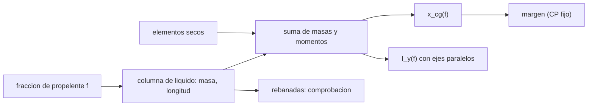

# B77-C22 — Centro de masa y su variación con el consumo de propelente

<!-- nav:top -->
[🏠 Programa](../../../../README.md) · [📚 Bloque B77](../../../tronco-comun/B77-dinamica-de-lanzamiento-y-reentrada.md) · [← Anterior: B77-C21 — Centro de presión y margen estático](../B77-C21-centro-de-presion-y-margen-estatico/CLASE.md) · [Siguiente: B77-C23 — Estabilidad de vuelo de lanzadores en ascenso →](../B77-C23-estabilidad-de-vuelo-de-lanzadores-en-ascenso/CLASE.md)
<!-- /nav -->

## 1. Ubicación, nivel y alcance

Clase 22 del bloque B77. Nivel N3. Un lanzador gasta la mayor parte de su masa en propelente, así que su centro de masa y su inercia cambian de forma notable durante el ascenso. Aquí calculas, para un vehículo sintético de dos tanques, el centro de masa, la inercia de cabeceo y el margen estático en cinco instantes del quemado, y comprobaste el resultado discretizando los tanques. Usas [C21](../B77-C21-centro-de-presion-y-margen-estatico/CLASE.md) para el margen. El vehículo es inventado, distinto del de C21.

## 2. Por qué esta clase existe

El control de actitud se diseña para una masa, un centro de masa y una inercia que ya no son los mismos al final del quemado. La decisión central: **¿cuánto se mueve el centro de masa, cuánto cae la inercia y qué le pasa al margen?**

## 3. Lo que podrás hacer al terminar

1. Calcular el centro de masa de un conjunto de elementos secos y de columnas de líquido.
2. Calcular la inercia de cabeceo con el teorema de ejes paralelos.
3. Seguir ambas cantidades en cinco instantes del quemado.
4. Calcular el margen estático con el centro de presión fijo.
5. Verificar el resultado con una discretización en rebanadas.
6. Separar lo consultado (definición de centro de gravedad) de lo inventado (vehículo, tanques).

La evidencia es la **ficha de masa y centro de masa en el quemado** del ejercicio 12 (sección 20).

## 4. Con qué llegas y cómo comprobarlo

1. ¿Qué es el centro de masa?
2. ¿Qué es el momento de inercia?
3. ¿Qué dice el teorema de ejes paralelos?
4. ¿Qué es la inercia de un cilindro respecto de un eje transversal?
5. ¿Qué es el oleaje (slosh)?

<details>
<summary>Ver respuestas</summary>

1. El promedio de las posiciones ponderado por la masa. 2. Una medida de la resistencia a girar: `∑ m r²` respecto de un eje. 3. `I = I_cm + m d²` para un eje a distancia `d` del centro de masa. 4. `m(R²/4 + L²/12)` por su centro. 5. El movimiento libre del líquido en un tanque, que aquí se ignora.
</details>

Con cuatro o cinco aciertos, sigue; si no, repasa los prerrequisitos.

## 5. Un caso de contexto y casos de referencia

Un vehículo sintético de `24 500 kg` con dos tanques tiene el centro de masa a `10,39 m` de la punta con los tanques llenos, llega a `11,27 m` cuando queda el `25 %` del propelente y termina en `10,60 m`. Su inercia de cabeceo cae de `5,04e+05` a `2,76e+05 kg·m²`. Con el centro de presión fijo en `14 m`, el margen baja de `2,41` a un mínimo de `1,82` calibres (con `25 %` de propelente) y termina en `2,27`. Es el **ejemplo conductor**; el vehículo es **inventado**.

## 6. Vocabulario

El **centro de masa** (`x_cg`) es `Σ m x/Σ m`. El **momento de inercia de cabeceo** `I_y` es el respecto de un eje transversal por el centro de masa. La **columna de líquido** es el propelente acumulado en el fondo del tanque bajo la aceleración axial. El **teorema de ejes paralelos** traslada inercias. El **oleaje** es el movimiento del líquido, no modelado.

## 7. Modelo mental



*Descripción textual:* la fracción de propelente restante fija la masa y la longitud de cada columna de líquido; con los elementos secos se obtienen el centro de masa, la inercia y el margen, y las rebanadas comprueban la forma cerrada.

Analogía: un vaso de agua que se vacía: cambia dónde está su centro de masa y qué tan fácil es hacerlo girar. Límite: se ignora el oleaje, que en un vehículo real acopla con el control.

## 8. La explicación, paso a paso

### 8.1 Columna de líquido

Con `ρ = 1000 kg/m³` y `A = π·0,75² = 1,767 m²`, un tanque con masa de líquido `m_l` tiene una columna de longitud `L_l = m_l/(ρA)` pegada a su extremo trasero. Su centro está a `x_trasero − L_l/2` y su inercia propia es `m_l(R²/4 + L_l²/12)`.

### 8.2 Centro de masa e inercia

`x_cg = Σ m x/Σ m`; `I_y = Σ [I_i + m_i (x_i − x_cg)²]`.

| Propelente restante (%) | Masa (kg) | `x_cg` (m) | `I_y` (kg·m²) | Margen (calibres) |
|---|---|---|---|---|
| 100 | 24500 | 10,387 | 5,036e+05 | 2,409 |
| 75 | 20000 | 10,839 | 4,399e+05 | 2,108 |
| 50 | 15500 | 11,179 | 3,867e+05 | 1,881 |
| 25 | 11000 | 11,270 | 3,371e+05 | 1,820 |
| 0 | 6500 | 10,596 | 2,763e+05 | 2,269 |

### 8.3 Lectura

El centro de masa **no se mueve de forma monótona**: se corre hacia la cola hasta `11,27 m` (a `25 %` de propelente) y luego vuelve a `10,60 m`, porque primero se vacía el tanque superior (delante) y después el inferior. Al inicio, `dx_cg/dm = -0,1081 mm/kg`. La inercia cae `1,8` veces. El margen estático pasa de `2,41` a un mínimo de `1,82` calibres y termina en `2,27`: siempre positivo, pero el control debe re-sintonizarse (ver [C24](../B77-C24-guiado-y-control-de-actitud-de-lanzadores-tvc/CLASE.md)). En C21 el vehículo era otro y el sentido del desplazamiento, distinto.

### 8.4 Verificación

Una discretización de cada tanque en `4000` rebanadas reproduce masa, `x_cg` e `I_y` con un error relativo máximo de `5,0e-09`. Es una comprobación de la integración; no valida el modelo de columna plana (sin oleaje, sin aceleración lateral).

## 9. Magnitudes, símbolos y unidades

| Símbolo | Qué es | Unidad | Valor / nota |
|---|---|---|---|
| `m` | masa del vehículo | kg | 24 500 → 6500 |
| `x_cg` | centro de masa (desde la punta) | m | 10,39 → 11,27 → 10,60 |
| `I_y` | inercia de cabeceo | kg·m² | 5,04e+05 → 2,76e+05 |
| `ρ` | densidad del propelente | kg/m³ | 1000 (inventada) |
| `R` | radio de los tanques | m | 0,75 (inventado) |
| margen | con CP fijo en 14 m | calibres | 2,41 → 1,82 → 2,27 |

## 10. Convenciones y referencias

`x` desde la punta hacia atrás; inercia respecto del centro de masa instantáneo; columna de líquido en el fondo, superficie plana, sin oleaje. Definición de centro de gravedad de la NASA Glenn; todos los datos del vehículo inventados.

## 11. De dónde sale lo que afirmamos

| ID | Fuente | Localizador | Respalda | Estado |
|---|---|---|---|---|
| S1 | NASA Glenn, Rocket Stability — https://www1.grc.nasa.gov/beginners-guide-to-aeronautics/rocket-stability/ (consultada 2026-11-10) | página completa | el centro de gravedad es el punto alrededor del cual rota el cohete; criterio de estabilidad | Consultada |
| — | Centro de masa por promedio ponderado, teorema de ejes paralelos e inercia del cilindro | — | las verifica el laboratorio con una segunda vía | No consultada en una fuente concreta |

Límites: vehículo, masas, tanques y densidad inventados; sin oleaje, sin flexión; no se consultó ninguna ficha de masas de un lanzador.

## 12. Cómo ver el resultado

| Magnitud | Valor |
|---|---|
| `x_cg` lleno; máximo; vacío | 10,387; 11,270; 10,596 m |
| `I_y` lleno → vacío | 5,036e+05 → 2,763e+05 kg·m² |
| margen mínimo | 1,82 calibres |
| margen inicial → final | 2,41 → 2,27 |
| error de las rebanadas | 5,0e-09 |

Descripción larga: el centro de masa se corre cerca de un metro hacia la cola y regresa; la inercia cae a algo más de la mitad; el margen pasa por un mínimo a media quema.

## 13. Ejemplo trabajado: el centro de masa con los tanques llenos

**Paso 1 · Columna superior.** `L_l = 8000/(1000 × 1,767) = 4,53 m` (cabe en los 5 m del tanque).

**Paso 2 · Centro de la columna.** `x = 9,0 − 4,53/2 = 6,74 m`.

**Paso 3 · Resultado completo.** Sumando secos y columnas, `x_cg = 10,3866 m` con los tanques llenos.

## 14. Distintas formas de describir el resultado

**Por tabla:** `m`, `x_cg`, `I_y`, margen. **Por gráfica:** `x_cg(f)`. **Por pendiente:** `dx_cg/dm`. **Por rebanadas:** comprobación.

## 15. Práctica guiada

**Ejercicio 1 · con los pasos indicados.** Calcula `x_cg` de dos masas: 100 kg en 2 m y 300 kg en 6 m. *Pasos:* promedio ponderado.

<details><summary>Solución comentada</summary>

`(200 + 1800)/400 = 5 m`.
</details>

**Ejercicio 2 · con una pista.** Inercia de un cilindro de 100 kg, `R = 0,5 m`, `L = 2 m` respecto de un eje transversal por su centro. *Pista:* `m(R²/4 + L²/12)`.

<details><summary>Solución comentada</summary>

`100(0,0625 + 0,3333) = 39,6 kg·m²`.
</details>

**Ejercicio 3 · casi autónomo.** ¿Por qué la columna de líquido queda en el fondo?

<details><summary>Solución comentada</summary>

Porque la aceleración axial empuja el líquido hacia el extremo trasero.
</details>

## 16. Práctica autónoma, transferencia e integrador

**Ejercicio 4 · autónomo.** Traslada la inercia anterior a un eje 3 m más allá. *Pista:* ejes paralelos.

<details><summary>Solución comentada</summary>

`39,6 + 100 × 9 = 939,6 kg·m²`.
</details>

**Ejercicio 5 · autónomo.** Margen si `x_cg = 10 m`, `x_cp = 14 m`, `d = 1,5 m`.

<details><summary>Solución comentada</summary>

`2,67` calibres.
</details>

**Ejercicio 6 · autónomo.** Cociente de inercias lleno/vacío del laboratorio.

<details><summary>Solución comentada</summary>

`1,82`.
</details>

**Ejercicio 7 · autónomo.** ¿Por qué el centro de masa regresa hacia delante al final del quemado?

<details><summary>Solución comentada</summary>

Porque primero se vacía el tanque delantero (el centro de masa se corre a la cola) y después el trasero (vuelve hacia delante).
</details>

**Ejercicio 8 · autónomo.** Desplazamiento máximo del centro de masa respecto del inicial, en calibres.

<details><summary>Solución comentada</summary>

`(11,270 − 10,387)/1,5 = 0,59`.
</details>

**Ejercicio 9 · transferencia.** **Transferencia.** Un documento da 'centro de masa 10 m' sin más. ¿Qué falta?

<details><summary>Solución comentada</summary>

El instante (masa restante) y el origen de la coordenada.
</details>

**Ejercicio 10 · transferencia.** **Transferencia.** Un colega diseña el control con la inercia inicial para todo el vuelo. ¿Qué error?

<details><summary>Solución comentada</summary>

Con la inercia final cuatro veces menor, la misma ganancia da mucha más respuesta angular.
</details>

**Ejercicio 11 · transferencia.** **Transferencia.** ¿Qué cambia si hay oleaje?

<details><summary>Solución comentada</summary>

El líquido añade modos que acoplan con la dinámica de cabeceo y pueden desestabilizar el control.
</details>

**Ejercicio 12 · integrador.** **Integrador.** Elabora tu *ficha de masa y centro de masa en el quemado*: tabla de `m`, `x_cg`, `I_y`, margen, comprobación por rebanadas y lista de qué es consultado e inventado.

<details><summary>Solución comentada</summary>

Secciones 8.1–8.4 y la salida del laboratorio.
</details>

## 17. Laboratorio: centro de masa e inercia durante el quemado

El script [centro_de_masa.py](centro_de_masa.py) calcula masa, `x_cg`, `I_y` y margen en cinco instantes y los comprueba con 4000 rebanadas por tanque (**comprueba** error < 1e-6).

**Datos:** la definición de centro de gravedad consultada; vehículo, tanques y densidad **inventados**. **Predice antes de ejecutar:** ¿el centro de masa se mueve siempre en el mismo sentido? (no: va hacia la cola hasta 11,27 m y regresa a 10,60 m.) **Ejecución del 2026-11-10 (Python 3.12.9):**

```text
Python 3.12.9 (biblioteca estandar)
Vehiculo SINTETICO: dos tanques cilindricos (R = 0.75 m); CP fijo en 14.0 m; d = 1.5 m
Columna de liquido a tanque lleno / largo del tanque [m]: superior 4.53 / 5.0; inferior 5.66 / 6.5
 prop. restante   masa [kg]   x_cg [m]   I_y [kg m2]   margen [calibres]
      100 %         24500    10.3866      5.036e+05     2.4089
       75 %         20000    10.8387      4.399e+05     2.1075
       50 %         15500    11.1790      3.867e+05     1.8807
       25 %         11000    11.2704      3.371e+05     1.8197
        0 %          6500    10.5962      2.763e+05     2.2692
Desplazamiento neto del centro de masa hacia la cola = 0.2095 m (0.140 calibres); maximo 11.2704 m; pendiente inicial dx_cg/dm = -0.1081 mm/kg
Margen estatico minimo = 1.8197 y maximo = 2.4089 calibres
Comprobacion por rebanadas (4000 por tanque): error relativo maximo en masa, x_cg e I_y = 5.01e-09
Pruebas superadas.
```

```bash
python programa/clases/B77/B77-C22-centro-de-masa-y-su-variacion-con-el-consumo-de-propelente/centro_de_masa.py
```

**Límites:** columna plana, sin oleaje, sin flexión, tanques y estructura simplificados.

## 18. Errores frecuentes y cómo corregirlos

**Usar el centro de masa inicial para todo el vuelo.** Se corrige con 8.3.

**Olvidar el teorema de ejes paralelos.** Se corrige con 8.2.

**Suponer que el centro de masa siempre avanza al gastar propelente.** Se corrige con 8.3.

**Presentar el vehículo inventado como uno real.** Se corrige con la sección 10.

## 19. Cómo sabrás que vas bien

Tras la sección 8: ¿cómo esperabas que se moviera el centro de masa y qué obtuviste? Si dudas, repasa el ejemplo 13. Tras el laboratorio: ¿qué comprueba? (ver la sección 17).

## 20. Qué entregas y cómo se evalúa

El producto es tu **ficha de masa y centro de masa en el quemado** (ejercicio 12).

| Criterio | Inicial | En desarrollo | Logrado | Destacado |
|---|---|---|---|---|
| Conceptos | Los confunde | Parciales | Aplica el modelo con sus supuestos | Explica los límites |
| Cálculo | Sin unidades | Con errores | Tablas completas con unidades | Calcula casos nuevos |
| Numérico | Sin comprobar | Un caso | Contraste con una segunda vía | Interpreta las diferencias |
| Fuentes | Sin fuente | Sin fecha | Fuentes con fecha y estado | Declara lo ilustrativo y lo no consultado |
| Límites | No los nombra | Uno | Tres | Discute qué falta del modelo |

**Condiciones críticas (no se compensan con promedio):** rotular el vehículo como inventado; declarar que no hay oleaje; no presentar la tabla como datos de masas de un lanzador; citar solo lo consultado.

## 21. Ética, seguridad y límites

Clase educativa: los modelos son simplificados y sus datos son sintéticos o ilustrativos; ningún resultado describe un vehículo real ni sustituye al análisis de seguridad, a la certificación o a los documentos del operador. Nada de lo simulado se presenta como observado ni como datos de vuelo. Accesibilidad: tablas equivalentes a las gráficas, fórmulas en texto, ejercicios sin conexión.

## 22. Para cerrar y seguir

En el vehículo inventado el centro de masa se corre hasta `0,9 m` hacia la cola y regresa, la inercia cae `1,8` veces y el margen pasa por un mínimo de `1,8` calibres. Queda una pregunta: ¿cómo evoluciona la estabilidad del vuelo con esas variaciones?

**Glosario español–inglés.** centro de masa · *center of mass*; momento de inercia · *moment of inertia*; teorema de ejes paralelos · *parallel-axis theorem*; oleaje · *slosh*; columna de líquido · *liquid column*.

**Continuidad.** [siguiente]

**Referencias:** ver sección 11.

<!-- nav:bottom -->
---

[← Anterior: B77-C21 — Centro de presión y margen estático](../B77-C21-centro-de-presion-y-margen-estatico/CLASE.md) · [📚 Bloque B77](../../../tronco-comun/B77-dinamica-de-lanzamiento-y-reentrada.md) · [Siguiente: B77-C23 — Estabilidad de vuelo de lanzadores en ascenso →](../B77-C23-estabilidad-de-vuelo-de-lanzadores-en-ascenso/CLASE.md)
<!-- /nav -->
