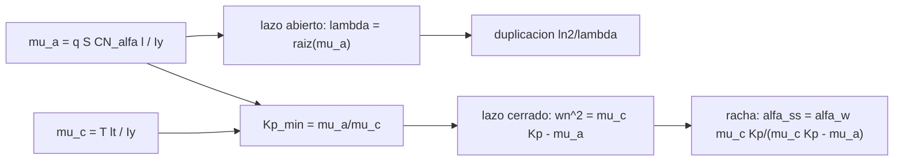

# B77-C23 — Estabilidad de vuelo de lanzadores en ascenso

<!-- nav:top -->
[🏠 Programa](../../../../README.md) · [📚 Bloque B77](../../../tronco-comun/B77-dinamica-de-lanzamiento-y-reentrada.md) · [← Anterior: B77-C22 — Centro de masa y su variación con el consumo de propelente](../B77-C22-centro-de-masa-y-su-variacion-con-el-consumo-de-propelente/CLASE.md) · [Siguiente: B77-C24 — Guiado y control de actitud de lanzadores (TVC) →](../B77-C24-guiado-y-control-de-actitud-de-lanzadores-tvc/CLASE.md)
<!-- /nav -->

## 1. Ubicación, nivel y alcance

Clase 23 del bloque B77. Nivel N3. Muchos lanzadores son aerodinámicamente inestables en una parte del ascenso: su centro de presión queda delante del centro de gravedad y el ángulo de ataque crece por sí solo. Aquí calculas la tasa de divergencia de un lanzador sintético, la ganancia mínima de control que lo estabiliza y el ángulo de ataque que deja una ráfaga constante según la ganancia elegida. Usas [C21](../B77-C21-centro-de-presion-y-margen-estatico/CLASE.md) y [C22](../B77-C22-centro-de-masa-y-su-variacion-con-el-consumo-de-propelente/CLASE.md). El vehículo es inventado.

## 2. Por qué esta clase existe

Un vehículo inestable es controlable si el control es más rápido que la divergencia, pero el control a su vez fija las cargas ante rachas. La decisión central: **¿cuánto control hace falta para estabilizar un lanzador y qué ángulo de ataque deja una racha según la ganancia?**

## 3. Lo que podrás hacer al terminar

1. Escribir el modelo lineal de cabeceo `θ̈ = μ_α α + μ_c δ`.
2. Calcular la tasa de divergencia y el tiempo de duplicación de lazo abierto.
3. Obtener la ganancia proporcional mínima `Kp_min = μ_α/μ_c`.
4. Calcular el estado estacionario ante una racha y la carga `q·α`.
5. Comprobar numéricamente divergencia, estabilización y estado estacionario.
6. Separar lo consultado (criterio de estabilidad) de lo inventado (vehículo y condiciones).

La evidencia es la **ficha de estabilidad en ascenso** del ejercicio 12 (sección 20).

## 4. Con qué llegas y cómo comprobarlo

1. ¿Qué es una raíz positiva de la ecuación característica?
2. ¿Qué es el ángulo de ataque inducido por una racha?
3. ¿Qué es la deflexión de la tobera?
4. ¿Qué es un control proporcional-derivativo?
5. ¿Qué es el estado estacionario?

<details>
<summary>Ver respuestas</summary>

1. Un modo cuya amplitud crece exponencialmente. 2. `α_w ≈ w/V`, el ángulo que forma el viento lateral con la velocidad. 3. El giro del motor que desvía el empuje y genera un momento. 4. Una ley que combina el error y su derivada: `δ = −Kp θ − Kd θ̇`. 5. El valor al que tiende una respuesta cuando cesa el transitorio.
</details>

Con cuatro o cinco aciertos, sigue; si no, repasa los prerrequisitos.

## 5. Un caso de contexto y casos de referencia

Un lanzador sintético cerca de max-q (`q = 35 kPa`, centro de presión `1,5 m` delante del de gravedad) tiene `μ_α = 0,928 s⁻²`: sin control, el ángulo se duplica cada `0,72 s` y se amplifica `7,6e+03` veces en 10 s. Con `μ_c = 21,3 s⁻²` (tobera), la ganancia mínima es `Kp_min = 0,0435`. Ante una racha de `20 m/s` (`α_w = 2,86°`), con `Kp = 2·Kp_min` el ángulo de ataque llega al doble de `α_w`; con `8·Kp_min`, a `1,14` veces. Es el **ejemplo conductor**; el vehículo es **inventado**.

## 6. Vocabulario

La **inestabilidad aerodinámica** ocurre si el centro de presión va delante del de gravedad (`μ_α > 0`). La **eficacia de control** `μ_c = T·l_t/I_y` mide el momento por radián de tobera. La **ganancia mínima** `Kp_min = μ_α/μ_c` es la que anula la rigidez negativa. El **control de actitud fija** mantiene `θ = 0`; la **carga ante racha** es `q·α`. Un **estado estacionario** es el valor al que tiende la respuesta.

## 7. Modelo mental



*Descripción textual:* la rigidez aerodinámica negativa da la divergencia de lazo abierto; la eficacia de control da la ganancia mínima; con ganancia mayor, el lazo cerrado es estable y fija el ángulo de ataque ante una racha.

Analogía: equilibrar un palo sobre la mano: solo se mantiene si la mano reacciona más rápido que lo que el palo cae, y cuanto más rígida es la mano, más obliga al palo a seguir el movimiento brusco del viento. Límite: aquí los coeficientes se congelan y no hay flexión ni oleaje.

## 8. La explicación, paso a paso

### 8.1 Divergencia de lazo abierto

`θ̈ = μ_α α` con `α = θ` (sin viento) tiene raíces `s = ±√μ_α`: `λ = 0,9632 s⁻¹`, duplicación `ln 2/λ = 0,7197 s`. La integración RK4 da `0,7197 s` (error `2e-05`). Con la NASA Glenn: si el centro de presión queda del lado de la nariz respecto del centro de gravedad, el par es desestabilizador.

### 8.2 Ganancia mínima

Con `δ = −Kp θ − Kd θ̇`, la ecuación es `θ̈ + μ_c Kd θ̇ + (μ_c Kp − μ_α) θ = 0`. Estable si `μ_c Kp > μ_α`: `Kp_min = 0,04348`. Con `0,5·Kp_min` y `Kd = 0,5` queda una raíz positiva pequeña (`0,0433 s⁻¹`) y el ángulo crece `1,54` veces en 10 s: divergencia lenta.

### 8.3 Racha constante

Con una racha `α_w = w/V`, y `θ_ref = 0`: `α_ss = α_w·μ_c Kp/(μ_c Kp − μ_α)`.

| `Kp/Kp_min` | `Kp` | `Kd` (ζ = 0,7) | `ω_n` (rad/s) | `α_ss/α_w` | `δ` (°) | `q·α` (kPa·rad) |
|---|---|---|---|---|---|---|
| 1,5 | 0,0652 | 0,045 | 0,681 | 3,000 | -0,374 | 5,25 |
| 2,0 | 0,0870 | 0,063 | 0,963 | 2,000 | -0,249 | 3,50 |
| 4,0 | 0,1739 | 0,109 | 1,668 | 1,333 | -0,166 | 2,33 |
| 8,0 | 0,3479 | 0,167 | 2,548 | 1,143 | -0,142 | 2,00 |

La simulación coincide con la fórmula (error máximo `2e-07`). Una ganancia justo por encima del mínimo deja un ángulo de ataque varias veces mayor que `α_w`; ganancias mayores se acercan a `α_w`, es decir, a mantener la actitud pase lo que pase.

### 8.4 Compromisos

La ganancia alta mantiene la actitud pero deja la carga `q·α_w = 1,75 kPa·rad` como mínimo; la ganancia baja reduce la rigidez, pero exige una tobera lenta y deja el ángulo de ataque mayor. El alivio de carga (dejar que el vehículo «se oriente con el viento») reduce `q·α` a costa de desviar la trayectoria. Todas las deflexiones del cuadro cumplen el límite ilustrativo de 5°.

## 9. Magnitudes, símbolos y unidades

| Símbolo | Qué es | Unidad | Valor / nota |
|---|---|---|---|
| `μ_α` | rigidez aerodinámica (negativa de estabilidad) | s⁻² | 0,9277 |
| `μ_c` | eficacia de control | s⁻² | 21,33 |
| `λ` | tasa de divergencia | s⁻¹ | 0,9632 |
| `Kp_min` | ganancia proporcional mínima | rad/rad | 0,04348 |
| `α_w` | ángulo inducido por la racha | ° | 2,865 |
| `q` | presión dinámica | kPa | 35 (ilustrativa) |

## 10. Convenciones y referencias

Plano de cabeceo con coeficientes congelados; `α = θ + w/V`; `l = 1,5 m` con el centro de presión delante del de gravedad. Criterio de la NASA Glenn; vehículo, `q`, `V`, empuje, brazo y límite inventados.

## 11. De dónde sale lo que afirmamos

| ID | Fuente | Localizador | Respalda | Estado |
|---|---|---|---|---|
| S1 | NASA Glenn, Rocket Stability — https://www1.grc.nasa.gov/beginners-guide-to-aeronautics/rocket-stability/ (consultada 2026-11-10) | página completa | centro de presión delante del de gravedad produce par desestabilizador y el desplazamiento crece | Consultada |
| S2 | NASA Glenn, Drag Coefficient — https://www1.grc.nasa.gov/beginners-guide-to-aeronautics/drag-coefficient/ (consultada 2026-11-10) | página completa | q = ρV²/2 | Consultada |
| — | Modelo lineal de cabeceo, raíces características y respuesta en estado estacionario | — | las verifica el laboratorio con una segunda vía | No consultada en una fuente concreta |

Límites: coeficientes congelados, sin flexión, oleaje ni actuador; vehículo inventado; no se consultó ninguna referencia de control de lanzadores.

## 12. Cómo ver el resultado

| Magnitud | Valor |
|---|---|
| `λ`; duplicación | 0,9632 s⁻¹; 0,7197 s |
| `Kp_min` | 0,04348 |
| amplificación en 10 s sin control | 7,62e+03 |
| `α_ss/α_w` con 2 y 8 `Kp_min` | 2,00; 1,14 |
| error del estado estacionario | 2e-07 |

Descripción larga: sin control el ángulo se duplica en menos de un segundo; con una ganancia modesta se estabiliza, pero el ángulo de ataque ante una racha puede ser varias veces el de la racha.

## 13. Ejemplo trabajado: la ganancia mínima

**Paso 1 · Rigidez.** `μ_α = 35 000 × 1,767 × 3,0 × 1,5/(3·10⁵) = 0,9277 s⁻²`.

**Paso 2 · Eficacia.** `μ_c = 800 000 × 8/(3·10⁵) = 21,33 s⁻²`.

**Paso 3 · Cociente.** `Kp_min = 0,9277/21,33 = 0,04348`.

## 14. Distintas formas de describir el resultado

**Por ecuación:** `θ̈ = μ_α α + μ_c δ`. **Por raíces:** `λ`. **Por ganancia:** `Kp_min`. **Por tabla:** `α_ss/α_w`. **Por carga:** `q α`.

## 15. Práctica guiada

**Ejercicio 1 · con los pasos indicados.** Calcula `λ` si `μ_α = 1,0 s⁻²`. *Pasos:* raíz cuadrada.

<details><summary>Solución comentada</summary>

`1,0 s⁻¹`; duplicación `0,693 s`.
</details>

**Ejercicio 2 · con una pista.** Duplicación para `μ_α = 0,25`. *Pista:* `ln 2/√μ_α`.

<details><summary>Solución comentada</summary>

`1,386 s`.
</details>

**Ejercicio 3 · casi autónomo.** ¿Por qué `Kp > μ_α/μ_c` estabiliza?

<details><summary>Solución comentada</summary>

Porque la rigidez neta `μ_c Kp − μ_α` pasa a ser positiva y el sistema oscila en lugar de divergir.
</details>

## 16. Práctica autónoma, transferencia e integrador

**Ejercicio 4 · autónomo.** `α_ss/α_w` con `Kp = 3 Kp_min`.

<details><summary>Solución comentada</summary>

`3/(3 − 1) = 1,5`.
</details>

**Ejercicio 5 · autónomo.** `α_ss` con ese `Kp` y `α_w = 2,865°`.

<details><summary>Solución comentada</summary>

`4,30°`.
</details>

**Ejercicio 6 · autónomo.** `q·α` para `α = 3°` y `q = 35 kPa`.

<details><summary>Solución comentada</summary>

`35 000 × 0,05236 = 1833 Pa·rad`.
</details>

**Ejercicio 7 · autónomo.** `ω_n` con `Kp = 4 Kp_min`.

<details><summary>Solución comentada</summary>

`√(μ_c Kp − μ_α) = 1,668 rad/s`.
</details>

**Ejercicio 8 · autónomo.** `Kd` para `ζ = 0,7` con `ω_n = 1,668`.

<details><summary>Solución comentada</summary>

`2 × 0,7 × 1,668/21,33 = 0,109`.
</details>

**Ejercicio 9 · transferencia.** **Transferencia.** Un documento afirma que un lanzador 'es controlable'. ¿Qué falta?

<details><summary>Solución comentada</summary>

La ganancia, el ancho de banda del actuador, el rango de Mach y las rachas consideradas.
</details>

**Ejercicio 10 · transferencia.** **Transferencia.** Un colega fija `Kp` para max-q y lo mantiene todo el vuelo. ¿Qué riesgo?

<details><summary>Solución comentada</summary>

`μ_α` y `μ_c` cambian con `q` y con la masa; la ganancia puede quedar bajo el mínimo o ser excesiva.
</details>

**Ejercicio 11 · transferencia.** **Transferencia.** ¿Qué cambia si el actuador tiene retraso?

<details><summary>Solución comentada</summary>

El retraso resta fase y limita la ganancia máxima y la frecuencia de cruce.
</details>

**Ejercicio 12 · integrador.** **Integrador.** Elabora tu *ficha de estabilidad en ascenso*: `μ_α`, `μ_c`, `λ`, `Kp_min`, tabla de respuesta ante racha y lista de qué es consultado e inventado.

<details><summary>Solución comentada</summary>

Secciones 8.1–8.4 y la salida del laboratorio.
</details>

## 17. Laboratorio: divergencia, ganancia mínima y racha

El script [estabilidad_ascenso.py](estabilidad_ascenso.py) integra el modelo lineal de cabeceo de un lanzador inestable en lazo abierto y cerrado y contrasta divergencia, ganancia y estado estacionario con las fórmulas (**comprueba** duplicación < 1e-3, estado estacionario < 1e-3 y divergencia bajo la ganancia mínima).

**Datos:** el criterio de la NASA Glenn consultado; todo lo demás **inventado**. **Predice antes de ejecutar:** ¿en cuánto tiempo se duplica el ángulo sin control? (0,72 s.) **Ejecución del 2026-11-10 (Python 3.12.9):**

```text
Python 3.12.9 (biblioteca estandar)
Lanzador SINTETICO cerca de max-q: mu_a = 0.9277 1/s2 (inestable), mu_c = 21.333 1/s2; racha alfa_w = w/V = 2.865 grados
Lazo abierto: lambda = 0.9632 1/s; duplicacion asintotica analitica = 0.7197 s; numerica = 0.7197 s (error 2.3e-05); amplificacion en 10 s desde reposo = 7.62e+03
Ganancia proporcional minima Kp_min = mu_a/mu_c = 0.04348 rad/rad; con 0.5 Kp_min (y Kd = 0.5) el angulo se amplifica 1.54 veces en 10 s; tasa asintotica numerica 0.0433 1/s frente a la raiz positiva 0.0433 1/s
Racha constante con control PD (zeta = 0.7) - estado estacionario:
  Kp/Kp_min   Kp       Kd      wn [rad/s]  alfa_ss/alfa_w   alfa_ss [grados]  delta [grados]  q*alfa [kPa*rad]  respeta 5 grados
      1.5   0.0652   0.045      0.681        3.0000         8.594        -0.374         5.250  si
      2.0   0.0870   0.063      0.963        2.0000         5.730        -0.249         3.500  si
      4.0   0.1739   0.109      1.668        1.3333         3.820        -0.166         2.333  si
      8.0   0.3479   0.167      2.548        1.1429         3.274        -0.142         2.000  si
Error relativo maximo del estado estacionario frente a la formula = 1.8e-07
Pruebas superadas.
```

```bash
python programa/clases/B77/B77-C23-estabilidad-de-vuelo-de-lanzadores-en-ascenso/estabilidad_ascenso.py
```

**Límites:** coeficientes congelados, sin flexión, sin oleaje, actuador ideal, trayectoria fija.

## 18. Errores frecuentes y cómo corregirlos

**Suponer que un vehículo inestable es incontrolable.** Se corrige con 8.2.

**Elegir la ganancia solo por rapidez, sin ver la carga ante rachas.** Se corrige con 8.3.

**Olvidar que `μ_α` y `μ_c` cambian durante el vuelo.** Se corrige con el ejercicio 10.

**Dar el vehículo inventado como real.** Se corrige con la sección 10.

## 19. Cómo sabrás que vas bien

Tras la sección 8: ¿qué `Kp_min` esperabas y cuál obtuviste? Si dudas, repasa el ejemplo 13. Tras el laboratorio: ¿qué comprueba? (ver la sección 17).

## 20. Qué entregas y cómo se evalúa

El producto es tu **ficha de estabilidad en ascenso** (ejercicio 12).

| Criterio | Inicial | En desarrollo | Logrado | Destacado |
|---|---|---|---|---|
| Conceptos | Los confunde | Parciales | Aplica el modelo con sus supuestos | Explica los límites |
| Cálculo | Sin unidades | Con errores | Tablas completas con unidades | Calcula casos nuevos |
| Numérico | Sin comprobar | Un caso | Contraste con una segunda vía | Interpreta las diferencias |
| Fuentes | Sin fuente | Sin fecha | Fuentes con fecha y estado | Declara lo ilustrativo y lo no consultado |
| Límites | No los nombra | Uno | Tres | Discute qué falta del modelo |

**Condiciones críticas (no se compensan con promedio):** rotular el vehículo como inventado; no presentar el análisis como el de un lanzador real; citar solo lo consultado.

## 21. Ética, seguridad y límites

Clase educativa: los modelos son simplificados y sus datos son sintéticos o ilustrativos; ningún resultado describe un vehículo real ni sustituye al análisis de seguridad, a la certificación o a los documentos del operador. Nada de lo simulado se presenta como observado ni como datos de vuelo. Accesibilidad: tablas equivalentes a las gráficas, fórmulas en texto, ejercicios sin conexión.

## 22. Para cerrar y seguir

Sin control, el lanzador sintético duplica su ángulo en `0,72 s`; con `Kp ≥ 0,043` se estabiliza, y una ganancia modesta deja un ángulo de ataque ante racha de hasta el doble. Queda una pregunta: ¿cómo se diseñan esas ganancias?

**Glosario español–inglés.** inestabilidad aerodinámica · *aerodynamic instability*; ganancia · *gain*; racha · *gust*; deflexión de la tobera · *nozzle deflection*; estado estacionario · *steady state*.

**Continuidad.** [siguiente]

**Referencias:** ver sección 11.

<!-- nav:bottom -->
---

[← Anterior: B77-C22 — Centro de masa y su variación con el consumo de propelente](../B77-C22-centro-de-masa-y-su-variacion-con-el-consumo-de-propelente/CLASE.md) · [📚 Bloque B77](../../../tronco-comun/B77-dinamica-de-lanzamiento-y-reentrada.md) · [Siguiente: B77-C24 — Guiado y control de actitud de lanzadores (TVC) →](../B77-C24-guiado-y-control-de-actitud-de-lanzadores-tvc/CLASE.md)
<!-- /nav -->
