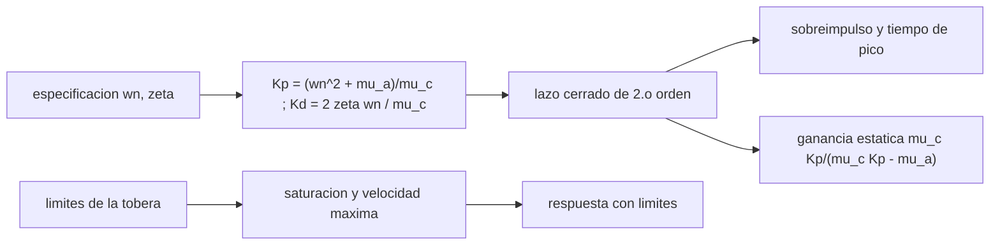

# B77-C24 — Guiado y control de actitud de lanzadores (TVC)

<!-- nav:top -->
[🏠 Programa](../../../../README.md) · [📚 Bloque B77](../../../tronco-comun/B77-dinamica-de-lanzamiento-y-reentrada.md) · [← Anterior: B77-C23 — Estabilidad de vuelo de lanzadores en ascenso](../B77-C23-estabilidad-de-vuelo-de-lanzadores-en-ascenso/CLASE.md) · [Siguiente: B77-C25 — Corredores de entrada y límites de trayectoria →](../B77-C25-corredores-de-entrada-y-limites-de-trayectoria/CLASE.md)
<!-- /nav -->

## 1. Ubicación, nivel y alcance

Clase 24 del bloque B77. Nivel N3. El control por vector de empuje (TVC) gira la tobera para generar un momento que mantiene la actitud del lanzador. Aquí diseñas un controlador proporcional-derivativo para la planta inestable de [C23](../B77-C23-estabilidad-de-vuelo-de-lanzadores-en-ascenso/CLASE.md), verificas el sobreimpulso y el tiempo de pico contra la teoría de segundo orden y ves qué pasa cuando la tobera llega a su límite. No es un sistema real: la planta, los límites y la especificación son inventados.

## 2. Por qué esta clase existe

El control de un lanzador inestable debe ser lo bastante rápido para estabilizarlo y lo bastante suave para no saturar la tobera. La decisión central: **¿qué ganancias cumplen una especificación dada y qué ocurre cuando la demanda supera los límites del actuador?**

## 3. Lo que podrás hacer al terminar

1. Deducir el lazo cerrado `θ̈ + μ_c Kd θ̇ + (μ_c Kp − μ_α)θ = μ_c Kp θ_c`.
2. Diseñar `Kp` y `Kd` para una `ω_n` y una `ζ` especificadas.
3. Verificar sobreimpulso y tiempo de pico con las fórmulas de segundo orden.
4. Calcular la ganancia estática y explicar por qué no es 1 en una planta inestable.
5. Simular la saturación y el límite de velocidad de la tobera.
6. Separar lo consultado (criterio de estabilidad) de lo inventado (planta, límites).

La evidencia es la **ficha de diseño de control TVC** del ejercicio 12 (sección 20).

## 4. Con qué llegas y cómo comprobarlo

1. ¿Qué es la frecuencia natural `ω_n`?
2. ¿Qué es la razón de amortiguamiento `ζ`?
3. ¿Qué es el sobreimpulso?
4. ¿Qué es la saturación de un actuador?
5. ¿Qué es la ganancia estática?

<details>
<summary>Ver respuestas</summary>

1. La frecuencia de oscilación sin amortiguamiento, en rad/s. 2. La relación entre el amortiguamiento y el crítico. 3. El exceso del pico respecto del valor final, en porcentaje. 4. El tope de deflexión (o de velocidad) que puede dar. 5. La relación entre salida final y entrada constante.
</details>

Con cuatro o cinco aciertos, sigue; si no, repasa los prerrequisitos.

## 5. Un caso de contexto y casos de referencia

Para una planta sintética inestable (`μ_α = 0,9277 s⁻²`, `μ_c = 21,33 s⁻²`) y la especificación `ω_n = 1,5 rad/s`, `ζ = 0,7`, las ganancias son `Kp = 0,1490` y `Kd = 0,0984`. Un escalón de `1°` da sobreimpulso `4,61 %` (teoría: `4,60 %`) y pico a los `2,93 s`; el valor final es `1,412` veces el comando. Con límites inventados de `0,6°` y `3°/s`, un comando de `10°` satura la tobera y el vehículo diverge. Es el **ejemplo conductor**; es **inventado**.

## 6. Vocabulario

El **control PD** usa el error y su derivada: `δ = Kp(θ_c − θ) − Kd θ̇`. La **frecuencia natural** de lazo cerrado es `ω_n² = μ_c Kp − μ_α`. La **razón de amortiguamiento** es `ζ = μ_c Kd/(2ω_n)`. El **sobreimpulso** es `exp(−πζ/√(1−ζ²))`. La **saturación** y el **límite de velocidad** son topes del actuador.

## 7. Modelo mental



*Descripción textual:* la especificación fija las ganancias; el lazo cerrado es un sistema de segundo orden con sobreimpulso, tiempo de pico y ganancia estática conocidos; los límites de la tobera pueden romper ese comportamiento.

Analogía: conducir con la dirección asistida limitada: con giros pequeños todo responde como se espera; si se pide un giro mayor que el tope, el coche deja de obedecer. Límite: el actuador real tiene dinámica, retraso y holguras; aquí solo se modelan tope y velocidad máxima.

## 8. La explicación, paso a paso

### 8.1 Lazo cerrado

Con `δ = Kp(θ_c − θ) − Kd θ̇` y `θ̈ = μ_α θ + μ_c δ`: `θ̈ + μ_c Kd θ̇ + (μ_c Kp − μ_α)θ = μ_c Kp θ_c`. Entonces `ω_n² = μ_c Kp − μ_α` y `2ζω_n = μ_c Kd`.

### 8.2 Diseño

Para `ω_n = 1,5` y `ζ = 0,7`: `Kp = (ω_n² + μ_α)/μ_c = (2,25 + 0,9277)/21,333 = 0,14896` (mínimo `0,04349`) y `Kd = 2ζω_n/μ_c = 0,09844`. La verificación del lazo cerrado da `ω_n = 1,5000` y `ζ = 0,7000`.

### 8.3 Respuesta al escalón

La ganancia estática es `μ_c Kp/(μ_c Kp − μ_α) = 1,4123`: el vehículo termina a `1,412` veces el comando, porque el control proporcional debe vencer además la rigidez aerodinámica negativa. Un control real añade integrador o realimentación de la dirección de vuelo. Para `1°`: valor final `1,4123°` (teoría `1,4123°`), sobreimpulso `4,605 %` (`4,599 %`), pico a `2,931 s` (`2,933 s`). Los errores son `1e-03`, `6e-04` y `2e-07`.

### 8.4 Límites del actuador

| Comando (°) | Tobera pico, lineal (°) | Tobera pico, con límites (°) | ¿Satura? | Actitud final con límites (°) | ¿Estable? |
|---|---|---|---|---|---|
| 1 | 0,149 | 0,142 | no | 1,412 | sí |
| 5 | 0,745 | 0,600 | sí | 7,062 | sí |
| 10 | 1,490 | 0,600 | sí | diverge | NO |

Con `1°` el límite no actúa. Con `5°` satura brevemente pero la respuesta se recupera. Con `10°` la demanda de `1,49°` supera el tope de `0,6°` y, como la planta es inestable, el momento disponible no basta: el ángulo diverge. Un sistema inestable tiene una región de atracción acotada por la autoridad de control.

## 9. Magnitudes, símbolos y unidades

| Símbolo | Qué es | Unidad | Valor / nota |
|---|---|---|---|
| `Kp` | ganancia proporcional | rad/rad | 0,14896 |
| `Kd` | ganancia derivativa | rad·s/rad | 0,09844 |
| `ω_n`, `ζ` | especificación | rad/s, — | 1,5; 0,7 (inventada) |
| `μ_α`, `μ_c` | rigidez y eficacia | s⁻² | 0,9277; 21,333 (inventadas) |
| `δ_max`, `δ̇_max` | límites de la tobera | °, °/s | 0,6; 3 (inventados) |
| ganancia estática | salida/comando | — | 1,4123 |

## 10. Convenciones y referencias

Plano de cabeceo, coeficientes congelados, planta de C23; SI. Criterio cualitativo de la NASA Glenn; planta, especificación y límites inventados; no se consultó literatura de control de lanzadores.

## 11. De dónde sale lo que afirmamos

| ID | Fuente | Localizador | Respalda | Estado |
|---|---|---|---|---|
| S1 | NASA Glenn, Rocket Stability — https://www1.grc.nasa.gov/beginners-guide-to-aeronautics/rocket-stability/ (consultada 2026-11-10) | página completa | par restaurador estabiliza y par desestabilizador amplifica el desplazamiento | Consultada |
| — | Sistema de segundo orden: sobreimpulso exp(−πζ/√(1−ζ²)) y tiempo de pico π/(ω_n√(1−ζ²)) | — | las verifica el laboratorio con una segunda vía | No consultada en una fuente concreta |

Límites: sin actuador dinámico, sin retraso, sin flexión ni oleaje; límites muy pequeños e inventados; no se consultó ninguna referencia de control de lanzadores; no es un diseño operativo.

## 12. Cómo ver el resultado

| Magnitud | Valor |
|---|---|
| `Kp`; `Kd` | 0,1490; 0,0984 |
| sobreimpulso (numérico; teoría) | 4,605 %; 4,599 % |
| tiempo de pico (numérico; teoría) | 2,931 s; 2,933 s |
| ganancia estática | 1,4123 |
| comando de 10° con límites | diverge |

Descripción larga: con las ganancias de diseño la respuesta sigue la teoría de segundo orden; cuando la demanda supera los límites de la tobera, un sistema inestable pierde la actitud.

## 13. Ejemplo trabajado: el diseño de ganancias

**Paso 1 · Rigidez deseada.** `ω_n² = 2,25 s⁻²`; se suma `μ_α = 0,9277` para anular la rigidez negativa: `3,1777`.

**Paso 2 · `Kp`.** `3,1777/21,333 = 0,14896`.

**Paso 3 · `Kd`.** `2 × 0,7 × 1,5/21,333 = 0,09844`.

## 14. Distintas formas de describir el resultado

**Por especificación:** `ω_n`, `ζ`. **Por ganancias:** `Kp`, `Kd`. **Por respuesta:** sobreimpulso y pico. **Por tabla:** límites. **Por estabilidad:** región de atracción.

## 15. Práctica guiada

**Ejercicio 1 · con los pasos indicados.** Calcula `Kp` para `ω_n = 2` con `μ_α = 0,9277`, `μ_c = 21,33`. *Pasos:* `(ω_n² + μ_α)/μ_c`.

<details><summary>Solución comentada</summary>

`4,9277/21,33 = 0,2310`.
</details>

**Ejercicio 2 · con una pista.** Calcula `Kd` para `ζ = 0,5` y `ω_n = 2`. *Pista:* `2ζω_n/μ_c`.

<details><summary>Solución comentada</summary>

`2/21,33 = 0,0938`.
</details>

**Ejercicio 3 · casi autónomo.** ¿Por qué la ganancia estática no es 1?

<details><summary>Solución comentada</summary>

Porque el control proporcional debe contrarrestar también el momento aerodinámico desestabilizador; sin integrador queda un error.
</details>

## 16. Práctica autónoma, transferencia e integrador

**Ejercicio 4 · autónomo.** Sobreimpulso para `ζ = 0,5`.

<details><summary>Solución comentada</summary>

`exp(−π·0,5/0,866) = 16,3 %`.
</details>

**Ejercicio 5 · autónomo.** Tiempo de pico para `ω_n = 1,5`, `ζ = 0,7`.

<details><summary>Solución comentada</summary>

`π/(1,5 × 0,714) = 2,933 s`.
</details>

**Ejercicio 6 · autónomo.** ¿Qué pasa si `Kp` baja al mínimo?

<details><summary>Solución comentada</summary>

`ω_n → 0`: el lazo queda al borde de la inestabilidad y es muy lento.
</details>

**Ejercicio 7 · autónomo.** Tobera necesaria para un comando de 5° (lineal).

<details><summary>Solución comentada</summary>

`0,745°`.
</details>

**Ejercicio 8 · autónomo.** ¿Por qué la saturación puede destruir la estabilidad de una planta inestable?

<details><summary>Solución comentada</summary>

Porque la autoridad de control es finita: si el momento aerodinámico crece más que el máximo que da la tobera, no hay recuperación.
</details>

**Ejercicio 9 · transferencia.** **Transferencia.** Un informe da 'ancho de banda 1,5 rad/s' sin más. ¿Qué falta?

<details><summary>Solución comentada</summary>

Margen de ganancia y de fase, retraso del actuador y rango de condiciones de vuelo.
</details>

**Ejercicio 10 · transferencia.** **Transferencia.** Un colega añade ganancia sin límite para 'acelerar' la respuesta. ¿Qué riesgo?

<details><summary>Solución comentada</summary>

Saturación, excitación de modos flexibles y de oleaje, y retraso que desestabiliza.
</details>

**Ejercicio 11 · transferencia.** **Transferencia.** ¿Qué falta para pasar de este diseño a uno operativo?

<details><summary>Solución comentada</summary>

Actuador real, estimación de estado, flexión, oleaje, programación de ganancias y verificación en todo el vuelo.
</details>

**Ejercicio 12 · integrador.** **Integrador.** Elabora tu *ficha de diseño de control TVC*: ganancias, verificación contra la teoría, ganancia estática, tabla de límites y lista de qué es consultado e inventado.

<details><summary>Solución comentada</summary>

Secciones 8.1–8.4 y la salida del laboratorio.
</details>

## 17. Laboratorio: diseño PD de un control de actitud TVC

El script [control_tvc.py](control_tvc.py) diseña `Kp` y `Kd` para una especificación, simula el escalón sin y con límites del actuador y contrasta con la teoría de segundo orden (**comprueba** sobreimpulso < 2e-2, tiempo de pico < 5e-3 y valor final < 1e-4).

**Datos:** el criterio de la NASA Glenn consultado; planta, especificación y límites **inventados**. **Predice antes de ejecutar:** ¿cuántas veces el comando es el valor final? (1,41.) **Ejecución del 2026-11-10 (Python 3.12.9):**

```text
Python 3.12.9 (biblioteca estandar)
Planta SINTETICA: mu_a = 0.9277 1/s2 (inestable), mu_c = 21.333 1/s2; especificacion wn = 1.5 rad/s, zeta = 0.7
Ganancias: Kp = 0.14896 (minimo 0.04349), Kd = 0.09844; lazo cerrado verificado: wn = 1.5000, zeta = 0.7000; ganancia estatica = 1.4123
Escalon de 1 grado (lineal): valor final = 1.4123 grados (analitico 1.4123; error 1.9e-07); sobreimpulso = 4.605 % (analitico 4.599 %; error 1.4e-03); tiempo de pico = 2.931 s (analitico 2.933 s; error 5.9e-04)
 comando  tobera pico lineal  tobera pico con limites  sobreimp. lineal  sobreimp. con limites  final con limites  satura  respuesta estable
   1.0          0.149               0.142             4.61 %            4.60 %           1.412      no     si
   5.0          0.745               0.600             4.61 %            4.59 %           7.062      si     si
  10.0          1.490               0.600             4.61 %             n/d %         diverge      si     NO
Pruebas superadas.
```

```bash
python programa/clases/B77/B77-C24-guiado-y-control-de-actitud-de-lanzadores-tvc/control_tvc.py
```

**Límites:** actuador sin dinámica, coeficientes congelados, sin flexión ni oleaje; límites inventados.

## 18. Errores frecuentes y cómo corregirlos

**Esperar ganancia estática 1 con una planta inestable.** Se corrige con 8.3.

**Ignorar los límites del actuador.** Se corrige con 8.4.

**Diseñar con `Kp` bajo el mínimo.** Se corrige con el ejercicio 6.

**Presentar el diseño inventado como operativo.** Se corrige con la sección 10.

## 19. Cómo sabrás que vas bien

Tras la sección 8: ¿qué sobreimpulso esperabas y cuál obtuviste? Si dudas, repasa el ejemplo 13. Tras el laboratorio: ¿qué comprueba? (ver la sección 17).

## 20. Qué entregas y cómo se evalúa

El producto es tu **ficha de diseño de control TVC** (ejercicio 12).

| Criterio | Inicial | En desarrollo | Logrado | Destacado |
|---|---|---|---|---|
| Conceptos | Los confunde | Parciales | Aplica el modelo con sus supuestos | Explica los límites |
| Cálculo | Sin unidades | Con errores | Tablas completas con unidades | Calcula casos nuevos |
| Numérico | Sin comprobar | Un caso | Contraste con una segunda vía | Interpreta las diferencias |
| Fuentes | Sin fuente | Sin fecha | Fuentes con fecha y estado | Declara lo ilustrativo y lo no consultado |
| Límites | No los nombra | Uno | Tres | Discute qué falta del modelo |

**Condiciones críticas (no se compensan con promedio):** rotular la planta, la especificación y los límites como inventados; no presentar el diseño como operativo; citar solo lo consultado.

## 21. Ética, seguridad y límites

Clase educativa: los modelos son simplificados y sus datos son sintéticos o ilustrativos; ningún resultado describe un vehículo real ni sustituye al análisis de seguridad, a la certificación o a los documentos del operador. Nada de lo simulado se presenta como observado ni como datos de vuelo. Accesibilidad: tablas equivalentes a las gráficas, fórmulas en texto, ejercicios sin conexión.

## 22. Para cerrar y seguir

Con `Kp = 0,149` y `Kd = 0,098` el lazo sigue la teoría de segundo orden, pero un comando de `10°` satura la tobera y diverge. Queda una pregunta: ¿qué corredor de trayectoria debe respetar el vehículo al volver?

**Glosario español–inglés.** control de vector de empuje · *thrust vector control*; ganancia proporcional · *proportional gain*; sobreimpulso · *overshoot*; saturación · *saturation*; región de atracción · *region of attraction*.

**Continuidad.** [siguiente]

**Referencias:** ver sección 11.

<!-- nav:bottom -->
---

[← Anterior: B77-C23 — Estabilidad de vuelo de lanzadores en ascenso](../B77-C23-estabilidad-de-vuelo-de-lanzadores-en-ascenso/CLASE.md) · [📚 Bloque B77](../../../tronco-comun/B77-dinamica-de-lanzamiento-y-reentrada.md) · [Siguiente: B77-C25 — Corredores de entrada y límites de trayectoria →](../B77-C25-corredores-de-entrada-y-limites-de-trayectoria/CLASE.md)
<!-- /nav -->
