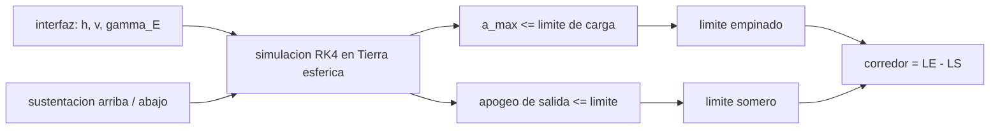

# B77-C25 — Corredores de entrada y límites de trayectoria

<!-- nav:top -->
[🏠 Programa](../../../../README.md) · [📚 Bloque B77](../../../tronco-comun/B77-dinamica-de-lanzamiento-y-reentrada.md) · [← Anterior: B77-C24 — Guiado y control de actitud de lanzadores (TVC)](../B77-C24-guiado-y-control-de-actitud-de-lanzadores-tvc/CLASE.md) · [Siguiente: B78-C01 — Empuje e impulso específico →](../../B78/B78-C01-empuje-e-impulso-especifico/CLASE.md)
<!-- /nav -->

## 1. Ubicación, nivel y alcance

Clase 25 del bloque B77. Nivel N3. Un vehículo que regresa a gran velocidad solo puede entrar con un ángulo de trayectoria dentro de una franja: demasiado empinado y la desaceleración supera el límite; demasiado somero y rebota o queda en una órbita demasiado alta. Aquí calculas, con una simulación completa en Tierra esférica, los dos límites de esa franja (el corredor de entrada) para un vehículo sintético balístico y otro con sustentación, y los contrastas con la estimación simple de [C14](../B77-C14-dinamica-de-reentrada/CLASE.md). Los límites de la misión son inventados.

## 2. Por qué esta clase existe

El corredor es la tolerancia que se le deja a la navegación y a la guía antes de entrar. La decisión central: **¿entre qué ángulos puede entrar el vehículo, cuánto ensancha el corredor la sustentación y cuándo falla la estimación de Allen–Eggers?**

## 3. Lo que podrás hacer al terminar

1. Definir los límites de carga (empinado) y de captura (somero) de un corredor.
2. Calcularlos por bisección sobre una simulación RK4 en Tierra esférica.
3. Expresar el corredor en grados y en altitud de perigeo kepleriano.
4. Comparar el vehículo balístico con el que tiene sustentación.
5. Contrastar el límite de carga con la estimación de Allen–Eggers y explicar la diferencia.
6. Separar lo consultado (resumen de Allen–Eggers, atmósfera) de lo no consultado (`μ`, criterios de misión) y de lo inventado.

La evidencia es la **ficha de corredor de entrada** del ejercicio 12 (sección 20).

## 4. Con qué llegas y cómo comprobarlo

1. ¿Qué es el ángulo de entrada?
2. ¿Qué es la sustentación en una entrada?
3. ¿Qué es una bisección?
4. ¿Qué es el apogeo de salida?
5. ¿Qué es la aceleración centrífuga relativa?

<details>
<summary>Ver respuestas</summary>

1. El ángulo bajo el horizonte de la velocidad en la interfaz de entrada. 2. Una fuerza perpendicular a la velocidad que alarga o acorta la trayectoria. 3. Un método que reduce a la mitad un intervalo hasta acotar un valor límite. 4. La altitud máxima de la órbita que sigue el vehículo tras salir de la atmósfera. 5. El término `v²/r` que, a gran velocidad, aplana la trayectoria frente a la gravedad.
</details>

Con cuatro o cinco aciertos, sigue; si no, repasa los prerrequisitos.

## 5. Un caso de contexto y casos de referencia

Un vehículo sintético entra a `122 km` y `11 000 m/s` con `β = 400 kg/m²` y límite inventado de `12 g`. Balístico, el corredor va de `4,52°` (captura: apogeo de salida ≤ 20 000 km) a `5,88°` (carga ≤ 12 g): `1,36°`, equivalentes a perigeos keplerianos entre `53` y `81 km`. Con `L/D = 0,3` va de `4,24°` a `7,38°`: `3,13°`. La estimación de Allen–Eggers daría `2,58°` para el límite de carga balístico, menos de la mitad. Es el **ejemplo conductor**; es **inventado**.

## 6. Vocabulario

El **corredor de entrada** es el intervalo de ángulos de entrada aceptables. El **límite empinado** (undershoot) está fijado por la carga o el calentamiento. El **límite somero** (overshoot) está fijado por la captura. El **perigeo kepleriano** es el de la órbita sin atmósfera. La **sustentación arriba/abajo** idealiza el balanceo del vector de sustentación.

## 7. Modelo mental



*Descripción textual:* para cada ángulo de entrada se simula el paso por la atmósfera; el máximo de desaceleración da el límite empinado y el apogeo de salida da el somero; su diferencia es el corredor, que la sustentación ensancha.

Analogía: pasar un vehículo por una puerta estrecha: si se acerca muy de cara se golpea fuerte, si se acerca de refilón rebota. Girar el vector de sustentación equivale a poder ajustar el ángulo en pleno paso. Límite: el balanceo real tiene límites de velocidad y de ángulo, y no se modela el calentamiento.

## 8. La explicación, paso a paso

### 8.1 Modelo

`ṙ = v sin γ`, `θ̇ = v cos γ/r`, `v̇ = −D/m − (μ/r²) sin γ`, `γ̇ = ±(L/m)/v − (μ/r² − v²/r) cos γ/v`, con `D/m = ρv²/(2β)` y `L = (L/D)·D`. A `11 km/s`, `v²/r = 18,6 m/s²` supera a `μ/r² = 9,4 m/s²`: el término centrífugo aplana la trayectoria.

### 8.2 Los dos límites

- **Empinado:** el mayor `|γ_E|` con `a_max ≤ 12 g` (sustentación arriba, que reduce la carga). Balístico: `5,884°`; con `L/D = 0,3`: `7,379°`.
- **Somero:** el menor `|γ_E|` con apogeo de salida ≤ 20 000 km (sustentación abajo, que mete el vehículo en la atmósfera). Balístico: `4,523°`; con `L/D = 0,3`: `4,244°`.

### 8.3 Corredor

| `L/D` | Empinado (°) | Somero (°) | Ancho (°) | Perigeo kepleriano empinado / somero (km) |
|---|---|---|---|---|
| 0 | 5,884 | 4,523 | 1,360 | 52,8 / 81,0 |
| 0,3 | 7,379 | 4,244 | 3,134 | 13,3 / 85,9 |

La sustentación multiplica el ancho por `2,3`. La desaceleración máxima balística crece con el ángulo: `0,1, 7,0, 20,7, 33,2, 49,6, 69,7` g para `3°, 5°, 7°, 9°, 12°, 16°`.

### 8.4 Por qué falla Allen–Eggers aquí

La fórmula `sin γ = 2eH a_lim/v_E²` da `2,58°`, frente a `5,88°` de la simulación. Allen–Eggers supone trayectoria recta y sin gravedad; a `11 km/s` el término `v²/r − μ/r²` incurva la trayectoria hacia arriba y reduce la carga. A `7,8 km/s` (clase C14) la aproximación era mucho mejor. Un corredor real usa siempre simulación completa con atmósfera y guiado.

## 9. Magnitudes, símbolos y unidades

| Símbolo | Qué es | Unidad | Valor / nota |
|---|---|---|---|
| `γ_E` | ángulo de entrada (bajo el horizonte) | ° | 4,52 a 5,88 (balístico) |
| `v_E`, `h_E` | velocidad y altitud de entrada | m/s, km | 11 000; 122 (ilustrativas) |
| `β` | coeficiente balístico | kg/m² | 400 (ilustrativo) |
| `a_lim` | límite de carga | g | 12 (inventado) |
| `L/D` | relación sustentación/arrastre | — | 0; 0,3 (ilustrativos) |
| ancho | del corredor | ° | 1,36; 3,13 |

## 10. Convenciones y referencias

Plano orbital, Tierra esférica no rotante, `R_E` y atmósfera de la NASA/NSSDC, `g₀` del NIST, `μ` **no consultado**. Entrada, `β`, `L/D`, límites de carga y de apogeo, y la idealización de la sustentación, inventados; no se consultó ningún corredor de misión.

## 11. De dónde sale lo que afirmamos

| ID | Fuente | Localizador | Respalda | Estado |
|---|---|---|---|---|
| S1 | Allen y Eggers, NACA Report 1381 (1958) — registro NTRS https://ntrs.nasa.gov/citations/19930091020 (consultado 2026-11-10) | resumen del registro | el pico de desaceleración balística no depende de masa, tamaño ni Cd (solo el resumen) | Consultada (solo el resumen; el PDF no se leyó) |
| S2 | NASA/NSSDC, Earth Fact Sheet — https://nssdc.gsfc.nasa.gov/planetary/factsheet/earthfact.html (consultada 2026-11-10) | ficha completa leída | ρ₀ = 1,217 kg/m³, altura de escala 8,5 km y radio ecuatorial | Consultada |
| S3 | NIST, CODATA 2022, standard acceleration of gravity — https://physics.nist.gov/cgi-bin/cuu/Value?gn (consultada 2026-11-10) | entrada gn | g₀ = 9,80665 m/s² | Consultada |
| S4 | NASA Glenn, Drag Coefficient — https://www1.grc.nasa.gov/beginners-guide-to-aeronautics/drag-coefficient/ (consultada 2026-11-10) | página completa | D = Cd·q·A | Consultada |
| — | Ecuaciones de entrada con sustentación, bisección y órbita kepleriana de salida | — | las verifica el laboratorio con una segunda vía | No consultada en una fuente concreta |

Límites: `μ` no consultado en una fuente; límites de carga, de apogeo y vehículo inventados; la sustentación se idealiza (siempre arriba o abajo), sin calentamiento, sin rotación terrestre y sin guiado real; no se consultó ningún corredor de misión.

## 12. Cómo ver el resultado

| Magnitud | Valor |
|---|---|
| corredor balístico | 4,52° a 5,88° (1,36°) |
| corredor con L/D = 0,3 | 4,24° a 7,38° (3,13°) |
| perigeo (balístico) | 53 a 81 km |
| Allen–Eggers (límite de carga) | 2,58° |
| monotonía de `a_max` | comprobada en 6 ángulos |

Descripción larga: el corredor es de unos pocos grados y la sustentación lo duplica o más; la estimación simple subestima el ángulo límite a velocidades superorbitales.

## 13. Ejemplo trabajado: la estimación de Allen–Eggers

**Paso 1 · Límite.** `a_lim = 12 g = 117,7 m/s²`.

**Paso 2 · Producto.** `2eH a_lim = 2 × 2,71828 × 8500 × 117,7 = 5,44·10⁶`.

**Paso 3 · Cociente.** `sin γ = 5,44·10⁶/11 000² = 0,0450`; `γ = 2,58°`.

**Paso 4 · Contraste.** La simulación da `5,88°`: la aproximación no es válida a esta velocidad.

## 14. Distintas formas de describir el resultado

**Por ángulos:** límites y ancho. **Por perigeo:** altitudes keplerianas. **Por tabla:** `a_max(γ)`. **Por sustentación:** `L/D`. **Por comparación:** Allen–Eggers frente a simulación.

## 15. Práctica guiada

**Ejercicio 1 · con los pasos indicados.** Calcula `a_lim` en m/s² para 8 g. *Pasos:* `8 × 9,80665`.

<details><summary>Solución comentada</summary>

`78,45 m/s²`.
</details>

**Ejercicio 2 · con una pista.** Ancho del corredor balístico. *Pista:* diferencia de límites.

<details><summary>Solución comentada</summary>

`5,884 − 4,523 = 1,360°`.
</details>

**Ejercicio 3 · casi autónomo.** ¿Por qué la sustentación arriba reduce la carga?

<details><summary>Solución comentada</summary>

Porque mantiene el vehículo más alto donde el aire es menos denso, lo que aplana la desaceleración.
</details>

## 16. Práctica autónoma, transferencia e integrador

**Ejercicio 4 · autónomo.** Factor de ensanchamiento por `L/D = 0,3`.

<details><summary>Solución comentada</summary>

`2,30`.
</details>

**Ejercicio 5 · autónomo.** `v²/r` a 11 000 m/s y `r = 6,5·10⁶ m`.

<details><summary>Solución comentada</summary>

`18,6 m/s²`.
</details>

**Ejercicio 6 · autónomo.** ¿Qué vale `μ/r²` ahí?

<details><summary>Solución comentada</summary>

`3,986e14/(6,5e6)² = 9,43 m/s²`.
</details>

**Ejercicio 7 · autónomo.** Distancia en perigeo (balístico) entre los dos límites.

<details><summary>Solución comentada</summary>

`28,3 km`.
</details>

**Ejercicio 8 · autónomo.** Si el límite de carga baja a 8 g, ¿el límite empinado sube o baja?

<details><summary>Solución comentada</summary>

Baja, el corredor se estrecha por arriba.
</details>

**Ejercicio 9 · transferencia.** **Transferencia.** Un documento afirma 'corredor de 2°' sin más datos. ¿Qué falta?

<details><summary>Solución comentada</summary>

La definición de cada límite, el modelo de atmósfera, el `β`, `L/D` y el criterio de captura.
</details>

**Ejercicio 10 · transferencia.** **Transferencia.** Un colega usa Allen–Eggers para un retorno lunar. ¿Qué riesgo?

<details><summary>Solución comentada</summary>

Sobreestima la carga (aquí por un factor ~2 en el ángulo) y subestima el corredor.
</details>

**Ejercicio 11 · transferencia.** **Transferencia.** ¿Qué cambia si la atmósfera real es más densa o menos densa que la exponencial?

<details><summary>Solución comentada</summary>

Se desplazan ambos límites; hay que simular con la atmósfera con incertidumbre.
</details>

**Ejercicio 12 · integrador.** **Integrador.** Elabora tu *ficha de corredor de entrada*: límites, ancho en grados y en perigeo, efecto de `L/D`, contraste con Allen–Eggers y lista de qué es consultado, no consultado e inventado.

<details><summary>Solución comentada</summary>

Secciones 8.1–8.4 y la salida del laboratorio.
</details>

## 17. Laboratorio: corredor de entrada por simulación

El script [corredor.py](corredor.py) busca por bisección los límites de carga y de captura de dos vehículos sintéticos (balístico y con `L/D = 0,3`) y los contrasta con la estimación de Allen–Eggers (**comprueba** monotonía de `a_max` en 6 puntos y que la sustentación ensancha el corredor).

**Datos:** atmósfera, radio, `g₀` y el resumen de Allen–Eggers consultados; `μ` **no consultado**; vehículo, límites y entrada **inventados**. **Predice antes de ejecutar:** ¿cuántos grados mide el corredor balístico? (1,36°.) **Ejecución del 2026-11-10 (Python 3.12.9):**

```text
Python 3.12.9 (biblioteca estandar)
Entrada SINTETICA: h = 122 km, v = 11000 m/s, beta = 400 kg/m2, limite de carga = 12 g
 L/D   limite de carga (steep) [grados]  limite de captura (shallow) [grados]  ancho [grados]  perigeo kepleriano steep/shallow [km]
 0.0         5.8836               4.5234         1.3602        52.8 /      81.0
 0.3         7.3789               4.2445         3.1344        13.3 /      85.9
Estimacion de Allen-Eggers para el limite de carga balistico (sin gravedad ni curvatura): 2.576 grados
Desaceleracion maxima balistica [g] para gamma_E = 3, 5, 7, 9, 12, 16 grados: 0.1, 7.0, 20.7, 33.2, 49.6, 69.7
Pruebas superadas.
```

```bash
python programa/clases/B77/B77-C25-corredores-de-entrada-y-limites-de-trayectoria/corredor.py
```

**Límites:** Tierra no rotante, atmósfera exponencial, sustentación idealizada, sin calentamiento ni guiado real, criterio de apogeo inventado.

## 18. Errores frecuentes y cómo corregirlos

**Aplicar Allen–Eggers a velocidades superorbitales.** Se corrige con 8.4.

**Olvidar que el corredor tiene dos límites con criterios distintos.** Se corrige con 8.2.

**Presentar el corredor inventado como el de una misión.** Se corrige con la sección 10.

**Dar el ancho en grados sin el perigeo asociado.** Se corrige con 8.3.

## 19. Cómo sabrás que vas bien

Tras la sección 8: ¿qué ancho esperabas para el corredor balístico y cuál obtuviste? Si dudas, repasa el ejemplo 13. Tras el laboratorio: ¿qué comprueba? (ver la sección 17).

## 20. Qué entregas y cómo se evalúa

El producto es tu **ficha de corredor de entrada** (ejercicio 12).

| Criterio | Inicial | En desarrollo | Logrado | Destacado |
|---|---|---|---|---|
| Conceptos | Los confunde | Parciales | Aplica el modelo con sus supuestos | Explica los límites |
| Cálculo | Sin unidades | Con errores | Tablas completas con unidades | Calcula casos nuevos |
| Numérico | Sin comprobar | Un caso | Contraste con una segunda vía | Interpreta las diferencias |
| Fuentes | Sin fuente | Sin fecha | Fuentes con fecha y estado | Declara lo ilustrativo y lo no consultado |
| Límites | No los nombra | Uno | Tres | Discute qué falta del modelo |

**Condiciones críticas (no se compensan con promedio):** rotular el vehículo, los límites y el criterio de captura como inventados; declarar que `μ` no se consultó; no presentar el corredor como el de una misión; citar solo lo consultado.

## 21. Ética, seguridad y límites

Clase educativa: los modelos son simplificados y sus datos son sintéticos o ilustrativos; ningún resultado describe un vehículo real ni sustituye al análisis de seguridad, a la certificación o a los documentos del operador. Nada de lo simulado se presenta como observado ni como datos de vuelo. Accesibilidad: tablas equivalentes a las gráficas, fórmulas en texto, ejercicios sin conexión.

## 22. Para cerrar y seguir

El vehículo sintético tiene un corredor balístico de `1,4°` y con sustentación de `3,1°`. Con esto se cierra el bloque: de un lanzador de dos etapas a un corredor de entrada, con el balance del `Δv` y de las cargas como hilo común.

**Glosario español–inglés.** corredor de entrada · *entry corridor*; límite empinado · *undershoot boundary*; límite somero · *overshoot boundary*; perigeo · *perigee*; relación sustentación/arrastre · *lift-to-drag ratio*.

**Continuidad.** [siguiente]

**Referencias:** ver sección 11.

<!-- nav:bottom -->
---

[← Anterior: B77-C24 — Guiado y control de actitud de lanzadores (TVC)](../B77-C24-guiado-y-control-de-actitud-de-lanzadores-tvc/CLASE.md) · [📚 Bloque B77](../../../tronco-comun/B77-dinamica-de-lanzamiento-y-reentrada.md) · [Siguiente: B78-C01 — Empuje e impulso específico →](../../B78/B78-C01-empuje-e-impulso-especifico/CLASE.md)
<!-- /nav -->
