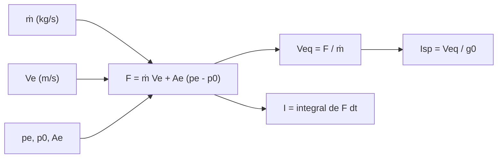

# B78-C01 — Empuje e impulso específico

<!-- nav:top -->
[🏠 Programa](../../../../README.md) · [📚 Bloque B78](../../../tronco-comun/B78-tecnologias-de-propulsion-espacial.md) · [← Anterior: B77-C25 — Corredores de entrada y límites de trayectoria](../../B77/B77-C25-corredores-de-entrada-y-limites-de-trayectoria/CLASE.md) · [Siguiente: B78-C02 — Propulsión química como sistema físico →](../B78-C02-propulsion-quimica-como-sistema-fisico/CLASE.md)
<!-- /nav -->

## 1. Ubicación, nivel y alcance

Clase 1 del bloque B78. Nivel N3. Antes de comparar motores hace falta un lenguaje común: el empuje es una fuerza, el impulso específico es esa fuerza por unidad de peso de propelente consumido por segundo, y la velocidad de escape equivalente es la misma información en m/s. Aquí aprendes a pasar de una a otra con la ecuación de empuje de la NASA y la aplicas a los valores publicados del motor iónico de Dawn y a una tobera química sintética. Usas la dinámica de [B77](../../../tronco-comun/B77-dinamica-de-lanzamiento-y-reentrada.md) solo como contexto del empuje en ascenso.

## 2. Por qué esta clase existe

Dos motores con el mismo empuje pueden gastar propelente a ritmos muy distintos, y dos con el mismo consumo pueden empujar muy distinto según la presión ambiente. La decisión central: **¿qué mide el impulso específico, qué no mide, y por qué el mismo motor tiene un `Isp` distinto en el mar y en el vacío?**

## 3. Lo que podrás hacer al terminar

1. Escribir y aplicar la ecuación de empuje `F = ṁ Vₑ + Aₑ (pₑ − p₀)`.
2. Calcular el impulso específico `Isp = F/(ṁ g₀)` y la velocidad equivalente `V_eq = F/ṁ`.
3. Explicar por qué `Isp` cambia con la presión ambiente a igual `ṁ`.
4. Calcular el impulso total de un perfil de empuje por integración numérica y por vía analítica.
5. Convertir entre empuje, consumo de propelente e `Isp` con unidades coherentes.
6. Separar lo consultado (Dawn, `g₀`) de lo ilustrativo (la tobera química).

La evidencia es la **ficha de empuje e Isp de un propulsor iónico** del ejercicio 12 (sección 20).

## 4. Con qué llegas y cómo comprobarlo

1. ¿Qué es la fuerza y en qué unidades se mide?
2. ¿Qué es un caudal másico?
3. ¿Qué es la presión y cuál es su unidad?
4. ¿Qué es un dato sintético?
5. ¿Qué es una verificación por segunda vía?

<details>
<summary>Ver respuestas</summary>

1. El cambio de cantidad de movimiento por unidad de tiempo; newton (N). 2. La masa que pasa por unidad de tiempo, en kg/s. 3. Fuerza por área; pascal (Pa). 4. Un dato generado para el ejemplo, no medido. 5. Calcular lo mismo con otro método y comparar.
</details>

Con cuatro o cinco aciertos, sigue; si no, repasa los prerrequisitos.

## 5. Un caso de contexto y casos de referencia

El motor iónico de la sonda Dawn entrega, según la página de propulsión iónica de la NASA/JPL, un empuje máximo de `91 mN` con un consumo de xenón de unos `3,25 mg/s`. De ahí salen una velocidad equivalente de `28 000 m/s` y un `Isp` de `2855,2 s`: el **ejemplo conductor**. Como contraste, una tobera química **ilustrativa** (`ṁ = 100 kg/s`, `Vₑ = 3000 m/s`, `Aₑ = 2,0 m²`, `pₑ = 60 kPa`) da `217,3 kN` al nivel del mar y `420,0 kN` en el vacío.

## 6. Vocabulario

El **empuje** `F` es la fuerza que el motor ejerce sobre la nave. El **caudal másico** `ṁ` es la masa de propelente expulsada por segundo. La **velocidad de escape** `Vₑ` es la velocidad del chorro en el plano de salida. El **impulso específico** `Isp = F/(ṁ g₀)` se mide en segundos y compara motores por el empuje obtenido por cada newton de propelente consumido por segundo. La **velocidad equivalente** `V_eq = F/ṁ` incluye el término de presión. El **impulso total** `I = ∫F dt` se mide en N·s.

## 7. Modelo mental



*Descripción textual:* el caudal, la velocidad de escape y el término de presión dan el empuje; el empuje entre el caudal da la velocidad equivalente, que dividida por `g₀` es el `Isp`; la integral del empuje es el impulso total.

Analogía: lanzar pelotas hacia atrás desde un patinete; empujas más si lanzas más pelotas por segundo o más rápido. El `Isp` pregunta cuánto empujas por cada pelota por segundo. Límite: el chorro de un cohete no es una pelota; su presión de salida también empuja.

## 8. La explicación, paso a paso

### 8.1 La ecuación de empuje

La NASA Glenn la escribe `F = ṁ Vₑ + Aₑ (pₑ − p₀)`: el primer término es la cantidad de movimiento del chorro y el segundo es la diferencia de presión entre el plano de salida y el ambiente actuando sobre el área de salida. Con `ṁ = 100 kg/s`, `Vₑ = 3000 m/s`, `Aₑ = 2,0 m²` y `pₑ = 60 kPa`, el primer término vale `300 kN`. En el vacío (`p₀ = 0`) el segundo vale `120 kN` y `F = 420 kN`; al nivel del mar (`p₀ = 101,325 kPa`) vale `−82,65 kN` y `F = 217,35 kN`.

### 8.2 Impulso específico

Según la NASA Glenn, `Isp = F/(ṁ g₀)`, con `g₀ = 9,80665 m/s²` (valor exacto de NIST). Es el empuje por unidad de peso de propelente por segundo; «peso» aquí es solo una convención con `g₀`, no la gravedad local. Equivale a `V_eq/g₀`.

| Ambiente | `p₀` (kPa) | `F` (kN) | `Isp` (s) |
|---|---|---|---|
| Nivel del mar | 101,325 | 217,3 | 221,6 |
| Alta atmósfera | 20,0 | 380,0 | 387,5 |
| Vacío | 0 | 420,0 | 428,3 |

El mismo motor, con el mismo `ṁ`, cambia su `Isp` casi al doble: la presión ambiente entra en el empuje.

### 8.3 Un motor eléctrico

Para Dawn, `V_eq = 0,091/3,25×10⁻⁶ = 28 000 m/s` e `Isp = 2855,2 s`. Es unas siete a diez veces la velocidad de un motor químico, que es lo que dice la página de la NASA. Por eso consume `280,8 g` de xenón por día a empuje máximo y entrega `7862 N·s` en ese día. El empuje es pequeño; el consumo, mínimo.

### 8.4 Impulso total

Con una rampa de empuje del 50 % al 100 % en `120 s`, el impulso total es `0,75 × 420 kN × 120 s = 37,8 MN·s`; la regla del trapecio coincide con la fórmula analítica.

## 9. Magnitudes, símbolos y unidades

| Símbolo | Qué es | Unidad | Valor / nota |
|---|---|---|---|
| `F` | empuje | N | 217,3 kN (mar) / 420,0 kN (vacío), ilustrativo |
| `ṁ` | caudal másico | kg/s | 100 (ilustrativo); 3,25×10⁻⁶ (Dawn) |
| `Vₑ` | velocidad de escape | m/s | 3000 (ilustrativo) |
| `pₑ`, `p₀` | presión de salida y ambiente | Pa | 60 kPa; 0–101,3 kPa |
| `Isp` | impulso específico | s | 2855,2 (Dawn); 428,3 (vacío, ilustrativo) |
| `g₀` | aceleración estándar | m/s² | 9,80665 (exacta) |
| `I` | impulso total | N·s | 37,8 MN·s |

## 10. Convenciones y referencias

Flujo unidimensional y estacionario; el sistema de referencia es la nave. `g₀ = 9,80665 m/s²` es una constante de conversión, no la gravedad local. El `Isp` se define aquí con el empuje total. Versiones: NIST CODATA (consulta del 2026-11-10); datos de Dawn de la página citada. La tobera química es **sintética** y no corresponde a ningún motor real.

## 11. De dónde sale lo que afirmamos

| ID | Fuente | Localizador | Respalda | Estado |
|---|---|---|---|---|
| S1 | NIST, CODATA Fundamental Physical Constants (tabla ASCII) — https://physics.nist.gov/cuu/Constants/Table/allascii.txt (consultada 2026-11-10) | fila «standard acceleration of gravity» | `g₀ = 9,80665 m/s²` (exacta) | Consultada |
| S2 | NASA Glenn, Specific Impulse — https://www.grc.nasa.gov/www/k-12/airplane/specimp.html (consultada 2026-11-10) | página completa | `Isp = F/(ṁ g₀)`; `V_eq` incluye el término de presión | Consultada |
| S3 | NASA Glenn, Rocket Thrust — https://www1.grc.nasa.gov/beginners-guide-to-aeronautics/rocket-thrust/ (consultada 2026-11-10) | ecuación de empuje | `F = ṁ Vₑ + Aₑ (pₑ − p₀)` y definición de los términos | Consultada |
| S4 | NASA/JPL, Dawn: Ion Propulsion — https://science.nasa.gov/mission/dawn/technology/ion-propulsion/ (consultada 2026-11-10) | párrafos de empuje y consumo | empuje máximo 91 mN; xenón ~3,25 mg/s; 425 kg de xenón al lanzamiento | Consultada |
| — | Relaciones estándar de la física y la ingeniería de propulsión | — | las verifica el laboratorio con una segunda vía | No consultada en una fuente concreta |

Límites: la página de Dawn no da el `Isp`; el valor de `2855,2 s` es un cálculo de esta clase a partir del empuje y el consumo publicados, no una cifra de la NASA. La tobera química es ilustrativa.

## 12. Cómo ver el resultado

| Magnitud | Valor |
|---|---|
| `V_eq` de Dawn | 28 000 m/s |
| `Isp` de Dawn | 2855,2 s |
| `F` química en el vacío | 420,0 kN |
| `Isp` química en el vacío | 428,3 s |
| Impulso con rampa | 37,8 MN·s |

Descripción larga: el motor eléctrico gasta muy poco propelente por newton; en la tobera química el `Isp` casi se duplica al pasar del mar al vacío.

## 13. Ejemplo trabajado

**Paso 1 · Datos.** `F = 0,091 N`, `ṁ = 3,25×10⁻⁶ kg/s`.

**Paso 2 · Velocidad equivalente.** `V_eq = 0,091/3,25×10⁻⁶ = 28 000 m/s`.

**Paso 3 · Impulso específico.** `Isp = 28 000/9,80665 = 2855,2 s`.

**Paso 4 · Consumo diario.** `3,25×10⁻⁶ × 86 400 = 0,2808 kg`.

## 14. Distintas formas de describir el problema

**Por fuerza:** `F`. **Por consumo:** `ṁ`. **Por eficiencia de propelente:** `Isp`. **Por velocidad:** `V_eq`. **Por impulso:** `I = ∫F dt`.

## 15. Práctica guiada

**Ejercicio 1 · guiado (con los pasos indicados).** Calcula `V_eq` e `Isp` para `F = 20 N` y `ṁ = 7 g/s`. *Pasos:* pasa `ṁ` a kg/s; divide; divide por `g₀`.

<details><summary>Solución comentada</summary>

`V_eq = 20/0,007 = 2857 m/s`; `Isp = 291,3 s`.
</details>

**Ejercicio 2 · guiado (con una pista).** Predice el signo del término de presión de la tobera ilustrativa al nivel del mar. *Pista:* compara `pₑ = 60 kPa` con `p₀`.

<details><summary>Solución comentada</summary>

Negativo: `60 < 101,3` kPa; vale `−82,65 kN`.
</details>

**Ejercicio 3 · guiado (casi autónomo).** ¿Por qué el `Isp` de un motor no depende de la gravedad local? *Casi autónomo.*

<details><summary>Solución comentada</summary>

Porque `g₀` es solo una constante de conversión; el `Isp` se deduce de `F` y `ṁ`.
</details>

## 16. Práctica autónoma, transferencia e integrador

**Ejercicio 4 · autónomo.** Calcula `F` de la tobera ilustrativa con `p₀ = 20 kPa`.

<details><summary>Solución comentada</summary>

`300 + 2(60−20) = 380 kN`.
</details>

**Ejercicio 5 · autónomo.** ¿Qué masa de xenón gasta Dawn en 30 días a empuje máximo?

<details><summary>Solución comentada</summary>

`3,25×10⁻⁶ × 2 592 000 = 8,42 kg`.
</details>

**Ejercicio 6 · autónomo.** Un motor da `F = 1,2 MN` con `Isp = 300 s`. ¿Cuál es `ṁ`?

<details><summary>Solución comentada</summary>

`ṁ = F/(Isp g₀) = 1,2×10⁶/(300×9,80665) = 407,9 kg/s`.
</details>

**Ejercicio 7 · autónomo.** Calcula el impulso de `91 mN` durante 1 año.

<details><summary>Solución comentada</summary>

`0,091 × 3,156×10⁷ = 2,87×10⁶ N·s`.
</details>

**Ejercicio 8 · autónomo.** ¿Cuánto cambia `Isp` si `V_eq` se duplica?

<details><summary>Solución comentada</summary>

Se duplica, porque es proporcional.
</details>

**Ejercicio 9 · transferencia.** Un colega dice que Dawn tiene `Isp = 91`. ¿Qué confundió?

<details><summary>Solución comentada</summary>

Confundió el empuje (91 mN) con el `Isp`; el `Isp` es `F/(ṁ g₀) = 2855 s`.
</details>

**Ejercicio 10 · transferencia.** Un motor de vacío se prueba en el mar. ¿Qué pasa con `F`?

<details><summary>Solución comentada</summary>

Baja por el término `Aₑ(pₑ−p₀)`; con `pₑ` muy bajo puede aparecer separación del flujo, que este modelo no trata.
</details>

**Ejercicio 11 · transferencia.** ¿Es válido comparar `Isp` de un motor eléctrico y uno químico para decidir cuál es mejor?

<details><summary>Solución comentada</summary>

No por sí solo: falta el empuje, la potencia y la masa de la planta; se trata en C06 y C20.
</details>

**Ejercicio 12 · integrador.** Elabora tu *ficha de empuje e Isp de un propulsor iónico*: datos de Dawn, `V_eq`, `Isp`, consumo diario, impulso por día y lista de qué es consultado y qué es calculado.

<details><summary>Solución comentada</summary>

Secciones 8.3–8.4 y la salida del laboratorio.
</details>

## 17. Laboratorio: empuje, Isp e impulso total

El script [empuje.py](empuje.py) calcula `V_eq` e `Isp` de Dawn a partir de los valores publicados, el empuje de una tobera ilustrativa en tres ambientes y el impulso total de una rampa (**comprueba** `Isp = V_eq/g₀` y la integral numérica contra la analítica, con tolerancia `1e-9`).

**Datos:** `g₀` (NIST), empuje y consumo de Dawn (NASA/JPL) y la ecuación de empuje (NASA Glenn) **consultados**; la tobera química y la rampa son **ilustrativas**. **Predice antes de ejecutar:** ¿cuántas veces mayor es el `Isp` de Dawn que el de la tobera en el vacío? (≈ 6,7.) **Ejecución del 2026-11-10 (Python 3.12.9):**

```text
Python 3.12.9 (biblioteca estandar)
Dawn (consultado): F = 91 mN, mdot = 3.25 mg/s -> Veq = 28000 m/s ; Isp = 2855.2 s
Tobera ILUSTRATIVA (mdot = 100 kg/s, Ve = 3000 m/s, Ae = 2.0 m2, pe = 60 kPa):
 ambiente        p0 [kPa]    F [kN]   Isp [s]
 nivel del mar    101.325     217.3     221.6
 alta atmosfera    20.000     380.0     387.5
 vacio              0.000     420.0     428.3
Impulso total (vacio, 120 s, rampa 50-100 %): numerico = 37.800 MN s ; analitico 0.75*F*t = 37.800 MN s
Propelente consumido en 120 s: 12000 kg ; mdot desde Isp = 100.000 kg/s
Dawn: xenon por dia a empuje maximo = 280.8 g ; impulso por dia = 7862 N s
Pruebas superadas.
```

```bash
python programa/clases/B78/B78-C01-empuje-e-impulso-especifico/empuje.py
```

**Límites:** flujo unidimensional; sin separación de flujo; el `Isp` de Dawn es un cálculo con datos redondeados de la página, no una especificación.

## 18. Errores frecuentes y cómo corregirlos

****Confundir empuje con impulso específico.** Se corrige con 8.2.**

****Usar la gravedad local en `Isp`.** Se corrige con 8.2.**

****Olvidar el término de presión.** Se corrige con 8.1.**

****Presentar el `Isp` de Dawn como cifra publicada.** Se corrige con la sección 11.**

## 19. Cómo sabrás que vas bien

Tras la sección 8: ¿qué `Isp` esperabas para Dawn y cuál obtuviste? Si dudas, repasa el ejemplo 13. Tras el laboratorio: ¿qué comprueba? (ver la sección 17).

## 20. Qué entregas y cómo se evalúa

El producto es tu **ficha de empuje e Isp de un propulsor iónico** (ejercicio 12).

| Criterio | Inicial | En desarrollo | Logrado | Destacado |
|---|---|---|---|---|
| Conceptos | Los confunde | Parciales | Calcula `F`, `Isp` y `V_eq` | Explica los límites |
| Cálculo | Sin unidades | Con errores | Tablas completas con unidades | Calcula casos nuevos |
| Numérico | Sin comprobar | Un caso | Contraste con una segunda vía | Interpreta las diferencias |
| Fuentes | Sin fuente | Sin fecha | Fuentes con fecha y estado | Declara lo ilustrativo y lo no consultado |
| Límites | No los nombra | Uno | Tres | Discute qué falta del modelo |

**Condiciones críticas (no se compensan con promedio):** rotular la tobera química como ilustrativa; no presentar el `Isp` de Dawn como cifra de la NASA; citar solo lo consultado.

## 21. Ética, seguridad y límites

Clase educativa y conceptual: los modelos son simplificados, los datos son consultados con fecha o sintéticos rotulados, y ningún resultado es una especificación de diseño, una verificación de hardware ni una instrucción operativa.  Accesibilidad: tablas equivalentes a las gráficas, fórmulas en texto, ejercicios sin conexión.

## 22. Para cerrar y seguir

Un motor iónico de `91 mN` gasta `3,25 mg/s` y tiene un `Isp` de unos `2855 s`; una tobera química da cientos de kilonewtons con `Isp` de centenas de segundos. Queda una pregunta: ¿qué sistema físico produce ese chorro químico?

**Glosario español–inglés.** empuje · *thrust*; impulso específico · *specific impulse*; caudal másico · *mass flow rate*; velocidad de escape · *exhaust velocity*; impulso total · *total impulse*.

**Continuidad.** [B78-C02](../B78-C02-propulsion-quimica-como-sistema-fisico/CLASE.md) estudia la propulsión química como sistema físico.

**Referencias:** ver sección 11.

<!-- nav:bottom -->
---

[← Anterior: B77-C25 — Corredores de entrada y límites de trayectoria](../../B77/B77-C25-corredores-de-entrada-y-limites-de-trayectoria/CLASE.md) · [📚 Bloque B78](../../../tronco-comun/B78-tecnologias-de-propulsion-espacial.md) · [Siguiente: B78-C02 — Propulsión química como sistema físico →](../B78-C02-propulsion-quimica-como-sistema-fisico/CLASE.md)
<!-- /nav -->
