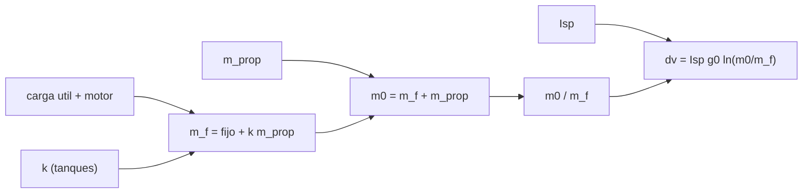

# B78-C02 — Propulsión química como sistema físico

<!-- nav:top -->
[🏠 Programa](../../../../README.md) · [📚 Bloque B78](../../../tronco-comun/B78-tecnologias-de-propulsion-espacial.md) · [← Anterior: B78-C01 — Empuje e impulso específico](../B78-C01-empuje-e-impulso-especifico/CLASE.md) · [Siguiente: B78-C03 — Termodinámica de cámaras →](../B78-C03-termodinamica-de-camaras/CLASE.md)
<!-- /nav -->

## 1. Ubicación, nivel y alcance

Clase 2 del bloque B78. Nivel N3. Un sistema de propulsión química no es solo un motor: es un conjunto de tanques, válvulas, líneas, motor y propelente cuya masa decide cuánto Δv entrega. Aquí tratas una etapa química como **sistema físico con masas** y aplicas la ecuación del cohete para pasar de una masa de propelente a un Δv y al revés. Usas [C01](../B78-C01-empuje-e-impulso-especifico/CLASE.md) para el `Isp`. La etapa es sintética y no corresponde a ningún producto.

## 2. Por qué esta clase existe

Más propelente da más Δv, pero cada kilo de propelente exige tanques, y esos tanques también se aceleran. La decisión central: **¿cuánto propelente hace falta para un Δv dado y existe un máximo de Δv que ninguna cantidad de propelente supera?**

## 3. Lo que podrás hacer al terminar

1. Aplicar `Δv = Isp g₀ ln(m₀/m_f)` con unidades coherentes.
2. Armar el balance de masas de una etapa: carga útil, motor, tanques y propelente.
3. Resolver la masa de propelente para un Δv objetivo con tanques proporcionales.
4. Calcular la cota de Δv que impone la fracción de tanques.
5. Comprobar la fórmula con una integración numérica de `dv = Vₑ dm/m`.
6. Separar lo consultado (rangos de `Isp`, `g₀`) de lo ilustrativo (masas y fracciones).

La evidencia es la **ficha de Δv de una etapa química** del ejercicio 12 (sección 20).

## 4. Con qué llegas y cómo comprobarlo

1. ¿Qué es el impulso específico y en qué unidades se mide?
2. ¿Qué es un logaritmo natural?
3. ¿Qué es la masa seca de una nave?
4. ¿Qué es un dato sintético?
5. ¿Qué es una verificación por segunda vía?

<details>
<summary>Ver respuestas</summary>

1. El empuje por unidad de peso de propelente por segundo; segundos. 2. El inverso de la exponencial de base `e`. 3. Su masa sin propelente. 4. Un dato generado para el ejemplo, no medido. 5. Calcular lo mismo con otro método y comparar.
</details>

Con cuatro o cinco aciertos, sigue; si no, repasa los prerrequisitos.

## 5. Un caso de contexto y casos de referencia

Una etapa **ilustrativa** de monopropelente con `Isp = 220 s` (dentro del rango de 180–285 s que la NASA publica para la hidracina) lleva `150 kg` de carga útil, `20 kg` de motor y tanques del `12 %` de la masa del propelente. Con `100 kg` de propelente entrega `944,75 m/s`; con `300 kg`, `1938,83 m/s`: el **ejemplo conductor**. Todas las masas son sintéticas.

## 6. Vocabulario

La **ecuación del cohete** relaciona el Δv con el `Isp` y la razón de masas `m₀/m_f`. La **masa inicial** `m₀` incluye el propelente; la **masa final** `m_f`, no. La **fracción de tanques** `k` es la masa de tanque por kilo de propelente. La **cota de Δv** es el valor al que tiende la etapa con propelente infinito. La **masa seca** es la masa sin propelente. El **sistema físico** es el conjunto motor, tanques, válvulas y propelente que determina esas masas.

## 7. Modelo mental



*Descripción textual:* la carga útil, el motor y los tanques fijan la masa final; sumada al propelente da la masa inicial; el cociente y el `Isp` dan el Δv.

Analogía: una mochila de agua para una caminata larga; llevar más agua exige una mochila más grande y más pesada. Límite: en el cohete el propelente se expulsa y se reduce la masa que acelera, algo que la mochila no hace.

## 8. La explicación, paso a paso

### 8.1 La ecuación y la tabla

Con `Vₑ = Isp g₀ = 220 × 9,80665 = 2157,5 m/s` y `m_f = 170 + 0,12 m_prop` (carga 150 kg + motor 20 kg + tanques):

| `m_prop` (kg) | `m₀` (kg) | `m_f` (kg) | `m₀/m_f` | Δv (m/s) |
|---|---|---|---|---|
| 100 | 282,0 | 182,0 | 1,5495 | 944,75 |
| 300 | 506,0 | 206,0 | 2,4563 | 1938,83 |
| 600 | 842,0 | 242,0 | 3,4793 | 2690,02 |
| 1000 | 1290,0 | 290,0 | 4,4483 | 3220,05 |

La integración numérica de `dv = Vₑ dm/m` con 200 000 pasos coincide con la fórmula a mejor que `10⁻⁶`.

### 8.2 Propelente para un Δv objetivo

Con `R = e^(Δv/Vₑ)` y `m_f = fijo + k m_prop`, resulta `m_prop = (R − 1) fijo/(1 − k (R − 1))`. Para `1000 m/s` hacen falta `107,87 kg` (fracción de propelente `0,371`); para `2000 m/s`, `317,82 kg` (`0,604`). Cada metro por segundo adicional cuesta más propelente que el anterior.

### 8.3 Una cota que no depende del propelente

Si `m_prop → ∞`, `m₀/m_f → (1 + k)/k = 9,333` y `Δv → Vₑ ln 9,333 = 4818,9 m/s`. Con tanques del 12 % ningún propelente adicional supera ese valor; un objetivo 1 % por encima se rechaza. La salida es bajar `k` o subir el `Isp`.

### 8.4 Sensibilidad al impulso específico

Para `1000 m/s`: `142,60 kg` con `Isp = 180 s`, `107,87 kg` con `220 s` y `77,11 kg` con `285 s`, los extremos del rango consultado para la hidracina.

## 9. Magnitudes, símbolos y unidades

| Símbolo | Qué es | Unidad | Valor / nota |
|---|---|---|---|
| `Δv` | variación de velocidad | m/s | 944,75; 1938,83; 4818,9 (cota) |
| `Isp` | impulso específico | s | 220 (dentro de 180–285 consultado) |
| `Vₑ` | velocidad equivalente | m/s | 2157,5 |
| `m₀`, `m_f` | masa inicial y final | kg | 282,0 y 182,0 (100 kg de propelente) |
| `k` | fracción de tanques | — | 0,12 (ilustrativo) |
| `g₀` | aceleración estándar | m/s² | 9,80665 |

## 10. Convenciones y referencias

Empuje impulsivo (la combustión es instantánea frente al arco), sin gravedad ni arrastre; Δv en m/s respecto a la nave; masas en kg. Versiones: NIST CODATA y NASA SSVI (consulta del 2026-11-10). Masas, `k` e `Isp` de la etapa son **sintéticos**.

## 11. De dónde sale lo que afirmamos

| ID | Fuente | Localizador | Respalda | Estado |
|---|---|---|---|---|
| S1 | NIST, CODATA Fundamental Physical Constants (tabla ASCII) — https://physics.nist.gov/cuu/Constants/Table/allascii.txt (consultada 2026-11-10) | fila de `g₀` | `g₀ = 9,80665 m/s²` | Consultada |
| S2 | NASA Small Spacecraft Systems Virtual Institute, State-of-the-Art: In-Space Propulsion, Tabla 4-1 — https://www.nasa.gov/smallsat-institute/sst-soa/in-space-propulsion/ (consultada 2026-11-10; solo se leyeron los primeros 100 000 de 289 063 caracteres) | Tabla 4-1, filas de química | hidracina 180–285 s; clase de 1 N ~200–235 s | Consultada parcialmente |
| S3 | NASA Glenn, Specific Impulse — https://www.grc.nasa.gov/www/k-12/airplane/specimp.html (consultada 2026-11-10) | definición de `Isp` | relación entre `Isp`, `V_eq` y `g₀` | Consultada |
| — | Relaciones estándar de la física y la ingeniería de propulsión | — | las verifica el laboratorio con una segunda vía | No consultada en una fuente concreta |

Límites: la ecuación del cohete no se consultó en una fuente concreta; las masas y la fracción de tanques son ilustrativas; las 3 cifras de `Isp` por encima son rangos publicados, no una especificación de producto.

## 12. Cómo ver el resultado

| Magnitud | Valor |
|---|---|
| `Δv` con 100 kg de propelente | 944,75 m/s |
| Propelente para 1000 m/s | 107,87 kg |
| Cota con `k = 0,12` | 4818,9 m/s |
| Integración numérica | igual a 1e-6 |

Descripción larga: el Δv crece con el logaritmo de la razón de masas y tiene una cota que depende solo de la fracción de tanques y del `Isp`.

## 13. Ejemplo trabajado

**Paso 1 · Masas.** `m_prop = 300 kg`; `m_f = 170 + 36 = 206 kg`; `m₀ = 506 kg`.

**Paso 2 · Razón.** `506/206 = 2,4563`.

**Paso 3 · Δv.** `2157,5 × ln 2,4563 = 2157,5 × 0,8987 = 1938,8 m/s`.

## 14. Distintas formas de describir el problema

**Por masas:** `m₀`, `m_f`. **Por Δv:** la ecuación del cohete. **Por fracción:** `m_prop/m₀`. **Por cota:** `Vₑ ln((1+k)/k)`. **Por sensibilidad:** cambio de propelente con el `Isp`.

## 15. Práctica guiada

**Ejercicio 1 · guiado (con los pasos indicados).** Calcula `Vₑ` para `Isp = 285 s`. *Pasos:* multiplica por `g₀`.

<details><summary>Solución comentada</summary>

`285 × 9,80665 = 2794,9 m/s`.
</details>

**Ejercicio 2 · guiado (con una pista).** Predice si el Δv sube o baja si la carga útil sube de 150 a 200 kg con el mismo propelente. *Pista:* mira `m₀/m_f`.

<details><summary>Solución comentada</summary>

Baja: `m_f` crece más que `m₀` en proporción.
</details>

**Ejercicio 3 · guiado (casi autónomo).** ¿Por qué un Δv doble no pide un propelente doble? *Casi autónomo.*

<details><summary>Solución comentada</summary>

Porque el Δv crece con `ln(m₀/m_f)`: la razón de masas crece exponencialmente con el Δv.
</details>

## 16. Práctica autónoma, transferencia e integrador

**Ejercicio 4 · autónomo.** Calcula el Δv con `m₀ = 600 kg`, `m_f = 200 kg` e `Isp = 220 s`.

<details><summary>Solución comentada</summary>

`2157,5 ln 3 = 2370,2 m/s`.
</details>

**Ejercicio 5 · autónomo.** Con `k = 0,12`, ¿qué fracción de propelente da `Δv = 1500 m/s` con `Isp = 220 s`?

<details><summary>Solución comentada</summary>

`0,501` (laboratorio): `194,11 kg` de 387,40 kg.
</details>

**Ejercicio 6 · autónomo.** Obtén la cota de Δv si `k = 0,06` y `Isp = 220 s`.

<details><summary>Solución comentada</summary>

`2157,5 ln(1,06/0,06) = 2157,5 × 2,8717 = 6195 m/s`.
</details>

**Ejercicio 7 · autónomo.** ¿Cuánto Δv pierde una etapa si el `Isp` real es 200 s en vez de 220?

<details><summary>Solución comentada</summary>

Pierde la razón `200/220`: un 9,1 % del Δv a igual razón de masas.
</details>

**Ejercicio 8 · autónomo.** Con `m₀/m_f = 2`, ¿qué `Isp` da `1500 m/s`?

<details><summary>Solución comentada</summary>

`Isp = 1500/(9,80665 ln 2) = 220,7 s`.
</details>

**Ejercicio 9 · transferencia.** Un diseñador dice que con suficiente propelente se llega a cualquier Δv. ¿Qué responde la cota?

<details><summary>Solución comentada</summary>

Falso si los tanques son proporcionales al propelente: el Δv tiende a `Vₑ ln((1+k)/k)`.
</details>

**Ejercicio 10 · transferencia.** Se cambia el motor por otro 5 kg más pesado con el mismo `Isp`. ¿Qué efecto tiene en el propelente para 1000 m/s?

<details><summary>Solución comentada</summary>

Sube el término `fijo`: `m_prop` crece en proporción a `fijo`, de 107,87 a unos 111,0 kg (`m_prop = (R−1)·175/(1−0,12(R−1))` con `R = 1,5895`).
</details>

**Ejercicio 11 · transferencia.** ¿Sirve esta ecuación para un ascenso desde la superficie?

<details><summary>Solución comentada</summary>

No sola: faltan gravedad y arrastre (ver B77); aquí el empuje es impulsivo.
</details>

**Ejercicio 12 · integrador.** Elabora tu *ficha de Δv de una etapa química*: tabla de masas y Δv, propelente para tres objetivos, cota y sensibilidad al `Isp`, con lo consultado y lo ilustrativo rotulados.

<details><summary>Solución comentada</summary>

Secciones 8.1–8.4 y la salida del laboratorio.
</details>

## 17. Laboratorio: Δv de una etapa química con tanques proporcionales

El script [etapa_quimica.py](etapa_quimica.py) calcula el Δv de cuatro cargas de propelente, el propelente para cuatro objetivos, la cota por la fracción de tanques y la sensibilidad al `Isp` (**comprueba** la fórmula contra una integración numérica, la inversión del propelente y el rechazo de un objetivo por encima de la cota).

**Datos:** `g₀` (NIST) y los rangos de `Isp` (NASA SSVI) **consultados**; masas, `k` e `Isp` de la etapa **ilustrativos**. **Predice antes de ejecutar:** ¿cuántos kilos de propelente pide `1000 m/s`? (≈ 108 kg.) **Ejecución del 2026-11-10 (Python 3.12.9):**

```text
Python 3.12.9 (biblioteca estandar)
Etapa ILUSTRATIVA: Isp = 220 s (rango consultado 180-285 s), carga util 150 kg, motor 20 kg, tanques 12 % del propelente
 m_prop [kg]   m0 [kg]   mf [kg]   m0/mf    dv [m/s]  dv numerico [m/s]
        100     282.0     182.0   1.5495      944.75      944.75
        300     506.0     206.0   2.4563     1938.83     1938.83
        600     842.0     242.0   3.4793     2690.02     2690.02
       1000    1290.0     290.0   4.4483     3220.05     3220.05
Propelente necesario para un delta-v objetivo (misma etapa):
  dv =    500 m/s -> m_prop =    45.77 kg ; m0 =   221.26 kg ; fraccion de propelente = 0.207
  dv =   1000 m/s -> m_prop =   107.87 kg ; m0 =   290.82 kg ; fraccion de propelente = 0.371
  dv =   1500 m/s -> m_prop =   194.11 kg ; m0 =   387.40 kg ; fraccion de propelente = 0.501
  dv =   2000 m/s -> m_prop =   317.82 kg ; m0 =   525.96 kg ; fraccion de propelente = 0.604
Cota con tanques de 12 %: dv < Ve ln((1+k)/k) = 4818.9 m/s (aunque m_prop -> infinito)
Un objetivo 1 % por encima de la cota se rechaza (inalcanzable).
  Isp =   180 s -> propelente para 1000 m/s = 142.60 kg
  Isp =   220 s -> propelente para 1000 m/s = 107.87 kg
  Isp =   285 s -> propelente para 1000 m/s = 77.11 kg
Pruebas superadas.
```

```bash
python programa/clases/B78/B78-C02-propulsion-quimica-como-sistema-fisico/etapa_quimica.py
```

**Límites:** empuje impulsivo, tanques estrictamente proporcionales, sin gravedad, arrastre ni residuos de propelente.

## 18. Errores frecuentes y cómo corregirlos

****Contar el propelente en la masa final.** Se corrige con 8.1.**

****Esperar que el Δv sea lineal en el propelente.** Se corrige con 8.2.**

****Ignorar la masa de los tanques.** Se corrige con 8.3.**

****Tomar un rango de `Isp` como especificación.** Se corrige con la sección 11.**

## 19. Cómo sabrás que vas bien

Tras la sección 8: ¿qué Δv esperabas con 300 kg y cuál obtuviste? Si dudas, repasa el ejemplo 13. Tras el laboratorio: ¿qué comprueba? (ver la sección 17).

## 20. Qué entregas y cómo se evalúa

El producto es tu **ficha de Δv de una etapa química** (ejercicio 12).

| Criterio | Inicial | En desarrollo | Logrado | Destacado |
|---|---|---|---|---|
| Conceptos | Los confunde | Parciales | Arma el balance de masas y calcula el Δv | Explica los límites |
| Cálculo | Sin unidades | Con errores | Tablas completas con unidades | Calcula casos nuevos |
| Numérico | Sin comprobar | Un caso | Contraste con una segunda vía | Interpreta las diferencias |
| Fuentes | Sin fuente | Sin fecha | Fuentes con fecha y estado | Declara lo ilustrativo y lo no consultado |
| Límites | No los nombra | Uno | Tres | Discute qué falta del modelo |

**Condiciones críticas (no se compensan con promedio):** rotular masas y fracciones como ilustrativas; no presentar un rango de `Isp` como especificación; citar solo lo consultado.

## 21. Ética, seguridad y límites

Clase educativa y conceptual: los modelos son simplificados, los datos son consultados con fecha o sintéticos rotulados, y ningún resultado es una especificación de diseño, una verificación de hardware ni una instrucción operativa.  Accesibilidad: tablas equivalentes a las gráficas, fórmulas en texto, ejercicios sin conexión.

## 22. Para cerrar y seguir

Una etapa de monopropelente ilustrativa da `944,75 m/s` con `100 kg` de propelente y no puede superar `4818,9 m/s` con tanques del 12 %. Queda una pregunta: ¿qué fija el `Isp` dentro de la cámara?

**Glosario español–inglés.** ecuación del cohete · *rocket equation*; masa seca · *dry mass*; fracción de propelente · *propellant fraction*; carga útil · *payload*; razón de masas · *mass ratio*.

**Continuidad.** [B78-C03](../B78-C03-termodinamica-de-camaras/CLASE.md) estudia la termodinámica de la cámara y la tobera.

**Referencias:** ver sección 11.

<!-- nav:bottom -->
---

[← Anterior: B78-C01 — Empuje e impulso específico](../B78-C01-empuje-e-impulso-especifico/CLASE.md) · [📚 Bloque B78](../../../tronco-comun/B78-tecnologias-de-propulsion-espacial.md) · [Siguiente: B78-C03 — Termodinámica de cámaras →](../B78-C03-termodinamica-de-camaras/CLASE.md)
<!-- /nav -->
