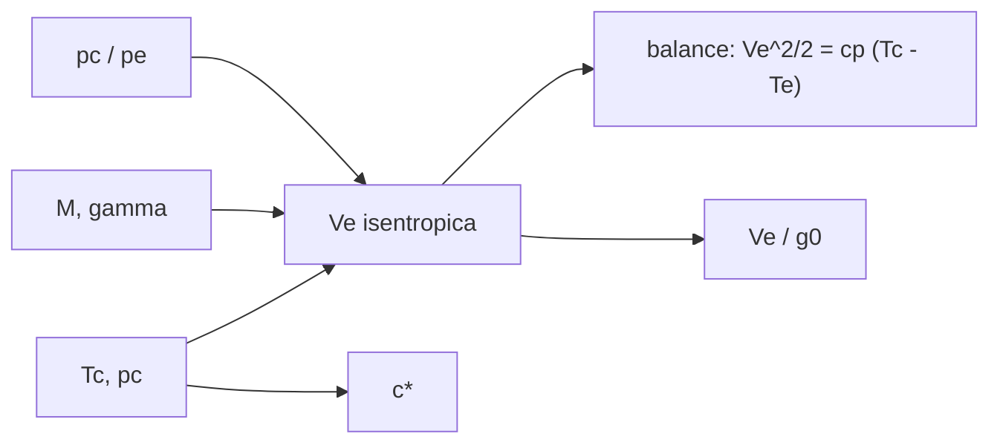

# B78-C03 — Termodinámica de cámaras

<!-- nav:top -->
[🏠 Programa](../../../../README.md) · [📚 Bloque B78](../../../tronco-comun/B78-tecnologias-de-propulsion-espacial.md) · [← Anterior: B78-C02 — Propulsión química como sistema físico](../B78-C02-propulsion-quimica-como-sistema-fisico/CLASE.md) · [Siguiente: B78-C04 — Propulsión monopropelente conceptual →](../B78-C04-propulsion-monopropelente-conceptual/CLASE.md)
<!-- /nav -->

## 1. Ubicación, nivel y alcance

Clase 3 del bloque B78. Nivel N3. La velocidad de escape de un motor térmico sale de dos cosas: cuánta energía térmica tiene el gas en la cámara y cuán liviano es. Aquí obtienes la velocidad de escape isentrópica a partir de la temperatura y la presión de cámara, la verificas con un balance de energía y ves el efecto de la masa molar y de la razón de presiones. Usas [C01](../B78-C01-empuje-e-impulso-especifico/CLASE.md) para pasar de `Vₑ` a `Isp`. La cámara es sintética.

## 2. Por qué esta clase existe

El mismo calor produce chorros distintos según el gas. La decisión central: **¿qué parámetro de cámara gana más escape, subir la temperatura o bajar la masa molar, y hasta dónde se puede expandir el gas?**

## 3. Lo que podrás hacer al terminar

1. Aplicar la fórmula de escape isentrópico `Vₑ = √(2γ/(γ−1) · R T_c/M · [1 − (pₑ/p_c)^((γ−1)/γ)])`.
2. Verificarla con el balance de energía `Vₑ²/2 = c_p (T_c − Tₑ)`.
3. Calcular la velocidad característica `c*`.
4. Ver que `Vₑ ∝ M^(−1/2)` y el efecto de `T_c`.
5. Acotar el escape con la expansión infinita.
6. Separar lo consultado (`R`, `g₀`) de lo ilustrativo (cámara).

La evidencia es la **tabla de escape según cámara y gas** del ejercicio 12 (sección 20).

## 4. Con qué llegas y cómo comprobarlo

1. ¿Qué es la entalpía y cómo se relaciona con la temperatura de un gas ideal?
2. ¿Qué es un proceso isentrópico?
3. ¿Qué es la masa molar?
4. ¿Qué es un dato sintético?
5. ¿Qué es una verificación por segunda vía?

<details>
<summary>Ver respuestas</summary>

1. Es la energía térmica más el trabajo de flujo; `h = c_p T`. 2. Uno adiabático y reversible, a entropía constante. 3. La masa por mol de sustancia, en kg/mol. 4. Un dato generado para el ejemplo, no medido. 5. Calcular lo mismo con otro método y comparar.
</details>

Con cuatro o cinco aciertos, sigue; si no, repasa los prerrequisitos.

## 5. Un caso de contexto y casos de referencia

Una cámara **ilustrativa** a `T_c = 3500 K`, `p_c = 7,0 MPa`, `γ = 1,2` y `M = 22 g/mol` que se expande hasta `p_c/pₑ = 100` entrega `Vₑ = 2916,4 m/s` (`Vₑ/g₀ = 297,4 s`) y deja el gas a `1624,6 K`: el **ejemplo conductor**. Ningún parámetro describe un motor real.

## 6. Vocabulario

La **temperatura de cámara** `T_c` es la del gas antes de la tobera. La **razón de presiones** `p_c/pₑ` mide cuánto se expande. `γ` es la razón de calores específicos. La **masa molar** `M` es la del gas de escape. La **velocidad característica** `c*` mide la calidad de combustión de la cámara. La **tobera adaptada** es la que expande hasta la presión ambiente.

## 7. Modelo mental



*Descripción textual:* la temperatura, la masa molar, `γ` y la razón de presiones dan el escape; el balance de energía lo verifica; `c*` sale de la cámara; dividir por `g₀` da un `Isp` equivalente.

Analogía: un resorte de gas comprimido; cuanto más se comprime y más liviano es el gas, más rápido sale. Límite: en la tobera el gas se enfría al expandirse y esa energía térmica se convierte en cinética; un resorte no cambia de temperatura.

## 8. La explicación, paso a paso

### 8.1 El escape isentrópico

Con `R = 8,314462618 J/(mol K)` (NIST), `T_c = 3500 K`, `γ = 1,2` y `M = 0,022 kg/mol`:

| `p_c/pₑ` | `Tₑ` (K) | `Vₑ` (m/s) | `Vₑ/g₀` (s) |
|---|---|---|---|
| 10 | 2384,5 | 2249,2 | 229,4 |
| 50 | 1823,5 | 2757,4 | 281,2 |
| 100 | 1624,6 | 2916,4 | 297,4 |
| 500 | 1242,3 | 3199,8 | 326,3 |
| 1000 | 1106,8 | 3294,5 | 335,9 |

### 8.2 Dos vías

El balance de energía con `c_p = γR/((γ−1)M)` y `Tₑ = T_c (pₑ/p_c)^((γ−1)/γ)` da el mismo valor a `10⁻¹²`. La velocidad característica vale `c* = 1773,4 m/s` (`Γ = 0,6485`) y su forma alternativa coincide.

### 8.3 Masa molar y temperatura

A `p_c/pₑ = 100`: `M = 10` g/mol da `4325,7 m/s`, `16` da `3419,8`, `22` da `2916,4` y `30` da `2497,5`. El cociente `Vₑ(10)/Vₑ(40) = 2,000000`, consistente con `Vₑ ∝ M^(−1/2)`. Con `M = 22`: `T_c = 2500 K` da `2464,8 m/s`, `3000 K` da `2700,1` y `3500 K` da `2916,4` (`Vₑ ∝ √T_c`).

### 8.4 La cota de la expansión

Si `pₑ → 0`, `Vₑ_max = √(2γ/(γ−1) R T_c/M) = 3984,1 m/s`. Con `p_c/pₑ = 1000` ya se alcanza el `82,69 %`. Expandir más sirve cada vez menos y agranda la tobera.

## 9. Magnitudes, símbolos y unidades

| Símbolo | Qué es | Unidad | Valor / nota |
|---|---|---|---|
| `T_c` | temperatura de cámara | K | 3500 (ilustrativo) |
| `p_c/pₑ` | razón de presiones | — | 10–1000 |
| `γ` | razón de calores específicos | — | 1,2 (ilustrativo) |
| `M` | masa molar | kg/mol | 0,022 (ilustrativo) |
| `Vₑ` | velocidad de escape | m/s | 2916,4 |
| `c*` | velocidad característica | m/s | 1773,4 |
| `R` | constante molar | J/(mol K) | 8,314462618 |

## 10. Convenciones y referencias

Gas ideal calóricamente perfecto, flujo unidimensional isentrópico, tobera adaptada, sin pérdidas ni disociación variable. Presiones en Pa, temperaturas en K. Versiones: NIST CODATA (consulta del 2026-11-10). `T_c`, `p_c`, `γ` y `M` son **sintéticos**.

## 11. De dónde sale lo que afirmamos

| ID | Fuente | Localizador | Respalda | Estado |
|---|---|---|---|---|
| S1 | NIST, CODATA Fundamental Physical Constants (tabla ASCII) — https://physics.nist.gov/cuu/Constants/Table/allascii.txt (consultada 2026-11-10) | filas de `R` y `g₀` | `R = 8,314462618…` y `g₀ = 9,80665` | Consultada |
| S2 | NASA Glenn, Specific Impulse — https://www.grc.nasa.gov/www/k-12/airplane/specimp.html (consultada 2026-11-10) | relación `Isp = V_eq/g₀` | `Isp` a partir de la velocidad equivalente | Consultada |
| S3 | NASA Glenn, Rocket Thrust — https://www1.grc.nasa.gov/beginners-guide-to-aeronautics/rocket-thrust/ (consultada 2026-11-10) | ecuación de empuje | el término de presión que vale cero con tobera adaptada | Consultada |
| — | Relaciones estándar de la física y la ingeniería de propulsión | — | las verifica el laboratorio con una segunda vía | No consultada en una fuente concreta |

Límites: la fórmula isentrópica no se consultó en una fuente concreta; la composición, `γ` y la temperatura de cámara son ilustrativos y no provienen del cálculo de equilibrio de un propelente real.

## 12. Cómo ver el resultado

| Magnitud | Valor |
|---|---|
| `Vₑ` a `p_c/pₑ = 100` | 2916,4 m/s |
| `Tₑ` | 1624,6 K |
| `c*` | 1773,4 m/s |
| `Vₑ_max` | 3984,1 m/s |
| Cociente `Vₑ(10)/Vₑ(40)` | 2,000000 |

Descripción larga: el escape crece con la raíz de la temperatura y decrece con la raíz de la masa molar; la expansión tiene una cota que se alcanza lentamente.

## 13. Ejemplo trabajado

**Paso 1 · Prefactor.** `2γ/(γ−1) = 12`; `R T_c/M = 8,3145 × 3500/0,022 = 1,3228×10⁶ m²/s²`.

**Paso 2 · Factor de expansión.** `1 − 100^(−0,1667) = 1 − 0,4642 = 0,5358`.

**Paso 3 · Escape.** `Vₑ = √(12 × 1,3228×10⁶ × 0,5358) = 2916 m/s`.

## 14. Distintas formas de describir el problema

**Por fórmula:** escape isentrópico. **Por energía:** `Vₑ²/2 = Δh`. **Por escalas:** `√T_c` y `M^(−1/2)`. **Por cota:** `pₑ → 0`. **Por `c*`:** calidad de la cámara.

## 15. Práctica guiada

**Ejercicio 1 · guiado (con los pasos indicados).** Calcula `R T_c/M` para `T_c = 3000 K` y `M = 0,016 kg/mol`. *Pasos:* aplica la fórmula con `R` de NIST.

<details><summary>Solución comentada</summary>

`8,3145 × 3000/0,016 = 1,559×10⁶ m²/s²`.
</details>

**Ejercicio 2 · guiado (con una pista).** Predice qué pasa con `Vₑ` si `T_c` se cuadruplica. *Pista:* `Vₑ ∝ √T_c`.

<details><summary>Solución comentada</summary>

Se duplica.
</details>

**Ejercicio 3 · guiado (casi autónomo).** ¿Por qué el hidrógeno da más escape que otros gases a igual `T_c`? *Casi autónomo.*

<details><summary>Solución comentada</summary>

Por su menor masa molar: `Vₑ ∝ M^(−1/2)`.
</details>

## 16. Práctica autónoma, transferencia e integrador

**Ejercicio 4 · autónomo.** Calcula `Tₑ` para `T_c = 3500 K`, `γ = 1,2`, `p_c/pₑ = 50`.

<details><summary>Solución comentada</summary>

`3500 × 50^(−0,1667) = 1823,5 K`.
</details>

**Ejercicio 5 · autónomo.** ¿Cuál es la fracción de la cota que se logra con `p_c/pₑ = 10`?

<details><summary>Solución comentada</summary>

`2249,2/3984,1 = 56,5 %`.
</details>

**Ejercicio 6 · autónomo.** Obtén `Vₑ` para `M = 10` y `M = 40` y su cociente.

<details><summary>Solución comentada</summary>

`4325,7` y `2162,9 m/s`; cociente 2.
</details>

**Ejercicio 7 · autónomo.** ¿Qué `Isp` equivalente da `Vₑ = 3294,5 m/s`?

<details><summary>Solución comentada</summary>

`335,9 s`.
</details>

**Ejercicio 8 · autónomo.** Si `γ` baja de 1,2 a 1,1 a igual `T_c` y `M`, ¿qué pasa con el prefactor?

<details><summary>Solución comentada</summary>

Sube: `2γ/(γ−1)` pasa de 12 a 22; compensa en parte el factor de expansión.
</details>

**Ejercicio 9 · transferencia.** Un diseñador sube `T_c` sin límite. ¿Qué otros efectos físicos intervienen?

<details><summary>Solución comentada</summary>

Disociación (cambia `M` y `γ`), pérdidas de calor a la pared y límites de materiales; el modelo no los trata.
</details>

**Ejercicio 10 · transferencia.** ¿Por qué una tobera adaptada elimina el término de presión del empuje?

<details><summary>Solución comentada</summary>

Porque `pₑ = p₀` y `Aₑ(pₑ−p₀) = 0` en la ecuación de empuje.
</details>

**Ejercicio 11 · transferencia.** ¿Basta `Vₑ` para comparar dos cámaras?

<details><summary>Solución comentada</summary>

No: la masa y el volumen de la tobera, la carga térmica y la presión de cámara también cuentan.
</details>

**Ejercicio 12 · integrador.** Elabora tu *tabla de escape según cámara y gas*: `Tₑ`, `Vₑ` e `Isp` equivalente para cinco razones de presiones, efecto de `M` y `T_c`, y la cota.

<details><summary>Solución comentada</summary>

Secciones 8.1–8.4 y la salida del laboratorio.
</details>

## 17. Laboratorio: escape isentrópico y balance de energía

El script [camara.py](camara.py) calcula el escape para cinco razones de presiones, la velocidad característica y los efectos de `M` y `T_c` (**comprueba** la fórmula contra el balance de energía a `1e-12`, `c*` contra su forma alternativa y `Vₑ ∝ M^(−1/2)`).

**Datos:** `R` y `g₀` (NIST) **consultados**; cámara (`T_c`, `p_c`, `γ`, `M`) **ilustrativa**. **Predice antes de ejecutar:** ¿qué fracción de la cota se alcanza con `p_c/pₑ = 1000`? (≈ 83 %.) **Ejecución del 2026-11-10 (Python 3.12.9):**

```text
Python 3.12.9 (biblioteca estandar)
Camara ILUSTRATIVA: Tc = 3500 K, pc = 7.0 MPa, gamma = 1.2, M = 22 g/mol
 pc/pe     Te [K]   Ve [m/s]   Isp_ve [s]  (Ve/g0)
     10    2384.5      2249.2       229.4
     50    1823.5      2757.4       281.2
    100    1624.6      2916.4       297.4
    500    1242.3      3199.8       326.3
   1000    1106.8      3294.5       335.9
Velocidad caracteristica c* = 1773.4 m/s (Gamma = 0.6485)
Efecto de la masa molar a pc/pe = 100 y Tc = 3500 K:
  M =   10 g/mol -> Ve =  4325.7 m/s
  M =   16 g/mol -> Ve =  3419.8 m/s
  M =   22 g/mol -> Ve =  2916.4 m/s
  M =   30 g/mol -> Ve =  2497.5 m/s
Cociente Ve(M=10)/Ve(M=40) = 2.000000 (esperado 2 por Ve ~ M^-1/2)
Efecto de la temperatura de camara (pc/pe = 100, M = 22 g/mol):
  Tc =  2500 K -> Ve =  2464.8 m/s
  Tc =  3000 K -> Ve =  2700.1 m/s
  Tc =  3500 K -> Ve =  2916.4 m/s
Cota de expansion infinita (pe -> 0): Ve_max = 3984.1 m/s ; Ve(pc/pe = 1000) / Ve_max = 0.8269
Pruebas superadas.
```

```bash
python programa/clases/B78/B78-C03-termodinamica-de-camaras/camara.py
```

**Límites:** gas ideal, `γ` y `M` constantes, sin disociación, sin pérdidas, tobera adaptada.

## 18. Errores frecuentes y cómo corregirlos

****Mezclar masa molar en g/mol y kg/mol.** Se corrige con la sección 9.**

****Esperar que `Vₑ` crezca sin límite con la expansión.** Se corrige con 8.4.**

****Usar `γ` de un gas frío para gases de combustión.** Se corrige con la sección 10.**

****Presentar la cámara ilustrativa como un motor real.** Se corrige con la sección 10.**

## 19. Cómo sabrás que vas bien

Tras la sección 8: ¿qué `Vₑ` esperabas para `p_c/pₑ = 100` y cuál obtuviste? Si dudas, repasa el ejemplo 13. Tras el laboratorio: ¿qué comprueba? (ver la sección 17).

## 20. Qué entregas y cómo se evalúa

El producto es tu **tabla de escape según cámara y gas** (ejercicio 12).

| Criterio | Inicial | En desarrollo | Logrado | Destacado |
|---|---|---|---|---|
| Conceptos | Los confunde | Parciales | Calcula el escape y lo verifica con energía | Explica los límites |
| Cálculo | Sin unidades | Con errores | Tablas completas con unidades | Calcula casos nuevos |
| Numérico | Sin comprobar | Un caso | Contraste con una segunda vía | Interpreta las diferencias |
| Fuentes | Sin fuente | Sin fecha | Fuentes con fecha y estado | Declara lo ilustrativo y lo no consultado |
| Límites | No los nombra | Uno | Tres | Discute qué falta del modelo |

**Condiciones críticas (no se compensan con promedio):** rotular la cámara como ilustrativa; no presentar la cota como diseño; citar solo lo consultado.

## 21. Ética, seguridad y límites

Clase educativa y conceptual: los modelos son simplificados, los datos son consultados con fecha o sintéticos rotulados, y ningún resultado es una especificación de diseño, una verificación de hardware ni una instrucción operativa.  Accesibilidad: tablas equivalentes a las gráficas, fórmulas en texto, ejercicios sin conexión.

## 22. Para cerrar y seguir

Una cámara ilustrativa a `3500 K` y `22 g/mol` da `2916,4 m/s` con una expansión de 100 a 1 y no supera `3984,1 m/s`. Queda una pregunta: ¿cómo se obtiene ese gas caliente con un solo propelente?

**Glosario español–inglés.** temperatura de cámara · *chamber temperature*; tobera · *nozzle*; velocidad característica · *characteristic velocity*; masa molar · *molar mass*; flujo isentrópico · *isentropic flow*.

**Continuidad.** [B78-C04](../B78-C04-propulsion-monopropelente-conceptual/CLASE.md) estudia la propulsión monopropelente.

**Referencias:** ver sección 11.

<!-- nav:bottom -->
---

[← Anterior: B78-C02 — Propulsión química como sistema físico](../B78-C02-propulsion-quimica-como-sistema-fisico/CLASE.md) · [📚 Bloque B78](../../../tronco-comun/B78-tecnologias-de-propulsion-espacial.md) · [Siguiente: B78-C04 — Propulsión monopropelente conceptual →](../B78-C04-propulsion-monopropelente-conceptual/CLASE.md)
<!-- /nav -->
