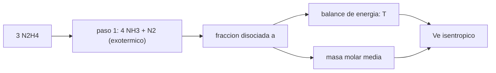

# B78-C04 — Propulsión monopropelente conceptual

<!-- nav:top -->
[🏠 Programa](../../../../README.md) · [📚 Bloque B78](../../../tronco-comun/B78-tecnologias-de-propulsion-espacial.md) · [← Anterior: B78-C03 — Termodinámica de cámaras](../B78-C03-termodinamica-de-camaras/CLASE.md) · [Siguiente: B78-C05 — Propulsión bipropelente conceptual →](../B78-C05-propulsion-bipropelente-conceptual/CLASE.md)
<!-- /nav -->

## 1. Ubicación, nivel y alcance

Clase 4 del bloque B78. Nivel N3. Un monopropelente es un líquido que se descompone por sí solo al pasar por un catalizador y produce el gas caliente sin necesidad de un oxidante aparte. Es el sistema más simple de la propulsión química y por eso el más usado en control de actitud y maniobras pequeñas. Aquí lo tratas de forma conceptual: balance de átomos, energía de la descomposición y efecto de la masa molar. Usas [C03](../B78-C03-termodinamica-de-camaras/CLASE.md) para el escape. Los valores moleculares son de manual y **no se consultaron** en esta sesión.

## 2. Por qué esta clase existe

La descomposición de un monopropelente tiene dos pasos: uno que libera calor y otro que lo absorbe. La decisión central: **¿conviene que el amoníaco intermedio se disocie del todo, por la menor masa molar, o que se conserve, por la mayor temperatura?**

## 3. Lo que podrás hacer al terminar

1. Plantear una reacción de descomposición y comprobar el balance de átomos y de masa.
2. Calcular la masa molar media de los productos según la fracción disociada `a`.
3. Estimar la temperatura adiabática con un balance de energía de calor específico constante.
4. Calcular el escape y ver el compromiso entre `T` y `M`.
5. Comparar el modelo con el rango consultado de `Isp` y declarar su alcance.
6. Separar lo consultado (`R`, `Isp`) de lo ilustrativo (entalpías, `C_p`, `γ`).

La evidencia es la **curva de masa molar y escape frente a disociación** del ejercicio 12 (sección 20).

## 4. Con qué llegas y cómo comprobarlo

1. ¿Qué es un catalizador?
2. ¿Qué significa balancear una reacción?
3. ¿Qué es una reacción exotérmica?
4. ¿Qué es un dato sintético?
5. ¿Qué es una verificación por segunda vía?

<details>
<summary>Ver respuestas</summary>

1. Una sustancia que acelera una reacción sin consumirse. 2. Que haya los mismos átomos de cada elemento a ambos lados. 3. Una que libera calor. 4. Un dato generado para el ejemplo, no medido. 5. Calcular lo mismo con otro método y comparar.
</details>

Con cuatro o cinco aciertos, sigue; si no, repasa los prerrequisitos.

## 5. Un caso de contexto y casos de referencia

Un modelo **ilustrativo** de hidracina descompone `3 N₂H₄ → 4(1−a) NH₃ + (1+2a) N₂ + 6a H₂`. Con `a = 0` hay `5 mol` de productos de masa molar media `19,227 g/mol` a `2063,3 K` y un escape de `2144,2 m/s` (`218,6 s`); con `a = 1` hay `9 mol` a `741,9 K` y `1725,0 m/s`: el **ejemplo conductor**. El modelo muestra una tendencia y no predice el `Isp` real.

## 6. Vocabulario

Un **monopropelente** es un líquido que se descompone en gas caliente por catálisis. La **fracción disociada** `a` es la parte del amoníaco que se separa en nitrógeno e hidrógeno. La **descomposición exotérmica** libera calor; la **disociación** lo absorbe. La **temperatura adiabática** sale de dividir el calor neto entre `n C_p`. La **masa molar media** es la masa de los productos entre sus moles.

## 7. Modelo mental



*Descripción textual:* el propelente se descompone en amoníaco y nitrógeno liberando calor; la fracción disociada fija la temperatura (baja) y la masa molar (baja); ambas determinan el escape.

Analogía: encender una estufa con una chispa: la primera etapa libera calor y la segunda lo gasta en romper moléculas. Límite: aquí la «chispa» es un catalizador y no hay llama.

## 8. La explicación, paso a paso

### 8.1 Balance de átomos

Para `3 N₂H₄` hay `6 N` y `12 H`. Los productos `4(1−a) NH₃ + (1+2a) N₂ + 6a H₂` tienen `4(1−a) + 2(1+2a) = 6` átomos de N y `12(1−a) + 12a = 12` de H para cualquier `a`. La masa de productos cierra con la de reactivos (`96,135 g`, con masas de manual) a menos de `0,05 g`.

### 8.2 Energía

Con las entalpías de formación ilustrativas, el paso 1 libera `3 × 50,6 − 4 × (−45,9) = 335,4 kJ` por `3 mol` de hidracina. Disociar todo el amoníaco absorbe `4 × 45,9 = 183,6 kJ`. Con `C_p = 38 J/(mol K)` por mol de productos, la temperatura es `T = 298 + Q/(n C_p)`.

### 8.3 Tabla

| `a` | mol | `T` (K) | `M` (g/mol) | `Vₑ` (m/s) | `Vₑ/g₀` (s) |
|---|---|---|---|---|---|
| 0,0 | 5,00 | 2063,3 | 19,227 | 2144,2 | 218,6 |
| 0,5 | 7,00 | 1213,8 | 13,734 | 1945,9 | 198,4 |
| 1,0 | 9,00 | 741,9 | 10,682 | 1725,0 | 175,9 |

### 8.4 Lectura

La disociación baja la masa molar, lo que favorecería el escape, pero baja más la temperatura: en este modelo el máximo está en `a = 0`. El rango publicado por la NASA para la hidracina es `180–285 s`; el modelo, con `a = 0,5`, da `198 s`: dentro del rango, pero el acuerdo es casual porque los parámetros son ilustrativos.

## 9. Magnitudes, símbolos y unidades

| Símbolo | Qué es | Unidad | Valor / nota |
|---|---|---|---|
| `a` | fracción de NH₃ disociado | — | 0–1 |
| `n` | moles de productos por 3 mol de N₂H₄ | mol | 5–9 |
| `T` | temperatura adiabática | K | 2063,3 (a=0) |
| `M` | masa molar media | g/mol | 19,227 (a=0) |
| `Vₑ` | velocidad de escape | m/s | 2144,2 (a=0) |
| `C_p` | calor específico molar medio | J/(mol K) | 38 (ilustrativo) |

## 10. Convenciones y referencias

Gas ideal, `C_p` constante, `γ = 1,30`, `p_c/pₑ = 50`, temperatura inicial 298 K, tobera adaptada. Versiones: NIST CODATA y NASA SSVI (consulta del 2026-11-10). Masas molares y entalpías de formación son de manual y **no se consultaron**; son ilustrativas.

## 11. De dónde sale lo que afirmamos

| ID | Fuente | Localizador | Respalda | Estado |
|---|---|---|---|---|
| S1 | NIST, CODATA Fundamental Physical Constants (tabla ASCII) — https://physics.nist.gov/cuu/Constants/Table/allascii.txt (consultada 2026-11-10) | filas de `R` y `g₀` | `R` y `g₀` | Consultada |
| S2 | NASA Small Spacecraft Systems Virtual Institute, State-of-the-Art: In-Space Propulsion, Tabla 4-1 — https://www.nasa.gov/smallsat-institute/sst-soa/in-space-propulsion/ (consultada 2026-11-10; solo se leyeron los primeros 100 000 de 289 063 caracteres) | Tabla 4-1, fila de hidracina | hidracina monopropelente: 0,25–28 N y 180–285 s | Consultada parcialmente |
| — | Relaciones estándar de la física y la ingeniería de propulsión | — | las verifica el laboratorio con una segunda vía | No consultada en una fuente concreta |

Límites: las masas molares, las entalpías, `C_p` y `γ` no se consultaron; el modelo no incluye la composición de equilibrio real ni la variación de `C_p` con la temperatura, de modo que el acuerdo con el rango consultado es cualitativo.

## 12. Cómo ver el resultado

| Magnitud | Valor |
|---|---|
| Productos con `a = 0` | 5 mol, 19,227 g/mol |
| `T` con `a = 0` | 2063,3 K |
| `Vₑ` con `a = 0` | 2144,2 m/s |
| `Vₑ` con `a = 1` | 1725,0 m/s |
| Calor del paso 1 | 335,4 kJ por 3 mol |

Descripción larga: el escape baja de forma monótona con la disociación, porque la caída de temperatura pesa más que la de la masa molar.

## 13. Ejemplo trabajado

**Paso 1 · Productos con `a = 0,5`.** `NH₃ = 2`, `N₂ = 2`, `H₂ = 3`: `7 mol`.

**Paso 2 · Masa molar.** `96,135/7 = 13,734 g/mol`.

**Paso 3 · Temperatura.** Se disocian `4a = 2 mol` de NH₃: `Q = 335,4 − 2 × 45,9 = 243,6 kJ`; `T = 298 + 243 600/(7 × 38) = 1213,8 K`.

## 14. Distintas formas de describir el problema

**Por reacción:** el balance de átomos. **Por energía:** calor neto. **Por composición:** moles y masa molar. **Por escape:** `Vₑ`. **Por rango:** el consultado frente al calculado.

## 15. Práctica guiada

**Ejercicio 1 · guiado (con los pasos indicados).** Verifica el balance de N y H para `a = 0,2`. *Pasos:* calcula `NH₃`, `N₂`, `H₂`.

<details><summary>Solución comentada</summary>

`NH₃ = 3,2`, `N₂ = 1,4`, `H₂ = 1,2`: N `3,2 + 2,8 = 6`; H `9,6 + 2,4 = 12`.
</details>

**Ejercicio 2 · guiado (con una pista).** Predice si la masa molar sube o baja con `a`. *Pista:* cuenta los moles.

<details><summary>Solución comentada</summary>

Baja, porque los moles crecen con `a` y la masa se conserva.
</details>

**Ejercicio 3 · guiado (casi autónomo).** ¿Por qué `a = 0` no es una descomposición completa del propelente? *Casi autónomo.*

<details><summary>Solución comentada</summary>

El amoníaco sigue siendo una molécula intermedia; completar la disociación es el paso 2, que absorbe calor.
</details>

## 16. Práctica autónoma, transferencia e integrador

**Ejercicio 4 · autónomo.** Calcula `n` y `M` con `a = 0,8`.

<details><summary>Solución comentada</summary>

`n = 5 + 3,2 = 8,2 mol`; `M = 96,135/8,2 = 11,72 g/mol`.
</details>

**Ejercicio 5 · autónomo.** Calcula `T` con `a = 1`.

<details><summary>Solución comentada</summary>

`Q = 335,4 − 183,6 = 151,8 kJ`; `T = 298 + 151 800/(9 × 38) = 741,9 K`.
</details>

**Ejercicio 6 · autónomo.** ¿Qué `Vₑ` da `T = 1000 K` y `M = 15 g/mol` con `γ = 1,3`, `p_c/pₑ = 50`?

<details><summary>Solución comentada</summary>

`2γ/(γ−1) = 8,667`; `R T/M = 5,543×10⁵`; factor `1 − 50^(−0,2308) = 0,5946`; `Vₑ = √(8,667 × 5,543×10⁵ × 0,5946) = 1690 m/s`.
</details>

**Ejercicio 7 · autónomo.** Si `C_p` fuera 45 J/(mol K), ¿qué pasa con `T` con `a = 0`?

<details><summary>Solución comentada</summary>

`T = 298 + 335 400/(5 × 45) = 1788,7 K`, más baja.
</details>

**Ejercicio 8 · autónomo.** Convierte `Vₑ = 2144,2 m/s` en `Isp`.

<details><summary>Solución comentada</summary>

`2144,2/9,80665 = 218,6 s`.
</details>

**Ejercicio 9 · transferencia.** Un colega dice que más disociación siempre mejora el escape porque baja la masa molar. ¿Qué responde el modelo?

<details><summary>Solución comentada</summary>

Que la temperatura cae más rápido; el escape baja con `a`.
</details>

**Ejercicio 10 · transferencia.** ¿Por qué el acuerdo con el rango 180–285 s no valida el modelo?

<details><summary>Solución comentada</summary>

Porque los parámetros son ilustrativos; un acuerdo puede ser casual.
</details>

**Ejercicio 11 · transferencia.** ¿Qué datos faltan para un cálculo de equilibrio real?

<details><summary>Solución comentada</summary>

Termoquímica completa de las especies, presión de cámara y pérdidas de calor.
</details>

**Ejercicio 12 · integrador.** Elabora tu *curva de masa molar y escape frente a disociación*: tabla de `a` de 0 a 1, balances, temperatura y escape, y lista de lo consultado y lo ilustrativo.

<details><summary>Solución comentada</summary>

Secciones 8.1–8.4 y la salida del laboratorio.
</details>

## 17. Laboratorio: descomposición de un monopropelente y escape

El script [monopropelente.py](monopropelente.py) calcula productos, temperatura, masa molar y escape para `a` de 0 a 1 (**comprueba** el balance de átomos de N y H para cada `a`, la conservación de la masa y los límites `a = 0` y `a = 1` a mano).

**Datos:** `R`, `g₀` (NIST) y el rango de `Isp` de la hidracina (NASA SSVI) **consultados**; masas molares, entalpías, `C_p` y `γ` **ilustrativos, no consultados**. **Predice antes de ejecutar:** ¿para qué `a` es máximo el escape en este modelo? (en `a = 0`.) **Ejecución del 2026-11-10 (Python 3.12.9):**

```text
Python 3.12.9 (biblioteca estandar)
Monopropelente ILUSTRATIVO (modelo de hidracina; valores de manual no consultados)
  a    mol productos   T [K]    M [g/mol]   Ve [m/s]   Isp_ve [s]
  0.0        5.00     2063.3     19.227     2144.2      218.6
  0.1        5.40     1843.0     17.803     2106.0      214.8
  0.2        5.80     1653.2     16.575     2067.2      210.8
  0.3        6.20     1487.8     15.506     2027.5      206.8
  0.4        6.60     1342.5     14.566     1987.1      202.6
  0.5        7.00     1213.8     13.734     1945.9      198.4
  0.6        7.40     1099.0     12.991     1903.8      194.1
  0.7        7.80      996.0     12.325     1860.7      189.7
  0.8        8.20      903.0     11.724     1816.6      185.2
  0.9        8.60      818.7     11.178     1771.4      180.6
  1.0        9.00      741.9     10.682     1725.0      175.9
Maximo de Ve en la malla: a = 0.0 (en este modelo la perdida de T pesa mas que la ganancia por menor M)
Limites a mano: a=0 -> 5 mol, M = 19.227 g/mol ; a=1 -> 9 mol, M = 10.682 g/mol
Energia del paso 1 por 3 mol de N2H4: 335.4 kJ ; disociar todo el NH3 absorbe 183.6 kJ
Rango consultado de Isp (hidracina): 180-285 s ; el modelo da 198 s con a = 0.5 (solo tendencia)
Pruebas superadas.
```

```bash
python programa/clases/B78/B78-C04-propulsion-monopropelente-conceptual/monopropelente.py
```

**Límites:** `C_p` constante, sin equilibrio químico real, sin pérdidas; solo muestra una tendencia.

## 18. Errores frecuentes y cómo corregirlos

****Olvidar que la disociación es endotérmica.** Se corrige con 8.2.**

****Creer que menor masa molar siempre gana.** Se corrige con 8.4.**

****Tomar el acuerdo con el rango como validación.** Se corrige con 8.4.**

****Presentar valores de manual como consultados.** Se corrige con la sección 11.**

## 19. Cómo sabrás que vas bien

Tras la sección 8: ¿qué `T` esperabas con `a = 0,5` y cuál obtuviste? Si dudas, repasa el ejemplo 13. Tras el laboratorio: ¿qué comprueba? (ver la sección 17).

## 20. Qué entregas y cómo se evalúa

El producto es tu **curva de masa molar y escape frente a disociación** (ejercicio 12).

| Criterio | Inicial | En desarrollo | Logrado | Destacado |
|---|---|---|---|---|
| Conceptos | Los confunde | Parciales | Balancea la reacción y calcula el escape | Explica los límites |
| Cálculo | Sin unidades | Con errores | Tablas completas con unidades | Calcula casos nuevos |
| Numérico | Sin comprobar | Un caso | Contraste con una segunda vía | Interpreta las diferencias |
| Fuentes | Sin fuente | Sin fecha | Fuentes con fecha y estado | Declara lo ilustrativo y lo no consultado |
| Límites | No los nombra | Uno | Tres | Discute qué falta del modelo |

**Condiciones críticas (no se compensan con promedio):** rotular entalpías, `C_p` y `γ` como ilustrativos y no consultados; no presentar el modelo como predicción de `Isp`; citar solo lo consultado.

## 21. Ética, seguridad y límites

Clase educativa y conceptual: los modelos son simplificados, los datos son consultados con fecha o sintéticos rotulados, y ningún resultado es una especificación de diseño, una verificación de hardware ni una instrucción operativa.  Accesibilidad: tablas equivalentes a las gráficas, fórmulas en texto, ejercicios sin conexión.

## 22. Para cerrar y seguir

En el modelo de hidracina, cada décima de amoníaco disociado resta unos `40 m/s` de escape. Queda una pregunta: ¿qué cambia cuando el oxidante viaja en un tanque aparte?

**Glosario español–inglés.** monopropelente · *monopropellant*; catalizador · *catalyst*; disociación · *dissociation*; masa molar media · *mean molar mass*; temperatura adiabática · *adiabatic temperature*.

**Continuidad.** [B78-C05](../B78-C05-propulsion-bipropelente-conceptual/CLASE.md) estudia la propulsión bipropelente.

**Referencias:** ver sección 11.

<!-- nav:bottom -->
---

[← Anterior: B78-C03 — Termodinámica de cámaras](../B78-C03-termodinamica-de-camaras/CLASE.md) · [📚 Bloque B78](../../../tronco-comun/B78-tecnologias-de-propulsion-espacial.md) · [Siguiente: B78-C05 — Propulsión bipropelente conceptual →](../B78-C05-propulsion-bipropelente-conceptual/CLASE.md)
<!-- /nav -->
