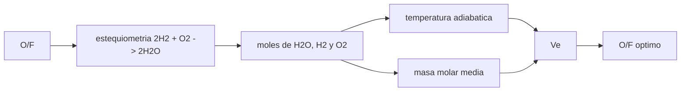

# B78-C05 — Propulsión bipropelente conceptual

<!-- nav:top -->
[🏠 Programa](../../../../README.md) · [📚 Bloque B78](../../../tronco-comun/B78-tecnologias-de-propulsion-espacial.md) · [← Anterior: B78-C04 — Propulsión monopropelente conceptual](../B78-C04-propulsion-monopropelente-conceptual/CLASE.md) · [Siguiente: B78-C06 — Propulsión eléctrica general →](../B78-C06-propulsion-electrica-general/CLASE.md)
<!-- /nav -->

## 1. Ubicación, nivel y alcance

Clase 5 del bloque B78. Nivel N3. Un bipropelente guarda combustible y oxidante en tanques separados y los junta en la cámara. Eso permite más energía por kilo que un monopropelente a cambio de más tuberías y válvulas. Aquí estudias, de forma conceptual, la **relación oxidante/combustible** `O/F`: cuánta masa de cada uno entra a la cámara y cómo cambian la temperatura, la masa molar y el escape. Usas [C03](../B78-C03-termodinamica-de-camaras/CLASE.md) para el escape. Los valores moleculares y de reacción son de manual y **no se consultaron**.

## 2. Por qué esta clase existe

Un motor puede quemar mezclas con exceso de combustible o de oxidante. La decisión central: **¿qué `O/F` maximiza el escape en un modelo sin disociación y por qué los motores reales operan en otro punto?**

## 3. Lo que podrás hacer al terminar

1. Calcular la relación estequiométrica `O/F` de H₂/O₂.
2. Hacer el balance de masas y de moles de los productos para cualquier `O/F`.
3. Estimar la temperatura adiabática y la masa molar según `O/F`.
4. Encontrar el máximo de escape con búsqueda de sección áurea y con una malla fina.
5. Explicar por qué un modelo sin disociación coloca el máximo en el punto estequiométrico.
6. Separar lo consultado (`R`, `Isp` alternativos) de lo ilustrativo (calor y `C_p`).

La evidencia es la **curva de Isp relativo frente a O/F** del ejercicio 12 (sección 20).

## 4. Con qué llegas y cómo comprobarlo

1. ¿Qué es una reacción estequiométrica?
2. ¿Qué es un reactivo limitante?
3. ¿Qué es la masa molar media de una mezcla?
4. ¿Qué es un dato sintético?
5. ¿Qué es una verificación por segunda vía?

<details>
<summary>Ver respuestas</summary>

1. Aquella en la que los reactivos se consumen por completo en la proporción exacta. 2. El que se agota primero y fija cuánto producto se forma. 3. Su masa total dividida por sus moles totales. 4. Un dato generado para el ejemplo, no medido. 5. Calcular lo mismo con otro método y comparar.
</details>

Con cuatro o cinco aciertos, sigue; si no, repasa los prerrequisitos.

## 5. Un caso de contexto y casos de referencia

Con el modelo **ilustrativo** H₂/O₂, la relación estequiométrica en masa es `7,936`. A `O/F = 4` el gas tiene `3344,9 K` y `10,080 g/mol` y escapa a `4212,0 m/s`; a `O/F = 7,936`, `4338,7 m/s`: el **ejemplo conductor**. Es un modelo de tendencia, sin disociación.

## 6. Vocabulario

El **bipropelente** usa combustible y oxidante en tanques separados. La **relación `O/F`** es la masa de oxidante entre la de combustible. La mezcla **estequiométrica** consume ambos por completo. Una mezcla **rica** tiene exceso de combustible; una **pobre**, de oxidante. El **reactivo en exceso** queda sin reaccionar en los productos y baja la temperatura.

## 7. Modelo mental



*Descripción textual:* `O/F` fija cuánto reacciona; de ahí salen la temperatura y la masa molar de los productos; ambas dan el escape, y se busca el `O/F` que lo maximiza.

Analogía: una receta con harina y huevos; si falta uno, el otro sobra y no aporta. Límite: en una cámara, el exceso no es inerte del todo; se disocia y se mezcla de forma distinta.

## 8. La explicación, paso a paso

### 8.1 Estequiometría

`2 H₂ + O₂ → 2 H₂O`. Con masas molares de manual (no consultadas) `2,016` y `31,998 g/mol`, `O/F_st = 31,998/(2 × 2,016) = 7,936`. Se comprobó la conservación de la masa en cada mezcla.

### 8.2 Tabla de tendencia

| `O/F` | `T` (K) | `M` (g/mol) | `Vₑ` (m/s) | `Vₑ/g₀` (s) |
|---|---|---|---|---|
| 1,0 | 1059,7 | 4,032 | 3748,5 | 382,2 |
| 4,0 | 3344,9 | 10,080 | 4212,0 | 429,5 |
| 7,0 | 5630,0 | 16,128 | 4320,1 | 440,5 |
| 8,0 | 6318,7 | 18,071 | 4323,6 | 440,9 |
| 9,0 | 5963,2 | 18,893 | 4107,8 | 418,9 |

### 8.3 El máximo del modelo

La búsqueda de sección áurea y una malla de `0,001` coinciden en `O/F = 7,936` con `Vₑ = 4338,7 m/s`: sin disociación, el escape sube hasta el punto estequiométrico (donde la temperatura es máxima) y cae después. Del lado rico la masa molar baja y ayuda; del pobre sube y perjudica.

### 8.4 Qué falta

Las temperaturas de la tabla (hasta `6318,7 K`) son irreales: sobreestiman al ignorar la disociación y el aumento de `C_p`. Con disociación, la temperatura se achata cerca del estequiométrico y la menor masa molar de una mezcla rica pasa a ganar; por eso los motores de H₂/O₂ operan ricos. Ese efecto **no está en este modelo**. El rango de 150–310 s que publica la NASA para mono y bipropelentes alternativos de naves pequeñas no aplica al H₂/O₂ (el modelo da 442 s).

## 9. Magnitudes, símbolos y unidades

| Símbolo | Qué es | Unidad | Valor / nota |
|---|---|---|---|
| `O/F` | relación oxidante/combustible | — | 0,5–9; estequiométrico 7,936 |
| `T` | temperatura adiabática | K | 3344,9 (O/F 4) |
| `M` | masa molar media | g/mol | 10,080 (O/F 4) |
| `Vₑ` | velocidad de escape | m/s | 4338,7 (máximo) |
| `Q` | calor por mol de H₂O | kJ/mol | 241,8 (ilustrativo) |
| `C_p` | calor específico molar medio | J/(mol K) | 40 (ilustrativo) |

## 10. Convenciones y referencias

Combustión completa sin disociación, exceso inerte, `C_p` constante, `γ = 1,20`, `p_c/pₑ = 100`, 298 K iniciales. Versiones: NIST CODATA y NASA SSVI (consulta del 2026-11-10). Masas molares y calor de reacción son de manual y **no se consultaron**.

## 11. De dónde sale lo que afirmamos

| ID | Fuente | Localizador | Respalda | Estado |
|---|---|---|---|---|
| S1 | NIST, CODATA Fundamental Physical Constants (tabla ASCII) — https://physics.nist.gov/cuu/Constants/Table/allascii.txt (consultada 2026-11-10) | filas de `R` y `g₀` | `R` y `g₀` | Consultada |
| S2 | NASA Small Spacecraft Systems Virtual Institute, State-of-the-Art: In-Space Propulsion, Tabla 4-1 — https://www.nasa.gov/smallsat-institute/sst-soa/in-space-propulsion/ (consultada 2026-11-10; solo se leyeron los primeros 100 000 de 289 063 caracteres) | Tabla 4-1, mono y bipropelentes alternativos | mono y bipropelentes alternativos: 50 mN–22 N y 150–310 s | Consultada parcialmente |
| — | Relaciones estándar de la física y la ingeniería de propulsión | — | las verifica el laboratorio con una segunda vía | No consultada en una fuente concreta |

Límites: las masas molares, el calor de reacción, `C_p` y `γ` no se consultaron; el modelo no es un cálculo de equilibrio y el H₂/O₂ no es un propelente de los de la tabla de la NASA.

## 12. Cómo ver el resultado

| Magnitud | Valor |
|---|---|
| `O/F` estequiométrico | 7,936 |
| `Vₑ` máximo | 4338,7 m/s |
| `Vₑ` con `O/F = 4` | 4212,0 m/s |
| `Vₑ` con `O/F = 9` | 4107,8 m/s |
| Diferencia sección áurea/malla | < 0,002 en O/F |

Descripción larga: el escape sube hasta el punto estequiométrico y cae después; la caída del lado pobre es mayor que la mejora del lado rico en este modelo.

## 13. Ejemplo trabajado

**Paso 1 · Moles.** Por 1 kg de H₂: `496,0 mol` de H₂; con `O/F = 4`, `125,0 mol` de O₂.

**Paso 2 · Reacción.** Reaccionan `250,0 mol` de H₂ y todo el O₂ forma `250,0 mol` de H₂O; sobran `246,0 mol` de H₂.

**Paso 3 · Masa molar.** `5,0 kg/(246,0 + 250,0) mol = 10,08 g/mol`.

## 14. Distintas formas de describir el problema

**Por masa:** `O/F`. **Por moles:** reactivo limitante. **Por temperatura:** el calor entre `n C_p`. **Por escape:** `Vₑ(O/F)`. **Por máximo:** sección áurea.

## 15. Práctica guiada

**Ejercicio 1 · guiado (con los pasos indicados).** Calcula `O/F_st` para `CH₄ + 2 O₂` con masas 16,043 y 31,998 g/mol. *Pasos:* masa de oxidante entre masa de combustible.

<details><summary>Solución comentada</summary>

`2 × 31,998/16,043 = 3,989`.
</details>

**Ejercicio 2 · guiado (con una pista).** Predice cuál es el reactivo en exceso si `O/F = 4` en H₂/O₂. *Pista:* compara con 7,936.

<details><summary>Solución comentada</summary>

El combustible (H₂): la mezcla es rica.
</details>

**Ejercicio 3 · guiado (casi autónomo).** ¿Por qué un exceso de oxidante enfría los productos? *Casi autónomo.*

<details><summary>Solución comentada</summary>

Porque hay masa que se calienta sin liberar calor adicional.
</details>

## 16. Práctica autónoma, transferencia e integrador

**Ejercicio 4 · autónomo.** Calcula los moles de H₂O con `O/F = 2` por kilo de H₂.

<details><summary>Solución comentada</summary>

`O₂ = 2/0,031998 = 62,5 mol`; `H₂O = 125,0 mol`.
</details>

**Ejercicio 5 · autónomo.** Calcula la masa molar con `O/F = 2`.

<details><summary>Solución comentada</summary>

`3,0 kg/(496,0 − 125,0 + 125,0 mol) = 6,048 g/mol`.
</details>

**Ejercicio 6 · autónomo.** ¿Qué `Vₑ/g₀` da el modelo con `O/F = 6`?

<details><summary>Solución comentada</summary>

`437,9 s`.
</details>

**Ejercicio 7 · autónomo.** ¿Cuánto vale la caída de `Vₑ` del estequiométrico a `O/F = 9`?

<details><summary>Solución comentada</summary>

`4338,7 → 4107,8`: `−5,3 %`.
</details>

**Ejercicio 8 · autónomo.** ¿Por qué el máximo del modelo coincide con el estequiométrico?

<details><summary>Solución comentada</summary>

Porque la temperatura es máxima ahí y la masa molar solo sube después.
</details>

**Ejercicio 9 · transferencia.** Un colega dice que los motores de H₂/O₂ operan estequiométricos por el modelo. ¿Qué omite?

<details><summary>Solución comentada</summary>

La disociación, que desplaza el óptimo hacia mezclas ricas.
</details>

**Ejercicio 10 · transferencia.** ¿Qué efecto tiene un `Q` más pequeño en la tabla?

<details><summary>Solución comentada</summary>

Baja todas las temperaturas y el escape, sin cambiar la posición del máximo.
</details>

**Ejercicio 11 · transferencia.** ¿Sirve este modelo para elegir un propelente real?

<details><summary>Solución comentada</summary>

No: es una tendencia. Un diseño exige equilibrio químico, pérdidas y materiales.
</details>

**Ejercicio 12 · integrador.** Elabora tu *curva de Isp relativo frente a O/F*: tabla, máximo del modelo, cuatro límites del modelo y qué es consultado e ilustrativo.

<details><summary>Solución comentada</summary>

Secciones 8.1–8.4 y la salida del laboratorio.
</details>

## 17. Laboratorio: relación O/F de un bipropelente H₂/O₂

El script [bipropelente.py](bipropelente.py) calcula productos, temperatura, masa molar y escape para `O/F` de 0,5 a 9, y halla el máximo (**comprueba** la conservación de la masa, `O/F_st` y la coincidencia del máximo entre sección áurea y malla fina).

**Datos:** `R`, `g₀` (NIST) y el rango de `Isp` (NASA SSVI) **consultados**; masas molares, calor de reacción, `C_p` y `γ` **ilustrativos, no consultados**. **Predice antes de ejecutar:** ¿en qué `O/F` está el máximo del modelo? (en el estequiométrico, 7,936.) **Ejecución del 2026-11-10 (Python 3.12.9):**

```text
Python 3.12.9 (biblioteca estandar)
O/F estequiometrico (masa) = 7.936
Bipropelente ILUSTRATIVO H2/O2 (valores de manual no consultados; solo tendencia)
  O/F    T [K]   M [g/mol]   Ve [m/s]   Isp_ve [s]
   0.5    678.9      3.024     3464.4      353.3
   1.0   1059.7      4.032     3748.5      382.2
   1.5   1440.6      5.040     3909.1      398.6
   2.0   1821.4      6.048     4012.6      409.2
   2.5   2202.3      7.056     4084.9      416.5
   3.0   2583.2      8.064     4138.3      422.0
   3.5   2964.0      9.072     4179.4      426.2
   4.0   3344.9     10.080     4212.0      429.5
   4.5   3725.7     11.088     4238.4      432.2
   5.0   4106.6     12.096     4260.4      434.4
   5.5   4487.4     13.104     4278.8      436.3
   6.0   4868.3     14.112     4294.6      437.9
   6.5   5249.2     15.120     4308.2      439.3
   7.0   5630.0     16.128     4320.1      440.5
   7.5   6010.9     17.136     4330.5      441.6
   8.0   6318.7     18.071     4323.6      440.9
   8.5   6135.6     18.495     4211.4      429.4
   9.0   5963.2     18.893     4107.8      418.9
Maximo de Ve (modelo): O/F = 7.936 (seccion aurea) ; malla fina: 7.936 ; Ve = 4338.7 m/s
Ve en el estequiometrico = 4338.7 m/s ; en el optimo = 4338.7 m/s (diferencia 0.000 %: sin disociacion el optimo cae en el estequiometrico)
Rango consultado de Isp (alternativos mono y bipropelentes) 150-310 s ; este modelo con H2/O2 da 442 s, fuera de rango: es otro propelente y un modelo ideal
Pruebas superadas.
```

```bash
python programa/clases/B78/B78-C05-propulsion-bipropelente-conceptual/bipropelente.py
```

**Límites:** sin disociación, `C_p` constante, exceso inerte; no es un cálculo de equilibrio y sus temperaturas no son realistas.

## 18. Errores frecuentes y cómo corregirlos

****Tomar las temperaturas del modelo por reales.** Se corrige con 8.4.**

****Creer que el óptimo real es el estequiométrico.** Se corrige con 8.4.**

****Mezclar la masa y los moles en `O/F`.** Se corrige con 8.1.**

****Usar el rango de la NASA para H₂/O₂.** Se corrige con la sección 11.**

## 19. Cómo sabrás que vas bien

Tras la sección 8: ¿qué `O/F` esperabas para el máximo y cuál obtuviste? Si dudas, repasa el ejemplo 13. Tras el laboratorio: ¿qué comprueba? (ver la sección 17).

## 20. Qué entregas y cómo se evalúa

El producto es tu **curva de Isp relativo frente a O/F** (ejercicio 12).

| Criterio | Inicial | En desarrollo | Logrado | Destacado |
|---|---|---|---|---|
| Conceptos | Los confunde | Parciales | Calcula `O/F` y el escape | Explica los límites |
| Cálculo | Sin unidades | Con errores | Tablas completas con unidades | Calcula casos nuevos |
| Numérico | Sin comprobar | Un caso | Contraste con una segunda vía | Interpreta las diferencias |
| Fuentes | Sin fuente | Sin fecha | Fuentes con fecha y estado | Declara lo ilustrativo y lo no consultado |
| Límites | No los nombra | Uno | Tres | Discute qué falta del modelo |

**Condiciones críticas (no se compensan con promedio):** rotular calor de reacción y `C_p` como ilustrativos y no consultados; no presentar las temperaturas como reales; citar solo lo consultado.

## 21. Ética, seguridad y límites

Clase educativa y conceptual: los modelos son simplificados, los datos son consultados con fecha o sintéticos rotulados, y ningún resultado es una especificación de diseño, una verificación de hardware ni una instrucción operativa.  Accesibilidad: tablas equivalentes a las gráficas, fórmulas en texto, ejercicios sin conexión.

## 22. Para cerrar y seguir

El modelo H₂/O₂ sin disociación da `4338,7 m/s` en el punto estequiométrico y baja al alejarse de él. Queda una pregunta: ¿qué pasa si la energía no viene de una reacción sino de la electricidad?

**Glosario español–inglés.** bipropelente · *bipropellant*; oxidante · *oxidizer*; relación de mezcla · *mixture ratio*; estequiométrico · *stoichiometric*; mezcla rica · *fuel-rich*.

**Continuidad.** [B78-C06](../B78-C06-propulsion-electrica-general/CLASE.md) estudia la propulsión eléctrica en general.

**Referencias:** ver sección 11.

<!-- nav:bottom -->
---

[← Anterior: B78-C04 — Propulsión monopropelente conceptual](../B78-C04-propulsion-monopropelente-conceptual/CLASE.md) · [📚 Bloque B78](../../../tronco-comun/B78-tecnologias-de-propulsion-espacial.md) · [Siguiente: B78-C06 — Propulsión eléctrica general →](../B78-C06-propulsion-electrica-general/CLASE.md)
<!-- /nav -->
