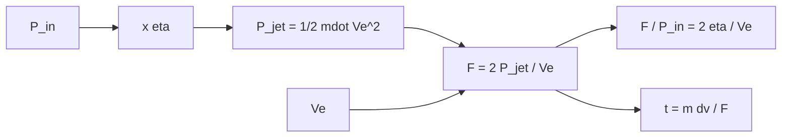

# B78-C06 — Propulsión eléctrica general

<!-- nav:top -->
[🏠 Programa](../../../../README.md) · [📚 Bloque B78](../../../tronco-comun/B78-tecnologias-de-propulsion-espacial.md) · [← Anterior: B78-C05 — Propulsión bipropelente conceptual](../B78-C05-propulsion-bipropelente-conceptual/CLASE.md) · [Siguiente: B78-C07 — Motores iónicos →](../B78-C07-motores-ionicos/CLASE.md)
<!-- /nav -->

## 1. Ubicación, nivel y alcance

Clase 6 del bloque B78. Nivel N3. En un propulsor eléctrico la energía no viene del propelente sino de una fuente de potencia (paneles, reactor). Eso desacopla la velocidad de escape de la química y la liga a la potencia: el chorro lleva potencia `½ ṁ Vₑ²`, y a mayor `Isp` hay menos empuje por vatio. Aquí aprendes esa relación general con los valores publicados de Dawn y los límites de la NASA para naves pequeñas. Usas [C01](../B78-C01-empuje-e-impulso-especifico/CLASE.md) para `F`, `ṁ` e `Isp`. La eficiencia total es ilustrativa.

## 2. Por qué esta clase existe

Subir el `Isp` ahorra propelente, pero el mismo vatio produce menos empuje y la maniobra tarda más. La decisión central: **¿cuánto empuje da cada kilovatio, cómo cae con el `Isp` y qué pasa con el tiempo de maniobra?**

## 3. Lo que podrás hacer al terminar

1. Calcular la potencia del chorro por tres fórmulas equivalentes.
2. Relacionar potencia de entrada, eficiencia y empuje: `F/P = 2η/Vₑ`.
3. Ver cómo cae el empuje por kilovatio con el `Isp`.
4. Estimar el tiempo de empuje y el propelente para un Δv con potencia fija.
5. Comparar con el tope consultado de ~75 mN/kW.
6. Separar lo consultado (Dawn, tope) de lo ilustrativo (`η`, nave).

La evidencia es la **ficha empuje–potencia–Isp de un propulsor eléctrico** del ejercicio 12 (sección 20).

## 4. Con qué llegas y cómo comprobarlo

1. ¿Qué es la potencia y en qué unidades se mide?
2. ¿Qué es la energía cinética de una masa en movimiento?
3. ¿Qué es una eficiencia?
4. ¿Qué es un dato sintético?
5. ¿Qué es una verificación por segunda vía?

<details>
<summary>Ver respuestas</summary>

1. Energía por unidad de tiempo; vatio (W). 2. `½ m v²`. 3. El cociente entre la potencia útil y la de entrada. 4. Un dato generado para el ejemplo, no medido. 5. Calcular lo mismo con otro método y comparar.
</details>

Con cuatro o cinco aciertos, sigue; si no, repasa los prerrequisitos.

## 5. Un caso de contexto y casos de referencia

Con los valores publicados de Dawn (`91 mN`, `3,25 mg/s`), la velocidad equivalente es `28 000 m/s` y la potencia del chorro `1274,0 W`. Con una eficiencia **ilustrativa** de `0,6`, la entrada es `2123,3 W` y el empuje por potencia `42,9 mN/kW`: el **ejemplo conductor**. La página de Dawn no da la potencia de entrada del motor.

## 6. Vocabulario

La **potencia del chorro** `P_jet = ½ ṁ Vₑ²` es la energía cinética por segundo del escape. La **eficiencia total** `η = P_jet/P_in` incluye todas las pérdidas. El **empuje por potencia** `F/P` se mide en mN/kW. Un propulsor **limitado por potencia** da un empuje que depende solo de `P` y `Vₑ`. La **planta de potencia** es la fuente que alimenta al propulsor.

## 7. Modelo mental



*Descripción textual:* la potencia de entrada, por la eficiencia, da la potencia del chorro; con la velocidad de escape fija el empuje; el empuje por potencia cae como `1/Vₑ` y fija el tiempo de maniobra.

Analogía: una bicicleta con una potencia fija; en marchas largas va rápido pero acelera poco. Límite: aquí el «cambio de marcha» es la elección del `Isp`, y está ligado al diseño del propulsor.

## 8. La explicación, paso a paso

### 8.1 Potencia del chorro

`P_jet = ½ ṁ Vₑ² = ½ F Vₑ = F²/(2ṁ)`. Para Dawn: `Vₑ = 28 000 m/s`, `Isp = 2855,2 s`, `P_jet = 1274,0 W`; las tres fórmulas coinciden a `10⁻¹²`.

### 8.2 Eficiencia y empuje por potencia

Como `F = 2 P_jet/Vₑ = 2η P_in/Vₑ`, resulta `F/P_in = 2η/Vₑ`.

| `η` (ilustrativa) | `P_in` (W) | `F/P` (mN/kW) |
|---|---|---|
| 0,4 | 3185,0 | 28,6 |
| 0,6 | 2123,3 | 42,9 |
| 0,7 | 1820,0 | 50,0 |

### 8.3 Empuje por kilovatio frente al `Isp` (con `η = 0,6`)

| `Isp` (s) | `Vₑ` (m/s) | `F/P` (mN/kW) |
|---|---|---|
| 300 | 2942 | 407,9 |
| 500 | 4903 | 244,7 |
| 1000 | 9807 | 122,4 |
| 2000 | 19 613 | 61,2 |
| 3000 | 29 420 | 40,8 |
| 5000 | 49 033 | 24,5 |

La NASA indica que la propulsión eléctrica de naves pequeñas queda por debajo de ~75 mN/kW. Con `η = 1`, la cota física `2/Vₑ` vale 75 mN/kW para `Vₑ = 26 667 m/s` (`Isp = 2719 s`); a `Isp` menores la cota física es mayor y manda el límite práctico, no el físico.

### 8.4 Tiempo de maniobra

Para `1000 m/s` con una nave de `500 kg`, `1 kW` y `η = 0,6`: `Isp = 1000 s` da `122,4 mN`, `47,3 días` y `50,99 kg`; `2000 s`, `61,2 mN`, `94,6 días` y `25,49 kg`; `3000 s`, `40,8 mN`, `141,9 días` y `17,00 kg`. Más `Isp` ahorra propelente y alarga la maniobra.

## 9. Magnitudes, símbolos y unidades

| Símbolo | Qué es | Unidad | Valor / nota |
|---|---|---|---|
| `P_jet` | potencia del chorro | W | 1274,0 (Dawn, calculada) |
| `η` | eficiencia total | — | 0,4–0,7 (ilustrativa) |
| `P_in` | potencia de entrada | W | 2123,3 (con η = 0,6) |
| `F/P` | empuje por potencia | mN/kW | 42,9; tope consultado ~75 |
| `Vₑ` | velocidad de escape | m/s | 28 000 |
| `Isp` | impulso específico | s | 2855,2 |

## 10. Convenciones y referencias

Potencia en vatios en el bus de la nave; chorro monoenergético y sin divergencia; `η` incluye todas las pérdidas. Versiones: NIST CODATA, página de Dawn y NASA SSVI (consulta del 2026-11-10). `η`, nave (500 kg), Δv y potencia de 1 kW son **ilustrativos**; la potencia de entrada del motor de Dawn **no se consultó**.

## 11. De dónde sale lo que afirmamos

| ID | Fuente | Localizador | Respalda | Estado |
|---|---|---|---|---|
| S1 | NIST, CODATA Fundamental Physical Constants (tabla ASCII) — https://physics.nist.gov/cuu/Constants/Table/allascii.txt (consultada 2026-11-10) | fila de `g₀` | `g₀ = 9,80665 m/s²` | Consultada |
| S2 | NASA/JPL, Dawn: Ion Propulsion — https://science.nasa.gov/mission/dawn/technology/ion-propulsion/ (consultada 2026-11-10) | empuje y consumo | 91 mN y ~3,25 mg/s; paneles de más de 10 kW | Consultada |
| S3 | NASA Small Spacecraft Systems Virtual Institute, State-of-the-Art: In-Space Propulsion, Tabla 4-1 — https://www.nasa.gov/smallsat-institute/sst-soa/in-space-propulsion/ (consultada 2026-11-10; solo se leyeron los primeros 100 000 de 289 063 caracteres) | Tabla 4-1, texto de empuje/potencia | tope de ~75 mN/kW; 500 W dan hasta ~38 mN | Consultada parcialmente |
| — | Relaciones estándar de la física y la ingeniería de propulsión | — | las verifica el laboratorio con una segunda vía | No consultada en una fuente concreta |

Límites: la página de Dawn no da la potencia de entrada del propulsor: las eficiencias son ilustrativas y la «potencia de entrada» calculada es un resultado del modelo, no un dato de la NASA. Los valores de `F/P` para `Isp` bajos superan el tope consultado porque ese tope corresponde a propulsores reales.

## 12. Cómo ver el resultado

| Magnitud | Valor |
|---|---|
| `P_jet` de Dawn | 1274,0 W |
| `F/P` con `η = 0,6` | 42,9 mN/kW |
| `Isp` donde la cota física es 75 mN/kW | 2719 s |
| Tiempo para 1000 m/s con `Isp = 2000 s` | 94,6 días |

Descripción larga: el empuje por kilovatio cae como `1/Isp`; el propelente baja y el tiempo de maniobra sube en la misma proporción.

## 13. Ejemplo trabajado

**Paso 1 · Potencia del chorro.** `½ × 0,091 × 28 000 = 1274 W`.

**Paso 2 · Potencia de entrada.** `1274/0,6 = 2123 W`.

**Paso 3 · Empuje por potencia.** `0,091/2123 = 4,29×10⁻⁵ N/W = 42,9 mN/kW`.

## 14. Distintas formas de describir el problema

**Por chorro:** `½ ṁ Vₑ²`. **Por empuje:** `½ F Vₑ`. **Por eficiencia:** `2η/Vₑ`. **Por tiempo:** `m Δv/F`. **Por tope:** 75 mN/kW.

## 15. Práctica guiada

**Ejercicio 1 · guiado (con los pasos indicados).** Calcula `P_jet` para `F = 50 mN` y `Vₑ = 20 000 m/s`. *Pasos:* `½ F Vₑ`.

<details><summary>Solución comentada</summary>

`½ × 0,05 × 20 000 = 500 W`.
</details>

**Ejercicio 2 · guiado (con una pista).** Predice qué pasa con `F/P` si `Vₑ` se duplica a igual `η`. *Pista:* `F/P = 2η/Vₑ`.

<details><summary>Solución comentada</summary>

Se divide por 2.
</details>

**Ejercicio 3 · guiado (casi autónomo).** ¿Por qué el empuje de un eléctrico es pequeño aunque su `Isp` sea alto? *Casi autónomo.*

<details><summary>Solución comentada</summary>

Porque la potencia limita el producto `F Vₑ`; para `Vₑ` alto, `F` es bajo.
</details>

## 16. Práctica autónoma, transferencia e integrador

**Ejercicio 4 · autónomo.** Calcula `P_in` para `F = 91 mN`, `Vₑ = 28 000 m/s` y `η = 0,5`.

<details><summary>Solución comentada</summary>

`1274/0,5 = 2548 W`.
</details>

**Ejercicio 5 · autónomo.** ¿Qué `F` da 500 W con `η = 0,6` e `Isp = 1500 s`?

<details><summary>Solución comentada</summary>

`F = 2 × 0,6 × 500/(1500 × 9,80665) = 40,8 mN`.
</details>

**Ejercicio 6 · autónomo.** ¿Cuánto es el tope de la NASA para 500 W?

<details><summary>Solución comentada</summary>

~38 mN (75 mN/kW × 0,5 kW = 37,5 mN).
</details>

**Ejercicio 7 · autónomo.** Con `F = 61,2 mN` ¿cuántos días hacen falta para `500 kg × 1000 m/s`?

<details><summary>Solución comentada</summary>

`500 000/0,0612 = 8,17×10⁶ s = 94,6 días`.
</details>

**Ejercicio 8 · autónomo.** Si `η` baja a 0,3, ¿cómo cambia el tiempo para un mismo Δv y `P`?

<details><summary>Solución comentada</summary>

Se duplica, porque `F` cae a la mitad.
</details>

**Ejercicio 9 · transferencia.** Un ingeniero propone doblar el `Isp` sin tocar la potencia para «ahorrar propelente». ¿Qué cuesta?

<details><summary>Solución comentada</summary>

El empuje se divide por dos y el tiempo de maniobra se duplica.
</details>

**Ejercicio 10 · transferencia.** ¿Por qué no se puede calcular `P_in` de Dawn solo con los datos consultados?

<details><summary>Solución comentada</summary>

Porque falta la potencia de entrada del motor; `η` es una suposición.
</details>

**Ejercicio 11 · transferencia.** ¿Basta `F/P` para elegir un propulsor?

<details><summary>Solución comentada</summary>

No: faltan la masa de la planta de potencia, la vida útil y la madurez (C15, C19, C21).
</details>

**Ejercicio 12 · integrador.** Elabora tu *ficha empuje–potencia–Isp de un propulsor eléctrico*: Dawn, tabla de `F/P` frente al `Isp`, tiempo de maniobra y qué es consultado e ilustrativo.

<details><summary>Solución comentada</summary>

Secciones 8.1–8.4 y la salida del laboratorio.
</details>

## 17. Laboratorio: potencia del chorro y empuje por vatio

El script [electrica.py](electrica.py) calcula la potencia del chorro de Dawn, el empuje por potencia para tres eficiencias, el empuje por kilovatio frente al `Isp` y el tiempo de maniobra (**comprueba** las tres fórmulas de `P_jet` a `1e-12`, `F/P = 2η/Vₑ` y que `F/P` decrece con el `Isp`).

**Datos:** `g₀` (NIST), `F` y `ṁ` de Dawn y el tope de 75 mN/kW (NASA SSVI) **consultados**; `η`, nave, Δv y potencia **ilustrativos**. **Predice antes de ejecutar:** ¿cuánto baja `F/P` si el `Isp` pasa de 1000 a 2000 s? (a la mitad.) **Ejecución del 2026-11-10 (Python 3.12.9):**

```text
Python 3.12.9 (biblioteca estandar)
Dawn (consultado F y mdot): Ve = 28000 m/s ; Isp = 2855.2 s ; P_jet = 1274.0 W
  eta = 0.4 (ILUSTRATIVA) -> P_in =  3185.0 W ; F/P =  28.6 mN/kW
  eta = 0.6 (ILUSTRATIVA) -> P_in =  2123.3 W ; F/P =  42.9 mN/kW
  eta = 0.7 (ILUSTRATIVA) -> P_in =  1820.0 W ; F/P =  50.0 mN/kW
Empuje por kilovatio frente al Isp (eta = 0.6, ILUSTRATIVA):
   Isp [s]   Ve [m/s]   F/P [mN/kW]   F con 1 kW [mN]
      300       2942         407.9            407.9
      500       4903         244.7            244.7
     1000       9807         122.4            122.4
     2000      19613          61.2             61.2
     3000      29420          40.8             40.8
     5000      49033          24.5             24.5
Con eta = 1, la cota fisica F/P = 2/Ve vale 75 mN/kW para Ve = 26667 m/s (Isp = 2719 s); por debajo de ese Isp la cota fisica es mayor que el tope consultado y manda el tope practico
Tiempo de empuje para 1000 m/s con 1 kW, 500 kg, eta = 0.6 (masa constante, aproximacion):
  Isp =  1000 s -> F =  122.4 mN ; t =    47.3 dias ; propelente =  50.99 kg
  Isp =  2000 s -> F =   61.2 mN ; t =    94.6 dias ; propelente =  25.49 kg
  Isp =  3000 s -> F =   40.8 mN ; t =   141.9 dias ; propelente =  17.00 kg
Pruebas superadas.
```

```bash
python programa/clases/B78/B78-C06-propulsion-electrica-general/electrica.py
```

**Límites:** chorro monoenergético, `η` constante, masa constante en el cálculo de tiempo; no incluye la masa de la planta de potencia.

## 18. Errores frecuentes y cómo corregirlos

****Confundir potencia de entrada con potencia del chorro.** Se corrige con 8.2.**

****Creer que más `Isp` es siempre mejor.** Se corrige con 8.4.**

****Usar el tope de 75 mN/kW como ley física.** Se corrige con 8.3.**

****Presentar una `η` ilustrativa como dato de Dawn.** Se corrige con la sección 11.**

## 19. Cómo sabrás que vas bien

Tras la sección 8: ¿qué `F/P` esperabas con `η = 0,6` y cuál obtuviste? Si dudas, repasa el ejemplo 13. Tras el laboratorio: ¿qué comprueba? (ver la sección 17).

## 20. Qué entregas y cómo se evalúa

El producto es tu **ficha empuje–potencia–Isp de un propulsor eléctrico** (ejercicio 12).

| Criterio | Inicial | En desarrollo | Logrado | Destacado |
|---|---|---|---|---|
| Conceptos | Los confunde | Parciales | Relaciona potencia, `η`, `Vₑ` y empuje | Explica los límites |
| Cálculo | Sin unidades | Con errores | Tablas completas con unidades | Calcula casos nuevos |
| Numérico | Sin comprobar | Un caso | Contraste con una segunda vía | Interpreta las diferencias |
| Fuentes | Sin fuente | Sin fecha | Fuentes con fecha y estado | Declara lo ilustrativo y lo no consultado |
| Límites | No los nombra | Uno | Tres | Discute qué falta del modelo |

**Condiciones críticas (no se compensan con promedio):** rotular `η` y la nave como ilustrativas; no presentar la potencia de entrada de Dawn como dato; citar solo lo consultado.

## 21. Ética, seguridad y límites

Clase educativa y conceptual: los modelos son simplificados, los datos son consultados con fecha o sintéticos rotulados, y ningún resultado es una especificación de diseño, una verificación de hardware ni una instrucción operativa.  Accesibilidad: tablas equivalentes a las gráficas, fórmulas en texto, ejercicios sin conexión.

## 22. Para cerrar y seguir

Con `η = 0,6`, un chorro de `28 km/s` da `42,9 mN/kW`, y duplicar el `Isp` divide el empuje por dos. Queda una pregunta: ¿cómo se acelera el propelente para lograr ese escape?

**Glosario español–inglés.** potencia del chorro · *jet power*; eficiencia total · *total efficiency*; empuje por potencia · *thrust-to-power ratio*; planta de potencia · *power plant*; propulsión eléctrica · *electric propulsion*.

**Continuidad.** [B78-C07](../B78-C07-motores-ionicos/CLASE.md) estudia los motores iónicos.

**Referencias:** ver sección 11.

<!-- nav:bottom -->
---

[← Anterior: B78-C05 — Propulsión bipropelente conceptual](../B78-C05-propulsion-bipropelente-conceptual/CLASE.md) · [📚 Bloque B78](../../../tronco-comun/B78-tecnologias-de-propulsion-espacial.md) · [Siguiente: B78-C07 — Motores iónicos →](../B78-C07-motores-ionicos/CLASE.md)
<!-- /nav -->
