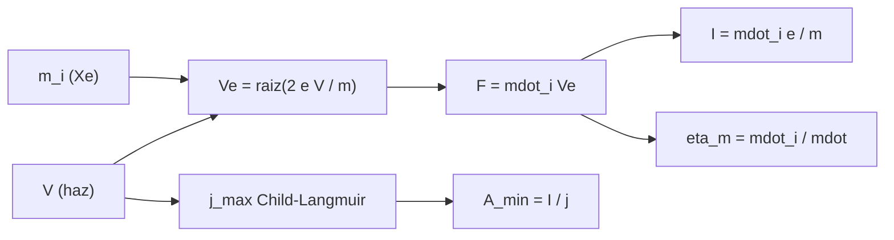

# B78-C07 — Motores iónicos

<!-- nav:top -->
[🏠 Programa](../../../../README.md) · [📚 Bloque B78](../../../tronco-comun/B78-tecnologias-de-propulsion-espacial.md) · [← Anterior: B78-C06 — Propulsión eléctrica general](../B78-C06-propulsion-electrica-general/CLASE.md) · [Siguiente: B78-C08 — Propulsores Hall →](../B78-C08-propulsores-hall/CLASE.md)
<!-- /nav -->

## 1. Ubicación, nivel y alcance

Clase 7 del bloque B78. Nivel N3. Un motor iónico de rejillas ioniza un gas noble, normalmente xenón, y acelera los iones con un campo eléctrico entre dos rejillas. La velocidad de los iones sale de la tensión y de la masa; la densidad de corriente máxima, de la carga espacial (ley de Child–Langmuir). Aquí calculas ambas con las constantes de NIST, contrastas con los valores publicados de Dawn y verificas la ley con una integral numérica. Usas [C06](../B78-C06-propulsion-electrica-general/CLASE.md) para la potencia. La tensión del haz es ilustrativa y la masa del xenón **no se consultó**.

## 2. Por qué esta clase existe

La velocidad de escape iónica crece con la raíz de la tensión, pero la corriente que cabe en una rejilla está limitada por la carga espacial. La decisión central: **¿qué tensión y qué área de rejilla se necesitan para un empuje dado y qué fracción del propelente llega a ser ion?**

## 3. Lo que podrás hacer al terminar

1. Calcular la velocidad de un ion acelerado por una tensión: `Vₑ = √(2eV/m)`.
2. Relacionar empuje, caudal de iones y corriente de haz.
3. Aplicar la ley de Child–Langmuir y verificarla con una integral numérica.
4. Calcular el área de rejilla mínima para un empuje dado.
5. Estimar la utilización de masa con los valores de Dawn.
6. Separar lo consultado (NIST, Dawn) de lo ilustrativo (tensión) y de lo no consultado (masa del xenón).

La evidencia es la **ficha de un motor iónico de xenón** del ejercicio 12 (sección 20).

## 4. Con qué llegas y cómo comprobarlo

1. ¿Qué energía gana una carga `q` al atravesar una diferencia de potencial `V`?
2. ¿Qué es la corriente eléctrica?
3. ¿Qué es la carga espacial?
4. ¿Qué es un dato sintético?
5. ¿Qué es una verificación por segunda vía?

<details>
<summary>Ver respuestas</summary>

1. `q V`. 2. Carga por unidad de tiempo; amperio (A). 3. La densidad de carga de las partículas que ocupan el volumen entre electrodos. 4. Un dato generado para el ejemplo, no medido. 5. Calcular lo mismo con otro método y comparar.
</details>

Con cuatro o cinco aciertos, sigue; si no, repasa los prerrequisitos.

## 5. Un caso de contexto y casos de referencia

Un ion Xe⁺ acelerado por una tensión **ilustrativa** de `1100 V` sale a `40 209 m/s` (`4100,2 s`). Con el empuje y el consumo publicados de Dawn (`91 mN`, `3,25 mg/s`), el caudal de iones sería `2,263 mg/s`, la corriente de haz `1,663 A` y la utilización de masa `0,696`: el **ejemplo conductor**. La tensión de Dawn no se consultó.

## 6. Vocabulario

La **tensión de haz** `V` acelera los iones. La **densidad de corriente** `j` es la corriente por unidad de área. El **límite de Child–Langmuir** es el máximo `j` que atraviesa el gap `d` sin que la carga espacial lo frene. La **utilización de masa** `η_m` es la fracción del propelente que se ioniza y sale como ion. La **rejilla** es el electrodo perforado que extrae y acelera los iones.

## 7. Modelo mental



*Descripción textual:* la tensión y la masa del ion dan su velocidad; el empuje fija el caudal de iones y la corriente; la ley de Child–Langmuir da la densidad máxima y con ella el área mínima; el caudal total da la utilización de masa.

Analogía: una escalera mecánica con límite de pasajeros por escalón; la tensión es la altura que sube cada persona y la carga espacial, cuántos caben. Límite: los iones se repelen entre sí; los pasajeros no.

## 8. La explicación, paso a paso

### 8.1 Velocidad del ion

`m_i = 131,293 u = 2,1802×10⁻²⁵ kg` (la masa atómica es un valor de manual, no consultado; `u` es de NIST). Con `V = 1100 V`: `Vₑ = √(2 × 1,602×10⁻¹⁹ × 1100/2,1802×10⁻²⁵) = 40 209 m/s` e `Isp = 4100,2 s`. A `V` cuadruplicada la velocidad se duplica.

### 8.2 Con los números de Dawn

El empuje es `F = ṁ_i Vₑ`, de donde `ṁ_i = 0,091/40 209 = 2,263 mg/s`; la corriente es `I = ṁ_i e/m_i = 1,663 A`. Como el consumo total publicado es `3,25 mg/s`, la utilización de masa es `0,696`. El producto `Vₑ η_m = 28 000 m/s` coincide con la velocidad equivalente `F/ṁ` publicada.

### 8.3 Ley de Child–Langmuir

`j = (4ε₀/9) √(2e/m) V^(3/2)/d²`. Con `d = 0,6 mm`: `j = 483,48 A/m²`. La integral numérica del campo (primera integral de Poisson, sustitución `φ = s⁴` y bisección en `j`) da el mismo valor con diferencia relativa `1,2×10⁻⁹`.

| `V` (V) | `Vₑ` (m/s) | `Isp` (s) | `j_max` (A/m²) |
|---|---|---|---|
| 500 | 27 109 | 2764,3 | 148,2 |
| 1100 | 40 209 | 4100,2 | 483,5 |
| 2000 | 54 218 | 5528,7 | 1185,3 |
| 3000 | 66 403 | 6771,2 | 2177,6 |

### 8.4 Área de rejilla

`A_min = F/(j √(2mV/e)) = 34,4 cm²` para `91 mN` (diámetro equivalente `6,6 cm`). La corriente máxima crece con `V^(3/2)` y el empuje con `V^(1/2) × I`, de modo que subir la tensión permite mucho más empuje por área.

## 9. Magnitudes, símbolos y unidades

| Símbolo | Qué es | Unidad | Valor / nota |
|---|---|---|---|
| `V` | tensión de haz | V | 1100 (ilustrativa) |
| `m_i` | masa del ion | kg | 2,1802×10⁻²⁵ (no consultada) |
| `Vₑ` | velocidad del ion | m/s | 40 209 |
| `I` | corriente de haz | A | 1,663 |
| `j_max` | límite de Child–Langmuir | A/m² | 483,48 |
| `η_m` | utilización de masa | — | 0,696 |
| `d` | separación entre rejillas | m | 0,6×10⁻³ (ilustrativa) |

## 10. Convenciones y referencias

Iones Xe⁺ de carga única, haz monoenergético sin divergencia, geometría 1D, sin carga inicial. `e`, `u`, `ε₀` y `g₀` de NIST CODATA y datos de Dawn de la página citada (consulta del 2026-11-10). La masa atómica 131,293 **no se consultó**; la tensión y el gap son **ilustrativos**.

## 11. De dónde sale lo que afirmamos

| ID | Fuente | Localizador | Respalda | Estado |
|---|---|---|---|---|
| S1 | NIST, CODATA Fundamental Physical Constants (tabla ASCII) — https://physics.nist.gov/cuu/Constants/Table/allascii.txt (consultada 2026-11-10) | filas de `e`, `u`, `ε₀` y `g₀` | `e`, `u = 1,66053906892×10⁻²⁷ kg`, `ε₀ = 8,8541878188×10⁻¹² F/m`, `g₀` | Consultada |
| S2 | NASA/JPL, Dawn: Ion Propulsion — https://science.nasa.gov/mission/dawn/technology/ion-propulsion/ (consultada 2026-11-10) | empuje y consumo de xenón | 91 mN y ~3,25 mg/s | Consultada |
| — | Relaciones estándar de la física y la ingeniería de propulsión | — | las verifica el laboratorio con una segunda vía | No consultada en una fuente concreta |

Límites: la tensión de haz de Dawn y su geometría de rejillas no se consultaron; la utilización de masa calculada depende de la tensión ilustrativa y no es un dato de la NASA.

## 12. Cómo ver el resultado

| Magnitud | Valor |
|---|---|
| `Vₑ` con 1100 V | 40 209 m/s |
| Corriente de haz | 1,663 A |
| `j_max` | 483,48 A/m² |
| Diferencia con la integral | 1,2×10⁻⁹ |
| Área mínima | 34,4 cm² |

Descripción larga: la velocidad crece con `V^(1/2)` y la densidad de corriente con `V^(3/2)`; el empuje por unidad de área de rejilla crece con `V`.

## 13. Ejemplo trabajado

**Paso 1 · Masa del ion.** `131,293 × 1,6605×10⁻²⁷ = 2,180×10⁻²⁵ kg`.

**Paso 2 · Velocidad.** `√(2 × 1,602×10⁻¹⁹ × 1100/2,180×10⁻²⁵) = √(1,617×10⁹) = 40 209 m/s`.

**Paso 3 · Caudal de iones.** `0,091/40 209 = 2,263×10⁻⁶ kg/s`.

## 14. Distintas formas de describir el problema

**Por energía:** `qV = ½ m v²`. **Por empuje:** `ṁ_i Vₑ`. **Por corriente:** `I = ṁ_i e/m`. **Por carga espacial:** `j ∝ V^(3/2)/d²`. **Por utilización:** `ṁ_i/ṁ`.

## 15. Práctica guiada

**Ejercicio 1 · guiado (con los pasos indicados).** Calcula la energía en eV de un ion que cruza 1100 V. *Pasos:* energía = carga × tensión.

<details><summary>Solución comentada</summary>

`1100 eV` para carga única.
</details>

**Ejercicio 2 · guiado (con una pista).** Predice cuánto sube `Vₑ` si `V` pasa de 500 a 2000 V. *Pista:* raíz.

<details><summary>Solución comentada</summary>

Se duplica.
</details>

**Ejercicio 3 · guiado (casi autónomo).** ¿Por qué el xenón y no el helio? *Casi autónomo.*

<details><summary>Solución comentada</summary>

Al ser pesado, para el mismo empuje se necesita menos corriente: `F = I √(2mV/e)`; además es fácil de ionizar y no es corrosivo (afirmación general no consultada).
</details>

## 16. Práctica autónoma, transferencia e integrador

**Ejercicio 4 · autónomo.** Calcula `j_max` si `d` baja de 0,6 a 0,3 mm a igual `V`.

<details><summary>Solución comentada</summary>

Sube ×4: `j ∝ 1/d²`, de 483,48 a 1933,9 A/m².
</details>

**Ejercicio 5 · autónomo.** ¿Qué corriente da 91 mN a 2000 V?

<details><summary>Solución comentada</summary>

`Vₑ = 54 218 m/s`; `ṁ_i = 1,678 mg/s`; `I = 1,678×10⁻⁶ × 1,602×10⁻¹⁹/2,1802×10⁻²⁵ = 1,233 A`.
</details>

**Ejercicio 6 · autónomo.** ¿Cuál es el `Isp` con `V = 3000 V`?

<details><summary>Solución comentada</summary>

`6771,2 s`.
</details>

**Ejercicio 7 · autónomo.** ¿Qué utilización de masa da `ṁ_i = 3 mg/s` y `ṁ = 3,25 mg/s`?

<details><summary>Solución comentada</summary>

`0,923`.
</details>

**Ejercicio 8 · autónomo.** Compara el área de rejilla a 2000 V con la de 1100 V para 91 mN.

<details><summary>Solución comentada</summary>

`A ∝ F/(j√V)`, con `j ∝ V^(3/2)`: `A ∝ V^(-2)`; es `(1100/2000)² = 0,3025` veces menor.
</details>

**Ejercicio 9 · transferencia.** Un colega usa `Vₑ = 28 000 m/s` como la velocidad de los iones de Dawn. ¿Qué confunde?

<details><summary>Solución comentada</summary>

La velocidad equivalente (que incluye al propelente sin ionizar) con la velocidad del ion.
</details>

**Ejercicio 10 · transferencia.** ¿Qué efectos reales faltan en Child–Langmuir?

<details><summary>Solución comentada</summary>

Iones con doble carga, divergencia del haz, geometría de orificios, erosión de rejillas y temperatura (C21).
</details>

**Ejercicio 11 · transferencia.** ¿Puede usarse este modelo para calcular el empuje de Dawn?

<details><summary>Solución comentada</summary>

No: la tensión es ilustrativa; solo muestra la relación entre magnitudes.
</details>

**Ejercicio 12 · integrador.** Elabora tu *ficha de un motor iónico de xenón*: velocidad, caudal de iones, corriente, utilización de masa, `j_max` y área mínima, con lo consultado, lo calculado y lo no consultado.

<details><summary>Solución comentada</summary>

Secciones 8.1–8.4 y la salida del laboratorio.
</details>

## 17. Laboratorio: aceleración electrostática de iones y ley de Child–Langmuir

El script [ionico.py](ionico.py) calcula la velocidad del ion, el caudal y la corriente de Dawn, el límite de Child–Langmuir y el área de rejilla (**comprueba** `Vₑ ∝ V^(1/2)`, `j` contra una integral numérica con tolerancia `1e-6` y la coincidencia con la velocidad equivalente publicada).

**Datos:** `e`, `u`, `ε₀`, `g₀` (NIST) y `F`, `ṁ` de Dawn **consultados**; tensión y gap **ilustrativos**; masa atómica del xenón **no consultada**. **Predice antes de ejecutar:** ¿cuánto vale la utilización de masa con 1100 V? (≈ 0,70.) **Ejecución del 2026-11-10 (Python 3.12.9):**

```text
Python 3.12.9 (biblioteca estandar)
Masa del ion Xe+ = 2.1802e-25 kg (131.293 u, valor de manual NO consultado)
V = 1100 V (ILUSTRATIVA): Ve = 40209 m/s ; Isp = 4100.2 s
Dawn (F y mdot consultados): mdot de iones = F/Ve = 2.263 mg/s ; corriente de haz = 1.663 A ; utilizacion de masa = 0.696
Velocidad equivalente consultada (F/mdot) = 28000 m/s ; Ve_ion*utilizacion = 28000 m/s
Child-Langmuir (d = 0.6 mm): j = 483.48 A/m2 ; numerica = 483.48 A/m2 ; diferencia relativa = 1.2e-09
  V [V]   Ve [m/s]   Isp [s]   j_max [A/m2]
    500      27109    2764.3         148.2
   1100      40209    4100.2         483.5
   2000      54218    5528.7        1185.3
   3000      66403    6771.2        2177.6
Ve(2000 V)/Ve(500 V) = 2.000000 (esperado 2 por Ve ~ V^(1/2)); j escala como V^(3/2): j(2000)/j(500) = 8.0000
Area de rejilla minima para 91 mN con j_max: A = F/(j sqrt(2 m V/e)) = 34.4 cm2 (diametro equivalente 6.6 cm)
Pruebas superadas.
```

```bash
python programa/clases/B78/B78-C07-motores-ionicos/ionico.py
```

**Límites:** iones de carga única, haz 1D sin divergencia, sin erosión ni iones de doble carga; la tensión de Dawn no se consultó.

## 18. Errores frecuentes y cómo corregirlos

****Confundir la velocidad del ion con la equivalente.** Se corrige con 8.2.**

****Olvidar el límite de carga espacial.** Se corrige con 8.3.**

****Presentar `1100 V` como dato de Dawn.** Se corrige con la sección 11.**

****Usar masa en u como si fuera kg.** Se corrige con la sección 9.**

## 19. Cómo sabrás que vas bien

Tras la sección 8: ¿qué utilización de masa esperabas y cuál obtuviste? Si dudas, repasa el ejemplo 13. Tras el laboratorio: ¿qué comprueba? (ver la sección 17).

## 20. Qué entregas y cómo se evalúa

El producto es tu **ficha de un motor iónico de xenón** (ejercicio 12).

| Criterio | Inicial | En desarrollo | Logrado | Destacado |
|---|---|---|---|---|
| Conceptos | Los confunde | Parciales | Calcula `Vₑ`, `I` y `j` | Explica los límites |
| Cálculo | Sin unidades | Con errores | Tablas completas con unidades | Calcula casos nuevos |
| Numérico | Sin comprobar | Un caso | Contraste con una segunda vía | Interpreta las diferencias |
| Fuentes | Sin fuente | Sin fecha | Fuentes con fecha y estado | Declara lo ilustrativo y lo no consultado |
| Límites | No los nombra | Uno | Tres | Discute qué falta del modelo |

**Condiciones críticas (no se compensan con promedio):** rotular la tensión y la geometría como ilustrativas; declarar la masa del xenón como no consultada; citar solo lo consultado.

## 21. Ética, seguridad y límites

Clase educativa y conceptual: los modelos son simplificados, los datos son consultados con fecha o sintéticos rotulados, y ningún resultado es una especificación de diseño, una verificación de hardware ni una instrucción operativa.  Accesibilidad: tablas equivalentes a las gráficas, fórmulas en texto, ejercicios sin conexión.

## 22. Para cerrar y seguir

A `1100 V`, un ion de xenón sale a `40,2 km/s` y una rejilla de `0,6 mm` admite `483 A/m²`; con los datos de Dawn, el `70 %` del xenón sería ion. Queda una pregunta: ¿cómo se logra lo mismo con un campo magnético en vez de rejillas?

**Glosario español–inglés.** motor iónico · *ion thruster*; rejilla · *grid*; carga espacial · *space charge*; utilización de masa · *mass utilization*; corriente de haz · *beam current*.

**Continuidad.** [B78-C08](../B78-C08-propulsores-hall/CLASE.md) estudia los propulsores Hall.

**Referencias:** ver sección 11.

<!-- nav:bottom -->
---

[← Anterior: B78-C06 — Propulsión eléctrica general](../B78-C06-propulsion-electrica-general/CLASE.md) · [📚 Bloque B78](../../../tronco-comun/B78-tecnologias-de-propulsion-espacial.md) · [Siguiente: B78-C08 — Propulsores Hall →](../B78-C08-propulsores-hall/CLASE.md)
<!-- /nav -->
