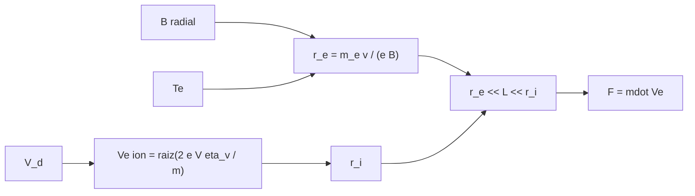

# B78-C08 — Propulsores Hall

<!-- nav:top -->
[🏠 Programa](../../../../README.md) · [📚 Bloque B78](../../../tronco-comun/B78-tecnologias-de-propulsion-espacial.md) · [← Anterior: B78-C07 — Motores iónicos](../B78-C07-motores-ionicos/CLASE.md) · [Siguiente: B78-C09 — Propulsión por plasma →](../B78-C09-propulsion-por-plasma/CLASE.md)
<!-- /nav -->

## 1. Ubicación, nivel y alcance

Clase 8 del bloque B78. Nivel N3. Un propulsor Hall acelera los iones con un campo eléctrico axial sin rejillas: un campo magnético radial atrapa a los electrones en una deriva `E×B` alrededor del canal, y ese gas de electrones crea el campo que empuja a los iones. Aquí aprendes la condición que lo hace funcionar (electrones magnetizados, iones no) con radios de giro y el parámetro de Hall. Usas [C07](../B78-C07-motores-ionicos/CLASE.md) para la velocidad del ion. El propulsor es sintético y la masa del xenón **no se consultó**.

## 2. Por qué esta clase existe

Sin rejillas no hay límite de Child–Langmuir, pero el propulsor depende de que los electrones giren en un radio pequeño y los iones pasen casi rectos. La decisión central: **¿cuánto vale cada radio de giro frente al largo del canal y qué cambia al subir la tensión?**

## 3. Lo que podrás hacer al terminar

1. Calcular el radio de giro de un electrón y de un ion en un campo magnético.
2. Verificar la condición `r_e ≪ L ≪ r_i` de un propulsor Hall.
3. Calcular la frecuencia de ciclotrón y el parámetro de Hall clásico.
4. Calcular la deriva `E×B` media y la velocidad del ion.
5. Obtener empuje, `Isp` y `F/P` con la tensión de descarga y el caudal.
6. Comparar con el rango consultado de Hall de naves pequeñas.

La evidencia es la **ficha de magnetización de un propulsor Hall** del ejercicio 12 (sección 20).

## 4. Con qué llegas y cómo comprobarlo

1. ¿Cómo se mueve una carga en un campo magnético uniforme?
2. ¿Qué es la frecuencia de ciclotrón?
3. ¿Qué es una deriva `E×B`?
4. ¿Qué es un dato sintético?
5. ¿Qué es una verificación por segunda vía?

<details>
<summary>Ver respuestas</summary>

1. Gira en círculos de radio `m v/(q B)`. 2. La de giro de la partícula: `q B/m`. 3. El movimiento de la carga perpendicular a `E` y `B` con velocidad `E/B`. 4. Un dato generado para el ejemplo, no medido. 5. Calcular lo mismo con otro método y comparar.
</details>

Con cuatro o cinco aciertos, sigue; si no, repasa los prerrequisitos.

## 5. Un caso de contexto y casos de referencia

En un canal **ilustrativo** de `25 mm` con `B = 0,015 T` y electrones de `10 eV`, el radio de giro del electrón es `0,711 mm` y el del ion de xenón a `300 V`, `1807 mm`: el electrón está magnetizado y el ion no. Con `5 mg/s` y `4,5 A` el empuje es `99,6 mN` con `Isp = 2031,4 s`: el **ejemplo conductor**.

## 6. Vocabulario

El **radio de giro** `r = m v⊥/(q B)`. La **frecuencia de ciclotrón** `ω_c = q B/m`. El **parámetro de Hall** `ω_c/ν` compara el giro con las colisiones. Un electrón está **magnetizado** si `r ≪ L`. La **deriva `E×B`** tiene velocidad `E/B`. La **eficiencia de tensión** `η_v` es la fracción de la tensión de descarga que gana el ion.

## 7. Modelo mental



*Descripción textual:* el campo magnético y la temperatura fijan el radio del electrón; la tensión fija la velocidad y el radio del ion; la condición `r_e ≪ L ≪ r_i` habilita al propulsor y el empuje sale del caudal y de la velocidad.

Analogía: un río con una compuerta de agitadores: los granos finos quedan girando cerca de la compuerta y los gruesos la cruzan de largo. Límite: aquí lo que separa a los electrones de los iones es su masa, no su tamaño.

## 8. La explicación, paso a paso

### 8.1 Radios de giro

Con `m_e = 9,1093837139×10⁻³¹ kg` (NIST), `B = 0,015 T` y `T_e = 10 eV`: `v⊥ = √(2eT_e/m_e) = 1,876×10⁶ m/s`, `ω_c = 2,638×10⁹ rad/s` y `r_e = 0,711 mm`; por la segunda vía `r = v⊥/ω_c` da el mismo valor a `10⁻¹²`. Para el ion Xe⁺ con `V = 300 V` y `η_v = 0,9`: `Vₑ = 19 921 m/s` y `r_i = 1807,2 mm`.

### 8.2 La condición del propulsor

`r_e/L = 0,0284` y `r_i/L = 72,3`: `r_e ≪ L ≪ r_i`. Los electrones giran en un radio mucho menor que el canal y los iones lo cruzan sin curvarse.

### 8.3 Parámetro de Hall y deriva

Con neutros de `10¹⁹ m⁻³` y sección `10⁻¹⁹ m²`, `ν = 1,876×10⁶ s⁻¹` y el parámetro de Hall clásico vale `1407`. En un propulsor real la difusión anómala (tipo Bohm) lo reduce a un efectivo de ~16. La deriva media es `E/B = 12 000/0,015 = 8,0×10⁵ m/s`.

### 8.4 Empuje y tensión

| `V` (V) | `Vₑ` (m/s) | `Isp` (s) | `F` (mN) |
|---|---|---|---|
| 150 | 14 086 | 1436,4 | 70,4 |
| 300 | 19 921 | 2031,4 | 99,6 |
| 450 | 24 398 | 2487,9 | 122,0 |
| 600 | 28 172 | 2872,8 | 140,9 |

Con `V = 300 V` y `4,5 A` la potencia es `1350 W` y `F/P = 73,8 mN/kW`. Este caso ilustrativo es más grande que los Hall de naves pequeñas de la NASA (0,25–55 mN, 200–1920 s): no representa a un propulsor de CubeSat.

## 9. Magnitudes, símbolos y unidades

| Símbolo | Qué es | Unidad | Valor / nota |
|---|---|---|---|
| `B` | campo magnético | T | 0,015 (ilustrativo) |
| `r_e`, `r_i` | radios de giro | mm | 0,711 y 1807,2 |
| `L` | largo del canal | mm | 25 (ilustrativo) |
| `ω_c` | frecuencia de ciclotrón del electrón | rad/s | 2,638×10⁹ |
| `ω_c/ν` | parámetro de Hall clásico | — | 1407 |
| `Vₑ` | velocidad del ion | m/s | 19 921 |
| `F` | empuje | mN | 99,6 |

## 10. Convenciones y referencias

Electrones con velocidad perpendicular `√(2eT_e/m_e)`; campo magnético uniforme (promedio), campo eléctrico medio `V/L`; xenón de carga única. Versiones: NIST CODATA y NASA SSVI (consulta del 2026-11-10). `B`, `L`, `T_e`, neutros, `η_v`, `ṁ` y corriente son **ilustrativos**; la masa del xenón **no se consultó**.

## 11. De dónde sale lo que afirmamos

| ID | Fuente | Localizador | Respalda | Estado |
|---|---|---|---|---|
| S1 | NIST, CODATA Fundamental Physical Constants (tabla ASCII) — https://physics.nist.gov/cuu/Constants/Table/allascii.txt (consultada 2026-11-10) | filas de `e`, `m_e`, `u` y `g₀` | constantes fundamentales | Consultada |
| S2 | NASA Small Spacecraft Systems Virtual Institute, State-of-the-Art: In-Space Propulsion, Tabla 4-1 — https://www.nasa.gov/smallsat-institute/sst-soa/in-space-propulsion/ (consultada 2026-11-10; solo se leyeron los primeros 100 000 de 289 063 caracteres) | Tabla 4-1, fila de Hall | Hall: 0,25–55 mN y 200–1920 s | Consultada parcialmente |
| — | Relaciones estándar de la física y la ingeniería de propulsión | — | las verifica el laboratorio con una segunda vía | No consultada en una fuente concreta |

Límites: el campo, la geometría y las temperaturas no provienen de un propulsor real ni de una fuente consultada; la difusión anómala (valor 16) es una referencia general no consultada.

## 12. Cómo ver el resultado

| Magnitud | Valor |
|---|---|
| `r_e` | 0,711 mm |
| `r_i` | 1807,2 mm |
| `r_e/L` | 0,0284 |
| `F` con 300 V | 99,6 mN |
| `F/P` | 73,8 mN/kW |

Descripción larga: en el largo del canal caben unos 35 radios del electrón y el ion lo cruza casi recto; el empuje sube con la raíz de la tensión.

## 13. Ejemplo trabajado

**Paso 1 · Velocidad del electrón.** `√(2 × 1,602×10⁻¹⁹ × 10/9,109×10⁻³¹) = 1,876×10⁶ m/s`.

**Paso 2 · Frecuencia.** `1,602×10⁻¹⁹ × 0,015/9,109×10⁻³¹ = 2,638×10⁹ rad/s`.

**Paso 3 · Radio.** `1,876×10⁶/2,638×10⁹ = 0,711 mm`.

## 14. Distintas formas de describir el problema

**Por radios:** `r_e`, `r_i`. **Por frecuencias:** `ω_c`. **Por colisiones:** parámetro de Hall. **Por deriva:** `E/B`. **Por empuje:** `ṁ Vₑ`.

## 15. Práctica guiada

**Ejercicio 1 · guiado (con los pasos indicados).** Calcula `ω_c` de un electrón con `B = 0,03 T`. *Pasos:* `e B/m_e`.

<details><summary>Solución comentada</summary>

`5,277×10⁹ rad/s`.
</details>

**Ejercicio 2 · guiado (con una pista).** Predice si el `r_e` sube o baja al duplicar `B`. *Pista:* `r = m v/(eB)`.

<details><summary>Solución comentada</summary>

Baja a la mitad.
</details>

**Ejercicio 3 · guiado (casi autónomo).** ¿Por qué el ion no está magnetizado? *Casi autónomo.*

<details><summary>Solución comentada</summary>

Por su masa: `r_i = m_i v_i/(eB)` es de decenas de veces el largo del canal.
</details>

## 16. Práctica autónoma, transferencia e integrador

**Ejercicio 4 · autónomo.** Calcula `E` y `E/B` con `V = 450 V`, `L = 25 mm`, `B = 0,015 T`.

<details><summary>Solución comentada</summary>

`E = 18 000 V/m`; `E/B = 1,2×10⁶ m/s`.
</details>

**Ejercicio 5 · autónomo.** Calcula `Isp` para `V = 450 V` y `η_v = 0,9`.

<details><summary>Solución comentada</summary>

`2487,9 s`.
</details>

**Ejercicio 6 · autónomo.** ¿Qué corriente de iones da `F = 99,6 mN` con `Vₑ = 19 921 m/s`?

<details><summary>Solución comentada</summary>

`I = F e/(m_i Vₑ) = 3,67 A`.
</details>

**Ejercicio 7 · autónomo.** ¿Qué fracción de la corriente de descarga es corriente de iones?

<details><summary>Solución comentada</summary>

`3,67/4,5 = 0,82`.
</details>

**Ejercicio 8 · autónomo.** ¿Qué pasa con `F/P` si `V` sube de 300 a 600 V con la misma corriente?

<details><summary>Solución comentada</summary>

`F` sube ×1,41 y `P` ×2: `F/P` baja a 0,71 del valor.
</details>

**Ejercicio 9 · transferencia.** Un diseñador sube `B` hasta que `r_i < L`. ¿Qué ocurre?

<details><summary>Solución comentada</summary>

El ion también se magnetiza y el mecanismo de aceleración por el campo axial deja de funcionar como Hall.
</details>

**Ejercicio 10 · transferencia.** ¿Por qué el parámetro de Hall clásico sobreestima el real?

<details><summary>Solución comentada</summary>

Porque en el propulsor hay transporte anómalo de electrones (fluctuaciones); el efectivo ronda 16 (referencia no consultada).
</details>

**Ejercicio 11 · transferencia.** ¿Se puede usar el caso del laboratorio como propulsor de CubeSat?

<details><summary>Solución comentada</summary>

No: su empuje y su `Isp` exceden el rango consultado de naves pequeñas.
</details>

**Ejercicio 12 · integrador.** Elabora tu *ficha de magnetización de un propulsor Hall*: radios, condición, parámetro de Hall, deriva, empuje frente a `V`, y lo consultado e ilustrativo.

<details><summary>Solución comentada</summary>

Secciones 8.1–8.4 y la salida del laboratorio.
</details>

## 17. Laboratorio: magnetización de electrones e iones en un Hall

El script [hall.py](hall.py) calcula radios de giro, parámetro de Hall, deriva `E×B`, empuje y `Isp` frente a la tensión (**comprueba** `r = m v/(eB) = v/ω_c` a `1e-12`, `F` por dos vías y la condición `r_e ≪ L ≪ r_i`).

**Datos:** `e`, `m_e`, `u`, `g₀` (NIST) y el rango de Hall (NASA SSVI) **consultados**; `B`, `L`, `T_e`, neutros, `η_v`, caudal y corriente **ilustrativos**; masa del xenón **no consultada**. **Predice antes de ejecutar:** ¿cuántas veces mayor es `r_i` que `L`? (≈ 72.) **Ejecución del 2026-11-10 (Python 3.12.9):**

```text
Python 3.12.9 (biblioteca estandar)
Electron (ILUSTRATIVO, Te = 10 eV): v = 1.876e+06 m/s ; w_c = 2.638e+09 rad/s ; r_L = 0.711 mm
Ion Xe+ (V = 300 V, eta_v = 0.9): Ve = 19921 m/s ; Isp = 2031.4 s ; r_L = 1807.2 mm
Canal L = 25 mm: r_e/L = 0.0284 (electron magnetizado) ; r_i/L = 72.3 (ion NO magnetizado)
Parametro de Hall clasico = w_c/nu = 1407 (nu = 1.876e+06 1/s) ; con la difusion tipo Bohm el valor efectivo seria 16
Deriva E x B media = E/B = 8.000e+05 m/s (E = 12000 V/m)
Empuje F = mdot Ve = 99.6 mN ; corriente de iones = 3.67 A (de 4.5 A de descarga: 0.82) ; potencia 1350 W ; F/P = 73.8 mN/kW
Isp y empuje frente a la tension de descarga (ILUSTRATIVO, mdot constante):
  V =  150 V -> Ve =  14086 m/s ; Isp = 1436.4 s ; F =  70.4 mN
  V =  300 V -> Ve =  19921 m/s ; Isp = 2031.4 s ; F =  99.6 mN
  V =  450 V -> Ve =  24398 m/s ; Isp = 2487.9 s ; F = 122.0 mN
  V =  600 V -> Ve =  28172 m/s ; Isp = 2872.8 s ; F = 140.9 mN
Condicion de un propulsor Hall verificada: r_e << L << r_i.
Pruebas superadas.
```

```bash
python programa/clases/B78/B78-C08-propulsores-hall/hall.py
```

**Límites:** campos medios y uniformes, sin transporte anómalo, sin erosión, `η_v` constante; el caso es mayor que los Hall de naves pequeñas.

## 18. Errores frecuentes y cómo corregirlos

****Creer que el ion gira con el campo magnético.** Se corrige con 8.2.**

****Tomar el parámetro de Hall clásico como el real.** Se corrige con 8.3.**

****Usar el caso como CubeSat.** Se corrige con 8.4.**

****Mezclar eV y J.** Se corrige con la sección 9.**

## 19. Cómo sabrás que vas bien

Tras la sección 8: ¿qué `r_e` esperabas con `B = 0,015 T` y cuál obtuviste? Si dudas, repasa el ejemplo 13. Tras el laboratorio: ¿qué comprueba? (ver la sección 17).

## 20. Qué entregas y cómo se evalúa

El producto es tu **ficha de magnetización de un propulsor Hall** (ejercicio 12).

| Criterio | Inicial | En desarrollo | Logrado | Destacado |
|---|---|---|---|---|
| Conceptos | Los confunde | Parciales | Verifica `r_e ≪ L ≪ r_i` | Explica los límites |
| Cálculo | Sin unidades | Con errores | Tablas completas con unidades | Calcula casos nuevos |
| Numérico | Sin comprobar | Un caso | Contraste con una segunda vía | Interpreta las diferencias |
| Fuentes | Sin fuente | Sin fecha | Fuentes con fecha y estado | Declara lo ilustrativo y lo no consultado |
| Límites | No los nombra | Uno | Tres | Discute qué falta del modelo |

**Condiciones críticas (no se compensan con promedio):** rotular `B`, `L` y `T_e` como ilustrativos; no presentar el caso como propulsor real ni de CubeSat; citar solo lo consultado.

## 21. Ética, seguridad y límites

Clase educativa y conceptual: los modelos son simplificados, los datos son consultados con fecha o sintéticos rotulados, y ningún resultado es una especificación de diseño, una verificación de hardware ni una instrucción operativa.  Accesibilidad: tablas equivalentes a las gráficas, fórmulas en texto, ejercicios sin conexión.

## 22. Para cerrar y seguir

En el canal ilustrativo, el electrón gira en `0,711 mm` y el ion cruza `25 mm` sin curvarse: de ahí viene un empuje de `99,6 mN`. Queda una pregunta: ¿qué pasa si el propelente es un plasma completo acelerado de otro modo?

**Glosario español–inglés.** propulsor Hall · *Hall thruster*; radio de giro · *gyroradius*; parámetro de Hall · *Hall parameter*; deriva E×B · *E×B drift*; magnetizado · *magnetized*.

**Continuidad.** [B78-C09](../B78-C09-propulsion-por-plasma/CLASE.md) estudia la propulsión por plasma.

**Referencias:** ver sección 11.

<!-- nav:bottom -->
---

[← Anterior: B78-C07 — Motores iónicos](../B78-C07-motores-ionicos/CLASE.md) · [📚 Bloque B78](../../../tronco-comun/B78-tecnologias-de-propulsion-espacial.md) · [Siguiente: B78-C09 — Propulsión por plasma →](../B78-C09-propulsion-por-plasma/CLASE.md)
<!-- /nav -->
