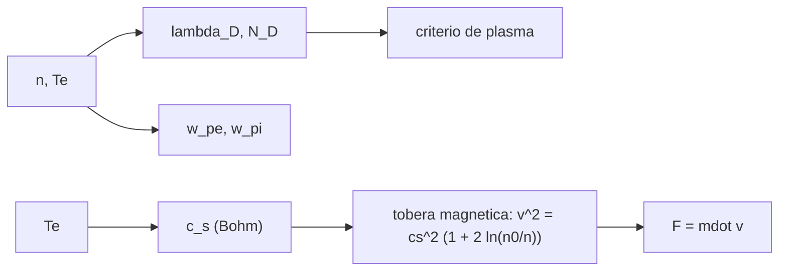

# B78-C09 — Propulsión por plasma

<!-- nav:top -->
[🏠 Programa](../../../../README.md) · [📚 Bloque B78](../../../tronco-comun/B78-tecnologias-de-propulsion-espacial.md) · [← Anterior: B78-C08 — Propulsores Hall](../B78-C08-propulsores-hall/CLASE.md) · [Siguiente: B78-C10 — Propulsión de gas frío →](../B78-C10-propulsion-de-gas-frio/CLASE.md)
<!-- /nav -->

## 1. Ubicación, nivel y alcance

Clase 9 del bloque B78. Nivel N3. Un propulsor de plasma no separa iones y electrones con rejillas: calienta o ioniza un gas y deja que el plasma, casi neutro, se expanda por una tobera magnética. Aquí calculas, de forma conceptual, los parámetros que definen un plasma (longitud de Debye, frecuencia de plasma, velocidad de Bohm) y cuánto escape da una expansión en un campo magnético divergente. Usas [C08](../B78-C08-propulsores-hall/CLASE.md) para los radios de giro. El plasma es sintético y la masa del xenón **no se consultó**.

## 2. Por qué esta clase existe

Un plasma solo es un plasma si es mucho mayor que su longitud de Debye. La decisión central: **¿cuándo un gas ionizado se comporta como plasma y cuánta velocidad de escape puede ganar al expandirse en una tobera magnética?**

## 3. Lo que podrás hacer al terminar

1. Calcular la longitud de Debye y la frecuencia de plasma.
2. Verificar el criterio de plasma: `λ_D ≪ L` y `N_D ≫ 1`.
3. Calcular la velocidad de Bohm y la expansión isoterma en una tobera magnética.
4. Distinguir la cota adiabática de la expansión isoterma.
5. Estimar empuje y potencia del chorro para un caudal dado.
6. Separar lo consultado (NIST, rango de plasma pulsado) de lo ilustrativo (`n`, `T_e`).

La evidencia es la **ficha de parámetros de un plasma de propulsión** del ejercicio 12 (sección 20).

## 4. Con qué llegas y cómo comprobarlo

1. ¿Qué es un plasma?
2. ¿Qué es la temperatura en eV?
3. ¿Qué es un proceso isotermo?
4. ¿Qué es un dato sintético?
5. ¿Qué es una verificación por segunda vía?

<details>
<summary>Ver respuestas</summary>

1. Un gas ionizado casi neutro con comportamiento colectivo. 2. La energía térmica `k T` expresada en electronvoltios. 3. Uno a temperatura constante. 4. Un dato generado para el ejemplo, no medido. 5. Calcular lo mismo con otro método y comparar.
</details>

Con cuatro o cinco aciertos, sigue; si no, repasa los prerrequisitos.

## 5. Un caso de contexto y casos de referencia

Un plasma de xenón **ilustrativo** con `n = 10¹⁸ m⁻³` y `T_e = 5 eV` tiene longitud de Debye `16,62 µm` y `19 240` partículas en la esfera de Debye; una expansión isoterma que reduce la densidad `10³` veces acelera los iones desde `1917 m/s` (velocidad de Bohm) hasta `7378 m/s` (`752 s`): el **ejemplo conductor**.

## 6. Vocabulario

La **longitud de Debye** `λ_D = √(ε₀ k T_e/(n e²))` es la escala de apantallamiento de la carga. La **frecuencia de plasma** `ω_p = √(n e²/(ε₀ m))` es la de oscilación colectiva. La **velocidad de Bohm** `c_s = √(e T_e/m_i)` es la velocidad con que los iones salen de un plasma. La **tobera magnética** guía y expande el plasma con un campo divergente. La expansión **isoterma** mantiene `T_e` por aporte de calor de los electrones.

## 7. Modelo mental



*Descripción textual:* la densidad y la temperatura dan las escalas de Debye y de plasma, que validan el criterio; `T_e` fija la velocidad de Bohm y la expansión en la tobera da la velocidad final y el empuje.

Analogía: una multitud con eco; cada persona queda «apantallada» por sus vecinos. Si la sala es mucho mayor que el alcance del eco, el comportamiento es colectivo. Límite: en el plasma el apantallamiento es eléctrico.

## 8. La explicación, paso a paso

### 8.1 Escalas del plasma

Con `n = 10¹⁸ m⁻³`, `T_e = 5 eV` y las constantes de NIST: `λ_D = 16,62 µm`, `N_D = 19 240` y `L/λ_D = 6016` para `L = 0,1 m`. La frecuencia de plasma electrónica es `5,641×10¹⁰ rad/s` y la iónica `1,153×10⁸ rad/s`; su cociente `489,2 = √(m_i/m_e)`. El criterio de plasma (`λ_D ≪ L`, `N_D ≫ 1`) se cumple.

### 8.2 Velocidad de Bohm

`c_s = √(e T_e/m_i) = 1917 m/s`. Es la velocidad mínima con que los iones salen de la zona cuasineutral.

### 8.3 Tobera magnética isoterma

Con electrones isotermos, `½ m v² = ½ m c_s² + e T_e ln(n₀/n)`, es decir `v = c_s √(1 + 2 ln(n₀/n))`. Para `n/n₀ = 10⁻³`: `v = 7378 m/s` (`752 s`); la integración numérica da el mismo valor. El Mach iónico es `3,85` y la razón de áreas `A/A₀ = n₀ c_s/(n v) = 259,8` por conservación del flujo.

### 8.4 Cota adiabática

Sin aporte de calor, la conversión total de la entalpía electrónica da `v = √(5 e T_e/m_i) = 4286 m/s` (`437 s`). La expansión isoterma la supera `1,721` veces porque supone que los electrones reciben calor de un reservorio: es una idealización optimista. Con `1 mg/s`, `F = 7,38 mN` y `P_jet = 27,2 W`.

## 9. Magnitudes, símbolos y unidades

| Símbolo | Qué es | Unidad | Valor / nota |
|---|---|---|---|
| `n` | densidad | m⁻³ | 10¹⁸ (ilustrativa) |
| `T_e` | temperatura electrónica | eV | 5 (ilustrativa) |
| `λ_D` | longitud de Debye | µm | 16,62 |
| `ω_pe` | frecuencia de plasma electrónica | rad/s | 5,641×10¹⁰ |
| `c_s` | velocidad de Bohm | m/s | 1917 |
| `v` | velocidad tras la tobera | m/s | 7378 |

## 10. Convenciones y referencias

Plasma de Xe⁺ y electrones, cuasineutral, iones fríos, electrones isotermos (caso optimista) o adiabáticos (cota). Versiones: NIST CODATA y NASA SSVI (consulta del 2026-11-10). `n`, `T_e`, `L`, cociente de densidades y caudal son **ilustrativos**; la masa del xenón **no se consultó**.

## 11. De dónde sale lo que afirmamos

| ID | Fuente | Localizador | Respalda | Estado |
|---|---|---|---|---|
| S1 | NIST, CODATA Fundamental Physical Constants (tabla ASCII) — https://physics.nist.gov/cuu/Constants/Table/allascii.txt (consultada 2026-11-10) | filas de `e`, `ε₀`, `m_e`, `u` y `g₀` | constantes fundamentales | Consultada |
| S2 | NASA Small Spacecraft Systems Virtual Institute, State-of-the-Art: In-Space Propulsion, Tabla 4-1 — https://www.nasa.gov/smallsat-institute/sst-soa/in-space-propulsion/ (consultada 2026-11-10; solo se leyeron los primeros 100 000 de 289 063 caracteres) | Tabla 4-1, fila de plasma pulsado y arco de vacío | pulsado y arco de vacío: 4–500 µN y 87–3200 s | Consultada parcialmente |
| — | Relaciones estándar de la física y la ingeniería de propulsión | — | las verifica el laboratorio con una segunda vía | No consultada en una fuente concreta |

Límites: la tobera magnética es un modelo conceptual sin fuente consultada: no hay desprendimiento del plasma del campo, no hay pérdidas por ionización ni radiación; el rango de la NASA es de otra tecnología (pulsado) y solo ilustra el orden de magnitud del `Isp`.

## 12. Cómo ver el resultado

| Magnitud | Valor |
|---|---|
| `λ_D` | 16,62 µm |
| `N_D` | 19 240 |
| `c_s` | 1917 m/s |
| `v` isoterma | 7378 m/s (752 s) |
| Cota adiabática | 4286 m/s |

Descripción larga: la expansión isoterma gana una velocidad que crece con el logaritmo del cociente de densidades y excede la cota adiabática porque recibe calor.

## 13. Ejemplo trabajado

**Paso 1 · Bohm.** `c_s = √(5 × 1,602×10⁻¹⁹/2,1802×10⁻²⁵) = 1917 m/s`.

**Paso 2 · Factor logarítmico.** `1 + 2 ln(1000) = 14,816`.

**Paso 3 · Velocidad.** `v = 1917 × √14,816 = 7378 m/s`.

## 14. Distintas formas de describir el problema

**Por escalas:** `λ_D`, `ω_p`. **Por criterio:** `λ_D ≪ L`. **Por Bohm:** `c_s`. **Por tobera:** `v(n)`. **Por cota:** conversión de entalpía.

## 15. Práctica guiada

**Ejercicio 1 · guiado (con los pasos indicados).** Calcula `kT_e` en julios para 5 eV. *Pasos:* multiplica por `e`.

<details><summary>Solución comentada</summary>

`8,011×10⁻¹⁹ J`.
</details>

**Ejercicio 2 · guiado (con una pista).** Predice si `λ_D` sube o baja si `n` se cuadruplica. *Pista:* `λ_D ∝ n^(−1/2)`.

<details><summary>Solución comentada</summary>

Baja a la mitad.
</details>

**Ejercicio 3 · guiado (casi autónomo).** ¿Por qué `ω_pe ≫ ω_pi`? *Casi autónomo.*

<details><summary>Solución comentada</summary>

Por la masa: `ω_p ∝ m^(−1/2)`; el cociente es `√(m_i/m_e) = 489,2`.
</details>

## 16. Práctica autónoma, transferencia e integrador

**Ejercicio 4 · autónomo.** Calcula `v` para `n/n₀ = 10⁻²`.

<details><summary>Solución comentada</summary>

`1917 × √(1 + 2 ln 100) = 1917 × 3,195 = 6125 m/s`.
</details>

**Ejercicio 5 · autónomo.** ¿Qué razón de áreas da `n/n₀ = 10⁻²` con esa `v`?

<details><summary>Solución comentada</summary>

`A/A₀ = 100/(6125/1917) = 31,3`.
</details>

**Ejercicio 6 · autónomo.** ¿Cuál es el `Isp` de `v = 7378 m/s`?

<details><summary>Solución comentada</summary>

`752 s`.
</details>

**Ejercicio 7 · autónomo.** ¿Qué `F` da `2 mg/s` a esa velocidad?

<details><summary>Solución comentada</summary>

`2×10⁻⁶ × 7378 = 14,8 mN`.
</details>

**Ejercicio 8 · autónomo.** ¿Qué potencia del chorro corresponde?

<details><summary>Solución comentada</summary>

`½ × 2×10⁻⁶ × 7378² = 54,4 W`.
</details>

**Ejercicio 9 · transferencia.** Un diseñador usa la expansión isoterma como valor garantizado. ¿Qué omite?

<details><summary>Solución comentada</summary>

Que exige un aporte de calor a los electrones; sin él, la cota adiabática es 4286 m/s.
</details>

**Ejercicio 10 · transferencia.** ¿Qué pasaría si `L` fuera `50 µm` con `λ_D = 16,6 µm`?

<details><summary>Solución comentada</summary>

El criterio `λ_D ≪ L` no se cumple: no se comportaría como plasma.
</details>

**Ejercicio 11 · transferencia.** ¿Se puede comparar este modelo con un propulsor de plasma pulsado?

<details><summary>Solución comentada</summary>

Solo en orden de magnitud: son mecanismos distintos.
</details>

**Ejercicio 12 · integrador.** Elabora tu *ficha de parámetros de un plasma de propulsión*: `λ_D`, `N_D`, `ω_p`, `c_s`, velocidad tras la tobera, cota adiabática y límites del modelo.

<details><summary>Solución comentada</summary>

Secciones 8.1–8.4 y la salida del laboratorio.
</details>

## 17. Laboratorio: escalas de plasma y tobera magnética

El script [plasma.py](plasma.py) calcula `λ_D`, `N_D`, `ω_p`, `c_s`, la velocidad en una tobera magnética isoterma y la cota adiabática (**comprueba** el cociente `ω_pe/ω_pi = √(m_i/m_e)`, el criterio de plasma y la velocidad analítica contra una integración numérica a `1e-6`).

**Datos:** `e`, `ε₀`, `m_e`, `u`, `g₀` (NIST) y el rango del plasma pulsado (NASA SSVI) **consultados**; `n`, `T_e`, `L`, cociente de densidades y caudal **ilustrativos**; masa del xenón **no consultada**. **Predice antes de ejecutar:** ¿cuántas veces supera la expansión isoterma a la cota adiabática? (≈ 1,7.) **Ejecución del 2026-11-10 (Python 3.12.9):**

```text
Python 3.12.9 (biblioteca estandar)
Plasma ILUSTRATIVO: n = 1e+18 m^-3, Te = 5 eV
  longitud de Debye = 16.62 um ; N_D (particulas en la esfera de Debye) = 19240 ; L/lambda_D = 6016
  frecuencia de plasma electronica = 5.641e+10 rad/s ; ionica = 1.153e+08 rad/s ; cociente = 489.2
  velocidad de Bohm cs = 1917 m/s
Tobera magnetica isoterma, n/n0 = 1e-03: v = 7378 m/s (752 s) ; numerica = 7378 m/s
  Mach ionico = 3.85 ; razon de areas A/A0 = n0 cs/(n v) = 259.8
Cota ADIABATICA (sin aporte de calor): conversion total de la entalpia electronica, v = sqrt(5 e Te/m_i) = 4286 m/s (437 s)
La expansion isoterma supera esa cota en un factor 1.721 porque supone que los electrones reciben calor de un reservorio: es una idealizacion optimista
Con 1 mg/s de iones ILUSTRATIVO: F = 7.38 mN ; potencia del chorro = 27.2 W
Pruebas superadas.
```

```bash
python programa/clases/B78/B78-C09-propulsion-por-plasma/plasma.py
```

**Límites:** iones fríos, plasma sin pérdidas, electrones isotermos con calor ilimitado, sin desprendimiento del campo magnético.

## 18. Errores frecuentes y cómo corregirlos

****Dar por plasma cualquier gas ionizado.** Se corrige con 8.1.**

****Tomar la expansión isoterma como cota.** Se corrige con 8.4.**

****Confundir `T_e` en eV con kelvin.** Se corrige con la sección 9.**

****Usar el rango de la NASA como ajuste del modelo.** Se corrige con la sección 11.**

## 19. Cómo sabrás que vas bien

Tras la sección 8: ¿qué `λ_D` esperabas y cuál obtuviste? Si dudas, repasa el ejemplo 13. Tras el laboratorio: ¿qué comprueba? (ver la sección 17).

## 20. Qué entregas y cómo se evalúa

El producto es tu **ficha de parámetros de un plasma de propulsión** (ejercicio 12).

| Criterio | Inicial | En desarrollo | Logrado | Destacado |
|---|---|---|---|---|
| Conceptos | Los confunde | Parciales | Verifica el criterio de plasma y calcula `v` | Explica los límites |
| Cálculo | Sin unidades | Con errores | Tablas completas con unidades | Calcula casos nuevos |
| Numérico | Sin comprobar | Un caso | Contraste con una segunda vía | Interpreta las diferencias |
| Fuentes | Sin fuente | Sin fecha | Fuentes con fecha y estado | Declara lo ilustrativo y lo no consultado |
| Límites | No los nombra | Uno | Tres | Discute qué falta del modelo |

**Condiciones críticas (no se compensan con promedio):** rotular `n` y `T_e` como ilustrativos; no presentar la expansión isoterma como cota; citar solo lo consultado.

## 21. Ética, seguridad y límites

Clase educativa y conceptual: los modelos son simplificados, los datos son consultados con fecha o sintéticos rotulados, y ningún resultado es una especificación de diseño, una verificación de hardware ni una instrucción operativa.  Accesibilidad: tablas equivalentes a las gráficas, fórmulas en texto, ejercicios sin conexión.

## 22. Para cerrar y seguir

Un plasma de `10¹⁸ m⁻³` y `5 eV` tiene `λ_D = 16,6 µm` y, expandido `10³` veces en una tobera magnética ideal, escapa a `7,4 km/s`. Queda una pregunta: ¿cómo se logra empuje sin gas pesado, con simple gas comprimido?

**Glosario español–inglés.** longitud de Debye · *Debye length*; frecuencia de plasma · *plasma frequency*; velocidad de Bohm · *Bohm speed*; tobera magnética · *magnetic nozzle*; cuasineutral · *quasineutral*.

**Continuidad.** [B78-C10](../B78-C10-propulsion-de-gas-frio/CLASE.md) estudia la propulsión de gas frío.

**Referencias:** ver sección 11.

<!-- nav:bottom -->
---

[← Anterior: B78-C08 — Propulsores Hall](../B78-C08-propulsores-hall/CLASE.md) · [📚 Bloque B78](../../../tronco-comun/B78-tecnologias-de-propulsion-espacial.md) · [Siguiente: B78-C10 — Propulsión de gas frío →](../B78-C10-propulsion-de-gas-frio/CLASE.md)
<!-- /nav -->
