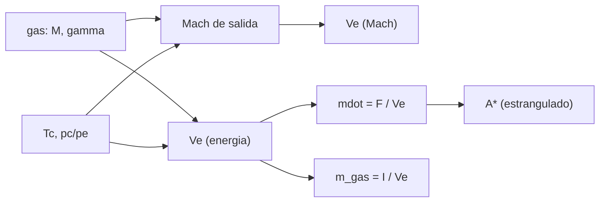

# B78-C10 — Propulsión de gas frío

<!-- nav:top -->
[🏠 Programa](../../../../README.md) · [📚 Bloque B78](../../../tronco-comun/B78-tecnologias-de-propulsion-espacial.md) · [← Anterior: B78-C09 — Propulsión por plasma](../B78-C09-propulsion-por-plasma/CLASE.md) · [Siguiente: B78-C11 — Micropropulsión para CubeSat →](../B78-C11-micropropulsion-para-cubesat/CLASE.md)
<!-- /nav -->

## 1. Ubicación, nivel y alcance

Clase 10 del bloque B78. Nivel N3. La propulsión de gas frío expulsa un gas comprimido por una tobera sin quemarlo ni ionizarlo. Es el sistema más simple y fiable, a costa de un `Isp` bajo. Aquí aplicas el flujo isentrópico del [C03](../B78-C03-termodinamica-de-camaras/CLASE.md) a cuatro gases, calculas el caudal estrangulado y la masa de gas para un impulso total consultado. Los gases y sus propiedades son valores de manual **no consultados**; las cifras de la NASA se usan como contraste.

## 2. Por qué esta clase existe

Con la misma temperatura, el gas más liviano escapa más rápido, pero ocupa más volumen almacenado. La decisión central: **¿qué gas da más impulso por kilo y qué cuesta en volumen y en límites físicos de la expansión?**

## 3. Lo que podrás hacer al terminar

1. Calcular el escape y el `Isp` de un gas frío con dos vías (energía y número de Mach).
2. Calcular el caudal y el área de garganta para un empuje dado.
3. Comparar nitrógeno, argón, helio y xenón.
4. Calcular la masa de gas para un impulso total.
5. Reconocer los límites físicos de la expansión isentrópica (condensación).
6. Separar lo consultado (NASA SSVI, NIST) de lo ilustrativo (gases).

La evidencia es la **tabla de Isp de gases fríos** del ejercicio 12 (sección 20).

## 4. Con qué llegas y cómo comprobarlo

1. ¿Qué es un gas ideal?
2. ¿Qué es el número de Mach?
3. ¿Qué es un flujo estrangulado?
4. ¿Qué es un dato sintético?
5. ¿Qué es una verificación por segunda vía?

<details>
<summary>Ver respuestas</summary>

1. Uno que cumple `p V = n R T`. 2. El cociente entre la velocidad del flujo y la del sonido. 3. Uno que alcanza Mach 1 en la garganta y fija el caudal. 4. Un dato generado para el ejemplo, no medido. 5. Calcular lo mismo con otro método y comparar.
</details>

Con cuatro o cinco aciertos, sigue; si no, repasa los prerrequisitos.

## 5. Un caso de contexto y casos de referencia

Nitrógeno **ilustrativo** a `300 K` y `1 MPa`, expandido a una razón de presiones de `1000`, escapa a `732,6 m/s` (`74,7 s`), dentro del rango de `40–110 s` que publica la NASA para el gas frío. Para `25 mN` hace falta un caudal de `34,13 mg/s`: el **ejemplo conductor**. Los 186 N·s del módulo CPOD (consultado) piden `0,254 kg` de nitrógeno en este modelo.

## 6. Vocabulario

El **gas frío** se expande sin reacción química. El **flujo estrangulado** tiene Mach 1 en la garganta. El **número de Mach de salida** `Mₑ` resume la expansión. El **área de garganta** `A*` fija el caudal. El **impulso total** `I` es el empuje por el tiempo. La **densidad de almacenamiento** es la masa de gas por litro de tanque.

## 7. Modelo mental



*Descripción textual:* el gas y la temperatura dan el escape por energía y, por otra vía, por el número de Mach; el escape fija el caudal para un empuje, el área de garganta y la masa de gas para un impulso total.

Analogía: soltar el aire de un globo; sale más rápido si el aire es más liviano y está más caliente. Límite: el aire de un globo no se expande hasta el vacío por una tobera diseñada.

## 8. La explicación, paso a paso

### 8.1 Cuatro gases

Con `R = 8,314462618 J/(mol K)`, `T_c = 300 K`, `p_c = 1 MPa` y `p_c/pₑ = 1000`:

| Gas | `M` (g/mol) | `γ` | `Mₑ` | `Tₑ` (K) | `Vₑ` (m/s) | `Isp` (s) | `ṁ` para 25 mN (mg/s) | `A*` (mm²) |
|---|---|---|---|---|---|---|---|---|
| N₂ | 28,014 | 1,400 | 5,57 | 41,7 | 732,6 | 74,7 | 34,13 | 0,0149 |
| Ar | 39,948 | 1,667 | 6,68 | 18,9 | 540,8 | 55,1 | 46,23 | 0,0159 |
| He | 4,003 | 1,667 | 6,68 | 18,9 | 1708,4 | 174,2 | 14,63 | 0,0159 |
| Xe | 131,293 | 1,667 | 6,68 | 18,9 | 298,3 | 30,4 | 83,81 | 0,0159 |

La vía de energía y la del número de Mach coinciden a `10⁻¹²`.

### 8.2 Masa para un impulso total

Para `186 N·s` (el valor del módulo CPOD): N₂ `0,254 kg`, Ar `0,344 kg`, He `0,109 kg`, Xe `0,624 kg`. El helio necesita menos masa, pero a `20 MPa` y `300 K` el N₂ ideal tiene `225 kg/m³` y ocupa `1,13 L`; la densidad del helio es mucho menor.

### 8.3 Contraste con la NASA

El `Isp` del N₂ (`74,7 s`) cae dentro de `40–110 s`. El del He (`174,2 s`) queda fuera: en el modelo, una expansión isentrópica total a `1000` de razón de presiones. Es una idealización.

### 8.4 Un límite físico

Las temperaturas de salida (`41,7 K` y `18,9 K`) están por debajo del punto de condensación de esos gases a las presiones de salida (afirmación general, no consultada). Una tobera real no se expande tanto: la razón de áreas se limita para que no condense el gas. Por eso el `Isp` real queda por debajo del ideal.

## 9. Magnitudes, símbolos y unidades

| Símbolo | Qué es | Unidad | Valor / nota |
|---|---|---|---|
| `T_c` | temperatura del gas | K | 300 (ilustrativa) |
| `p_c/pₑ` | razón de presiones | — | 1000 |
| `Mₑ` | Mach de salida | — | 5,57 (N₂) |
| `Vₑ` | velocidad de escape | m/s | 732,6 (N₂) |
| `Isp` | impulso específico | s | 74,7 (N₂) |
| `A*` | área de garganta | mm² | 0,0149 (N₂) |
| `I` | impulso total | N·s | 186 (CPOD, consultado) |

## 10. Convenciones y referencias

Gas ideal, flujo isentrópico unidimensional, tobera adaptada, sin capa límite. Gases y `γ` de manual (**no consultados**); `T_c`, `p_c` y razón de presiones **ilustrativas**. Versiones: NIST CODATA y NASA SSVI (consulta del 2026-11-10).

## 11. De dónde sale lo que afirmamos

| ID | Fuente | Localizador | Respalda | Estado |
|---|---|---|---|---|
| S1 | NIST, CODATA Fundamental Physical Constants (tabla ASCII) — https://physics.nist.gov/cuu/Constants/Table/allascii.txt (consultada 2026-11-10) | filas de `R` y `g₀` | `R` y `g₀` | Consultada |
| S2 | NASA Small Spacecraft Systems Virtual Institute, State-of-the-Art: In-Space Propulsion, Tabla 4-1 — https://www.nasa.gov/smallsat-institute/sst-soa/in-space-propulsion/ (consultada 2026-11-10; solo se leyeron los primeros 100 000 de 289 063 caracteres) | Tabla 4-1 y texto de gas frío | gas frío: 10 µN–3,6 N y 40–110 s; CPOD hasta 186 N·s; ArgoMoon con propulsores de 25 mN (R134a) | Consultada parcialmente |
| — | Relaciones estándar de la física y la ingeniería de propulsión | — | las verifica el laboratorio con una segunda vía | No consultada en una fuente concreta |

Límites: el modelo no incluye condensación, capa límite ni gas real; el valor de 25 mN se tomó del ejemplo de ArgoMoon solo como magnitud típica, no como diseño; los gases no se consultaron en una fuente concreta.

## 12. Cómo ver el resultado

| Magnitud | Valor |
|---|---|
| `Isp` N₂ | 74,7 s |
| `Isp` He | 174,2 s (fuera de rango) |
| `ṁ` N₂ para 25 mN | 34,13 mg/s |
| Masa N₂ para 186 N·s | 0,254 kg |
| Volumen a 20 MPa | 1,13 L |

Descripción larga: el escape crece cuando la masa molar baja; el helio gana escape pero obliga a volúmenes mayores.

## 13. Ejemplo trabajado

**Paso 1 · Prefactor.** `2γ/(γ−1) = 7`; `R T/M = 8,3145 × 300/0,028014 = 8,904×10⁴ m²/s²`.

**Paso 2 · Expansión.** `1 − 1000^(−0,2857) = 0,8611`.

**Paso 3 · Escape.** `Vₑ = √(7 × 8,904×10⁴ × 0,8611) = 732,6 m/s`; `Isp = 74,7 s`.

## 14. Distintas formas de describir el problema

**Por energía:** `Δh`. **Por Mach:** `Mₑ √(γ R Tₑ/M)`. **Por caudal:** `F/Vₑ`. **Por masa:** `I/Vₑ`. **Por rango:** el consultado frente al calculado.

## 15. Práctica guiada

**Ejercicio 1 · guiado (con los pasos indicados).** Calcula `R T/M` para N₂ a 300 K. *Pasos:* convierte la masa molar a kg/mol.

<details><summary>Solución comentada</summary>

`8,904×10⁴ m²/s²`.
</details>

**Ejercicio 2 · guiado (con una pista).** Predice qué gas escapa más rápido a igual `T`. *Pista:* `M^(−1/2)`.

<details><summary>Solución comentada</summary>

El helio, por su menor masa molar.
</details>

**Ejercicio 3 · guiado (casi autónomo).** ¿Por qué el xenón es mal gas frío para `Isp`? *Casi autónomo.*

<details><summary>Solución comentada</summary>

Su masa molar es alta: `Vₑ = 298 m/s`, `Isp = 30 s`.
</details>

## 16. Práctica autónoma, transferencia e integrador

**Ejercicio 4 · autónomo.** ¿Qué masa de N₂ da 1 N·s?

<details><summary>Solución comentada</summary>

`1/732,6 = 1,365 g`.
</details>

**Ejercicio 5 · autónomo.** ¿Qué caudal pide 100 mN con N₂?

<details><summary>Solución comentada</summary>

`0,1/732,6 = 136,5 mg/s`.
</details>

**Ejercicio 6 · autónomo.** Calcula el `Isp` si el gas real solo logra el 80 % de `Vₑ`.

<details><summary>Solución comentada</summary>

`59,8 s`.
</details>

**Ejercicio 7 · autónomo.** Con `Isp = 74,7 s` y 6 kg de nave, ¿qué Δv da 0,254 kg?

<details><summary>Solución comentada</summary>

`732,6 ln(6/5,746) = 31,7 m/s`; la aproximación de masa constante, `186/6`, da 31,0 m/s.
</details>

**Ejercicio 8 · autónomo.** Si `T_c` sube de 300 a 400 K, ¿cuánto cambia `Vₑ`?

<details><summary>Solución comentada</summary>

Sube ×`√(4/3) = 1,155`: a `846 m/s`.
</details>

**Ejercicio 9 · transferencia.** Un colega elige helio por su `Isp`. ¿Qué debe revisar?

<details><summary>Solución comentada</summary>

Almacenamiento (densidad), fugas y la condensación en la expansión; el modelo ideal no las incluye.
</details>

**Ejercicio 10 · transferencia.** ¿Por qué el `Isp` del He sale fuera del rango de la NASA?

<details><summary>Solución comentada</summary>

El rango resume sistemas reales; el modelo ideal es una cota optimista.
</details>

**Ejercicio 11 · transferencia.** ¿Cuándo conviene un gas frío pese a su bajo `Isp`?

<details><summary>Solución comentada</summary>

Cuando se prioriza simplicidad, bajo riesgo y empuje pequeño y preciso; es una elección de sistema, no de `Isp`.
</details>

**Ejercicio 12 · integrador.** Elabora tu *tabla de Isp de gases fríos*: cuatro gases, `Mₑ`, `Tₑ`, `Vₑ`, `Isp`, caudal, masa para 186 N·s y límites.

<details><summary>Solución comentada</summary>

Secciones 8.1–8.4 y la salida del laboratorio.
</details>

## 17. Laboratorio: gases fríos y flujo estrangulado

El script [gas_frio.py](gas_frio.py) calcula el escape, el `Isp`, el caudal y el área de garganta de cuatro gases y la masa para 186 N·s (**comprueba** la vía de energía contra la del número de Mach a `1e-12` y que el `Isp` del N₂ cae dentro del rango consultado).

**Datos:** `R`, `g₀` (NIST), el rango y el impulso total del CPOD (NASA SSVI) **consultados**; gases, `γ`, `T_c`, `p_c` y razón de presiones **ilustrativos**. **Predice antes de ejecutar:** ¿qué gas necesita menos masa para 186 N·s? (el helio.) **Ejecución del 2026-11-10 (Python 3.12.9):**

```text
Python 3.12.9 (biblioteca estandar)
Gas frio ILUSTRATIVO: Tc = 300 K, pc = 1.0 MPa, pc/pe = 1000 (gases de manual no consultados)
 gas    M [g/mol]  gamma   Mach_e   Te [K]   Ve [m/s]   Isp [s]  mdot para 25 mN [mg/s]  A* [mm2]
 N2       28.014  1.400     5.57     41.7      732.6      74.7            34.13         0.0149
 Ar       39.948  1.667     6.68     18.9      540.8      55.1            46.23         0.0159
 He        4.003  1.667     6.68     18.9     1708.4     174.2            14.63         0.0159
 Xe      131.293  1.667     6.68     18.9      298.3      30.4            83.81         0.0159
Impulso total de 186 N s (valor consultado del modulo CPOD) -> masa de gas ideal:
  N2 :   0.254 kg
  Ar :   0.344 kg
  He :   0.109 kg
  Xe :   0.624 kg
Isp del N2 = 74.7 s: dentro del rango consultado 40-110 s
Isp del He = 174.2 s: fuera del rango consultado (modelo ideal; ver limites)
Densidad ideal de N2 a 20 MPa y 300 K = 225 kg/m3 (el gas real a esa presion difiere) -> volumen para 186 N s = 1.13 L
Pruebas superadas.
```

```bash
python programa/clases/B78/B78-C10-propulsion-de-gas-frio/gas_frio.py
```

**Límites:** gas ideal, sin condensación ni capa límite, tobera adaptada; las temperaturas de salida son irreales.

## 18. Errores frecuentes y cómo corregirlos

****Usar `M` en g/mol en la fórmula.** Se corrige con 8.1.**

****Dar el `Isp` ideal por real.** Se corrige con 8.3.**

****Ignorar el volumen de almacenamiento.** Se corrige con 8.2.**

****Olvidar la condensación.** Se corrige con 8.4.**

## 19. Cómo sabrás que vas bien

Tras la sección 8: ¿qué `Isp` esperabas para N₂ y cuál obtuviste? Si dudas, repasa el ejemplo 13. Tras el laboratorio: ¿qué comprueba? (ver la sección 17).

## 20. Qué entregas y cómo se evalúa

El producto es tu **tabla de Isp de gases fríos** (ejercicio 12).

| Criterio | Inicial | En desarrollo | Logrado | Destacado |
|---|---|---|---|---|
| Conceptos | Los confunde | Parciales | Calcula el escape y la masa de gas | Explica los límites |
| Cálculo | Sin unidades | Con errores | Tablas completas con unidades | Calcula casos nuevos |
| Numérico | Sin comprobar | Un caso | Contraste con una segunda vía | Interpreta las diferencias |
| Fuentes | Sin fuente | Sin fecha | Fuentes con fecha y estado | Declara lo ilustrativo y lo no consultado |
| Límites | No los nombra | Uno | Tres | Discute qué falta del modelo |

**Condiciones críticas (no se compensan con promedio):** rotular los gases como no consultados e ilustrativos; no presentar el `Isp` ideal como real; citar solo lo consultado.

## 21. Ética, seguridad y límites

Clase educativa y conceptual: los modelos son simplificados, los datos son consultados con fecha o sintéticos rotulados, y ningún resultado es una especificación de diseño, una verificación de hardware ni una instrucción operativa.  Accesibilidad: tablas equivalentes a las gráficas, fórmulas en texto, ejercicios sin conexión.

## 22. Para cerrar y seguir

El nitrógeno ilustrativo da `74,7 s` y `0,254 kg` de gas por cada `186 N·s`; el helio gana escape y pierde volumen. Queda una pregunta: ¿qué presupuesto de propulsión cabe en un CubeSat?

**Glosario español–inglés.** gas frío · *cold gas*; flujo estrangulado · *choked flow*; garganta · *throat*; impulso total · *total impulse*; número de Mach · *Mach number*.

**Continuidad.** [B78-C11](../B78-C11-micropropulsion-para-cubesat/CLASE.md) estudia la micropropulsión para CubeSat.

**Referencias:** ver sección 11.

<!-- nav:bottom -->
---

[← Anterior: B78-C09 — Propulsión por plasma](../B78-C09-propulsion-por-plasma/CLASE.md) · [📚 Bloque B78](../../../tronco-comun/B78-tecnologias-de-propulsion-espacial.md) · [Siguiente: B78-C11 — Micropropulsión para CubeSat →](../B78-C11-micropropulsion-para-cubesat/CLASE.md)
<!-- /nav -->
