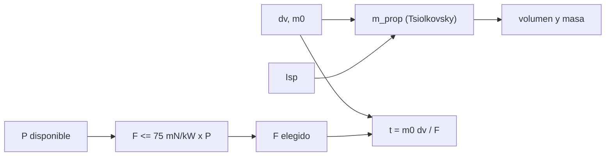

# B78-C11 — Micropropulsión para CubeSat

<!-- nav:top -->
[🏠 Programa](../../../../README.md) · [📚 Bloque B78](../../../tronco-comun/B78-tecnologias-de-propulsion-espacial.md) · [← Anterior: B78-C10 — Propulsión de gas frío](../B78-C10-propulsion-de-gas-frio/CLASE.md) · [Siguiente: B78-C12 — Velas solares →](../B78-C12-velas-solares/CLASE.md)
<!-- /nav -->

## 1. Ubicación, nivel y alcance

Clase 11 del bloque B78. Nivel N3. Un CubeSat tiene poca masa, poco volumen y poca potencia; esas tres limitaciones deciden qué tecnología de propulsión cabe. Aquí armas un presupuesto de micropropulsión para un CubeSat ilustrativo: propelente, tiempo de empuje y límite por potencia, con los rangos y los impulsos totales que publica la NASA. Usas [C06](../B78-C06-propulsion-electrica-general/CLASE.md) para el empuje por potencia y [C10](../B78-C10-propulsion-de-gas-frio/CLASE.md) para el gas frío. El satélite es sintético.

## 2. Por qué esta clase existe

Un propulsor de alto `Isp` ahorra propelente pero empuja poco y tarda semanas; uno de empuje alto gasta más volumen de propelente. La decisión central: **¿qué tecnología cumple un Δv dado con una masa, un volumen y una potencia que un CubeSat sí puede dar?**

## 3. Lo que podrás hacer al terminar

1. Calcular el propelente y el tiempo de empuje de cada opción para un Δv dado.
2. Aplicar el tope de empuje por potencia de la NASA a un CubeSat.
3. Calcular el Δv que da un impulso total con la masa del satélite.
4. Comparar gas frío, bipropelente verde, electrospray, iónico y Hall.
5. Comprobar la aproximación lineal frente a la ecuación del cohete.
6. Separar lo consultado (rangos e impulsos) de lo ilustrativo (satélite y Δv).

La evidencia es la **presupuesto de micropropulsión de un CubeSat** del ejercicio 12 (sección 20).

## 4. Con qué llegas y cómo comprobarlo

1. ¿Qué es un CubeSat?
2. ¿Qué es el impulso total?
3. ¿Qué es el Δv?
4. ¿Qué es un dato sintético?
5. ¿Qué es una verificación por segunda vía?

<details>
<summary>Ver respuestas</summary>

1. Un satélite modular cuyo tamaño se expresa en unidades `U` de 10 cm de lado. 2. El empuje integrado en el tiempo, en N·s. 3. El cambio de velocidad que la propulsión puede dar. 4. Un dato generado para el ejemplo, no medido. 5. Calcular lo mismo con otro método y comparar.
</details>

Con cuatro o cinco aciertos, sigue; si no, repasa los prerrequisitos.

## 5. Un caso de contexto y casos de referencia

Un CubeSat **ilustrativo** de `6 kg` con `20 W` para propulsión necesita `100 m/s`. El gas frío (25 mN, 70 s) gasta `0,8134 kg`; un electrospray (1 mN, 1500 s), `0,0407 kg` pero `6,94 días` de empuje. El tope consultado de 75 mN/kW limita el empuje eléctrico a `1,50 mN` con 20 W: el **ejemplo conductor**.

## 6. Vocabulario

La **micropropulsión** cubre empujes de micronewton a newton. El **impulso total** de un sistema es lo que puede entregar con su propelente. La **aproximación lineal** `m_p ≈ m₀ Δv/Vₑ` vale si `Δv ≪ Vₑ`. El **tope por potencia** es el empuje máximo por kilovatio. El **tiempo de empuje** es `m Δv/F`. Las **U** miden el volumen del satélite.

## 7. Modelo mental



*Descripción textual:* el Δv y la masa del satélite con el `Isp` dan el propelente; el empuje elegido da el tiempo; la potencia disponible limita el empuje eléctrico; el propelente fija masa y volumen.

Analogía: cruzar una ciudad a pie, en bicicleta o en moto con una billetera pequeña: la moto es rápida, pero gasta combustible que no cabe. Límite: en el CubeSat el recurso escaso también es la potencia.

## 8. La explicación, paso a paso

### 8.1 Opciones para `100 m/s`

Con `m₀ = 6 kg`, `P = 20 W` y el tope `F ≤ 75 mN/kW × 20 W = 1,50 mN` para los eléctricos:

| Tecnología | `F` (mN) | `Isp` (s) | `m_prop` (kg) | `m_prop/m₀` | `t` (días) | Cumple tope |
|---|---|---|---|---|---|---|
| Gas frío | 25,00 | 70 | 0,8134 | 0,1356 | 0,28 | sí |
| H₂O₂–etanol | 250,00 | 179 | 0,3323 | 0,0554 | 0,03 | sí |
| Electrospray | 1,00 | 1500 | 0,0407 | 0,0068 | 6,94 | sí |
| Iónico de rejillas | 1,00 | 2000 | 0,0305 | 0,0051 | 6,94 | sí |
| Hall | 1,40 | 1200 | 0,0508 | 0,0085 | 4,96 | sí |

Los empujes y los `Isp` están elegidos dentro de los rangos consultados (gas frío 40–110 s; electrospray 225–3000 s; iónico 500–3000 s; Hall 200–1920 s); la combinación concreta es ilustrativa.

### 8.2 Impulsos totales consultados

Con la masa constante de `6 kg`: CPOD (`186 N·s`) da `31,0 m/s`; el sistema H₂O₂–etanol de 1,5U (`1400 N·s`), `233,3 m/s`; el de 2U (`2120 N·s`), `353,3 m/s`. Un impulso de `1400 N·s` con `Isp = 179 s` equivale a `0,798 kg` de propelente.

### 8.3 Límite por potencia

Con una eficiencia ilustrativa de `0,5`: `Isp = 1500 s` permite `1,360 mN` y `5,1 días` para `100 m/s`; `2000 s`, `1,020 mN` y `6,8 días`; `3000 s`, `0,680 mN` y `10,2 días`. Más `Isp` ahorra propelente y alarga el tiempo.

### 8.4 Aproximación lineal

`m_p ≈ m₀ Δv/Vₑ` acierta con un error relativo de ~`(Δv/Vₑ)/2` (7,6 % para el gas frío, menos de 1 % para los eléctricos). Para estas cifras, el cálculo exacto es el de la tabla.

## 9. Magnitudes, símbolos y unidades

| Símbolo | Qué es | Unidad | Valor / nota |
|---|---|---|---|
| `m₀` | masa del CubeSat | kg | 6 (ilustrativa) |
| `P` | potencia para propulsión | W | 20 (ilustrativa) |
| `Δv` | variación de velocidad | m/s | 100 (ilustrativo) |
| `F` | empuje | mN | 1,0–250 (elegido en rangos) |
| `m_prop` | masa de propelente | kg | 0,0305–0,8134 |
| `t` | tiempo de empuje | días | 0,03–6,94 |

## 10. Convenciones y referencias

Empuje impulsivo, masa inicial constante en el tiempo de empuje, sin arrastre ni gravedad; las cifras de empuje e `Isp` son valores elegidos dentro de los rangos de la NASA. Versiones: NIST CODATA y NASA SSVI (consulta del 2026-11-10; se leyeron los primeros 100 000 de 289 063 caracteres). La masa, la potencia y el Δv son **ilustrativos**.

## 11. De dónde sale lo que afirmamos

| ID | Fuente | Localizador | Respalda | Estado |
|---|---|---|---|---|
| S1 | NIST, CODATA Fundamental Physical Constants (tabla ASCII) — https://physics.nist.gov/cuu/Constants/Table/allascii.txt (consultada 2026-11-10) | fila de `g₀` | `g₀` | Consultada |
| S2 | NASA Small Spacecraft Systems Virtual Institute, State-of-the-Art: In-Space Propulsion, Tabla 4-1 — https://www.nasa.gov/smallsat-institute/sst-soa/in-space-propulsion/ (consultada 2026-11-10; solo se leyeron los primeros 100 000 de 289 063 caracteres) | Tabla 4-1 y texto | rangos de empuje e `Isp`; CPOD 186 N·s; H₂O₂–etanol 250 mN, 179 s, 1400 N·s (1,5U) y 2120 N·s (2U); tope de 75 mN/kW | Consultada parcialmente |
| — | Relaciones estándar de la física y la ingeniería de propulsión | — | las verifica el laboratorio con una segunda vía | No consultada en una fuente concreta |

Límites: la página de la NASA es larga y solo se leyó el primer tercio; la combinación de empuje e `Isp` elegida para cada tecnología no corresponde a un producto; el volumen y la masa de los sistemas no se calcularon.

## 12. Cómo ver el resultado

| Magnitud | Valor |
|---|---|
| Propelente gas frío | 0,8134 kg |
| Propelente electrospray | 0,0407 kg |
| Tope con 20 W | 1,50 mN |
| `Δv` CPOD | 31,0 m/s |
| `Δv` 1,5U | 233,3 m/s |

Descripción larga: el propelente baja una decena de veces del gas frío al eléctrico, pero el tiempo de empuje pasa de horas a días.

## 13. Ejemplo trabajado

**Paso 1 · Escape.** `Isp = 1500 s` → `Vₑ = 14 710 m/s`.

**Paso 2 · Propelente.** `6 (1 − e^(−100/14 710)) = 6 × 0,006775 = 0,0407 kg`.

**Paso 3 · Tiempo.** `6 × 100/0,001 = 6×10⁵ s = 6,94 días`.

## 14. Distintas formas de describir el problema

**Por propelente:** `m_p`. **Por tiempo:** `t`. **Por potencia:** `F ≤ 75 mN/kW × P`. **Por impulso:** `I/m`. **Por tecnología:** tabla.

## 15. Práctica guiada

**Ejercicio 1 · guiado (con los pasos indicados).** Calcula el tope de empuje con 5 W. *Pasos:* `75 mN/kW × 0,005 kW`.

<details><summary>Solución comentada</summary>

`0,375 mN`.
</details>

**Ejercicio 2 · guiado (con una pista).** Predice si el tiempo sube o baja si el empuje se duplica. *Pista:* `t = m Δv/F`.

<details><summary>Solución comentada</summary>

Baja a la mitad.
</details>

**Ejercicio 3 · guiado (casi autónomo).** ¿Por qué el gas frío no cumple con poco volumen? *Casi autónomo.*

<details><summary>Solución comentada</summary>

Por su bajo `Isp`: gasta ~0,8 kg de gas, que ocupa volumen a alta presión.
</details>

## 16. Práctica autónoma, transferencia e integrador

**Ejercicio 4 · autónomo.** Calcula `Vₑ` para `Isp = 179 s`.

<details><summary>Solución comentada</summary>

`1755 m/s`.
</details>

**Ejercicio 5 · autónomo.** ¿Qué Δv da 186 N·s a una nave de 3 kg?

<details><summary>Solución comentada</summary>

`186/3 = 62 m/s`.
</details>

**Ejercicio 6 · autónomo.** ¿Qué propelente pide `Δv = 50 m/s` con `Isp = 1200 s` y `m₀ = 6 kg`?

<details><summary>Solución comentada</summary>

`6 (1 − e^(−50/11 768)) = 0,0254 kg`.
</details>

**Ejercicio 7 · autónomo.** ¿Qué empuje da 20 W con `η = 0,5` e `Isp = 1000 s`?

<details><summary>Solución comentada</summary>

`2 × 0,5 × 20/9807 = 2,04 mN`, pero el tope de la NASA es 1,50 mN: manda el tope.
</details>

**Ejercicio 8 · autónomo.** Un sistema de 1400 N·s ¿cuántos días tarda con 250 mN?

<details><summary>Solución comentada</summary>

`1400/0,25 = 5600 s = 1,56 horas` de empuje continuo.
</details>

**Ejercicio 9 · transferencia.** Un colega propone Hall de 55 mN para el CubeSat. ¿Qué verifica?

<details><summary>Solución comentada</summary>

Que la potencia lo permita: 55 mN a ≤ 75 mN/kW pide ≥ 733 W, muy por encima de 20 W.
</details>

**Ejercicio 10 · transferencia.** ¿Qué falta para decidir entre opciones?

<details><summary>Solución comentada</summary>

Masa y volumen del sistema, madurez (C19), vida útil (C21) y compatibilidad con el resto de la plataforma.
</details>

**Ejercicio 11 · transferencia.** ¿El Δv de 100 m/s es una necesidad real de misión?

<details><summary>Solución comentada</summary>

No: es un valor ilustrativo.
</details>

**Ejercicio 12 · integrador.** Elabora tu *presupuesto de micropropulsión de un CubeSat*: tabla de cinco opciones, impulsos totales consultados, límite por potencia y lista de lo consultado e ilustrativo.

<details><summary>Solución comentada</summary>

Secciones 8.1–8.4 y la salida del laboratorio.
</details>

## 17. Laboratorio: presupuesto de micropropulsión

El script [cubesat.py](cubesat.py) calcula propelente, tiempo de empuje y cumplimiento del tope de potencia para cinco tecnologías, el Δv de los impulsos totales consultados y el tiempo con potencia limitada (**comprueba** la aproximación lineal contra Tsiolkovsky y que los eléctricos no superan el tope).

**Datos:** `g₀` (NIST) y rangos, impulsos totales y tope de potencia (NASA SSVI) **consultados**; masa, potencia, Δv y los valores de empuje e `Isp` elegidos **ilustrativos**. **Predice antes de ejecutar:** ¿qué opción gasta menos propelente para 100 m/s? (el iónico de 2000 s: 0,0305 kg.) **Ejecución del 2026-11-10 (Python 3.12.9):**

```text
Python 3.12.9 (biblioteca estandar)
CubeSat ILUSTRATIVO: m = 6 kg ; potencia para propulsion = 20 W ; dv requerido = 100 m/s
Tope consultado F/P < 75 mN/kW -> F <= 1.50 mN con 20 W
 tecnologia            F [mN]  Isp [s]  m_prop [kg]  m_prop/m0   t [dias]   cumple tope
 gas frio               25.00       70      0.8134     0.1356       0.28   si
 H2O2-etanol           250.00      179      0.3323     0.0554       0.03   si
 electrospray            1.00     1500      0.0407     0.0068       6.94   si
 ionico de rejillas      1.00     2000      0.0305     0.0051       6.94   si
 Hall                    1.40     1200      0.0508     0.0085       4.96   si
Delta-v con los impulsos totales consultados (masa constante de 6 kg):
  CPOD (gas frio)      I =    186 N s -> dv ~   31.0 m/s
  H2O2-etanol, 1.5U    I =   1400 N s -> dv ~  233.3 m/s
  H2O2-etanol, 2U      I =   2120 N s -> dv ~  353.3 m/s
  Propelente equivalente a 1400 N s con Isp 179 s: 0.798 kg
Limite por potencia: tiempo para dv = 100 m/s con 20 W si el propulsor electrico usa todo el tope:
  Isp =  1500 s -> F = 1.360 mN ; t =    5.1 dias de empuje continuo
  Isp =  2000 s -> F = 1.020 mN ; t =    6.8 dias de empuje continuo
  Isp =  3000 s -> F = 0.680 mN ; t =   10.2 dias de empuje continuo
Pruebas superadas.
```

```bash
python programa/clases/B78/B78-C11-micropropulsion-para-cubesat/cubesat.py
```

**Límites:** masa constante en el tiempo de empuje, sin pérdidas de eficiencia con la potencia, sin masa del propulsor ni de la planta de potencia.

## 18. Errores frecuentes y cómo corregirlos

****Dar por posible un empuje que la potencia no permite.** Se corrige con 8.3.**

****Tomar un rango por un valor.** Se corrige con 8.1.**

****Olvidar el tiempo de empuje.** Se corrige con 8.1.**

****Presentar el satélite como una misión real.** Se corrige con la sección 10.**

## 19. Cómo sabrás que vas bien

Tras la sección 8: ¿qué propelente esperabas para el electrospray y cuál obtuviste? Si dudas, repasa el ejemplo 13. Tras el laboratorio: ¿qué comprueba? (ver la sección 17).

## 20. Qué entregas y cómo se evalúa

El producto es tu **presupuesto de micropropulsión de un CubeSat** (ejercicio 12).

| Criterio | Inicial | En desarrollo | Logrado | Destacado |
|---|---|---|---|---|
| Conceptos | Los confunde | Parciales | Compara opciones por propelente, tiempo y potencia | Explica los límites |
| Cálculo | Sin unidades | Con errores | Tablas completas con unidades | Calcula casos nuevos |
| Numérico | Sin comprobar | Un caso | Contraste con una segunda vía | Interpreta las diferencias |
| Fuentes | Sin fuente | Sin fecha | Fuentes con fecha y estado | Declara lo ilustrativo y lo no consultado |
| Límites | No los nombra | Uno | Tres | Discute qué falta del modelo |

**Condiciones críticas (no se compensan con promedio):** rotular el satélite y los valores elegidos como ilustrativos; no dar un rango por un valor; citar solo lo consultado.

## 21. Ética, seguridad y límites

Clase educativa y conceptual: los modelos son simplificados, los datos son consultados con fecha o sintéticos rotulados, y ningún resultado es una especificación de diseño, una verificación de hardware ni una instrucción operativa.  Accesibilidad: tablas equivalentes a las gráficas, fórmulas en texto, ejercicios sin conexión.

## 22. Para cerrar y seguir

Para `100 m/s` y `6 kg`, un electrospray gasta `0,0407 kg` en `6,94 días` y el gas frío `0,8134 kg` en horas. Queda una pregunta: ¿qué empuje da la luz del Sol sin propelente alguno?

**Glosario español–inglés.** micropropulsión · *micropropulsion*; impulso total · *total impulse*; electrospray · *electrospray*; tope de empuje por potencia · *thrust-to-power limit*; CubeSat · *CubeSat*.

**Continuidad.** [B78-C12](../B78-C12-velas-solares/CLASE.md) estudia las velas solares.

**Referencias:** ver sección 11.

<!-- nav:bottom -->
---

[← Anterior: B78-C10 — Propulsión de gas frío](../B78-C10-propulsion-de-gas-frio/CLASE.md) · [📚 Bloque B78](../../../tronco-comun/B78-tecnologias-de-propulsion-espacial.md) · [Siguiente: B78-C12 — Velas solares →](../B78-C12-velas-solares/CLASE.md)
<!-- /nav -->
