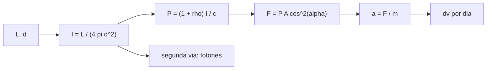

# B78-C12 — Velas solares

<!-- nav:top -->
[🏠 Programa](../../../../README.md) · [📚 Bloque B78](../../../tronco-comun/B78-tecnologias-de-propulsion-espacial.md) · [← Anterior: B78-C11 — Micropropulsión para CubeSat](../B78-C11-micropropulsion-para-cubesat/CLASE.md) · [Siguiente: B78-C13 — Propulsión solar térmica →](../B78-C13-propulsion-solar-termica/CLASE.md)
<!-- /nav -->

## 1. Ubicación, nivel y alcance

Clase 12 del bloque B78. Nivel N3. Una vela solar no lleva propelente: la luz del Sol, al reflejarse en una lámina muy grande y liviana, le transfiere cantidad de movimiento. Aquí calculas la irradiancia solar a partir de la luminosidad y la distancia que publica la NASA, la presión de radiación, la fuerza sobre una vela de `32 m²` y su aceleración, y ves cómo cambian con el ángulo y la distancia. Usas [C01](../B78-C01-empuje-e-impulso-especifico/CLASE.md) para el impulso. La masa y la reflectividad de la nave son ilustrativas.

## 2. Por qué esta clase existe

La vela no gasta propelente, pero su empuje es del orden de los micronewton por metro cuadrado y cae con el cuadrado de la distancia al Sol. La decisión central: **¿cuánta aceleración da una vela real y cómo depende de su orientación y de su distancia?**

## 3. Lo que podrás hacer al terminar

1. Calcular la irradiancia solar `I = L/(4π d²)` a partir de datos consultados.
2. Calcular la presión de radiación para absorción total, reflexión ideal y reflectividad parcial.
3. Calcular la fuerza, la aceleración y el Δv diario de una vela.
4. Aplicar la dependencia `cos²α` con el ángulo y el inverso del cuadrado con la distancia.
5. Calcular el número de ligereza como cociente entre fuerza de radiación y gravitatoria.
6. Separar lo consultado (`L`, `d`, `c`, área) de lo ilustrativo (masa, reflectividad).

La evidencia es la **ficha de empuje de una vela solar** del ejercicio 12 (sección 20).

## 4. Con qué llegas y cómo comprobarlo

1. ¿Qué es la irradiancia y en qué unidades se mide?
2. ¿Qué es la presión?
3. ¿Qué es el momento lineal de un fotón?
4. ¿Qué es un dato sintético?
5. ¿Qué es una verificación por segunda vía?

<details>
<summary>Ver respuestas</summary>

1. La potencia por unidad de área, en W/m². 2. Fuerza por unidad de área, en Pa. 3. `h/λ`, o `E/c` para la energía `E`. 4. Un dato generado para el ejemplo, no medido. 5. Calcular lo mismo con otro método y comparar.
</details>

Con cuatro o cinco aciertos, sigue; si no, repasa los prerrequisitos.

## 5. Un caso de contexto y casos de referencia

A 1 UA la irradiancia calculada es `1361,1 W/m²` y la presión de radiación, `4,540 µPa` para absorción total y `9,080 µPa` para reflexión ideal. Una vela de `32 m²` con reflectividad ilustrativa `0,9` y orientada de frente recibe `276,05 µN`; con `5 kg` acelera `0,0552 mm/s²` (`4,77 m/s` por día): el **ejemplo conductor**. En un resultado de búsqueda sobre LightSail 2, una fuente estimó unos cien micronewton: la diferencia es el tema de 8.4.

## 6. Vocabulario

La **irradiancia** `I` es la potencia solar por unidad de área. La **presión de radiación** es `I/c` si la luz se absorbe y `2I/c` si se refleja de forma ideal. La **reflectividad** `ρ` es la fracción reflejada. La **vela** es una lámina que recibe esa presión. El **ángulo de incidencia** `α` entre la normal y el Sol reduce la fuerza como `cos²α` para una vela ideal. El **número de ligereza** `β` compara la fuerza de radiación con la gravedad solar.

## 7. Modelo mental



*Descripción textual:* la luminosidad y la distancia dan la irradiancia; con la reflectividad se obtiene la presión; la fuerza depende del área y del ángulo; la aceleración y el Δv diario siguen de la masa; el conteo de fotones verifica la presión.

Analogía: una pelota de ping-pong golpeada por un chorro de agua; el empuje crece si rebota. Límite: los fotones no tienen masa en reposo y la vela también absorbe y se calienta.

## 8. La explicación, paso a paso

### 8.1 Irradiancia y presión

Con `L = 382,8×10²⁴ W` y `d = 149,6×10⁶ km` (NASA/NSSDC), `I = 1361,1 W/m²`. La presión es `I/c = 4,540 µPa` (absorción), `2I/c = 9,080 µPa` (reflexión ideal) y `(1 + ρ) I/c = 8,626 µPa` con `ρ = 0,9`. Por conteo de fotones de `550 nm` (`p = h/λ`) resultan `3,769×10²¹ fotones/(m² s)` y la misma presión.

### 8.2 Fuerza y aceleración

| `α` (°) | `F` (µN) | `a` (mm/s²) | Δv por día (m/s) |
|---|---|---|---|
| 0 | 276,05 | 0,0552 | 4,770 |
| 30 | 207,03 | 0,0414 | 3,578 |
| 45 | 138,02 | 0,0276 | 2,385 |
| 60 | 69,01 | 0,0138 | 1,193 |

### 8.3 Distancia

A `α = 0`: Venus (0,72 UA) `532,50 µN`; Tierra `276,05`; Marte (1,52 UA) `119,48`; Júpiter (5,20 UA) `10,21 µN`. `F(2 UA)/F(1 UA) = 0,25`.

### 8.4 Ideal frente a real

El número de ligereza de una vela ilustrativa de `1000 m²` y `20 g/m²` es `β = 0,073`, independiente de la distancia (la gravedad también cae con `d⁻²`). Para el caso de LightSail 2, la fuerza ideal de frente (`276 µN`) supera a la estimación de unos `100 µN` de un resultado de búsqueda: en órbita baja la vela no apunta siempre al Sol, hay sombra de la Tierra y la reflectividad real es menor. Ese contraste es cualitativo: no se consultó el informe de la misión.

## 9. Magnitudes, símbolos y unidades

| Símbolo | Qué es | Unidad | Valor / nota |
|---|---|---|---|
| `I` | irradiancia a 1 UA | W/m² | 1361,1 (calculada) |
| `P` | presión de radiación | µPa | 4,540 / 9,080 / 8,626 |
| `A` | área de la vela | m² | 32 (consultada vía búsqueda) |
| `F` | fuerza | µN | 276,05 (α = 0) |
| `a` | aceleración | mm/s² | 0,0552 |
| `ρ` | reflectividad | — | 0,9 (ilustrativa) |
| `β` | número de ligereza | — | 0,073 |

## 10. Convenciones y referencias

Vela plana de frente o inclinada `α`, reflexión especular con `ρ`, sin sombra, sin arrastre y a distancia heliocéntrica `d`; sistema de referencia: el Sol en el origen. Versiones: NIST CODATA y NASA/NSSDC (consulta del 2026-11-10). El área de LightSail 2 se obtuvo de resúmenes de resultados de búsqueda. Masa, reflectividad y vela de `1000 m²` son **ilustrativas**; `h` y `GM` del Sol **no se consultaron**.

## 11. De dónde sale lo que afirmamos

| ID | Fuente | Localizador | Respalda | Estado |
|---|---|---|---|---|
| S1 | NIST, CODATA Fundamental Physical Constants (tabla ASCII) — https://physics.nist.gov/cuu/Constants/Table/allascii.txt (consultada 2026-11-10) | fila de `c` | `c = 299 792 458 m/s` | Consultada |
| S2 | NASA/NSSDC, Sun Fact Sheet — https://nssdc.gsfc.nasa.gov/planetary/factsheet/sunfact.html (consultada 2026-11-10) | luminosidad y distancia media | luminosidad 382,8×10²⁴ J/s; distancia media 149,6×10⁶ km | Consultada |
| S3 | Resultados de búsqueda sobre LightSail 2 (misión de The Planetary Society, no de la NASA) — consulta del 2026-11-10; solo los resúmenes de los resultados, no las páginas completas | resúmenes de resultados de búsqueda | vela de 32 m² (aluminizada, 4 secciones triangulares); misión de The Planetary Society; éxito declarado el 31 de julio de 2019; estimación del orden de cien micronewton | Consultada parcialmente |
| — | Relaciones estándar de la física y la ingeniería de propulsión | — | las verifica el laboratorio con una segunda vía | No consultada en una fuente concreta |

Límites: la página de la NASA no lista la constante solar: la irradiancia es un cálculo de esta clase; de LightSail 2 se consultaron solo resúmenes de resultados de búsqueda y no el informe de la misión; `h` y `GM` del Sol no se consultaron.

## 12. Cómo ver el resultado

| Magnitud | Valor |
|---|---|
| `I` a 1 UA | 1361,1 W/m² |
| `F` de frente | 276,05 µN |
| `a` | 0,0552 mm/s² |
| `F(2 UA)/F(1 UA)` | 0,25 |
| `β` (ilustrativo) | 0,073 |

Descripción larga: la fuerza cae con el cuadrado de la distancia y con `cos²α`; una vela de 32 m² da cientos de micronewton.

## 13. Ejemplo trabajado

**Paso 1 · Irradiancia.** `3,828×10²⁶/(4π × (1,496×10¹¹)²) = 1361,1 W/m²`.

**Paso 2 · Presión.** `1,9 × 1361,1/299 792 458 = 8,626 µPa`.

**Paso 3 · Fuerza.** `8,626×10⁻⁶ × 32 = 276,05 µN`.

**Paso 4 · Aceleración.** `276,05×10⁻⁶/5 = 5,52×10⁻⁵ m/s²`.

## 14. Distintas formas de describir el problema

**Por irradiancia:** `L/(4π d²)`. **Por presión:** `(1+ρ) I/c`. **Por fotones:** `N h/λ`. **Por ángulo:** `cos²α`. **Por ligereza:** `β`.

## 15. Práctica guiada

**Ejercicio 1 · guiado (con los pasos indicados).** Calcula `I/c` para `I = 1361 W/m²`. *Pasos:* divide por `c`.

<details><summary>Solución comentada</summary>

`4,540×10⁻⁶ Pa`.
</details>

**Ejercicio 2 · guiado (con una pista).** Predice cuánto cae `F` a 2 UA. *Pista:* `I ∝ d⁻²`.

<details><summary>Solución comentada</summary>

A un cuarto.
</details>

**Ejercicio 3 · guiado (casi autónomo).** ¿Por qué reflejar duplica la fuerza respecto de absorber? *Casi autónomo.*

<details><summary>Solución comentada</summary>

Porque el fotón invierte su momento: el cambio es `2p`.
</details>

## 16. Práctica autónoma, transferencia e integrador

**Ejercicio 4 · autónomo.** Calcula `F` con `A = 100 m²`, `ρ = 1` a 1 UA.

<details><summary>Solución comentada</summary>

`9,080×10⁻⁶ × 100 = 908 µN`.
</details>

**Ejercicio 5 · autónomo.** ¿Qué aceleración da con `m = 10 kg`?

<details><summary>Solución comentada</summary>

`9,08×10⁻⁵ m/s²`.
</details>

**Ejercicio 6 · autónomo.** ¿Cuántos días tarda en ganar `100 m/s` a esa aceleración?

<details><summary>Solución comentada</summary>

`100/(9,08×10⁻⁵ × 86 400) = 12,7 días`.
</details>

**Ejercicio 7 · autónomo.** Calcula `F` a 45° con 32 m² y `ρ = 0,9`.

<details><summary>Solución comentada</summary>

`276,05 × 0,5 = 138,02 µN`.
</details>

**Ejercicio 8 · autónomo.** Calcula `β` si la masa areal baja a 10 g/m².

<details><summary>Solución comentada</summary>

Se duplica: `0,146`.
</details>

**Ejercicio 9 · transferencia.** Un diseñador usa `2I/c` para una vela con `ρ = 0,9`. ¿Qué error comete?

<details><summary>Solución comentada</summary>

Sobreestima por `2/1,9`, un 5,3 %.
</details>

**Ejercicio 10 · transferencia.** ¿Por qué en órbita baja no se logra la fuerza ideal continua?

<details><summary>Solución comentada</summary>

Hay eclipses y la orientación al Sol no es constante; el modelo no los incluye.
</details>

**Ejercicio 11 · transferencia.** ¿Puede una vela escapar del campo gravitatorio solar con `β = 0,073`?

<details><summary>Solución comentada</summary>

No por sí sola: `β` debe superar 1 para equilibrar la gravedad solar; con `β < 1` solo se modifica la trayectoria.
</details>

**Ejercicio 12 · integrador.** Elabora tu *ficha de empuje de una vela solar*: irradiancia, presión, tabla de fuerza frente al ángulo y a la distancia, `β` y qué es consultado, calculado e ilustrativo.

<details><summary>Solución comentada</summary>

Secciones 8.1–8.4 y la salida del laboratorio.
</details>

## 17. Laboratorio: presión de radiación y vela solar

El script [vela.py](vela.py) calcula la irradiancia, la presión, la fuerza y la aceleración de una vela, su dependencia con el ángulo y la distancia y el número de ligereza (**comprueba** la presión contra un conteo de fotones a `1e-12` y la ley del inverso del cuadrado).

**Datos:** `c` (NIST), `L` y `d` (NASA/NSSDC) y el área de 32 m² (resúmenes de búsqueda) **consultados**; masa, reflectividad y vela de `1000 m²` **ilustrativos**; `h` y `GM` **no consultados**. **Predice antes de ejecutar:** ¿cuántos micronewton da la vela de frente a 1 UA? (≈ 276.) **Ejecución del 2026-11-10 (Python 3.12.9):**

```text
Python 3.12.9 (biblioteca estandar)
Irradiancia a 1 UA (calculada de L y d consultados) = 1361.1 W/m2
Presion: absorbente 4.540 uPa ; reflector ideal 9.080 uPa ; rho = 0.9 (ILUSTRATIVA) 8.626 uPa
Conteo de fotones (550 nm): 3.769e+21 fotones/(m2 s) -> presion absorbente 4.540 uPa (coincide)
Vela de 32 m2 (area de LightSail 2, consultada) y 5 kg (ILUSTRATIVOS):
  alpha [grados]   F [uN]    a [mm/s2]   dv por dia [m/s]
             0    276.05      0.0552        4.770
            30    207.03      0.0414        3.578
            45    138.02      0.0276        2.385
            60     69.01      0.0138        1.193
Distancia al Sol (alpha = 0):
  Venus 0.72 UA    F =  532.50 uN
  Tierra 1.00 UA   F =  276.05 uN
  Marte 1.52 UA    F =  119.48 uN
  Jupiter 5.20 UA  F =   10.21 uN
F(2 UA)/F(1 UA) = 0.25 (inverso del cuadrado)
Numero de ligereza de una vela de 1000 m2 y 20 g/m2 (areal): beta = F_rad/F_grav = 0.073 (independiente de la distancia; GM no consultado)
Pruebas superadas.
```

```bash
python programa/clases/B78/B78-C12-velas-solares/vela.py
```

**Límites:** vela plana ideal, sin sombra ni arrastre, sin degradación óptica, reflexión especular; la irradiancia es un cálculo.

## 18. Errores frecuentes y cómo corregirlos

****Confundir absorción con reflexión.** Se corrige con 8.1.**

****Olvidar `cos²α`.** Se corrige con 8.2.**

****Usar la gravedad terrestre en vez de la solar para `β`.** Se corrige con 8.4.**

****Presentar el empuje ideal como el medido.** Se corrige con 8.4.**

## 19. Cómo sabrás que vas bien

Tras la sección 8: ¿qué fuerza esperabas y cuál obtuviste? Si dudas, repasa el ejemplo 13. Tras el laboratorio: ¿qué comprueba? (ver la sección 17).

## 20. Qué entregas y cómo se evalúa

El producto es tu **ficha de empuje de una vela solar** (ejercicio 12).

| Criterio | Inicial | En desarrollo | Logrado | Destacado |
|---|---|---|---|---|
| Conceptos | Los confunde | Parciales | Calcula presión, fuerza y aceleración | Explica los límites |
| Cálculo | Sin unidades | Con errores | Tablas completas con unidades | Calcula casos nuevos |
| Numérico | Sin comprobar | Un caso | Contraste con una segunda vía | Interpreta las diferencias |
| Fuentes | Sin fuente | Sin fecha | Fuentes con fecha y estado | Declara lo ilustrativo y lo no consultado |
| Límites | No los nombra | Uno | Tres | Discute qué falta del modelo |

**Condiciones críticas (no se compensan con promedio):** rotular masa y reflectividad como ilustrativas; no presentar el empuje ideal como el medido de una misión; citar solo lo consultado.

## 21. Ética, seguridad y límites

Clase educativa y conceptual: los modelos son simplificados, los datos son consultados con fecha o sintéticos rotulados, y ningún resultado es una especificación de diseño, una verificación de hardware ni una instrucción operativa.  Accesibilidad: tablas equivalentes a las gráficas, fórmulas en texto, ejercicios sin conexión.

## 22. Para cerrar y seguir

Una vela de `32 m²` a 1 UA recibe `276 µN` de frente y `10 µN` a la distancia de Júpiter. Queda una pregunta: ¿cómo se aprovecha la luz del Sol para calentar un propelente?

**Glosario español–inglés.** vela solar · *solar sail*; presión de radiación · *radiation pressure*; irradiancia · *irradiance*; reflectividad · *reflectivity*; número de ligereza · *lightness number*.

**Continuidad.** [B78-C13](../B78-C13-propulsion-solar-termica/CLASE.md) estudia la propulsión solar térmica.

**Referencias:** ver sección 11.

<!-- nav:bottom -->
---

[← Anterior: B78-C11 — Micropropulsión para CubeSat](../B78-C11-micropropulsion-para-cubesat/CLASE.md) · [📚 Bloque B78](../../../tronco-comun/B78-tecnologias-de-propulsion-espacial.md) · [Siguiente: B78-C13 — Propulsión solar térmica →](../B78-C13-propulsion-solar-termica/CLASE.md)
<!-- /nav -->
