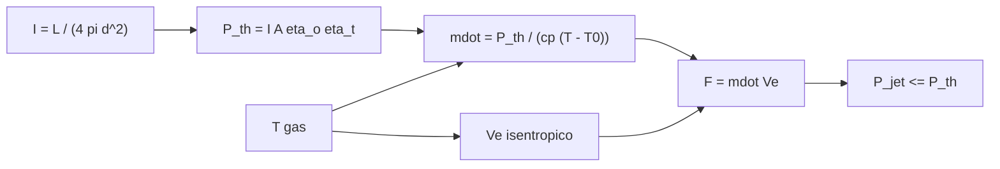

# B78-C13 — Propulsión solar térmica

<!-- nav:top -->
[🏠 Programa](../../../../README.md) · [📚 Bloque B78](../../../tronco-comun/B78-tecnologias-de-propulsion-espacial.md) · [← Anterior: B78-C12 — Velas solares](../B78-C12-velas-solares/CLASE.md) · [Siguiente: B78-C14 — Propulsión nuclear térmica conceptual →](../B78-C14-propulsion-nuclear-termica-conceptual/CLASE.md)
<!-- /nav -->

## 1. Ubicación, nivel y alcance

Clase 13 del bloque B78. Nivel N3. La propulsión solar térmica concentra la luz del Sol para calentar un propelente (típicamente hidrógeno) y expandirlo en una tobera. Combina la fuente de energía externa de la propulsión eléctrica con el escape térmico de un cohete: da un `Isp` de varios cientos de segundos y un empuje de newtons, no de milinewtons. Aquí haces el balance de energía con la irradiancia calculada de [C12](../B78-C12-velas-solares/CLASE.md) y el escape isentrópico de [C03](../B78-C03-termodinamica-de-camaras/CLASE.md). Todo el diseño es ilustrativo.

## 2. Por qué esta clase existe

La energía llega por la óptica y el propelente solo la transporta; el escape depende de la temperatura que resistan los materiales y de la masa molar. La decisión central: **¿qué empuje e `Isp` da un colector de área dada y cómo se compara con un propulsor eléctrico alimentado con la misma potencia?**

## 3. Lo que podrás hacer al terminar

1. Calcular la potencia térmica captada por un colector concentrador.
2. Calcular el caudal de hidrógeno que esa potencia puede calentar a una temperatura dada.
3. Calcular el escape, el `Isp` y el empuje.
4. Ver el compromiso entre temperatura, caudal y empuje.
5. Comparar con un propulsor eléctrico de la misma potencia.
6. Separar lo consultado (`L`, `d`, `R`) de lo ilustrativo (óptica, temperatura).

La evidencia es la **ficha de un propulsor solar térmico** del ejercicio 12 (sección 20).

## 4. Con qué llegas y cómo comprobarlo

1. ¿Qué es un concentrador solar?
2. ¿Qué es el calor específico a presión constante?
3. ¿Qué es el balance de energía?
4. ¿Qué es un dato sintético?
5. ¿Qué es una verificación por segunda vía?

<details>
<summary>Ver respuestas</summary>

1. Un espejo o lente que reúne luz de un área grande en una pequeña. 2. La energía por kilo y kelvin para calentar a presión constante. 3. Que la energía aportada iguala la que gana el fluido más las pérdidas. 4. Un dato generado para el ejemplo, no medido. 5. Calcular lo mismo con otro método y comparar.
</details>

Con cuatro o cinco aciertos, sigue; si no, repasa los prerrequisitos.

## 5. Un caso de contexto y casos de referencia

Un colector **ilustrativo** de `100 m²` con eficiencias óptica `0,70` y térmica `0,80` capta `76,22 kW` a 1 UA. Calienta `2,400 g/s` de hidrógeno de 300 a `2500 K`, que sale a `7267 m/s` (`741,0 s`) con `17,44 N`: el **ejemplo conductor**. Con la misma potencia, un eléctrico ilustrativo de 3000 s daría `3,11 N`.

## 6. Vocabulario

El **concentrador** reúne la luz en el absorbedor. La **eficiencia óptica** y la **térmica** miran las pérdidas de la óptica y del absorbedor. El **caudal** `ṁ = P_th/(c_p ΔT)` es lo que esa potencia puede calentar. El **propulsor solar térmico** expande el gas calentado. La **eficiencia de tobera** `P_jet/P_th` mide qué parte del calor pasa a energía cinética.

## 7. Modelo mental



*Descripción textual:* la irradiancia y el área dan la potencia térmica; con la temperatura fija el caudal; la temperatura y la masa molar fijan el escape; caudal y escape dan el empuje y el balance exige que la potencia del chorro no supere la térmica.

Analogía: un hervidor con una lupa gigante; cuanto más agua calientas por segundo, menos se calienta. Límite: el gas se expande en una tobera y la energía térmica se convierte en cinética con pérdidas.

## 8. La explicación, paso a paso

### 8.1 Potencia y caudal

`I = 1361,1 W/m²` (calculada con `L` y `d` de la NASA/NSSDC). `P_th = 1361,1 × 100 × 0,70 × 0,80 = 76,22 kW`. Con `γ = 1,40` y `M = 2,016 g/mol` (valores de manual, no consultados), `c_p = γR/((γ−1)M) = 14 435 J/(kg K)` y `ṁ = P_th/(c_p (T − T₀)) = 2,400 g/s` a `2500 K`.

### 8.2 Escape y empuje

El escape isentrópico con `p_c/pₑ = 100` es `Vₑ = 7267 m/s`, de donde `Isp = 741,0 s` y `F = ṁ Vₑ = 17,44 N`. La potencia del chorro es `63,38 kW`: la eficiencia de tobera es `0,832` y nunca supera `1`.

### 8.3 Efecto de la temperatura (misma `P_th`)

| `T` (K) | `Vₑ` (m/s) | `Isp` (s) | `ṁ` (g/s) | `F` (N) |
|---|---|---|---|---|
| 1500 | 5629 | 574,0 | 4,400 | 24,77 |
| 2000 | 6500 | 662,8 | 3,106 | 20,19 |
| 2500 | 7267 | 741,0 | 2,400 | 17,44 |
| 3000 | 7961 | 811,8 | 1,956 | 15,57 |

Subir la temperatura sube el `Isp` y baja el empuje: es el mismo compromiso de la potencia fija de C06.

### 8.4 Maniobra y contraste con un eléctrico

Para `1000 m/s` con `500 kg`: `64,28 kg` de propelente, `7,44 h` de empuje y `34,9 mm/s²` de aceleración inicial. Un eléctrico ilustrativo (`Isp 3000 s`, `η = 0,6`) con la misma potencia da `3,11 N`, gasta `16,71 kg` y tarda `43,92 h`. El solar térmico es más rápido y gasta más propelente.

## 9. Magnitudes, símbolos y unidades

| Símbolo | Qué es | Unidad | Valor / nota |
|---|---|---|---|
| `P_th` | potencia térmica captada | kW | 76,22 (ilustrativa) |
| `A` | área del colector | m² | 100 (ilustrativa) |
| `T` | temperatura del gas | K | 2500 (ilustrativa) |
| `ṁ` | caudal de H₂ | g/s | 2,400 |
| `Vₑ` | velocidad de escape | m/s | 7267 |
| `F` | empuje | N | 17,44 |

## 10. Convenciones y referencias

Gas ideal de `c_p` constante (sin disociación), expansión isentrópica con `p_c/pₑ = 100`, sin pérdidas de calor ni de fricción, 1 UA. Versiones: NIST CODATA y NASA/NSSDC (consulta del 2026-11-10). Óptica, temperatura, nave y Δv son **ilustrativos**; masa molar, `γ` y `T₀` **no se consultaron**.

## 11. De dónde sale lo que afirmamos

| ID | Fuente | Localizador | Respalda | Estado |
|---|---|---|---|---|
| S1 | NIST, CODATA Fundamental Physical Constants (tabla ASCII) — https://physics.nist.gov/cuu/Constants/Table/allascii.txt (consultada 2026-11-10) | filas de `R` y `g₀` | `R` y `g₀` | Consultada |
| S2 | NASA/NSSDC, Sun Fact Sheet — https://nssdc.gsfc.nasa.gov/planetary/factsheet/sunfact.html (consultada 2026-11-10) | luminosidad y distancia media | luminosidad 382,8×10²⁴ J/s; distancia 149,6×10⁶ km | Consultada |
| — | Relaciones estándar de la física y la ingeniería de propulsión | — | las verifica el laboratorio con una segunda vía | No consultada en una fuente concreta |

Límites: el diseño del colector, la temperatura admisible del absorbedor y el comportamiento del hidrógeno a alta temperatura (disociación) no se consultaron; el contraste con el eléctrico usa una eficiencia ilustrativa.

## 12. Cómo ver el resultado

| Magnitud | Valor |
|---|---|
| `P_th` | 76,22 kW |
| `Isp` | 741,0 s |
| `F` | 17,44 N |
| Eficiencia de tobera | 0,832 |
| Eléctrico de la misma potencia | 3,11 N |

Descripción larga: a potencia fija, subir la temperatura sube el `Isp` y baja el empuje; el solar térmico entrega empujes de newtons con `Isp` de centenas de segundos.

## 13. Ejemplo trabajado

**Paso 1 · Potencia.** `1361,1 × 100 × 0,56 = 76,22 kW`.

**Paso 2 · Caudal.** `76 220/(14 435 × 2200) = 2,400 g/s`.

**Paso 3 · Empuje.** `2,400×10⁻³ × 7267 = 17,44 N`.

## 14. Distintas formas de describir el problema

**Por potencia:** `I A η`. **Por caudal:** `P/(c_p ΔT)`. **Por escape:** isentrópico. **Por empuje:** `ṁ Vₑ`. **Por comparación:** con el eléctrico.

## 15. Práctica guiada

**Ejercicio 1 · guiado (con los pasos indicados).** Calcula `P_th` con `A = 50 m²`, `η_o = 0,6`, `η_t = 0,7`. *Pasos:* `I A η_o η_t`.

<details><summary>Solución comentada</summary>

`1361,1 × 50 × 0,42 = 28,6 kW`.
</details>

**Ejercicio 2 · guiado (con una pista).** Predice qué pasa con `F` si `A` se duplica a igual `T`. *Pista:* `ṁ ∝ P`.

<details><summary>Solución comentada</summary>

Se duplica.
</details>

**Ejercicio 3 · guiado (casi autónomo).** ¿Por qué el hidrógeno y no el nitrógeno? *Casi autónomo.*

<details><summary>Solución comentada</summary>

Por su masa molar: `Vₑ ∝ M^(−1/2)`.
</details>

## 16. Práctica autónoma, transferencia e integrador

**Ejercicio 4 · autónomo.** Calcula el caudal si `T = 2000 K`, `P_th = 76,22 kW`.

<details><summary>Solución comentada</summary>

`76 220/(14 435 × 1700) = 3,106 g/s`.
</details>

**Ejercicio 5 · autónomo.** ¿Qué `Isp` da `Vₑ = 6500 m/s`?

<details><summary>Solución comentada</summary>

`662,8 s`.
</details>

**Ejercicio 6 · autónomo.** ¿Cuántas horas de empuje consume `64,28 kg` a `2,400 g/s`?

<details><summary>Solución comentada</summary>

`26 783 s = 7,44 h`.
</details>

**Ejercicio 7 · autónomo.** ¿Qué pasa con `F` si la eficiencia óptica baja a 0,5 (resto igual)?

<details><summary>Solución comentada</summary>

Baja ×0,714: `12,46 N`.
</details>

**Ejercicio 8 · autónomo.** Compara el propelente con el eléctrico: ¿cuántas veces más gasta el solar térmico?

<details><summary>Solución comentada</summary>

`64,28/16,71 = 3,85`.
</details>

**Ejercicio 9 · transferencia.** Un colega dice que más temperatura siempre da más empuje. ¿Qué responde la tabla?

<details><summary>Solución comentada</summary>

A potencia fija, el empuje baja: `ṁ` cae más rápido de lo que sube `Vₑ`.
</details>

**Ejercicio 10 · transferencia.** ¿Qué efecto no incluido limita la temperatura real?

<details><summary>Solución comentada</summary>

Los materiales del absorbedor y la disociación del hidrógeno, que cambian `γ` y `M`.
</details>

**Ejercicio 11 · transferencia.** ¿Por qué este diseño no puede alimentarse en eclipse?

<details><summary>Solución comentada</summary>

Porque la luz es la única fuente de energía; en sombra `P_th = 0`.
</details>

**Ejercicio 12 · integrador.** Elabora tu *ficha de un propulsor solar térmico*: potencia, caudal, escape, empuje, efecto de la temperatura, contraste con un eléctrico y qué es consultado e ilustrativo.

<details><summary>Solución comentada</summary>

Secciones 8.1–8.4 y la salida del laboratorio.
</details>

## 17. Laboratorio: balance de energía de un propulsor solar térmico

El script [solar_termica.py](solar_termica.py) calcula potencia, caudal, escape y empuje, el efecto de la temperatura y la comparación con un eléctrico (**comprueba** que la potencia del chorro no supera la térmica, `F = 2 P_jet/Vₑ` y que el escape crece con `T`).

**Datos:** `R`, `g₀` (NIST), `L` y `d` (NASA/NSSDC) **consultados**; óptica, temperatura, nave y Δv **ilustrativos**; masa molar, `γ` y `T₀` **no consultados**. **Predice antes de ejecutar:** ¿cuánto empuje da el eléctrico de la misma potencia frente al solar térmico? (unas 5,6 veces menos.) **Ejecución del 2026-11-10 (Python 3.12.9):**

```text
Python 3.12.9 (biblioteca estandar)
I a 1 UA = 1361.1 W/m2 ; P_th = 76.22 kW (A = 100 m2, eta_o = 0.7, eta_t = 0.8; ILUSTRATIVOS)
cp(H2) = 14435 J/(kg K) ; mdot = 2.400 g/s ; Ve = 7267 m/s ; Isp = 741.0 s ; F = 17.44 N
Potencia del chorro = 63.38 kW ; eficiencia de tobera P_jet/P_th = 0.832
Efecto de la temperatura del gas (misma P_th):
  T [K]   Ve [m/s]  Isp [s]   mdot [g/s]   F [N]
   1500       5629    574.0       4.400    24.77
   2000       6500    662.8       3.106    20.19
   2500       7267    741.0       2.400    17.44
   3000       7961    811.8       1.956    15.57
Delta-v 1000 m/s con 500 kg: propelente = 64.28 kg ; tiempo de empuje = 7.44 h ; aceleracion inicial = 34.9 mm/s2
Electrico ILUSTRATIVO (Isp 3000 s, eta 0.6) con la misma potencia: F = 3.11 N ; propelente = 16.71 kg ; tiempo = 43.92 h
Pruebas superadas.
```

```bash
python programa/clases/B78/B78-C13-propulsion-solar-termica/solar_termica.py
```

**Límites:** `c_p` constante, sin disociación, sin pérdidas de calor, sin masa del colector ni del tanque criogénico.

## 18. Errores frecuentes y cómo corregirlos

****Dividir la potencia por la temperatura absoluta en vez de por `ΔT`.** Se corrige con 8.1.**

****Pensar que el empuje crece siempre con `T`.** Se corrige con 8.3.**

****Olvidar el eclipse.** Se corrige con la pregunta 11.**

****Presentar las eficiencias como de un diseño.** Se corrige con la sección 10.**

## 19. Cómo sabrás que vas bien

Tras la sección 8: ¿qué empuje esperabas y cuál obtuviste? Si dudas, repasa el ejemplo 13. Tras el laboratorio: ¿qué comprueba? (ver la sección 17).

## 20. Qué entregas y cómo se evalúa

El producto es tu **ficha de un propulsor solar térmico** (ejercicio 12).

| Criterio | Inicial | En desarrollo | Logrado | Destacado |
|---|---|---|---|---|
| Conceptos | Los confunde | Parciales | Hace el balance de energía y calcula el empuje | Explica los límites |
| Cálculo | Sin unidades | Con errores | Tablas completas con unidades | Calcula casos nuevos |
| Numérico | Sin comprobar | Un caso | Contraste con una segunda vía | Interpreta las diferencias |
| Fuentes | Sin fuente | Sin fecha | Fuentes con fecha y estado | Declara lo ilustrativo y lo no consultado |
| Límites | No los nombra | Uno | Tres | Discute qué falta del modelo |

**Condiciones críticas (no se compensan con promedio):** rotular óptica y temperatura como ilustrativas; no presentarlo como diseño; citar solo lo consultado.

## 21. Ética, seguridad y límites

Clase educativa y conceptual: los modelos son simplificados, los datos son consultados con fecha o sintéticos rotulados, y ningún resultado es una especificación de diseño, una verificación de hardware ni una instrucción operativa.  Accesibilidad: tablas equivalentes a las gráficas, fórmulas en texto, ejercicios sin conexión.

## 22. Para cerrar y seguir

Con `76 kW` de luz concentrada, el hidrógeno ilustrativo sale a `7,3 km/s` y da `17 N`; un eléctrico con esa potencia da `3 N` pero gasta cuatro veces menos propelente. Queda una pregunta: ¿qué cambia si la fuente de calor es un reactor?

**Glosario español–inglés.** propulsión solar térmica · *solar thermal propulsion*; concentrador · *concentrator*; absorbedor · *absorber*; calor específico · *specific heat*; eficiencia de tobera · *nozzle efficiency*.

**Continuidad.** [B78-C14](../B78-C14-propulsion-nuclear-termica-conceptual/CLASE.md) estudia la propulsión nuclear térmica de forma conceptual.

**Referencias:** ver sección 11.

<!-- nav:bottom -->
---

[← Anterior: B78-C12 — Velas solares](../B78-C12-velas-solares/CLASE.md) · [📚 Bloque B78](../../../tronco-comun/B78-tecnologias-de-propulsion-espacial.md) · [Siguiente: B78-C14 — Propulsión nuclear térmica conceptual →](../B78-C14-propulsion-nuclear-termica-conceptual/CLASE.md)
<!-- /nav -->
