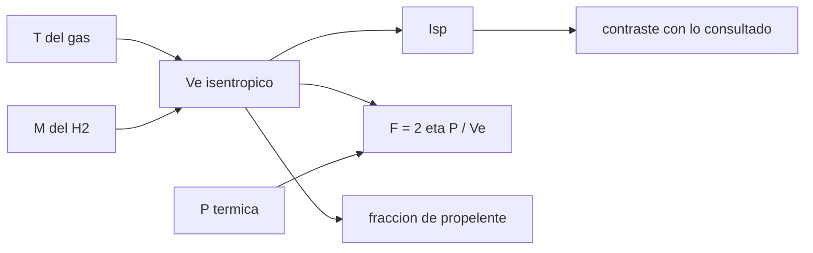

# B78-C14 — Propulsión nuclear térmica conceptual

<!-- nav:top -->
[🏠 Programa](../../../../README.md) · [📚 Bloque B78](../../../tronco-comun/B78-tecnologias-de-propulsion-espacial.md) · [← Anterior: B78-C13 — Propulsión solar térmica](../B78-C13-propulsion-solar-termica/CLASE.md) · [Siguiente: B78-C15 — Propulsión nuclear eléctrica conceptual →](../B78-C15-propulsion-nuclear-electrica-conceptual/CLASE.md)
<!-- /nav -->

## 1. Ubicación, nivel y alcance

Clase 14 del bloque B78. Nivel N3. En la propulsión nuclear térmica un reactor calienta hidrógeno, que se expande por una tobera. La ventaja no es un combustible más energético sino un gas de masa molar mínima a alta temperatura: `Vₑ ∝ √(T/M)`. Aquí la tratas **solo de forma conceptual** como un balance de energía y de masa molar, con el mismo escape isentrópico de [C03](../B78-C03-termodinamica-de-camaras/CLASE.md). No hay diseño de reactor, núcleo ni combustible. Las cifras históricas proceden de un informe de la NASA y de resúmenes secundarios.

## 2. Por qué esta clase existe

Un cohete químico limita su `Isp` por la química del propelente; uno térmico lo limita por la temperatura que aguanta el núcleo. La decisión central: **¿cuánto `Isp` puede dar un gas de baja masa molar calentado a una temperatura dada y qué empuje corresponde a una potencia térmica?**

## 3. Lo que podrás hacer al terminar

1. Calcular el escape y el `Isp` del hidrógeno calentado a distintas temperaturas.
2. Verificar el escape con dos vías (fórmula y balance de energía) y con el escalamiento `√(T/M)`.
3. Contrastar el modelo con las cifras consultadas de `Isp`.
4. Calcular el empuje para una potencia térmica dada.
5. Comparar la fracción de propelente frente a la química.
6. Rotular lo consultado, lo secundario y lo ilustrativo.

La evidencia es la **tabla de Isp térmico del hidrógeno** del ejercicio 12 (sección 20).

## 4. Con qué llegas y cómo comprobarlo

1. ¿Qué es la masa molar?
2. ¿Qué es un reactor nuclear, a grandes rasgos?
3. ¿Qué es la fracción de propelente?
4. ¿Qué es un dato sintético?
5. ¿Qué es una verificación por segunda vía?

<details>
<summary>Ver respuestas</summary>

1. La masa por mol de sustancia. 2. Un dispositivo donde una reacción nuclear controlada libera calor. 3. La masa de propelente entre la masa inicial. 4. Un dato generado para el ejemplo, no medido. 5. Calcular lo mismo con otro método y comparar.
</details>

Con cuatro o cinco aciertos, sigue; si no, repasa los prerrequisitos.

## 5. Un caso de contexto y casos de referencia

Un modelo **ilustrativo** de hidrógeno ideal (`γ = 1,40`, sin disociación) calentado a `2700 K` y expandido `1000` veces da `8193 m/s` (`835,4 s`). Kirk (NASA/MSFC, 2004) indica que el hidrógeno calentado en el núcleo de un reactor da impulsos específicos por encima de `900 s`, casi el doble que los motores LOX/LH₂ del transbordador; resúmenes de búsqueda mencionan pruebas en tierra de `825–850 s`: el **ejemplo conductor**.

## 6. Vocabulario

El **cohete térmico** calienta un propelente con una fuente externa al propelente. El **núcleo** es la zona donde el gas gana calor. La **masa molar baja** del hidrógeno sube el escape. La **temperatura del núcleo** está limitada por los materiales. El **empuje por potencia térmica** es `F = 2ηP/Vₑ`. Lo **conceptual** significa que no se analiza ni propone ningún diseño.

## 7. Modelo mental



*Descripción textual:* la temperatura y la masa molar dan el escape y el `Isp`, que se contrasta con las cifras consultadas; con la potencia térmica se obtiene el empuje; el escape fija la fracción de propelente para un Δv.

Analogía: un globo de hidrógeno y uno de aire expulsan el gas con el mismo calor; el liviano sale más rápido. Límite: aquí el calor viene de una fuente cuyo límite es el material, no la química.

## 8. La explicación, paso a paso

### 8.1 Escape del hidrógeno

Con `R = 8,314462618 J/(mol K)`, `M = 2,016 g/mol` y `γ = 1,40` (valores de manual, no consultados):

| `T` (K) | `Vₑ` (m/s) | `Isp` (s) |
|---|---|---|
| 2300 | 7561 | 771,0 |
| 2700 | 8193 | 835,4 |
| 3000 | 8636 | 880,6 |

La fórmula y el balance de energía `Vₑ = √(2 c_p (T − Tₑ))` coinciden a `10⁻¹²`. A igual `T`, `Vₑ(H₂)/Vₑ(CH₄) = 2,8207 = √(16,04/2,016)`: la masa molar baja es la clave.

### 8.2 Contraste con lo consultado

El modelo da `835,4 s` a `2700 K`, dentro del rango `825–850 s` que citan los resúmenes de búsqueda para las pruebas de NERVA/Rover (fuente secundaria, sin verificar), pero por debajo de los `900 s` de Kirk (2004). Para alcanzar `900 s` el modelo pide `3134 K`. El acuerdo depende de los parámetros ilustrativos (un modelo sin disociación sobreestima el `Isp` a cierta temperatura): no valida nada.

### 8.3 Empuje por potencia térmica

Con `P = 1000 MW` térmicos y `η = 0,90` (ilustrativos, sin diseño de reactor), `F = 2ηP/Vₑ = 220 kN` y `ṁ = 26,8 kg/s`.

### 8.4 Fracción de propelente

Con un `Vₑ` químico ilustrativo de `450 s`:

| Δv (m/s) | Químico | Térmico |
|---|---|---|
| 3000 | 0,493 | 0,307 |
| 5000 | 0,678 | 0,457 |
| 8000 | 0,837 | 0,623 |

A igual Δv, el cohete térmico necesita menos propelente. No se tratan el peso del reactor ni del escudo ni la seguridad, que decidirían si esa ventaja se mantiene.

## 9. Magnitudes, símbolos y unidades

| Símbolo | Qué es | Unidad | Valor / nota |
|---|---|---|---|
| `T` | temperatura del gas | K | 2300–3000 (ilustrativa) |
| `M` | masa molar del H₂ | g/mol | 2,016 (no consultada) |
| `Vₑ` | velocidad de escape | m/s | 8193 (2700 K) |
| `Isp` | impulso específico | s | 835,4 (modelo) |
| `P` | potencia térmica | MW | 1000 (ilustrativa) |
| `F` | empuje | kN | 220 (ilustrativo) |

## 10. Convenciones y referencias

Gas ideal de `c_p` constante, `γ = 1,40`, expansión isentrópica con `p_c/pₑ = 1000`, sin pérdidas; sistema de referencia: la nave. Versiones: NIST CODATA y Kirk (2004) (consulta del 2026-11-10). Temperaturas, potencia, eficiencia y el `Vₑ` químico son **ilustrativos**; las cifras de NERVA son secundarias. **No hay diseño de reactor.**

## 11. De dónde sale lo que afirmamos

| ID | Fuente | Localizador | Respalda | Estado |
|---|---|---|---|---|
| S1 | NIST, CODATA Fundamental Physical Constants (tabla ASCII) — https://physics.nist.gov/cuu/Constants/Table/allascii.txt (consultada 2026-11-10) | filas de `R` y `g₀` | `R` y `g₀` | Consultada |
| S2 | Kirk, D. R. (2004), Modeling and Testing of Non-Nuclear, High-Power Simulated Nuclear Thermal Rocket Reactor Elements, NASA Faculty Fellowship Program, MSFC — https://ntrs.nasa.gov/citations/20050215304 (PDF leído con PyMuPDF el 2026-11-10) | párrafo de introducción | hidrógeno calentado en un reactor; `Isp` por encima de 900 s, casi el doble que LOX/LH₂ del transbordador; viaje a Marte de 2,5 años (química) a 12–14 meses | Consultada |
| S3 | Resultados de búsqueda sobre NERVA/Rover (fuente secundaria: 825–850 s probados en tierra, ~900 s como objetivo) — consulta del 2026-11-10; solo resúmenes, sin verificar contra el informe primario | resúmenes de resultados de búsqueda | pruebas de tierra de NERVA/Rover de 825–850 s; objetivo de ~900 s | Consultada parcialmente (secundaria) |
| — | Relaciones estándar de la física y la ingeniería de propulsión | — | las verifica el laboratorio con una segunda vía | No consultada en una fuente concreta |

Límites: NERVA se consultó solo por resúmenes de búsqueda (fuente secundaria, sin verificar); no se leyó el informe primario; no se trata ningún diseño de reactor; no se consultaron ni la masa molar ni `γ`.

## 12. Cómo ver el resultado

| Magnitud | Valor |
|---|---|
| `Vₑ` a 2700 K | 8193 m/s |
| `Isp` a 2700 K | 835,4 s |
| `T` para 900 s | 3134 K |
| `F` para 1000 MW | 220 kN |
| `Vₑ(H₂)/Vₑ(CH₄)` | 2,8207 |

Descripción larga: el escape crece con `√(T/M)`; la masa molar baja del hidrógeno aporta un factor 2,8 sobre el metano.

## 13. Ejemplo trabajado

**Paso 1 · Prefactor.** `2γ/(γ−1) = 7`; `R T/M = 8,3145 × 2700/0,002016 = 1,1135×10⁷`.

**Paso 2 · Expansión.** `1 − 1000^(−0,2857) = 0,8611`.

**Paso 3 · Escape.** `√(7 × 1,1135×10⁷ × 0,8611) = 8193 m/s`; `Isp = 835,4 s`.

## 14. Distintas formas de describir el problema

**Por temperatura:** `√T`. **Por masa molar:** `M^(−1/2)`. **Por empuje:** `2ηP/Vₑ`. **Por fracción:** `1 − e^(−Δv/Vₑ)`. **Por contraste:** modelo frente a consultado.

## 15. Práctica guiada

**Ejercicio 1 · guiado (con los pasos indicados).** Calcula el factor `1 − 1000^(−0,2857)`. *Pasos:* eleva y resta.

<details><summary>Solución comentada</summary>

`0,8611`.
</details>

**Ejercicio 2 · guiado (con una pista).** Predice cuánto sube `Vₑ` si `T` pasa de 2300 a 3000 K. *Pista:* raíz.

<details><summary>Solución comentada</summary>

`√(3000/2300) = 1,142`: de 7561 a 8636 m/s.
</details>

**Ejercicio 3 · guiado (casi autónomo).** ¿Por qué no se usa metano en un cohete térmico? *Casi autónomo.*

<details><summary>Solución comentada</summary>

Su masa molar es 8 veces mayor: baja el escape en un factor 2,8.
</details>

## 16. Práctica autónoma, transferencia e integrador

**Ejercicio 4 · autónomo.** Calcula `T` para 880,6 s con el modelo.

<details><summary>Solución comentada</summary>

`3000 K` (tabla).
</details>

**Ejercicio 5 · autónomo.** ¿Qué empuje da 500 MW con `η = 0,9` y `Vₑ = 8193 m/s`?

<details><summary>Solución comentada</summary>

`2 × 0,9 × 5×10⁸/8193 = 110 kN`.
</details>

**Ejercicio 6 · autónomo.** ¿Qué fracción de propelente pide 6000 m/s con `Vₑ = 8193 m/s`?

<details><summary>Solución comentada</summary>

`1 − e^(−0,732) = 0,519`.
</details>

**Ejercicio 7 · autónomo.** Compara con el químico (4413 m/s) para 6000 m/s.

<details><summary>Solución comentada</summary>

`1 − e^(−1,360) = 0,743`.
</details>

**Ejercicio 8 · autónomo.** ¿Por qué el modelo no valida las pruebas históricas?

<details><summary>Solución comentada</summary>

Sus parámetros son ilustrativos y no hay disociación; que caiga en el rango es coincidencia.
</details>

**Ejercicio 9 · transferencia.** Un colega usa 900 s como `Isp` garantizado. ¿Qué dice la fuente?

<details><summary>Solución comentada</summary>

Kirk indica «por encima de 900 s» para el concepto; las pruebas históricas citadas por fuentes secundarias fueron menores.
</details>

**Ejercicio 10 · transferencia.** ¿Qué falta para un presupuesto real?

<details><summary>Solución comentada</summary>

Masa del reactor y escudo, hidrógeno líquido y su evaporación, y seguridad.
</details>

**Ejercicio 11 · transferencia.** ¿Esta clase propone un diseño?

<details><summary>Solución comentada</summary>

No: es un balance de energía y masa molar; no se describe reactor alguno.
</details>

**Ejercicio 12 · integrador.** Elabora tu *tabla de Isp térmico del hidrógeno*: tres temperaturas, contraste con lo consultado, empuje por potencia y fracción de propelente, con límites.

<details><summary>Solución comentada</summary>

Secciones 8.1–8.4 y la salida del laboratorio.
</details>

## 17. Laboratorio: Isp térmico del hidrógeno (conceptual)

El script [nuclear_termica.py](nuclear_termica.py) calcula el escape para tres temperaturas, el efecto de la masa molar, la temperatura que pediría 900 s, el empuje por potencia y la fracción de propelente (**comprueba** las dos vías de `Vₑ` a `1e-12` y el escalamiento `√(M_CH₄/M_H₂)`).

**Datos:** `R`, `g₀` (NIST) y la afirmación de Kirk (2004) **consultados**; NERVA, **secundaria**; temperaturas, potencia, eficiencia y `Vₑ` químico **ilustrativos**; masa molar y `γ` **no consultados**. **Predice antes de ejecutar:** ¿cae el modelo a 2700 K dentro del rango 825–850 s? (sí, por coincidencia.) **Ejecución del 2026-11-10 (Python 3.12.9):**

```text
Python 3.12.9 (biblioteca estandar)
Cohete termico de H2 (gas ideal, gamma = 1.40, SIN disociacion; ILUSTRATIVO)
  T [K]    Ve [m/s]   Isp [s]
   2300        7561     771.0
   2700        8193     835.4
   3000        8636     880.6
A igual T, Ve(H2)/Ve(CH4) = 2.8207 = sqrt(M_CH4/M_H2) (la masa molar baja del hidrogeno es la clave)
Contraste con lo consultado: modelo a 2700 K = 835 s ; NERVA (secundaria) 825-850 s ; Kirk (2004): > 900 s
  El modelo cae dentro del rango 825-850 s: la coincidencia depende de los parametros ilustrativos
En este modelo, 900 s piden T = 3134 K (sin disociacion)
Con P = 1000 MW termicos y eta = 0.9 (ILUSTRATIVOS): F = 2 eta P/Ve = 220 kN ; mdot = 26.8 kg/s
Fraccion de propelente 1 - exp(-dv/Ve) (comparacion, Ve quimico = 450 s ILUSTRATIVO):
  dv =  3000 m/s -> quimico 0.493 ; termico 0.307
  dv =  5000 m/s -> quimico 0.678 ; termico 0.457
  dv =  8000 m/s -> quimico 0.837 ; termico 0.623
Pruebas superadas.
```

```bash
python programa/clases/B78/B78-C14-propulsion-nuclear-termica-conceptual/nuclear_termica.py
```

**Límites:** sin disociación del hidrógeno, `c_p` constante, sin masa de reactor ni escudo, sin diseño alguno.

## 18. Errores frecuentes y cómo corregirlos

****Tomar el modelo como validado por la coincidencia.** Se corrige con 8.2.**

****Dar 900 s como garantizado.** Se corrige con 8.2.**

****Ignorar la masa del reactor.** Se corrige con 8.4.**

****Citar NERVA como fuente primaria.** Se corrige con la sección 11.**

## 19. Cómo sabrás que vas bien

Tras la sección 8: ¿qué `Isp` esperabas a 2700 K y cuál obtuviste? Si dudas, repasa el ejemplo 13. Tras el laboratorio: ¿qué comprueba? (ver la sección 17).

## 20. Qué entregas y cómo se evalúa

El producto es tu **tabla de Isp térmico del hidrógeno** (ejercicio 12).

| Criterio | Inicial | En desarrollo | Logrado | Destacado |
|---|---|---|---|---|
| Conceptos | Los confunde | Parciales | Calcula el escape y lo contrasta con lo consultado | Explica los límites |
| Cálculo | Sin unidades | Con errores | Tablas completas con unidades | Calcula casos nuevos |
| Numérico | Sin comprobar | Un caso | Contraste con una segunda vía | Interpreta las diferencias |
| Fuentes | Sin fuente | Sin fecha | Fuentes con fecha y estado | Declara lo ilustrativo y lo no consultado |
| Límites | No los nombra | Uno | Tres | Discute qué falta del modelo |

**Condiciones críticas (no se compensan con promedio):** no describir ningún diseño de reactor; rotular NERVA como secundaria; rotular lo ilustrativo; citar solo lo consultado.

## 21. Ética, seguridad y límites

Clase educativa y conceptual: los modelos son simplificados, los datos son consultados con fecha o sintéticos rotulados, y ningún resultado es una especificación de diseño, una verificación de hardware ni una instrucción operativa.  Accesibilidad: tablas equivalentes a las gráficas, fórmulas en texto, ejercicios sin conexión.

## 22. Para cerrar y seguir

El hidrógeno ilustrativo a `2700 K` escapa a `8,2 km/s`, casi el doble que un propelente químico, pero la ventaja depende de masas que este modelo no incluye. Queda una pregunta: ¿qué cambia si el reactor alimenta propulsores eléctricos?

**Glosario español–inglés.** propulsión nuclear térmica · *nuclear thermal propulsion*; núcleo · *core*; masa molar · *molar mass*; hidrógeno · *hydrogen*; fracción de propelente · *propellant fraction*.

**Continuidad.** [B78-C15](../B78-C15-propulsion-nuclear-electrica-conceptual/CLASE.md) estudia la propulsión nuclear-eléctrica de forma conceptual.

**Referencias:** ver sección 11.

<!-- nav:bottom -->
---

[← Anterior: B78-C13 — Propulsión solar térmica](../B78-C13-propulsion-solar-termica/CLASE.md) · [📚 Bloque B78](../../../tronco-comun/B78-tecnologias-de-propulsion-espacial.md) · [Siguiente: B78-C15 — Propulsión nuclear eléctrica conceptual →](../B78-C15-propulsion-nuclear-electrica-conceptual/CLASE.md)
<!-- /nav -->
