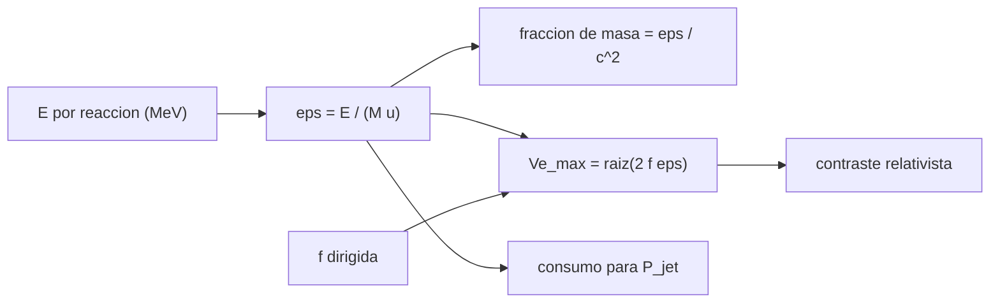

# B78-C16 — Propulsión de fusión como investigación

<!-- nav:top -->
[🏠 Programa](../../../../README.md) · [📚 Bloque B78](../../../tronco-comun/B78-tecnologias-de-propulsion-espacial.md) · [← Anterior: B78-C15 — Propulsión nuclear eléctrica conceptual](../B78-C15-propulsion-nuclear-electrica-conceptual/CLASE.md) · [Siguiente: B78-C17 — Masa de propelente y presupuesto →](../B78-C17-masa-de-propelente-y-presupuesto/CLASE.md)
<!-- /nav -->

## 1. Ubicación, nivel y alcance

Clase 16 del bloque B78. Nivel N3. La fusión se estudia como investigación: no hay un propulsor de fusión demostrado en el espacio (afirmación general, no consultada). Lo que sí se puede hacer es un balance de energía: cuánta energía por kilo libera una reacción D–T frente a la fisión y a la combustión química, y qué escape máximo permitiría. Aquí aplicas ese balance con las constantes de NIST y valores de manual (no consultados), sin diseño de dispositivo alguno. Usas [C06](../B78-C06-propulsion-electrica-general/CLASE.md) para la potencia del chorro.

## 2. Por qué esta clase existe

Si la energía por kilo es millones de veces mayor, el escape posible es enorme; pero eso es una cota, no un propulsor. La decisión central: **¿cuánta energía por kilo libera cada reacción y cuánto escape acotaría, según la fracción que se logre dirigir?**

## 3. Lo que podrás hacer al terminar

1. Convertir MeV por reacción en J/kg usando `u`, `e` y `c`.
2. Calcular la fracción de masa convertida y verificarla por dos vías.
3. Acotar el escape `Vₑ = √(2 f ε)` según la fracción dirigida `f`.
4. Comparar con la fisión y la química y contrastar con la corrección relativista.
5. Calcular el consumo de combustible para una potencia del chorro dada.
6. Rotular lo no consultado y recordar que es investigación, no un diseño.

La evidencia es la **comparación de energía específica de reacciones** del ejercicio 12 (sección 20).

## 4. Con qué llegas y cómo comprobarlo

1. ¿Qué es un electronvoltio?
2. ¿Qué es la equivalencia masa–energía?
3. ¿Qué es la energía específica?
4. ¿Qué es un dato sintético?
5. ¿Qué es una verificación por segunda vía?

<details>
<summary>Ver respuestas</summary>

1. La energía de un electrón acelerado por 1 V: `1,602×10⁻¹⁹ J`. 2. `E = m c²`. 3. La energía por unidad de masa, en J/kg. 4. Un dato generado para el ejemplo, no medido. 5. Calcular lo mismo con otro método y comparar.
</details>

Con cuatro o cinco aciertos, sigue; si no, repasa los prerrequisitos.

## 5. Un caso de contexto y casos de referencia

Con los valores de manual `17,6 MeV` por reacción D–T y masas de `2,014` y `3,016 u`, la energía específica es `3,376×10¹⁴ J/kg`, unas `2,5×10⁷` veces la de H₂/O₂ (`1,342×10⁷ J/kg`) y `4,11` veces la de la fisión del U-235 (`8,210×10¹³ J/kg`): el **ejemplo conductor**. Convierten `0,3756 %` de la masa en energía.

## 6. Vocabulario

La **energía específica** `ε` es la energía liberada por kilo de combustible. La **fracción de masa convertida** es `E/(M c²)`. La **fracción dirigida** `f` es la parte de la energía que queda como energía cinética del escape. La **cota de escape** es `√(2 f ε)`. La **fusión como investigación** significa que se estudia en laboratorio y no hay dispositivo en vuelo.

## 7. Modelo mental



*Descripción textual:* la energía por reacción y la masa de los reactivos dan la energía específica; ésta da la fracción de masa convertida y, con la fracción dirigida, la cota de escape, que se contrasta con la relativista; con una potencia dada se calcula el consumo.

Analogía: el contenido calórico de un alimento frente a su peso; un gramo de grasa rinde mucho más que uno de azúcar. Límite: la energía de la fusión no se «quema» en un motor ya construido; se aprovecha solo con un dispositivo aún en investigación.

## 8. La explicación, paso a paso

### 8.1 Energía específica

`u c²/e = 931,494 MeV` (derivado de `u`, `c` y `e` de NIST). Con valores de manual:

| Reacción | `ε` (J/kg) | Fracción de masa |
|---|---|---|
| D–T (fusión) | 3,376×10¹⁴ | 3,756×10⁻³ |
| U-235 (fisión) | 8,210×10¹³ | 9,135×10⁻⁴ |
| H₂/O₂ (química) | 1,342×10⁷ | 1,493×10⁻¹⁰ |

Las dos vías (`E/M` y `fracción × c²`) coinciden a `10⁻¹²`. Cociente D–T/química `2,515×10⁷`; D–T/fisión `4,11`.

### 8.2 Cota de escape

`Vₑ_max = √(2 f ε)`. Para D–T: `f = 0,05` da `5,810×10⁶ m/s`; `f = 0,30`, `1,423×10⁷ m/s` (`0,0475 c`); `f = 1`, `2,598×10⁷ m/s` (`0,0867 c`). Para H₂/O₂ con `f = 1`: `5181 m/s` (`528 s`). La corrección relativista de `γ−1` frente a `½ β²` difiere en menos de `1 %` en el peor caso.

### 8.3 Consumo

Para una potencia del chorro de `1 GW` y `f = 0,30`: D–T gastaría `9,87 mg/s` (`0,85 kg/día`); la química H₂/O₂ pediría `248,3 kg/s`.

### 8.4 Qué significa

Estas cifras son **cotas energéticas**. No dicen si existe un dispositivo que dirija esa fracción, ni cuánto pesa, ni cuándo funcionaría. Los neutrones, las pérdidas por radiación y el confinamiento reducen `f`, y no se tratan aquí. Para el estado de madurez véase C19.

## 9. Magnitudes, símbolos y unidades

| Símbolo | Qué es | Unidad | Valor / nota |
|---|---|---|---|
| `E` | energía por reacción | MeV | 17,6 (D–T, no consultada) |
| `ε` | energía específica | J/kg | 3,376×10¹⁴ (D–T) |
| `f` | fracción dirigida | — | 0,05; 0,30; 1,00 (ilustrativa) |
| `Vₑ_max` | cota de escape | m/s | 1,423×10⁷ (f = 0,30) |
| `u c²` | equivalente en energía | MeV | 931,494 |
| `ṁ` | consumo para 1 GW | mg/s | 9,87 |

## 10. Convenciones y referencias

Balance de energía por masa de reactivos; sin geometría ni confinamiento; velocidad clásica y relativista para contraste. Versiones: NIST CODATA (consulta del 2026-11-10). Las energías por reacción y las masas atómicas son de manual y **no se consultaron**; `f` y la potencia son **ilustrativas**.

## 11. De dónde sale lo que afirmamos

| ID | Fuente | Localizador | Respalda | Estado |
|---|---|---|---|---|
| S1 | NIST, CODATA Fundamental Physical Constants (tabla ASCII) — https://physics.nist.gov/cuu/Constants/Table/allascii.txt (consultada 2026-11-10) | filas de `e`, `u`, `c` y `g₀` | `e`, `u`, `c`, `g₀` | Consultada |
| — | Relaciones estándar de la física y la ingeniería de propulsión | — | las verifica el laboratorio con una segunda vía | No consultada en una fuente concreta |

Límites: las energías por reacción, las masas atómicas y el estado de la investigación en fusión no se consultaron; no se clasifica la madurez de la fusión con ninguna escala (eso es C19).

## 12. Cómo ver el resultado

| Magnitud | Valor |
|---|---|
| `ε` D–T | 3,376×10¹⁴ J/kg |
| D–T/química | 2,515×10⁷ |
| `Vₑ_max` (f = 0,30) | 1,423×10⁷ m/s |
| `v/c` (f = 1) | 0,0867 |
| Consumo para 1 GW | 9,87 mg/s |

Descripción larga: la energía por kilo de la fusión supera a la química en siete órdenes de magnitud; la cota de escape sigue siendo una fracción de la velocidad de la luz.

## 13. Ejemplo trabajado

**Paso 1 · Masa.** `5,030 u = 8,353×10⁻²⁷ kg`.

**Paso 2 · Energía.** `17,6×10⁶ × 1,602×10⁻¹⁹ = 2,820×10⁻¹² J`.

**Paso 3 · Específica.** `2,820×10⁻¹²/8,353×10⁻²⁷ = 3,376×10¹⁴ J/kg`.

## 14. Distintas formas de describir el problema

**Por reacción:** MeV. **Por masa:** J/kg. **Por fracción:** `ε/c²`. **Por escape:** `√(2 f ε)`. **Por consumo:** `P/(f ε)`.

## 15. Práctica guiada

**Ejercicio 1 · guiado (con los pasos indicados).** Convierte `17,6 MeV` a J. *Pasos:* multiplica por `1,602×10⁻¹³ J/MeV`.

<details><summary>Solución comentada</summary>

`2,82×10⁻¹² J`.
</details>

**Ejercicio 2 · guiado (con una pista).** Predice cuánto sube `Vₑ_max` si `f` se cuadruplica. *Pista:* raíz.

<details><summary>Solución comentada</summary>

Se duplica.
</details>

**Ejercicio 3 · guiado (casi autónomo).** ¿Por qué la fracción de masa convertida de la química es ~`10⁻¹⁰`? *Casi autónomo.*

<details><summary>Solución comentada</summary>

Porque la energía de enlace por átomo es del orden de eV frente a miles de MeV en la masa en reposo.
</details>

## 16. Práctica autónoma, transferencia e integrador

**Ejercicio 4 · autónomo.** Calcula `ε` de U-235 con 200 MeV y 235,04 u.

<details><summary>Solución comentada</summary>

`3,204×10⁻¹¹/3,903×10⁻²⁵ = 8,21×10¹³ J/kg`.
</details>

**Ejercicio 5 · autónomo.** Calcula `Vₑ` química con `f = 0,3`.

<details><summary>Solución comentada</summary>

`√(2 × 0,3 × 1,342×10⁷) = 2838 m/s`.
</details>

**Ejercicio 6 · autónomo.** ¿Qué consumo pide 500 MW con `f = 0,3` en D–T?

<details><summary>Solución comentada</summary>

`4,94 mg/s`.
</details>

**Ejercicio 7 · autónomo.** ¿Cuál es `ε/c²` de D–T?

<details><summary>Solución comentada</summary>

`3,376×10¹⁴/8,988×10¹⁶ = 3,756×10⁻³`.
</details>

**Ejercicio 8 · autónomo.** ¿Cuándo importa la corrección relativista?

<details><summary>Solución comentada</summary>

Cuando `β` no es pequeño; para `β = 0,0867` el error es menor de 1 %.
</details>

**Ejercicio 9 · transferencia.** Un colega dice que la fusión da un `Isp` de `2,6×10⁶ s`. ¿Qué omite?

<details><summary>Solución comentada</summary>

Que es una cota con `f = 1` y sin dispositivo; con `f = 0,3` es `1,45×10⁶ s` y ni siquiera existe el dispositivo.
</details>

**Ejercicio 10 · transferencia.** ¿Basta la energía específica para elegir una tecnología?

<details><summary>Solución comentada</summary>

No: faltan la masa del dispositivo, la potencia, la madurez (C19) y la vida útil.
</details>

**Ejercicio 11 · transferencia.** ¿Esta clase propone un diseño de fusión?

<details><summary>Solución comentada</summary>

No: es un balance de energía.
</details>

**Ejercicio 12 · integrador.** Elabora tu *comparación de energía específica de reacciones*: tabla de tres reacciones, cota de escape con tres `f`, consumo para 1 GW y límites.

<details><summary>Solución comentada</summary>

Secciones 8.1–8.4 y la salida del laboratorio.
</details>

## 17. Laboratorio: energía específica de D–T, fisión y química

El script [fusion.py](fusion.py) calcula la energía específica, la fracción de masa, la cota de escape y el consumo para una potencia (**comprueba** las dos vías de `ε` a `1e-12` y que la corrección relativista difiere de la clásica en menos de `1 %` para D–T).

**Datos:** `e`, `u`, `c`, `g₀` (NIST) **consultados**; energías por reacción y masas atómicas **de manual, no consultadas**; `f` y potencia **ilustrativas**. **Predice antes de ejecutar:** ¿cuántos órdenes de magnitud separan D–T de la química? (siete.) **Ejecución del 2026-11-10 (Python 3.12.9):**

```text
Python 3.12.9 (biblioteca estandar)
u c^2 = 931.494 MeV (derivado de u, c, e consultados)
  D-T (fusion)     eps = 3.376e+14 J/kg ; fraccion de masa convertida = 3.756e-03
  U-235 (fision)   eps = 8.210e+13 J/kg ; fraccion de masa convertida = 9.135e-04
  H2/O2 (quimica)  eps = 1.342e+07 J/kg ; fraccion de masa convertida = 1.493e-10
Cociente D-T/quimica = 2.515e+07 ; D-T/fision = 4.11
Cota de escape Ve_max = sqrt(2 f eps) segun la fraccion f dirigida (ILUSTRATIVA):
  caso            f      Ve_clasica [m/s]  Ve/c     Isp [s]       gamma-1 relativista
  D-T (fusion)    0.05        5.810e+06   0.0194    5.925e+05    1.879e-04
  D-T (fusion)    0.30        1.423e+07   0.0475    1.451e+06    1.129e-03
  D-T (fusion)    1.00        2.598e+07   0.0867    2.650e+06    3.778e-03
  H2/O2 (quimica) 0.05        1.159e+03   0.0000    1.181e+02    7.467e-12
  H2/O2 (quimica) 0.30        2.838e+03   0.0000    2.894e+02    4.480e-11
  H2/O2 (quimica) 1.00        5.181e+03   0.0000    5.283e+02    1.493e-10
Para una potencia del chorro de 1 GW con f = 0.3: consumo de combustible D-T = 9.87 mg/s (0.85 kg/dia)
  la misma potencia con quimica H2/O2 pediria 248.3 kg/s
Pruebas superadas.
```

```bash
python programa/clases/B78/B78-C16-propulsion-de-fusion-como-investigacion/fusion.py
```

**Límites:** balance de energía sin dispositivo; no incluye neutrones, radiación ni confinamiento.

## 18. Errores frecuentes y cómo corregirlos

****Tomar la cota por un propulsor.** Se corrige con 8.4.**

****Olvidar la fracción dirigida.** Se corrige con 8.2.**

****Mezclar MeV y J.** Se corrige con 8.1.**

****Tratar valores de manual como consultados.** Se corrige con la sección 11.**

## 19. Cómo sabrás que vas bien

Tras la sección 8: ¿qué `ε` esperabas y cuál obtuviste? Si dudas, repasa el ejemplo 13. Tras el laboratorio: ¿qué comprueba? (ver la sección 17).

## 20. Qué entregas y cómo se evalúa

El producto es tu **comparación de energía específica de reacciones** (ejercicio 12).

| Criterio | Inicial | En desarrollo | Logrado | Destacado |
|---|---|---|---|---|
| Conceptos | Los confunde | Parciales | Calcula `ε` y la cota de escape | Explica los límites |
| Cálculo | Sin unidades | Con errores | Tablas completas con unidades | Calcula casos nuevos |
| Numérico | Sin comprobar | Un caso | Contraste con una segunda vía | Interpreta las diferencias |
| Fuentes | Sin fuente | Sin fecha | Fuentes con fecha y estado | Declara lo ilustrativo y lo no consultado |
| Límites | No los nombra | Uno | Tres | Discute qué falta del modelo |

**Condiciones críticas (no se compensan con promedio):** no describir ningún dispositivo de fusión; rotular energías de manual como no consultadas; no presentar la cota como propulsor.

## 21. Ética, seguridad y límites

Clase educativa y conceptual: los modelos son simplificados, los datos son consultados con fecha o sintéticos rotulados, y ningún resultado es una especificación de diseño, una verificación de hardware ni una instrucción operativa.  Accesibilidad: tablas equivalentes a las gráficas, fórmulas en texto, ejercicios sin conexión.

## 22. Para cerrar y seguir

D–T libera `3,4×10¹⁴ J/kg`, siete órdenes de magnitud sobre la química; esa cota no es un propulsor. Queda una pregunta: ¿cómo se presupuesta el propelente de una misión cualquiera?

**Glosario español–inglés.** fusión · *fusion*; energía específica · *specific energy*; fracción dirigida · *directed fraction*; deuterio · *deuterium*; tritio · *tritium*.

**Continuidad.** [B78-C17](../B78-C17-masa-de-propelente-y-presupuesto/CLASE.md) estudia la masa de propelente y el presupuesto.

**Referencias:** ver sección 11.

<!-- nav:bottom -->
---

[← Anterior: B78-C15 — Propulsión nuclear eléctrica conceptual](../B78-C15-propulsion-nuclear-electrica-conceptual/CLASE.md) · [📚 Bloque B78](../../../tronco-comun/B78-tecnologias-de-propulsion-espacial.md) · [Siguiente: B78-C17 — Masa de propelente y presupuesto →](../B78-C17-masa-de-propelente-y-presupuesto/CLASE.md)
<!-- /nav -->
