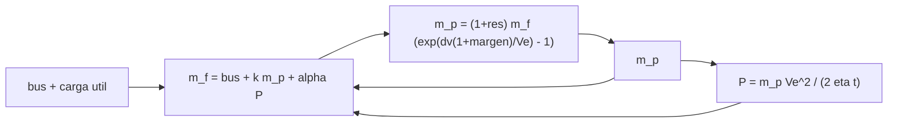

# B78-C17 — Masa de propelente y presupuesto

<!-- nav:top -->
[🏠 Programa](../../../../README.md) · [📚 Bloque B78](../../../tronco-comun/B78-tecnologias-de-propulsion-espacial.md) · [← Anterior: B78-C16 — Propulsión de fusión como investigación](../B78-C16-propulsion-de-fusion-como-investigacion/CLASE.md) · [Siguiente: B78-C18 — Energía específica y limitaciones →](../B78-C18-energia-especifica-y-limitaciones/CLASE.md)
<!-- /nav -->

## 1. Ubicación, nivel y alcance

Clase 17 del bloque B78. Nivel N3. Un presupuesto de propulsión suma masas: el propelente, los tanques, la planta de potencia (si es eléctrica) y las reservas. Lo difícil es que se realimentan: más propelente exige tanques, y en la propulsión eléctrica más potencia exige más planta, que a su vez eleva la masa que hay que acelerar. Aquí resuelves ese acoplamiento por dos métodos, aplicas márgenes y residuos, y comparas una misión química y una eléctrica. Usas [C02](../B78-C02-propulsion-quimica-como-sistema-fisico/CLASE.md) y [C15](../B78-C15-propulsion-nuclear-electrica-conceptual/CLASE.md). La misión es sintética.

## 2. Por qué esta clase existe

Una hoja de presupuesto honesta incluye márgenes y reservas, y esos márgenes cuestan masa. La decisión central: **¿cuánto propelente, tanques y planta hacen falta para un Δv con margen, y qué arquitectura da la menor masa total en cada caso?**

## 3. Lo que podrás hacer al terminar

1. Armar el presupuesto de masa con propelente, tanques y planta de potencia.
2. Resolver el acoplamiento propelente–masa final por punto fijo y por bisección.
3. Aplicar un margen de Δv y un residuo de propelente.
4. Comparar la masa total de una opción química y una eléctrica para varios Δv.
5. Cuantificar el costo en propelente de los márgenes.
6. Separar lo consultado (`g₀`, rangos de `Isp`) de lo ilustrativo (masas, márgenes).

La evidencia es la **hoja de presupuesto de masa de una misión** del ejercicio 12 (sección 20).

## 4. Con qué llegas y cómo comprobarlo

1. ¿Qué es la ecuación del cohete?
2. ¿Qué es un margen de diseño?
3. ¿Qué es un punto fijo?
4. ¿Qué es un dato sintético?
5. ¿Qué es una verificación por segunda vía?

<details>
<summary>Ver respuestas</summary>

1. `Δv = Vₑ ln(m₀/m_f)`. 2. Una reserva sobre el valor nominal para cubrir incertidumbres. 3. Un valor que no cambia al aplicar una función. 4. Un dato generado para el ejemplo, no medido. 5. Calcular lo mismo con otro método y comparar.
</details>

Con cuatro o cinco aciertos, sigue; si no, repasa los prerrequisitos.

## 5. Un caso de contexto y casos de referencia

Para una misión **ilustrativa** de `400 kg` de bus y carga útil y `Δv = 2000 m/s` con `10 %` de margen y `2 %` de residuo, la opción química (`Isp = 300 s`) pide `511,91 kg` de propelente y pesa `963,10 kg` en total; la eléctrica (`Isp = 2500 s`, `α = 25 kg/kW`, 200 días) pide `41,50 kg`, una planta de `30,08 kg` (`1,20 kW`) y pesa `474,90 kg`: el **ejemplo conductor**.

## 6. Vocabulario

La **masa seca** es la masa final sin propelente. El **margen de Δv** es un porcentaje sobre el Δv nominal. El **residuo** es propelente que no se puede usar. La **fracción de tanques** `k` es la masa de tanque por kilo de propelente. La **planta** es la fuente de potencia, con masa `α P`. El **acoplamiento** es la dependencia mutua entre propelente, tanques y planta.

## 7. Modelo mental



*Descripción textual:* el propelente fija la potencia y la planta, que suman a la masa final, que a su vez fija el propelente: se resuelve iterando o por bisección.

Analogía: planificar una mudanza donde cada caja nueva requiere otra caja de embalaje. Límite: aquí las cajas se multiplican por una exponencial.

## 8. La explicación, paso a paso

### 8.1 Dos métodos, una respuesta

El punto fijo `m_p ← (1+res) m_f(m_p) (e^(Δv(1+m)/Vₑ) − 1)` converge a la raíz de `m_p − f(m_p) = 0`; la bisección da el mismo valor a `10⁻⁹`.

### 8.2 Las dos misiones

| Opción | `Isp` (s) | `m_prop` (kg) | `P` (kW) | Planta (kg) | Tanques (kg) | Total (kg) | `m_prop`/total |
|---|---|---|---|---|---|---|---|
| Química | 300 | 511,91 | — | — | 51,19 | 963,10 | 0,532 |
| Eléctrica | 2500 | 41,50 | 1,20 | 30,08 | 3,32 | 474,90 | 0,087 |

### 8.3 Frente al Δv

| Δv (m/s) | Química (kg) | Eléctrica (kg) | Cociente |
|---|---|---|---|
| 500 | 494,2 | 417,0 | 1,19 |
| 1000 | 613,3 | 435,1 | 1,41 |
| 2000 | 963,1 | 474,9 | 2,03 |
| 3000 | 1577,7 | 520,3 | 3,03 |
| 4000 | 2801,9 | 572,6 | 4,89 |
| 6000 | 27 285,5 | 704,7 | 38,72 |

Con estos parámetros ilustrativos la eléctrica pesa menos en todos los casos, pero el cálculo no incluye el tiempo de maniobra (200 días) ni el costo.

### 8.4 El costo de los márgenes

Sin margen ni residuo, la opción química pide `431,40 kg` en lugar de `511,91 kg`: los márgenes de `10 %` de Δv y `2 %` de residuo cuestan `80,5 kg` de propelente.

## 9. Magnitudes, símbolos y unidades

| Símbolo | Qué es | Unidad | Valor / nota |
|---|---|---|---|
| `m_p` | masa de propelente | kg | 511,91 (química); 41,50 (eléctrica) |
| `k` | fracción de tanques | — | 0,10 / 0,08 (ilustrativa) |
| `α` | masa específica de la planta | kg/kW | 25 (ilustrativa) |
| margen | reserva de Δv | % | 10 (ilustrativo) |
| residuo | propelente inutilizable | % | 2 (ilustrativo) |
| `m_total` | masa total | kg | 963,10 / 474,90 |

## 10. Convenciones y referencias

Empuje impulsivo equivalente, planta proporcional a la potencia, tiempo de empuje de 200 días para la eléctrica, sin estructura adicional. Versiones: NIST CODATA y NASA SSVI (consulta del 2026-11-10). Masas, márgenes, `α`, `k` y los `Isp` elegidos son **ilustrativos**.

## 11. De dónde sale lo que afirmamos

| ID | Fuente | Localizador | Respalda | Estado |
|---|---|---|---|---|
| S1 | NIST, CODATA Fundamental Physical Constants (tabla ASCII) — https://physics.nist.gov/cuu/Constants/Table/allascii.txt (consultada 2026-11-10) | fila de `g₀` | `g₀` | Consultada |
| S2 | NASA Small Spacecraft Systems Virtual Institute, State-of-the-Art: In-Space Propulsion, Tabla 4-1 — https://www.nasa.gov/smallsat-institute/sst-soa/in-space-propulsion/ (consultada 2026-11-10; solo se leyeron los primeros 100 000 de 289 063 caracteres) | Tabla 4-1, filas de química, Hall y iónico | bi/monopropelentes alternativos 150–310 s; Hall 200–1920 s; iónico 500–3000 s | Consultada parcialmente |
| — | Relaciones estándar de la física y la ingeniería de propulsión | — | las verifica el laboratorio con una segunda vía | No consultada en una fuente concreta |

Límites: los `Isp` de 300 y 2500 s caen dentro de los rangos consultados pero son valores elegidos; las masas de planta y tanques no provienen de ninguna fuente; el modelo no incluye la masa del propulsor.

## 12. Cómo ver el resultado

| Magnitud | Valor |
|---|---|
| Propelente químico | 511,91 kg |
| Propelente eléctrico | 41,50 kg |
| Masa total química/eléctrica | 963,10 / 474,90 kg |
| Costo de márgenes | 80,5 kg |
| Convergencia | 1e-9 |

Descripción larga: la química crece exponencialmente con el Δv; la eléctrica crece casi linealmente porque su costo es la planta.

## 13. Ejemplo trabajado

**Paso 1 · Escape y razón.** `Vₑ = 300 × 9,80665 = 2942 m/s`; `e^(2200/2942) = 2,1124`.

**Paso 2 · Ecuación.** `m_p = 1,02 (400 + 0,10 m_p)(2,1124 − 1) = 1,1346 (400 + 0,1 m_p)`.

**Paso 3 · Resolver.** `m_p (1 − 0,11346) = 453,83`; `m_p = 511,9 kg`.

## 14. Distintas formas de describir el problema

**Por masas:** propelente, tanques y planta. **Por método:** punto fijo o bisección. **Por margen:** nominal frente a con reserva. **Por arquitectura:** química frente a eléctrica. **Por Δv:** tabla.

## 15. Práctica guiada

**Ejercicio 1 · guiado (con los pasos indicados).** Calcula `Vₑ` para `Isp = 2500 s`. *Pasos:* multiplica por `g₀`.

<details><summary>Solución comentada</summary>

`24 517 m/s`.
</details>

**Ejercicio 2 · guiado (con una pista).** Predice si el propelente sube o baja al subir la fracción de tanques. *Pista:* hay que mover más masa.

<details><summary>Solución comentada</summary>

Sube.
</details>

**Ejercicio 3 · guiado (casi autónomo).** ¿Por qué el acoplamiento no se resuelve en un solo paso? *Casi autónomo.*

<details><summary>Solución comentada</summary>

Porque `m_p` aparece a ambos lados: la masa final depende del propelente.
</details>

## 16. Práctica autónoma, transferencia e integrador

**Ejercicio 4 · autónomo.** Calcula el propelente sin tanques para `Δv = 2000 m/s`, `Isp = 300 s`, `m_f = 400 kg` sin margen.

<details><summary>Solución comentada</summary>

`400 (e^(0,6798) − 1) = 400 × 0,9734 = 389,4 kg`.
</details>

**Ejercicio 5 · autónomo.** ¿Qué potencia pide la eléctrica si `m_p = 41,50 kg`, `η = 0,6`, `t = 200 días`?

<details><summary>Solución comentada</summary>

`41,50 × 24 517²/(2 × 0,6 × 1,728×10⁷) = 1,20 kW`.
</details>

**Ejercicio 6 · autónomo.** ¿Cuánto pesa la planta con `α = 25 kg/kW`?

<details><summary>Solución comentada</summary>

`1,20 × 25 = 30,08 kg`.
</details>

**Ejercicio 7 · autónomo.** ¿Cuál es la fracción de propelente de la química?

<details><summary>Solución comentada</summary>

`511,91/963,10 = 0,532`.
</details>

**Ejercicio 8 · autónomo.** ¿Cuánto cuesta en masa total quitar los márgenes de la química?

<details><summary>Solución comentada</summary>

Baja el propelente en `80,5 kg` y los tanques en `8,05 kg`.
</details>

**Ejercicio 9 · transferencia.** Un colega elige la eléctrica solo por masa. ¿Qué omite?

<details><summary>Solución comentada</summary>

El tiempo de maniobra (200 días), la vida útil, el costo y la madurez.
</details>

**Ejercicio 10 · transferencia.** ¿Por qué el cociente química/eléctrica crece tanto con el Δv?

<details><summary>Solución comentada</summary>

Porque la química crece como `e^(Δv/Vₑ)` y la eléctrica solo linealmente en `Δv` con la planta.
</details>

**Ejercicio 11 · transferencia.** ¿Es 963 kg una masa de misión real?

<details><summary>Solución comentada</summary>

No: es un resultado de datos ilustrativos.
</details>

**Ejercicio 12 · integrador.** Elabora tu *hoja de presupuesto de masa de una misión*: tabla de las dos arquitecturas, curva frente al Δv, costo de los márgenes y supuestos.

<details><summary>Solución comentada</summary>

Secciones 8.1–8.4 y la salida del laboratorio.
</details>

## 17. Laboratorio: presupuesto de masa acoplado

El script [presupuesto.py](presupuesto.py) resuelve el presupuesto de una misión química y una eléctrica para varios Δv y mide el costo de los márgenes (**comprueba** el punto fijo contra la bisección a `1e-9`).

**Datos:** `g₀` (NIST) y los rangos de `Isp` (NASA SSVI) **consultados**; masas, márgenes, `α`, `k` y los `Isp` elegidos **ilustrativos**. **Predice antes de ejecutar:** ¿cuántas veces pesa más la química que la eléctrica a 2000 m/s? (≈ 2.) **Ejecución del 2026-11-10 (Python 3.12.9):**

```text
Python 3.12.9 (biblioteca estandar)
Mision ILUSTRATIVA: bus + carga util 400 kg ; margen de dv 10 % ; residuo 2 % ; dv nominal 2000 m/s
 opcion      Isp [s]  m_prop [kg]  P [kW]  planta [kg]  tanques [kg]  masa total [kg]  prop/total
 quimica        300       511.91    0.00         0.00         51.19           963.10       0.532
 electrica     2500        41.50    1.20        30.08          3.32           474.90       0.087
Masa total frente al delta-v nominal (quimica / electrica):
  dv =   500 m/s ->     494.2 kg /     417.0 kg ; cociente quimica/electrica = 1.19
  dv =  1000 m/s ->     613.3 kg /     435.1 kg ; cociente quimica/electrica = 1.41
  dv =  2000 m/s ->     963.1 kg /     474.9 kg ; cociente quimica/electrica = 2.03
  dv =  3000 m/s ->    1577.7 kg /     520.3 kg ; cociente quimica/electrica = 3.03
  dv =  4000 m/s ->    2801.9 kg /     572.6 kg ; cociente quimica/electrica = 4.89
  dv =  6000 m/s ->   27285.5 kg /     704.7 kg ; cociente quimica/electrica = 38.72
Con estos parametros ILUSTRATIVOS la electrica pesa menos en todos los dv de la tabla: True (no incluye tiempo de maniobra ni costo)
Sensibilidad del propelente quimico (dv nominal 2000 m/s):
  con margen 10 % y residuo 2 %: m_prop = 511.91 kg
  sin margen ni residuo: m_prop = 431.40 kg
Pruebas superadas.
```

```bash
python programa/clases/B78/B78-C17-masa-de-propelente-y-presupuesto/presupuesto.py
```

**Límites:** sin masa de propulsor ni estructura, planta proporcional, tiempo de maniobra no restringido salvo el de 200 días.

## 18. Errores frecuentes y cómo corregirlos

****Calcular el propelente con la masa inicial.** Se corrige con 8.1.**

****Olvidar tanques y planta.** Se corrige con 8.2.**

****Quitar márgenes sin cuantificarlos.** Se corrige con 8.4.**

****Comparar solo masa total.** Se corrige con la pregunta 9.**

## 19. Cómo sabrás que vas bien

Tras la sección 8: ¿qué propelente esperabas para la química y cuál obtuviste? Si dudas, repasa el ejemplo 13. Tras el laboratorio: ¿qué comprueba? (ver la sección 17).

## 20. Qué entregas y cómo se evalúa

El producto es tu **hoja de presupuesto de masa de una misión** (ejercicio 12).

| Criterio | Inicial | En desarrollo | Logrado | Destacado |
|---|---|---|---|---|
| Conceptos | Los confunde | Parciales | Resuelve el presupuesto acoplado | Explica los límites |
| Cálculo | Sin unidades | Con errores | Tablas completas con unidades | Calcula casos nuevos |
| Numérico | Sin comprobar | Un caso | Contraste con una segunda vía | Interpreta las diferencias |
| Fuentes | Sin fuente | Sin fecha | Fuentes con fecha y estado | Declara lo ilustrativo y lo no consultado |
| Límites | No los nombra | Uno | Tres | Discute qué falta del modelo |

**Condiciones críticas (no se compensan con promedio):** rotular masas y márgenes como ilustrativos; no presentar el resultado como diseño de misión; citar solo lo consultado.

## 21. Ética, seguridad y límites

Clase educativa y conceptual: los modelos son simplificados, los datos son consultados con fecha o sintéticos rotulados, y ningún resultado es una especificación de diseño, una verificación de hardware ni una instrucción operativa.  Accesibilidad: tablas equivalentes a las gráficas, fórmulas en texto, ejercicios sin conexión.

## 22. Para cerrar y seguir

Para `2000 m/s`, la química ilustrativa pesa `963 kg` y la eléctrica `475 kg`, y los márgenes cuestan `80 kg` de propelente. Queda una pregunta: ¿cuánta energía por kilo puede entregar cada fuente?

**Glosario español–inglés.** presupuesto de masa · *mass budget*; margen · *margin*; masa seca · *dry mass*; planta de potencia · *power plant*; punto fijo · *fixed point*.

**Continuidad.** [B78-C18](../B78-C18-energia-especifica-y-limitaciones/CLASE.md) estudia la energía específica y sus limitaciones.

**Referencias:** ver sección 11.

<!-- nav:bottom -->
---

[← Anterior: B78-C16 — Propulsión de fusión como investigación](../B78-C16-propulsion-de-fusion-como-investigacion/CLASE.md) · [📚 Bloque B78](../../../tronco-comun/B78-tecnologias-de-propulsion-espacial.md) · [Siguiente: B78-C18 — Energía específica y limitaciones →](../B78-C18-energia-especifica-y-limitaciones/CLASE.md)
<!-- /nav -->
