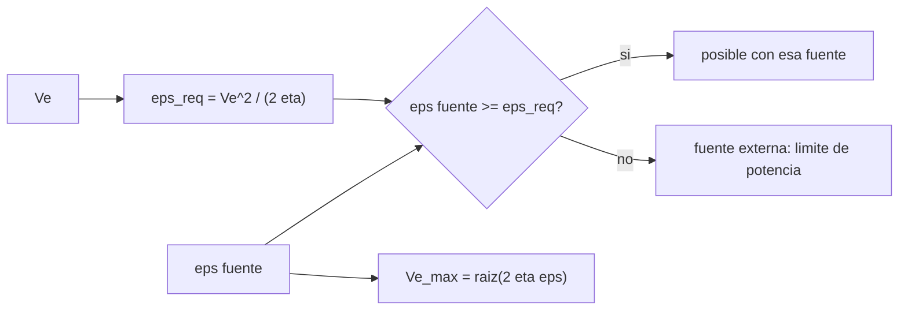

# B78-C18 — Energía específica y limitaciones

<!-- nav:top -->
[🏠 Programa](../../../../README.md) · [📚 Bloque B78](../../../tronco-comun/B78-tecnologias-de-propulsion-espacial.md) · [← Anterior: B78-C17 — Masa de propelente y presupuesto](../B78-C17-masa-de-propelente-y-presupuesto/CLASE.md) · [Siguiente: B78-C19 — Madurez tecnológica TRL →](../B78-C19-madurez-tecnologica-trl/CLASE.md)
<!-- /nav -->

## 1. Ubicación, nivel y alcance

Clase 18 del bloque B78. Nivel N3. Cada velocidad de escape exige una energía cinética por kilo de propelente, `½ Vₑ²`. Si esa energía debe salir del propio propelente, la química y su energía por kilo fijan un techo de `Isp`; si viene de fuera (paneles, reactor), el límite pasa a ser la potencia. Aquí calculas esa energía requerida, la comparas con la de la química, las baterías y la fusión, y distingues limitación de energía de limitación de potencia. Usas [C06](../B78-C06-propulsion-electrica-general/CLASE.md) y [C16](../B78-C16-propulsion-de-fusion-como-investigacion/CLASE.md). Los valores de energía de las fuentes son de manual y **no se consultaron**.

## 2. Por qué esta clase existe

No todo `Isp` es posible con cualquier fuente. La decisión central: **¿qué fuente de energía alcanza para un `Isp` dado, y cuándo el límite es la energía almacenada y cuándo la potencia disponible?**

## 3. Lo que podrás hacer al terminar

1. Calcular la energía requerida por kilo de propelente para un `Isp` dado.
2. Obtener la cota de escape de una fuente: `Vₑ_max = √(2ηε)`.
3. Comparar química, batería y fusión como fuentes de energía.
4. Mostrar con los datos de Dawn que su energía no sale del propelente.
5. Distinguir un límite de energía (batería) de uno de potencia (fuente continua).
6. Separar lo consultado (`g₀`, Dawn) de lo no consultado (energías de las fuentes).

La evidencia es la **ficha de límites energéticos** del ejercicio 12 (sección 20).

## 4. Con qué llegas y cómo comprobarlo

1. ¿Qué es la energía cinética por unidad de masa?
2. ¿Qué es la energía específica de una batería?
3. ¿Qué es una cota?
4. ¿Qué es un dato sintético?
5. ¿Qué es una verificación por segunda vía?

<details>
<summary>Ver respuestas</summary>

1. `½ v²`, en J/kg. 2. La energía almacenada por kilo, en Wh/kg. 3. Un valor que un resultado no puede superar. 4. Un dato generado para el ejemplo, no medido. 5. Calcular lo mismo con otro método y comparar.
</details>

Con cuatro o cinco aciertos, sigue; si no, repasa los prerrequisitos.

## 5. Un caso de contexto y casos de referencia

El hidrógeno y el oxígeno liberan, con valores de manual, `1,342×10⁷ J/kg`: su cota de escape es `5181 m/s` (`528,3 s`) si toda la energía fuera cinética. Dawn tiene `Vₑ = 28 000 m/s`, que exige `6,533×10⁸ J/kg` con `η = 0,6`, `48,7` veces la química: su energía no sale del propelente. Ese es el **ejemplo conductor**.

## 6. Vocabulario

La **energía requerida** `ε_req = Vₑ²/(2η)` es la que la fuente debe aportar por kilo de propelente. La **cota de escape** `Vₑ_max = √(2ηε)` es el escape máximo con una fuente de energía específica `ε`. Un límite de **energía** es el de una fuente que se agota (batería). Un límite de **potencia** es el de una fuente continua (paneles, reactor) cuyo problema es la tasa. La **energía específica** es la energía por kilo.

## 7. Modelo mental



*Descripción textual:* el escape fija la energía requerida; si la fuente la iguala o supera, el `Isp` es posible; si no, hace falta una fuente externa y el límite pasa a ser la potencia; la cota de escape es la inversa.

Analogía: un tanque de agua para una fuente; si el tanque es pequeño, el chorro dura poco aunque la bomba sea buena. Límite: aquí la energía del tanque es el propio propelente.

## 8. La explicación, paso a paso

### 8.1 Cotas de escape

Con valores de manual: H₂/O₂ `1,342×10⁷ J/kg`, batería de iones de litio `7,200×10⁵ J/kg` (200 Wh/kg) y D–T `3,376×10¹⁴ J/kg` (de C16).

| Fuente | `η` | `Vₑ_max` (m/s) | `Isp` (s) |
|---|---|---|---|
| H₂/O₂ | 1,0 | 5181,1 | 528,3 |
| H₂/O₂ | 0,6 | 4013,3 | 409,2 |
| Batería | 1,0 | 1200,0 | 122,4 |
| Batería | 0,6 | 929,5 | 94,8 |
| D–T | 1,0 | 2,598×10⁷ | 2,650×10⁶ |

La ida y vuelta `Vₑ ↔ ε` coincide a `10⁻¹²`.

### 8.2 Energía requerida por `Isp` (`η = 0,6`)

| `Isp` (s) | `ε_req` (J/kg) | `ε_req/ε_química` |
|---|---|---|
| 300 | 7,213×10⁶ | 0,54 |
| 450 | 1,623×10⁷ | 1,21 |
| 1000 | 8,014×10⁷ | 5,97 |
| 2855,2 | 6,533×10⁸ | 48,68 |
| 5000 | 2,004×10⁹ | 149,27 |

Con `η = 0,6` ilustrativa, 450 s quedaría por encima de la química (1,21), lo que revela que la conversión real de un motor químico supera 0,6; la cota ideal (`η = 1`) es 528 s.

### 8.3 Dawn

Con `F` y `ṁ` consultados, `Vₑ = 28 000 m/s` y `ε_req = 6,533×10⁸ J/kg`, `48,7` veces la energía química: la energía llega de los paneles.

### 8.4 Energía frente a potencia

Con baterías (límite de energía), `η = 0,6` y una fracción de propelente de `0,3`: una fracción de batería `0,1` da `536,7 m/s` (`54,7 s`), `0,3` da `929,5 m/s` y `0,5` da `1200,0 m/s`, con Δv de `191,4`, `331,5` y `428,0 m/s`. Con una fuente continua (límite de potencia), 2 kW con `η = 0,6` dan `240,0 mN` a `10 000 m/s` y `85,7 mN` a `28 000 m/s`, sin tope de energía.

## 9. Magnitudes, símbolos y unidades

| Símbolo | Qué es | Unidad | Valor / nota |
|---|---|---|---|
| `ε` | energía específica de la fuente | J/kg | 1,342×10⁷ (H₂/O₂) |
| `ε_req` | energía requerida | J/kg | 6,533×10⁸ (Dawn) |
| `η` | eficiencia a energía cinética | — | 1,0 y 0,6 |
| `Vₑ_max` | cota de escape | m/s | 5181,1 (H₂/O₂, η = 1) |
| `Isp` | impulso específico | s | 528,3 (cota química) |

## 10. Convenciones y referencias

Energía cinética por kilo de propelente `½ Vₑ²`; fuente que aporta `ε` por kilo del propio propelente (cota) o fuente externa. Versiones: NIST CODATA y página de Dawn (consulta del 2026-11-10). Las energías de H₂/O₂, batería y D–T son de manual y **no se consultaron**; `η` es **ilustrativa**.

## 11. De dónde sale lo que afirmamos

| ID | Fuente | Localizador | Respalda | Estado |
|---|---|---|---|---|
| S1 | NIST, CODATA Fundamental Physical Constants (tabla ASCII) — https://physics.nist.gov/cuu/Constants/Table/allascii.txt (consultada 2026-11-10) | fila de `g₀` | `g₀` | Consultada |
| S2 | NASA/JPL, Dawn: Ion Propulsion — https://science.nasa.gov/mission/dawn/technology/ion-propulsion/ (consultada 2026-11-10) | empuje y consumo | 91 mN y ~3,25 mg/s → velocidad equivalente de 28 000 m/s | Consultada |
| — | Relaciones estándar de la física y la ingeniería de propulsión | — | las verifica el laboratorio con una segunda vía | No consultada en una fuente concreta |

Límites: las energías específicas de las fuentes no se consultaron; la cota supone que toda la energía se convierte en energía cinética del chorro; la comparación con Dawn usa una `η` ilustrativa.

## 12. Cómo ver el resultado

| Magnitud | Valor |
|---|---|
| Cota química | 5181,1 m/s (528,3 s) |
| Cota con `η = 0,6` | 409,2 s |
| `ε_req` de Dawn | 6,533×10⁸ J/kg |
| Dawn/química | 48,7 |
| Batería (η = 0,6) | 94,8 s |

Descripción larga: una fuente química o de batería limita el `Isp`; solo una fuente externa lo supera, y entonces manda la potencia.

## 13. Ejemplo trabajado

**Paso 1 · Escape.** `Isp = 1000 s` → `Vₑ = 9807 m/s`.

**Paso 2 · Energía requerida.** `ε_req = 9807²/(2 × 0,6) = 8,014×10⁷ J/kg`.

**Paso 3 · Comparación.** `8,014×10⁷/1,342×10⁷ = 5,97`: la química no alcanza.

## 14. Distintas formas de describir el problema

**Por escape:** `Vₑ`. **Por energía:** `ε_req`. **Por fuente:** `ε`. **Por cota:** `√(2ηε)`. **Por régimen:** energía o potencia.

## 15. Práctica guiada

**Ejercicio 1 · guiado (con los pasos indicados).** Calcula `ε_req` para `Vₑ = 5000 m/s` y `η = 1`. *Pasos:* `Vₑ²/2`.

<details><summary>Solución comentada</summary>

`1,25×10⁷ J/kg`.
</details>

**Ejercicio 2 · guiado (con una pista).** Predice si H₂/O₂ alcanza `Isp = 400 s` con `η = 0,8`. *Pista:* compara con la cota.

<details><summary>Solución comentada</summary>

`Vₑ = 3923 m/s`; `ε_req = 9,6×10⁶ < 1,342×10⁷`: sí.
</details>

**Ejercicio 3 · guiado (casi autónomo).** ¿Por qué las baterías limitan el `Isp` a ~100 s? *Casi autónomo.*

<details><summary>Solución comentada</summary>

Su energía específica es ~19 veces menor que la química: `√(1/19) ≈ 0,23` del escape.
</details>

## 16. Práctica autónoma, transferencia e integrador

**Ejercicio 4 · autónomo.** Calcula la cota de una fuente de `10⁸ J/kg` con `η = 0,5`.

<details><summary>Solución comentada</summary>

`√(10⁸) = 10 000 m/s` (1020 s).
</details>

**Ejercicio 5 · autónomo.** Compara `ε_req` de 2000 s con la química (`η = 0,6`).

<details><summary>Solución comentada</summary>

`19 613²/1,2 = 3,205×10⁸`; `23,9` veces.
</details>

**Ejercicio 6 · autónomo.** ¿Por qué Dawn supera la cota química?

<details><summary>Solución comentada</summary>

Su energía viene de paneles solares (consultado: >10 kW), no del xenón.
</details>

**Ejercicio 7 · autónomo.** ¿Cuánto Δv da una batería con fracción de batería 0,3 y fracción de propelente 0,3?

<details><summary>Solución comentada</summary>

`331,5 m/s` (laboratorio).
</details>

**Ejercicio 8 · autónomo.** Con 2 kW y `η = 0,6`, ¿qué empuje a `Vₑ = 15 000 m/s`?

<details><summary>Solución comentada</summary>

`2 × 0,6 × 2000/15 000 = 160 mN`.
</details>

**Ejercicio 9 · transferencia.** Un diseñador promete 3000 s con un monopropelente. ¿Qué dice la cota?

<details><summary>Solución comentada</summary>

Es imposible: el `ε_req` (`η = 0,6`) es ~54 veces la energía química.
</details>

**Ejercicio 10 · transferencia.** ¿Por qué la cota de fusión de 2,6 millones de segundos no es un `Isp` realizable?

<details><summary>Solución comentada</summary>

Es una cota energética sin dispositivo (C16).
</details>

**Ejercicio 11 · transferencia.** ¿La potencia disponible es un límite de energía?

<details><summary>Solución comentada</summary>

No: es un límite de tasa; si la fuente es continua, la energía no se agota en la misión.
</details>

**Ejercicio 12 · integrador.** Elabora tu *ficha de límites energéticos*: tabla de cotas por fuente, energía requerida por `Isp`, caso Dawn y distinción energía/potencia.

<details><summary>Solución comentada</summary>

Secciones 8.1–8.4 y la salida del laboratorio.
</details>

## 17. Laboratorio: energía requerida y límites de energía y de potencia

El script [energia_especifica.py](energia_especifica.py) calcula las cotas de escape de tres fuentes, la energía requerida por `Isp`, el caso de Dawn y el límite de una batería (**comprueba** la ida y vuelta `Vₑ ↔ ε` a `1e-12` y que Dawn exige más energía que la química).

**Datos:** `g₀` (NIST) y `F` y `ṁ` de Dawn **consultados**; energías específicas de las fuentes **de manual, no consultadas**; `η` **ilustrativa**. **Predice antes de ejecutar:** ¿cuántas veces supera la energía requerida por Dawn a la química? (≈ 49.) **Ejecución del 2026-11-10 (Python 3.12.9):**

```text
Python 3.12.9 (biblioteca estandar)
Energia especifica de las fuentes (valores de manual no consultados):
  H2/O2 quimica    1.342e+07 J/kg
  bateria Li-ion   7.200e+05 J/kg
  D-T (de C16)     3.376e+14 J/kg
Cota de escape de las fuentes si la energia sale del propio propelente (eta = 1 cota quimica; 0.6 = ILUSTRATIVA):
  H2/O2 quimica    eta = 1.0: Ve_max =      5181.1 m/s ; Isp =      528.3 s
  H2/O2 quimica    eta = 0.6: Ve_max =      4013.3 m/s ; Isp =      409.2 s
  bateria Li-ion   eta = 1.0: Ve_max =      1200.0 m/s ; Isp =      122.4 s
  bateria Li-ion   eta = 0.6: Ve_max =       929.5 m/s ; Isp =       94.8 s
  D-T (de C16)     eta = 1.0: Ve_max =  25984610.8 m/s ; Isp =  2649692.9 s
  D-T (de C16)     eta = 0.6: Ve_max =  20127593.0 m/s ; Isp =  2052443.3 s
Energia requerida por Isp (eta = 0.6) y comparacion con la quimica H2/O2:
  Isp [s]    eps_req [J/kg]   eps_req/eps_quimica   posible solo con energia quimica
    300.0        7.213e+06                 0.54   si
    450.0        1.623e+07                 1.21   NO
   1000.0        8.014e+07                 5.97   NO
   2855.2        6.533e+08                48.68   NO
   5000.0        2.004e+09               149.27   NO
Dawn (F y mdot consultados): Veq = 28000 m/s -> eps_req = 6.533e+08 J/kg = 48.7 veces la quimica: la energia NO sale del propelente
Propulsor alimentado por BATERIA (limite de energia), eta = 0.6, fraccion de propelente 0.3 de m0:
  fraccion de bateria 0.1: Ve =   536.7 m/s ; Isp =   54.7 s ; dv =  191.4 m/s
  fraccion de bateria 0.3: Ve =   929.5 m/s ; Isp =   94.8 s ; dv =  331.5 m/s
  fraccion de bateria 0.5: Ve =  1200.0 m/s ; Isp =  122.4 s ; dv =  428.0 m/s
Limite de POTENCIA (P fija): F = 2 eta P/Ve, sin tope de energia si la fuente es continua (solar, reactor):
  Ve =  10000 m/s con P = 2 kW, eta = 0.6 -> F =  240.0 mN
  Ve =  28000 m/s con P = 2 kW, eta = 0.6 -> F =   85.7 mN
Pruebas superadas.
```

```bash
python programa/clases/B78/B78-C18-energia-especifica-y-limitaciones/energia_especifica.py
```

**Límites:** conversión total de energía a energía cinética, `η` constante, fuente de energía específica uniforme.

## 18. Errores frecuentes y cómo corregirlos

****Confundir energía almacenada con potencia.** Se corrige con 8.4.**

****Esperar un `Isp` sin fuente de energía suficiente.** Se corrige con 8.2.**

****Usar `η = 1` como real.** Se corrige con 8.2.**

****Citar las energías de las fuentes como consultadas.** Se corrige con la sección 11.**

## 19. Cómo sabrás que vas bien

Tras la sección 8: ¿cuántas veces supera Dawn a la química y cuál obtuviste? Si dudas, repasa el ejemplo 13. Tras el laboratorio: ¿qué comprueba? (ver la sección 17).

## 20. Qué entregas y cómo se evalúa

El producto es tu **ficha de límites energéticos** (ejercicio 12).

| Criterio | Inicial | En desarrollo | Logrado | Destacado |
|---|---|---|---|---|
| Conceptos | Los confunde | Parciales | Distingue límite de energía y de potencia | Explica los límites |
| Cálculo | Sin unidades | Con errores | Tablas completas con unidades | Calcula casos nuevos |
| Numérico | Sin comprobar | Un caso | Contraste con una segunda vía | Interpreta las diferencias |
| Fuentes | Sin fuente | Sin fecha | Fuentes con fecha y estado | Declara lo ilustrativo y lo no consultado |
| Límites | No los nombra | Uno | Tres | Discute qué falta del modelo |

**Condiciones críticas (no se compensan con promedio):** rotular las energías de las fuentes como no consultadas; no presentar las cotas como `Isp` realizables; citar solo lo consultado.

## 21. Ética, seguridad y límites

Clase educativa y conceptual: los modelos son simplificados, los datos son consultados con fecha o sintéticos rotulados, y ningún resultado es una especificación de diseño, una verificación de hardware ni una instrucción operativa.  Accesibilidad: tablas equivalentes a las gráficas, fórmulas en texto, ejercicios sin conexión.

## 22. Para cerrar y seguir

La química ideal no pasa de unos `528 s` y Dawn exige `49` veces su energía por kilo. Queda una pregunta: ¿cómo se cuenta cuán maduras están estas tecnologías?

**Glosario español–inglés.** energía específica · *specific energy*; cota · *bound*; límite de potencia · *power limit*; límite de energía · *energy limit*; eficiencia · *efficiency*.

**Continuidad.** [B78-C19](../B78-C19-madurez-tecnologica-trl/CLASE.md) estudia la madurez tecnológica TRL.

**Referencias:** ver sección 11.

<!-- nav:bottom -->
---

[← Anterior: B78-C17 — Masa de propelente y presupuesto](../B78-C17-masa-de-propelente-y-presupuesto/CLASE.md) · [📚 Bloque B78](../../../tronco-comun/B78-tecnologias-de-propulsion-espacial.md) · [Siguiente: B78-C19 — Madurez tecnológica TRL →](../B78-C19-madurez-tecnologica-trl/CLASE.md)
<!-- /nav -->
