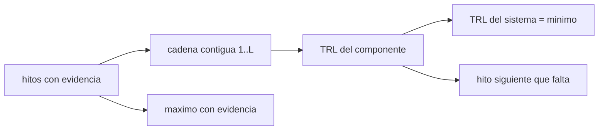

# B78-C19 — Madurez tecnológica TRL

<!-- nav:top -->
[🏠 Programa](../../../../README.md) · [📚 Bloque B78](../../../tronco-comun/B78-tecnologias-de-propulsion-espacial.md) · [← Anterior: B78-C18 — Energía específica y limitaciones](../B78-C18-energia-especifica-y-limitaciones/CLASE.md) · [Siguiente: B78-C20 — Comparación no operativa de arquitecturas de propulsión →](../B78-C20-comparacion-no-operativa-de-arquitecturas-de-propulsion/CLASE.md)
<!-- /nav -->

## 1. Ubicación, nivel y alcance

Clase 19 del bloque B78. Nivel N3. Los niveles de madurez tecnológica (TRL) ordenan una tecnología del 1 al 9 según la evidencia de que funciona, desde el estudio de principios hasta el vuelo exitoso. Aquí aplicas la escala de la NASA a tecnologías **sintéticas** con evidencia declarada, usas una regla de cadena contigua que es de esta clase (no de la NASA) y ves por qué un sistema vale lo que su componente menos maduro. Usas la escala para situar lo visto en C06–C16 sin asignarle un TRL real. Ninguna tecnología del ejercicio es real.

## 2. Por qué esta clase existe

Una tecnología con un buen desempeño en papel puede estar lejos de volar. La decisión central: **¿en qué nivel está una tecnología según la evidencia que tiene, y qué nivel tiene un sistema formado por componentes de madureces distintas?**

## 3. Lo que podrás hacer al terminar

1. Enunciar los nueve niveles de la escala TRL de la NASA.
2. Asignar un TRL a partir de la evidencia con una regla explícita de cadena contigua.
3. Distinguir el TRL por cadena, el máximo con evidencia y la media.
4. Calcular el TRL de un sistema como el mínimo de sus componentes.
5. Identificar la evidencia que falta para subir un nivel.
6. Separar la escala consultada de la regla y los datos sintéticos.

La evidencia es la **matriz TRL de tecnologías con evidencia** del ejercicio 12 (sección 20).

## 4. Con qué llegas y cómo comprobarlo

1. ¿Qué es un prototipo?
2. ¿Qué es un entorno relevante?
3. ¿Qué es el mínimo de un conjunto?
4. ¿Qué es un dato sintético?
5. ¿Qué es una verificación por segunda vía?

<details>
<summary>Ver respuestas</summary>

1. Un modelo funcional hecho para probar un concepto. 2. Un entorno de prueba que reproduce las condiciones de uso esenciales. 3. Su valor más pequeño. 4. Un dato generado para el ejemplo, no medido. 5. Calcular lo mismo con otro método y comparar.
</details>

Con cuatro o cinco aciertos, sigue; si no, repasa los prerrequisitos.

## 5. Un caso de contexto y casos de referencia

Cinco tecnologías **sintéticas** A–E declaran hitos de evidencia. La A tiene los nueve hitos y es TRL 9; la C tiene `{1, 2, 3, 5, 6}` y, por saltarse el hito 4, queda en TRL 3 pese a un máximo de 6. Un sistema A+B+C vale `min(9, 7, 3) = 3`, no la media `6,33`: el **ejemplo conductor**.

## 6. Vocabulario

El **TRL** es el nivel de 1 a 9 de madurez. El **hito de evidencia** es la prueba asociada a cada nivel. La **cadena contigua** es la regla de esta clase: el TRL es el mayor nivel `L` tal que los hitos 1 a `L` están todos. El **eslabón más débil** es el componente de menor TRL, que fija el del sistema. El **entorno relevante** es el de prueba que reproduce lo esencial del uso.

## 7. Modelo mental



*Descripción textual:* los hitos de evidencia dan el TRL por cadena contigua; el sistema toma el mínimo de sus componentes; el máximo con evidencia y la media son referencias engañosas; el hito siguiente indica qué falta.

Analogía: la cadena de una bicicleta; un eslabón roto la deja inservible aunque el resto sea nuevo. Límite: la escala no mide el desempeño, solo la evidencia.

## 8. La explicación, paso a paso

### 8.1 La escala consultada

Según la NASA: 1 investigación inicial; 2 principios estudiados y aplicaciones consideradas; 3 investigación y diseño activos con estudios analíticos y de laboratorio y prueba de concepto; 4 prueba de concepto lista y varios componentes probados juntos; 5 tecnología de «breadboard» probada en entornos simulados realistas; 6 prototipo totalmente funcional o modelo representativo; 7 modelo o prototipo demostrado en el espacio; 8 tecnología probada y «calificada para vuelo»; 9 tecnología «probada en vuelo» en una misión exitosa.

### 8.2 La regla de esta clase

El TRL es la longitud de la cadena contigua de hitos desde el 1. La función alternativa «primer hito ausente menos uno» da el mismo resultado en todos los casos.

| Tecnología (sintética) | Hitos | TRL por cadena | Máximo con evidencia | Media de niveles |
|---|---|---|---|---|
| A | 1–9 | 9 | 9 | 5,00 |
| B | 1–7 | 7 | 7 | 4,00 |
| C | 1, 2, 3, 5, 6 | 3 | 6 | 3,40 |
| D | 1, 2, 3 | 3 | 3 | 2,00 |
| E | 1, 2, 3, 4, 6, 7, 8 | 4 | 8 | 4,43 |

### 8.3 Sistemas

Un sistema formado por A, B y C tiene componentes `[9, 7, 3]` y TRL `min = 3`; la media daría `6,33`. El máximo con evidencia de C (6) sobreestima su madurez.

### 8.4 Qué falta

B necesita evidencia del hito 8; C y D, del hito 4; E, del hito 5. Esa es la brecha concreta.

## 9. Magnitudes, símbolos y unidades

| Símbolo | Qué es | Unidad | Valor / nota |
|---|---|---|---|
| `TRL` | nivel de madurez | — | 1–9 |
| hito `L` | evidencia del nivel `L` | — | booleano |
| TRL de cadena | mayor `L` con hitos 1..L | — | 9, 7, 3, 3, 4 |
| TRL de sistema | mínimo de componentes | — | 3 |

## 10. Convenciones y referencias

Escala de la NASA (resumen propio); la regla de cadena contigua y las cinco tecnologías son **sintéticas**; versiones: página de la NASA consultada el 2026-11-10. No se asigna un TRL real a ninguna tecnología.

## 11. De dónde sale lo que afirmamos

| ID | Fuente | Localizador | Respalda | Estado |
|---|---|---|---|---|
| S1 | NASA, Technology Readiness Levels — https://www.nasa.gov/directorates/somd/space-communications-navigation-program/technology-readiness-levels/ (consultada 2026-11-10) | lista completa de los nueve niveles | definición de los niveles 1–9 | Consultada |
| — | Relaciones estándar de la física y la ingeniería de propulsión | — | las verifica el laboratorio con una segunda vía | No consultada en una fuente concreta |

Límites: la regla de cadena contigua es de esta clase y no de la NASA; las tecnologías A–E y sus hitos son inventadas; no se consultó ninguna tabla de TRL de propulsores reales.

## 12. Cómo ver el resultado

| Magnitud | Valor |
|---|---|
| TRL de A, B, C, D, E | 9, 7, 3, 3, 4 |
| TRL del sistema A+B+C | 3 |
| Media de componentes | 6,33 |
| Hitos faltantes | 8 (B), 4 (C, D), 5 (E) |

Descripción larga: una cadena rota fija el nivel aunque haya evidencia de niveles superiores.

## 13. Ejemplo trabajado

**Paso 1 · Hitos de E.** `{1, 2, 3, 4, 6, 7, 8}`.

**Paso 2 · Cadena.** 1, 2, 3, 4 presentes; el 5 falta: se detiene en 4.

**Paso 3 · Comparación.** TRL `4`, máximo con evidencia `8`.

## 14. Distintas formas de describir el problema

**Por hitos:** presentes o ausentes. **Por cadena:** longitud. **Por sistema:** mínimo. **Por brecha:** hito siguiente. **Por engaño:** máximo y media.

## 15. Práctica guiada

**Ejercicio 1 · guiado (con los pasos indicados).** ¿Qué TRL tiene una tecnología con hitos 1–5? *Pasos:* cuenta la cadena.

<details><summary>Solución comentada</summary>

TRL 5.
</details>

**Ejercicio 2 · guiado (con una pista).** Predice el TRL de `{1, 2, 4, 5}`. *Pista:* mira el hito 3.

<details><summary>Solución comentada</summary>

TRL 2.
</details>

**Ejercicio 3 · guiado (casi autónomo).** ¿Por qué no se promedia el TRL de los componentes? *Casi autónomo.*

<details><summary>Solución comentada</summary>

Porque el componente menos maduro limita al sistema.
</details>

## 16. Práctica autónoma, transferencia e integrador

**Ejercicio 4 · autónomo.** Calcula el TRL de un sistema de componentes `[6, 6, 7, 5]`.

<details><summary>Solución comentada</summary>

5.
</details>

**Ejercicio 5 · autónomo.** ¿Qué hito falta a una tecnología TRL 6 para subir?

<details><summary>Solución comentada</summary>

El hito 7: demostración en el espacio.
</details>

**Ejercicio 6 · autónomo.** ¿Qué diferencia hay entre «máximo con evidencia» y TRL por cadena?

<details><summary>Solución comentada</summary>

El primero ignora saltos; el segundo los penaliza.
</details>

**Ejercicio 7 · autónomo.** ¿En qué TRL está una tecnología que solo tiene un cálculo analítico y un banco de laboratorio?

<details><summary>Solución comentada</summary>

TRL 3 si tiene también los hitos 1 y 2.
</details>

**Ejercicio 8 · autónomo.** Si E consigue el hito 5, ¿qué TRL tiene?

<details><summary>Solución comentada</summary>

8: los hitos 1–8 quedan completos.
</details>

**Ejercicio 9 · transferencia.** Un colega asigna TRL 6 a C porque tiene evidencia del 6. ¿Qué corriges?

<details><summary>Solución comentada</summary>

Que falta el 4: por cadena es TRL 3.
</details>

**Ejercicio 10 · transferencia.** ¿Un TRL alto garantiza buen desempeño?

<details><summary>Solución comentada</summary>

No: mide evidencia de funcionamiento, no desempeño.
</details>

**Ejercicio 11 · transferencia.** ¿Esta clase asigna un TRL real a un propulsor?

<details><summary>Solución comentada</summary>

No: todas las tecnologías son sintéticas.
</details>

**Ejercicio 12 · integrador.** Elabora tu *matriz TRL de tecnologías con evidencia*: tabla de cinco tecnologías, TRL por cadena, brecha de cada una y TRL de un sistema.

<details><summary>Solución comentada</summary>

Secciones 8.1–8.4 y la salida del laboratorio.
</details>

## 17. Laboratorio: clasificación TRL por cadena contigua

El script [trl.py](trl.py) clasifica cinco tecnologías sintéticas por cadena contigua, calcula el TRL de un sistema y la brecha de cada una (**comprueba** que dos funciones distintas dan el mismo TRL y que el mínimo del sistema es 3).

**Datos:** la escala TRL de la NASA **consultada**; las tecnologías A–E y sus hitos **sintéticos**. **Predice antes de ejecutar:** ¿qué TRL tiene la tecnología E? (4.) **Ejecución del 2026-11-10 (Python 3.12.9):**

```text
Python 3.12.9 (biblioteca estandar)
Escala TRL de la NASA (consultada; resumen propio):
  TRL 1: investigacion inicial
  TRL 2: principios estudiados
  TRL 3: estudios analiticos y de laboratorio; prueba de concepto
  TRL 4: componentes probados juntos
  TRL 5: breadboard en entorno simulado realista
  TRL 6: prototipo funcional o modelo representativo
  TRL 7: demostracion en el espacio
  TRL 8: calificado para vuelo
  TRL 9: probado en vuelo en una mision exitosa
Tecnologias SINTETICAS (evidencia declarada -> TRL por cadena contigua):
  tecnologia       hitos con evidencia            TRL cadena  TRL maximo con evidencia  media de niveles con evidencia
  A (sintetica)   [1, 2, 3, 4, 5, 6, 7, 8, 9]             9                         9                5.00
  B (sintetica)   [1, 2, 3, 4, 5, 6, 7]                   7                         7                4.00
  C (sintetica)   [1, 2, 3, 5, 6]                         3                         6                3.40
  D (sintetica)   [1, 2, 3]                               3                         3                2.00
  E (sintetica)   [1, 2, 3, 4, 6, 7, 8]                   4                         8                4.43
Sistema formado por A (sintetica), B (sintetica), C (sintetica): TRL de componentes = [9, 7, 3] -> TRL del sistema = min = 3 (la media daria 6.33)
Hito siguiente que falta para subir un nivel (cadena):
  A (sintetica)   TRL 9
  B (sintetica)   TRL 7 -> falta evidencia del hito 8
  C (sintetica)   TRL 3 -> falta evidencia del hito 4
  D (sintetica)   TRL 3 -> falta evidencia del hito 4
  E (sintetica)   TRL 4 -> falta evidencia del hito 5
Pruebas superadas.
```

```bash
python programa/clases/B78/B78-C19-madurez-tecnologica-trl/trl.py
```

**Límites:** la regla de cadena es una simplificación de esta clase; los TRL reales los asigna un proceso de revisión con evidencia documentada.

## 18. Errores frecuentes y cómo corregirlos

****Dar el TRL por el máximo con evidencia.** Se corrige con 8.2.**

****Promediar los TRL de un sistema.** Se corrige con 8.3.**

****Atribuir la regla de cadena a la NASA.** Se corrige con la sección 11.**

****Tomar el TRL como medida de desempeño.** Se corrige con la pregunta 10.**

## 19. Cómo sabrás que vas bien

Tras la sección 8: ¿qué TRL esperabas para E y cuál obtuviste? Si dudas, repasa el ejemplo 13. Tras el laboratorio: ¿qué comprueba? (ver la sección 17).

## 20. Qué entregas y cómo se evalúa

El producto es tu **matriz TRL de tecnologías con evidencia** (ejercicio 12).

| Criterio | Inicial | En desarrollo | Logrado | Destacado |
|---|---|---|---|---|
| Conceptos | Los confunde | Parciales | Asigna TRL por evidencia y calcula el sistema | Explica los límites |
| Cálculo | Sin unidades | Con errores | Tablas completas con unidades | Calcula casos nuevos |
| Numérico | Sin comprobar | Un caso | Contraste con una segunda vía | Interpreta las diferencias |
| Fuentes | Sin fuente | Sin fecha | Fuentes con fecha y estado | Declara lo ilustrativo y lo no consultado |
| Límites | No los nombra | Uno | Tres | Discute qué falta del modelo |

**Condiciones críticas (no se compensan con promedio):** rotular las tecnologías como sintéticas; no atribuir la regla de cadena a la NASA; no asignar un TRL real; citar solo lo consultado.

## 21. Ética, seguridad y límites

Clase educativa y conceptual: los modelos son simplificados, los datos son consultados con fecha o sintéticos rotulados, y ningún resultado es una especificación de diseño, una verificación de hardware ni una instrucción operativa.  Accesibilidad: tablas equivalentes a las gráficas, fórmulas en texto, ejercicios sin conexión.

## 22. Para cerrar y seguir

Un sistema de componentes `[9, 7, 3]` es TRL 3, no 6,33. Queda una pregunta: ¿cómo se comparan las arquitecturas sin recomendar ninguna?

**Glosario español–inglés.** nivel de madurez tecnológica · *technology readiness level*; hito · *milestone*; entorno relevante · *relevant environment*; calificado para vuelo · *flight qualified*; probado en vuelo · *flight proven*.

**Continuidad.** [B78-C20](../B78-C20-comparacion-no-operativa-de-arquitecturas-de-propulsion/CLASE.md) compara arquitecturas de propulsión sin carácter operativo.

**Referencias:** ver sección 11.

<!-- nav:bottom -->
---

[← Anterior: B78-C18 — Energía específica y limitaciones](../B78-C18-energia-especifica-y-limitaciones/CLASE.md) · [📚 Bloque B78](../../../tronco-comun/B78-tecnologias-de-propulsion-espacial.md) · [Siguiente: B78-C20 — Comparación no operativa de arquitecturas de propulsión →](../B78-C20-comparacion-no-operativa-de-arquitecturas-de-propulsion/CLASE.md)
<!-- /nav -->
