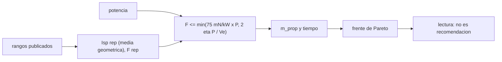

# B78-C20 — Comparación no operativa de arquitecturas de propulsión

<!-- nav:top -->
[🏠 Programa](../../../../README.md) · [📚 Bloque B78](../../../tronco-comun/B78-tecnologias-de-propulsion-espacial.md) · [← Anterior: B78-C19 — Madurez tecnológica TRL](../B78-C19-madurez-tecnologica-trl/CLASE.md) · [Siguiente: B78-C21 — Erosión y vida útil de propulsores eléctricos →](../B78-C21-erosion-y-vida-util-de-propulsores-electricos/CLASE.md)
<!-- /nav -->

## 1. Ubicación, nivel y alcance

Clase 20 del bloque B78. Nivel N3. Comparar arquitecturas de propulsión es contrastar rangos de empuje, `Isp`, potencia y madurez, no elegir un producto. Aquí usas los rangos publicados por la NASA para pequeñas naves, un Δv y una masa ilustrativos, y el frente de Pareto para ver cuáles opciones no están dominadas. La comparación es **no operativa**: no recomienda ninguna arquitectura ni describe hardware. Usas [C06](../B78-C06-propulsion-electrica-general/CLASE.md), [C17](../B78-C17-masa-de-propelente-y-presupuesto/CLASE.md) y [C19](../B78-C19-madurez-tecnologica-trl/CLASE.md).

## 2. Por qué esta clase existe

Cada arquitectura gana en una dimensión y pierde en otra. La decisión central: **¿qué opciones no están dominadas por otra en propelente y en tiempo, y cómo cambia el resultado con la potencia disponible?**

## 3. Lo que podrás hacer al terminar

1. Representar cada arquitectura por un `Isp` y un empuje representativos dentro de un rango publicado.
2. Calcular propelente y tiempo para un Δv dado.
3. Aplicar el tope de empuje por potencia a las opciones eléctricas.
4. Obtener el frente de Pareto por dos algoritmos.
5. Ver la sensibilidad del tiempo a la potencia.
6. Explicar por qué una comparación de rangos no es una recomendación.

La evidencia es la **tabla comparativa con frente de Pareto** del ejercicio 12 (sección 20).

## 4. Con qué llegas y cómo comprobarlo

1. ¿Qué es un frente de Pareto?
2. ¿Qué es la media geométrica?
3. ¿Qué es el empuje por potencia?
4. ¿Qué es un dato sintético?
5. ¿Qué es una verificación por segunda vía?

<details>
<summary>Ver respuestas</summary>

1. El conjunto de opciones que ninguna otra supera en todos los criterios. 2. La raíz `n`-ésima del producto de `n` valores. 3. El empuje por unidad de potencia, en mN/kW. 4. Un dato generado para el ejemplo, no medido. 5. Calcular lo mismo con otro método y comparar.
</details>

Con cuatro o cinco aciertos, sigue; si no, repasa los prerrequisitos.

## 5. Un caso de contexto y casos de referencia

Para `1000 kg`, `Δv = 3000 m/s` y `5 kW` (ilustrativos), un propulsor representativo de cada rango publicado da: hidracina `740,93 kg` de propelente en `1,24 días`; iónico de rejillas `221,03 kg` en `1736,11 días`; Hall `389,62 kg` en `631,31 días`. Esas tres forman el frente de Pareto: el **ejemplo conductor**.

## 6. Vocabulario

La **comparación no operativa** contrasta rangos y no recomienda ni diseña. El **valor representativo** es la media geométrica del rango de `Isp` y el máximo del rango de empuje, acotado por la potencia. La **dominancia** ocurre cuando otra opción es igual o mejor en todos los criterios y estrictamente mejor en uno. El **frente de Pareto** es el conjunto de las opciones no dominadas. El **tope de potencia** limita el empuje eléctrico.

## 7. Modelo mental



*Descripción textual:* los rangos dan valores representativos; la potencia acota el empuje eléctrico; con ellos se calculan propelente y tiempo; el frente de Pareto muestra qué opciones no están dominadas.

Analogía: comparar medios de transporte por costo y tiempo; ninguno gana en todo. Límite: aquí «costo» es propelente y «tiempo» es duración de la maniobra.

## 8. La explicación, paso a paso

### 8.1 Tabla de representantes

Los rangos son los de la NASA (Tabla 4-1); el valor representativo es ilustrativo.

| Arquitectura | `Isp` rep. (s) | `F` rep. (N) | `m_prop` (kg) | `t` (días) |
|---|---|---|---|---|
| Hidracina mono | 226,5 | 28 | 740,93 | 1,24 |
| Alternativos mono/bi | 215,6 | 22 | 757,96 | 1,58 |
| Gas frío | 66,3 | 3,6 | 990,07 | 9,65 |
| Electrotérmico | 83,7 | 0,375 | 974,17 | 92,59 |
| Electrospray | 821,6 | 0,02 | 310,89 | 1736,11 |
| Iónico de rejillas | 1224,7 | 0,02 | 221,03 | 1736,11 |
| Hall | 619,7 | 0,055 | 389,62 | 631,31 |
| Pulsado/arco de vacío | 527,6 | 0,0005 | 439,98 | 69 444,44 |

### 8.2 Frente de Pareto

El barrido ordenado y la comparación exhaustiva dan el mismo frente: hidracina mono, iónico de rejillas y Hall. Quedan dominadas: alternativos, gas frío, electrotérmico, electrospray y pulsado.

### 8.3 Sensibilidad a la potencia

Con `P = 0,1 kW`, el Hall y el iónico quedan en `7,50 mN` y `4629,6 días`; con `0,5 kW`, `37,50 mN` (`925,9 días`) y `20,00 mN` (`1736,1`); desde `1 kW` el Hall satura en `55,00 mN` (`631,3 días`).

### 8.4 Cómo leerlo

Es un contraste de **rangos** con **un solo** propulsor, sin masa de planta ni de propulsor. Las dominancias cambiarían con otros valores representativos, con varios propulsores o con otros criterios (madurez, vida útil, masa). Ninguna fila es una recomendación.

## 9. Magnitudes, símbolos y unidades

| Símbolo | Qué es | Unidad | Valor / nota |
|---|---|---|---|
| `Isp` rep. | media geométrica del rango | s | 66,3–1224,7 |
| `F` rep. | empuje representativo | N | 0,0005–28 |
| `m_prop` | propelente para 3000 m/s | kg | 221,03–990,07 |
| `t` | tiempo de empuje | días | 1,24–69 444 |
| `P` | potencia | kW | 0,1–5 (ilustrativa) |

## 10. Convenciones y referencias

Un propulsor, empuje impulsivo, masa constante en el tiempo; electricos acotados por `75 mN/kW × P` y `2ηP/Vₑ` con `η = 0,6`. Versiones: NIST CODATA y NASA SSVI (consulta del 2026-11-10; se leyeron los primeros 100 000 de 289 063 caracteres). `m₀`, Δv, `P`, `η` y la elección de valores representativos son **ilustrativos**.

## 11. De dónde sale lo que afirmamos

| ID | Fuente | Localizador | Respalda | Estado |
|---|---|---|---|---|
| S1 | NIST, CODATA Fundamental Physical Constants (tabla ASCII) — https://physics.nist.gov/cuu/Constants/Table/allascii.txt (consultada 2026-11-10) | fila de `g₀` | `g₀` | Consultada |
| S2 | NASA Small Spacecraft Systems Virtual Institute, State-of-the-Art: In-Space Propulsion, Tabla 4-1 — https://www.nasa.gov/smallsat-institute/sst-soa/in-space-propulsion/ (consultada 2026-11-10; solo se leyeron los primeros 100 000 de 289 063 caracteres) | Tabla 4-1 | rangos de empuje e `Isp` de ocho familias; tope de ~75 mN/kW | Consultada parcialmente |
| — | Relaciones estándar de la física y la ingeniería de propulsión | — | las verifica el laboratorio con una segunda vía | No consultada en una fuente concreta |

Límites: la página de la NASA es larga y solo se leyó el primer tercio; los rangos son de pequeñas naves y no de sistemas mayores; no se compara madurez ni vida útil con fuentes; no se incluyen la vela solar, la solar térmica ni las nucleares porque no se consultaron rangos para ellas.

## 12. Cómo ver el resultado

| Magnitud | Valor |
|---|---|
| Frente de Pareto | hidracina, iónico, Hall |
| Menor propelente | iónico: 221,03 kg |
| Menor tiempo | hidracina: 1,24 días |
| Hall con 0,5 kW | 37,50 mN |
| Algoritmos del frente | idénticos |

Descripción larga: ninguna arquitectura gana en propelente y en tiempo a la vez; el frente muestra el compromiso.

## 13. Ejemplo trabajado

**Paso 1 · Representante.** Hall: `√(200 × 1920) = 619,7 s`; `Vₑ = 6077 m/s`.

**Paso 2 · Propelente.** `1000 (1 − e^(−3000/6077)) = 389,6 kg`.

**Paso 3 · Tiempo.** `F = min(55 mN, 375 mN, 2 × 0,6 × 5000/6077 = 987 mN) = 55 mN`; `t = 1000 × 3000/0,055 = 5,45×10⁷ s = 631,3 días`.

## 14. Distintas formas de describir el problema

**Por tabla:** valores representativos. **Por dominancia:** pares. **Por frente:** Pareto. **Por potencia:** tope. **Por lectura:** rango, no producto.

## 15. Práctica guiada

**Ejercicio 1 · guiado (con los pasos indicados).** Calcula la media geométrica de 500 y 3000 s. *Pasos:* raíz del producto.

<details><summary>Solución comentada</summary>

`√(1,5×10⁶) = 1224,7 s`.
</details>

**Ejercicio 2 · guiado (con una pista).** Predice si el gas frío entra en el frente. *Pista:* compara con la hidracina.

<details><summary>Solución comentada</summary>

No: la hidracina gasta menos propelente y es tan rápida.
</details>

**Ejercicio 3 · guiado (casi autónomo).** ¿Por qué el iónico gasta menos propelente pero tarda más que el Hall? *Casi autónomo.*

<details><summary>Solución comentada</summary>

Tiene mayor `Isp` y menor empuje máximo.
</details>

## 16. Práctica autónoma, transferencia e integrador

**Ejercicio 4 · autónomo.** Calcula `Vₑ` para 1224,7 s.

<details><summary>Solución comentada</summary>

`12 010 m/s`.
</details>

**Ejercicio 5 · autónomo.** Calcula el tope de potencia con 0,5 kW.

<details><summary>Solución comentada</summary>

`75 × 0,5 = 37,5 mN`.
</details>

**Ejercicio 6 · autónomo.** ¿Qué pasa con el tiempo del Hall si `P` baja de 1 a 0,1 kW?

<details><summary>Solución comentada</summary>

Pasa de 631,3 a 4629,6 días.
</details>

**Ejercicio 7 · autónomo.** Si se usan 10 Hall en paralelo con 5 kW, ¿qué tiempo resulta?

<details><summary>Solución comentada</summary>

El empuje sumado sería 550 mN, pero con 5 kW el tope es 375 mN: `3×10⁶/0,375 = 8×10⁶ s = 92,6 días`, no 63,1.
</details>

**Ejercicio 8 · autónomo.** ¿Puede un nuevo criterio (madurez) cambiar el frente?

<details><summary>Solución comentada</summary>

Sí: añadir un criterio puede dejar de dominar a algunas opciones.
</details>

**Ejercicio 9 · transferencia.** Un colega dice que el frente muestra qué comprar. ¿Qué corriges?

<details><summary>Solución comentada</summary>

Que compara rangos con supuestos ilustrativos; no es una recomendación.
</details>

**Ejercicio 10 · transferencia.** ¿Por qué falta la vela solar en la tabla?

<details><summary>Solución comentada</summary>

No se consultó un rango publicado para ella.
</details>

**Ejercicio 11 · transferencia.** ¿Qué criterios añadirías además de propelente y tiempo?

<details><summary>Solución comentada</summary>

Masa de planta, vida útil, TRL, volumen y costo.
</details>

**Ejercicio 12 · integrador.** Elabora tu *tabla comparativa con frente de Pareto*: ocho arquitecturas, el frente por dos algoritmos, sensibilidad a la potencia y lista de limitaciones.

<details><summary>Solución comentada</summary>

Secciones 8.1–8.4 y la salida del laboratorio.
</details>

## 17. Laboratorio: comparación por rangos y frente de Pareto

El script [comparacion.py](comparacion.py) calcula propelente y tiempo para ocho arquitecturas, el frente de Pareto y la sensibilidad a la potencia (**comprueba** que el frente por comparación exhaustiva y por barrido ordenado es idéntico).

**Datos:** `g₀` (NIST) y los rangos de la tabla de la NASA **consultados**; `m₀`, Δv, `P`, `η` y los valores representativos **ilustrativos**. **Predice antes de ejecutar:** ¿cuántas opciones quedan en el frente? (tres.) **Ejecución del 2026-11-10 (Python 3.12.9):**

```text
Python 3.12.9 (biblioteca estandar)
Comparacion NO operativa por RANGOS publicados: m0 = 1000 kg, dv = 3000 m/s, P = 5 kW (ILUSTRATIVOS)
 arquitectura            Isp rep [s]   F rep [N]    m_prop [kg]   t [dias]
 hidracina mono              226.5           28         740.93       1.24
 alternativos mono/bi        215.6           22         757.96       1.58
 gas frio                     66.3          3.6         990.07       9.65
 electrotermico               83.7        0.375         974.17      92.59
 electrospray                821.6         0.02         310.89    1736.11
 ionico de rejillas         1224.7         0.02         221.03    1736.11
 Hall                        619.7        0.055         389.62     631.31
 pulsado/arco de vacio       527.6       0.0005         439.98   69444.44
Frente de Pareto (menos propelente y menos tiempo; sin masa de planta ni de propulsor):
  hidracina mono         m_prop = 740.93 kg ; t = 1.24 dias
  ionico de rejillas     m_prop = 221.03 kg ; t = 1736.11 dias
  Hall                   m_prop = 389.62 kg ; t = 631.31 dias
Dominadas: alternativos mono/bi, gas frio, electrotermico, electrospray, pulsado/arco de vacio
Sensibilidad: tiempo del Hall y del ionico con P = 0.1, 0.5, 1 y 5 kW:
  P =   0.1 kW Hall                 F =   7.50 mN ; t =    4629.6 dias
  P =   0.1 kW ionico de rejillas   F =   7.50 mN ; t =    4629.6 dias
  P =   0.5 kW Hall                 F =  37.50 mN ; t =     925.9 dias
  P =   0.5 kW ionico de rejillas   F =  20.00 mN ; t =    1736.1 dias
  P =   1.0 kW Hall                 F =  55.00 mN ; t =     631.3 dias
  P =   1.0 kW ionico de rejillas   F =  20.00 mN ; t =    1736.1 dias
  P =   5.0 kW Hall                 F =  55.00 mN ; t =     631.3 dias
  P =   5.0 kW ionico de rejillas   F =  20.00 mN ; t =    1736.1 dias
Pruebas superadas.
```

```bash
python programa/clases/B78/B78-C20-comparacion-no-operativa-de-arquitecturas-de-propulsion/comparacion.py
```

**Límites:** un solo propulsor, sin masa de planta ni de propulsor; dos criterios; los rangos son de pequeñas naves.

## 18. Errores frecuentes y cómo corregirlos

****Leer el frente como recomendación.** Se corrige con 8.4.**

****Comparar `Isp` sin empuje.** Se corrige con 8.1.**

****Ignorar el tope de potencia.** Se corrige con 8.3.**

****Extrapolar rangos de pequeñas naves a grandes.** Se corrige con la sección 11.**

## 19. Cómo sabrás que vas bien

Tras la sección 8: ¿cuántas opciones esperabas en el frente y cuál obtuviste? Si dudas, repasa el ejemplo 13. Tras el laboratorio: ¿qué comprueba? (ver la sección 17).

## 20. Qué entregas y cómo se evalúa

El producto es tu **tabla comparativa con frente de Pareto** (ejercicio 12).

| Criterio | Inicial | En desarrollo | Logrado | Destacado |
|---|---|---|---|---|
| Conceptos | Los confunde | Parciales | Calcula la tabla y el frente | Explica los límites |
| Cálculo | Sin unidades | Con errores | Tablas completas con unidades | Calcula casos nuevos |
| Numérico | Sin comprobar | Un caso | Contraste con una segunda vía | Interpreta las diferencias |
| Fuentes | Sin fuente | Sin fecha | Fuentes con fecha y estado | Declara lo ilustrativo y lo no consultado |
| Límites | No los nombra | Uno | Tres | Discute qué falta del modelo |

**Condiciones críticas (no se compensan con promedio):** mantener el carácter no operativo; rotular los valores representativos como ilustrativos; citar solo lo consultado.

## 21. Ética, seguridad y límites

Clase educativa y conceptual: los modelos son simplificados, los datos son consultados con fecha o sintéticos rotulados, y ningún resultado es una especificación de diseño, una verificación de hardware ni una instrucción operativa.  Accesibilidad: tablas equivalentes a las gráficas, fórmulas en texto, ejercicios sin conexión.

## 22. Para cerrar y seguir

Con `3000 m/s` y `5 kW`, el frente ilustrativo tiene tres opciones: hidracina (`1,24 días`), Hall (`631 días`) e iónico (`221 kg`). Queda una pregunta: ¿cuánto dura un propulsor eléctrico antes de erosionarse?

**Glosario español–inglés.** frente de Pareto · *Pareto front*; dominancia · *dominance*; valor representativo · *representative value*; comparación · *comparison*; arquitectura · *architecture*.

**Continuidad.** [B78-C21](../B78-C21-erosion-y-vida-util-de-propulsores-electricos/CLASE.md) estudia la erosión y la vida útil de los propulsores eléctricos.

**Referencias:** ver sección 11.

<!-- nav:bottom -->
---

[← Anterior: B78-C19 — Madurez tecnológica TRL](../B78-C19-madurez-tecnologica-trl/CLASE.md) · [📚 Bloque B78](../../../tronco-comun/B78-tecnologias-de-propulsion-espacial.md) · [Siguiente: B78-C21 — Erosión y vida útil de propulsores eléctricos →](../B78-C21-erosion-y-vida-util-de-propulsores-electricos/CLASE.md)
<!-- /nav -->
