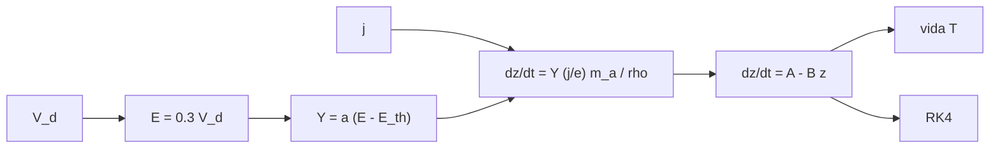

# B78-C21 — Erosión y vida útil de propulsores eléctricos

<!-- nav:top -->
[🏠 Programa](../../../../README.md) · [📚 Bloque B78](../../../tronco-comun/B78-tecnologias-de-propulsion-espacial.md) · [← Anterior: B78-C20 — Comparación no operativa de arquitecturas de propulsión](../B78-C20-comparacion-no-operativa-de-arquitecturas-de-propulsion/CLASE.md) · [Siguiente: B78-C22 — Ciclos de trabajo y operación de propulsión eléctrica →](../B78-C22-ciclos-de-trabajo-y-operacion-de-propulsion-electrica/CLASE.md)
<!-- /nav -->

## 1. Ubicación, nivel y alcance

Clase 21 del bloque B78 (clase programada por la ampliación `0.2.0`). Nivel N3. B78 describe los tipos de propulsores; esta clase añade lo que los limita en el tiempo: la erosión. Los iones de alta energía arrancan material de las paredes de un Hall o de las rejillas de un motor iónico, y el desgaste decide cuántas horas de empuje pueden entregar. Aquí construyes un modelo **sintético** de erosión por pulverización, calculas la vida útil en función de la tensión de descarga y la verificas contra una integración numérica. Usas [C07](../B78-C07-motores-ionicos/CLASE.md) y [C08](../B78-C08-propulsores-hall/CLASE.md). Ningún parámetro del modelo es de un material real.

## 2. Por qué esta clase existe

El impulso total que un propulsor eléctrico puede entregar no lo limita el propelente sino su desgaste. La decisión central: **¿cómo depende la vida útil de la tensión de descarga y qué fracción del empuje máximo posible con el propelente alcanza a entregar?**

## 3. Lo que podrás hacer al terminar

1. Escribir un rendimiento de pulverización lineal con umbral.
2. Calcular la velocidad de recesión de una pared.
3. Resolver la vida útil con una pared que reduce la energía de impacto al retirarse.
4. Verificar la vida analítica con una integración de Runge–Kutta.
5. Ver cómo cae la vida con la tensión de descarga.
6. Comparar la vida con el tiempo de consumo del propelente de Dawn.

La evidencia es la **ficha de vida útil frente a tensión** del ejercicio 12 (sección 20).

## 4. Con qué llegas y cómo comprobarlo

1. ¿Qué es la pulverización catódica (sputtering)?
2. ¿Qué es el rendimiento de pulverización?
3. ¿Qué es una ecuación diferencial lineal de primer orden?
4. ¿Qué es un dato sintético?
5. ¿Qué es una verificación por segunda vía?

<details>
<summary>Ver respuestas</summary>

1. El arranque de átomos de una superficie por el impacto de iones. 2. Los átomos arrancados por ion incidente. 3. Una de la forma `dz/dt = A − B z`. 4. Un dato generado para el ejemplo, no medido. 5. Calcular lo mismo con otro método y comparar.
</details>

Con cuatro o cinco aciertos, sigue; si no, repasa los prerrequisitos.

## 5. Un caso de contexto y casos de referencia

Con un modelo **sintético** (`Y = 0,002 (E − 30 eV)`, `E = 0,3 V_d`, `j = 10 A/m²`, espesor `2 mm`), la vida a `300 V` es de `10 050 h` (`418,8 días`) y a `600 V`, `3751 h`: el **ejemplo conductor**. Con los datos consultados de Dawn, `425 kg` de xenón a `3,25 mg/s` durarían `1514 días` en un solo motor al empuje máximo, más que la vida del modelo a 300 V.

## 6. Vocabulario

La **pulverización** es el arranque de átomos por impacto iónico. El **rendimiento** `Y(E)` es lineal con umbral `E_th`. La **velocidad de recesión** es cuánto retrocede la pared por unidad de tiempo. La **vida útil** es el tiempo en que se agota el espesor erosionable. La **corriente a la pared** `j` es la densidad de iones que la golpean. El **impulso total** disponible lo limita el desgaste.

## 7. Modelo mental



*Descripción textual:* la tensión fija la energía de impacto y el rendimiento; con la corriente a la pared da la velocidad de recesión; como la energía baja al retirarse la pared resulta una ecuación lineal con solución cerrada, contrastada con una integración numérica.

Analogía: unos tacos de goma que se gastan al caminar; cuanto más fuerte se pisa, más rápido se gastan. Límite: aquí «pisar más fuerte» es subir la tensión.

## 8. La explicación, paso a paso

### 8.1 El modelo

`Y(E) = a (E − E_th)` con `a = 0,002 átomos/(ion eV)` y `E_th = 30 eV`. La energía de impacto es `E₀ = 0,3 V_d` y baja linealmente hasta el `70 %` al agotarse el espesor `w`: `E(z) = E₀ (1 − 0,3 z/w)`. La recesión es `dz/dt = Y(E) (j/e) m_a/ρ = A − B z`, con `A = c a (E₀ − E_th)`, `B = c a E₀ 0,3/w` y `c = (j/e) m_a/ρ`. La vida es `T = (1/B) ln(A/(A − B w))`.

### 8.2 Resultados

| `V_d` (V) | `E₀` (eV) | `Y` | Recesión inicial (nm/h) | Vida (h) | Vida (días) |
|---|---|---|---|---|---|
| 150 | 45,0 | 0,0300 | 66,09 | 77 417 | 3225,7 |
| 200 | 60,0 | 0,0600 | 132,19 | 23 106 | 962,7 |
| 300 | 90,0 | 0,1200 | 264,38 | 10 050 | 418,8 |
| 450 | 135,0 | 0,2100 | 462,66 | 5461 | 227,6 |
| 600 | 180,0 | 0,3000 | 660,94 | 3751 | 156,3 |

La integración de Runge–Kutta coincide con la fórmula a mejor que `10⁻⁶`.

### 8.3 Con los datos de Dawn

`425 kg/3,25×10⁻⁶ kg/s = 1514 días` (`4,1 años`) de empuje máximo en un solo motor, con un impulso de `1,190×10⁷ N·s`. La vida del modelo a `300 V` es `0,277` de ese tiempo: en este modelo el desgaste limitaría el uso del propelente antes de agotarse.

### 8.4 Qué falta

El modelo no incluye la forma real del canal ni de las rejillas, el redepósito, los iones de doble carga, la dependencia angular del rendimiento ni el cambio de campo con la erosión. Los valores de `a`, `E_th`, `j` y el material son inventados.

## 9. Magnitudes, símbolos y unidades

| Símbolo | Qué es | Unidad | Valor / nota |
|---|---|---|---|
| `V_d` | tensión de descarga | V | 150–600 |
| `Y` | rendimiento de pulverización | átomos/ion | 0,03–0,30 |
| `j` | densidad de corriente a la pared | A/m² | 10 (ilustrativa) |
| `w` | espesor erosionable | mm | 2 (ilustrativo) |
| `T` | vida útil | h | 10 050 (300 V) |

## 10. Convenciones y referencias

Pulverización lineal con umbral, energía de impacto proporcional a la tensión, corriente a la pared constante, pared de material único. Versiones: NIST CODATA y página de Dawn (consulta del 2026-11-10). Todos los parámetros del modelo son **sintéticos**; no hay ningún dato de material consultado.

## 11. De dónde sale lo que afirmamos

| ID | Fuente | Localizador | Respalda | Estado |
|---|---|---|---|---|
| S1 | NIST, CODATA Fundamental Physical Constants (tabla ASCII) — https://physics.nist.gov/cuu/Constants/Table/allascii.txt (consultada 2026-11-10) | filas de `e` y `u` | `e` y `u` | Consultada |
| S2 | NASA/JPL, Dawn: Ion Propulsion — https://science.nasa.gov/mission/dawn/technology/ion-propulsion/ (consultada 2026-11-10) | xenón de lanzamiento y consumo | 425 kg de xenón; ~3,25 mg/s; 91 mN | Consultada |
| — | Relaciones estándar de la física y la ingeniería de propulsión | — | las verifica el laboratorio con una segunda vía | No consultada en una fuente concreta |

Límites: no se consultó ningún dato de rendimiento de pulverización ni de vida de propulsores reales; los resultados no predicen ninguna vida y solo muestran la dependencia cualitativa con la tensión; la masa atómica media y la densidad son ilustrativas.

## 12. Cómo ver el resultado

| Magnitud | Valor |
|---|---|
| Vida a 300 V | 10 050 h |
| Vida a 600 V | 3751 h |
| Cociente 150/600 V | 20,6 |
| Dawn en un motor | 1514 días |
| Diferencia RK4/analítica | < 1e-6 |

Descripción larga: la vida cae más rápido que la inversa de la tensión: el umbral amplifica el efecto.

## 13. Ejemplo trabajado

**Paso 1 · Energía y rendimiento.** `V_d = 300 V` → `E₀ = 90 eV`; `Y = 0,002 × 60 = 0,12`.

**Paso 2 · Coeficiente.** `c = (10/1,602×10⁻¹⁹) × (12,4 × 1,6605×10⁻²⁷)/2100 = 6,12×10⁻¹⁰ m/s` por unidad de rendimiento.

**Paso 3 · Recesión inicial.** `c Y = 6,12×10⁻¹⁰ × 0,12 = 7,34×10⁻¹¹ m/s = 264 nm/h`; con la energía decreciente la integración da `T = 10 050 h`.

## 14. Distintas formas de describir el problema

**Por rendimiento:** `Y(E)`. **Por recesión:** `dz/dt`. **Por vida:** `T`. **Por numérica:** RK4. **Por límite:** vida frente a propelente.

## 15. Práctica guiada

**Ejercicio 1 · guiado (con los pasos indicados).** Calcula `Y` con `E = 75 eV`. *Pasos:* `0,002 (75 − 30)`.

<details><summary>Solución comentada</summary>

`0,09`.
</details>

**Ejercicio 2 · guiado (con una pista).** Predice qué pasa con la vida si `j` se duplica. *Pista:* la recesión es proporcional a `j`.

<details><summary>Solución comentada</summary>

Se reduce a la mitad.
</details>

**Ejercicio 3 · guiado (casi autónomo).** ¿Por qué a 150 V la vida es tan larga? *Casi autónomo.*

<details><summary>Solución comentada</summary>

Porque `E₀ = 45 eV` solo supera 15 eV al umbral: el rendimiento es 0,03.
</details>

## 16. Práctica autónoma, transferencia e integrador

**Ejercicio 4 · autónomo.** Calcula `E₀` y `Y` para 450 V.

<details><summary>Solución comentada</summary>

`135 eV` y `0,21`.
</details>

**Ejercicio 5 · autónomo.** Calcula la razón de vidas 150/600 V.

<details><summary>Solución comentada</summary>

`77 417/3751 = 20,6`.
</details>

**Ejercicio 6 · autónomo.** ¿Qué pasa si `E₀ ≤ 30 eV`?

<details><summary>Solución comentada</summary>

No hay erosión en el modelo (por debajo del umbral).
</details>

**Ejercicio 7 · autónomo.** Convierte 10 050 h en días.

<details><summary>Solución comentada</summary>

`418,8 días`.
</details>

**Ejercicio 8 · autónomo.** Si el espesor `w` se duplica, ¿cómo cambia la vida?

<details><summary>Solución comentada</summary>

Aproximadamente se duplica (con la energía decreciente se alarga algo más).
</details>

**Ejercicio 9 · transferencia.** Un colega usa la vida del modelo como la de un propulsor real. ¿Qué corriges?

<details><summary>Solución comentada</summary>

Que todos los parámetros son sintéticos.
</details>

**Ejercicio 10 · transferencia.** ¿Por qué Dawn a 300 V quedaría limitado por erosión en el modelo?

<details><summary>Solución comentada</summary>

Porque `0,277` del tiempo de consumo del xenón.
</details>

**Ejercicio 11 · transferencia.** ¿Qué efectos reales faltan?

<details><summary>Solución comentada</summary>

Redepósito, geometría, doble carga, dependencia angular del rendimiento y cambios de campo.
</details>

**Ejercicio 12 · integrador.** Elabora tu *ficha de vida útil frente a tensión*: tabla de cinco tensiones, solución analítica y numérica, comparación con Dawn y límites.

<details><summary>Solución comentada</summary>

Secciones 8.1–8.4 y la salida del laboratorio.
</details>

## 17. Laboratorio: erosión por pulverización y vida útil

El script [erosion.py](erosion.py) calcula la recesión y la vida útil para cinco tensiones y las compara con el consumo del propelente de Dawn (**comprueba** la vida analítica contra una integración de Runge–Kutta a `1e-6` y que la vida decrece con la tensión).

**Datos:** `e`, `u` (NIST) y los datos de Dawn **consultados**; rendimiento, umbral, corriente, espesor y material **sintéticos**. **Predice antes de ejecutar:** ¿cuántas veces dura más la pared a 150 V que a 600 V? (≈ 21.) **Ejecución del 2026-11-10 (Python 3.12.9):**

```text
Python 3.12.9 (biblioteca estandar)
Modelo SINTETICO: Y(E) = 0.002 (E - 30 eV), E_impacto = 0.3 V_d, j = 10 A/m2, espesor 2 mm
  V_d [V]   E_impacto [eV]   Y [atomos/ion]   recesion inicial [nm/h]   vida [h]    vida [dias]
      150            45.0           0.0300                     66.09      77417      3225.7
      200            60.0           0.0600                    132.19      23106       962.7
      300            90.0           0.1200                    264.38      10050       418.8
      450           135.0           0.2100                    462.66       5461       227.6
      600           180.0           0.3000                    660.94       3751       156.3
Dawn (consultado): 425 kg de xenon a 3.25 mg/s por un motor = 1514 dias (4.1 anos) de empuje maximo ; impulso = F t = 1.190e+07 N s
Un requisito de vida impone un limite de proyecto: vida >= tiempo de empuje; aqui: vida del modelo a 300 V frente a ese tiempo:
  vida(300 V) = 419 dias ; cociente con el tiempo de consumo del xenon = 0.277
Pruebas superadas.
```

```bash
python programa/clases/B78/B78-C21-erosion-y-vida-util-de-propulsores-electricos/erosion.py
```

**Límites:** modelo sintético, pared de un solo material, sin redepósito ni geometría real.

## 18. Errores frecuentes y cómo corregirlos

****Tomar la vida del modelo como la de un propulsor.** Se corrige con 8.4.**

****Ignorar el umbral.** Se corrige con 8.2.**

****Olvidar el cambio de energía al retirarse la pared.** Se corrige con 8.1.**

****Comparar con Dawn como si hubiera un dato de erosión.** Se corrige con la sección 11.**

## 19. Cómo sabrás que vas bien

Tras la sección 8: ¿qué vida esperabas a 300 V y cuál obtuviste? Si dudas, repasa el ejemplo 13. Tras el laboratorio: ¿qué comprueba? (ver la sección 17).

## 20. Qué entregas y cómo se evalúa

El producto es tu **ficha de vida útil frente a tensión** (ejercicio 12).

| Criterio | Inicial | En desarrollo | Logrado | Destacado |
|---|---|---|---|---|
| Conceptos | Los confunde | Parciales | Calcula la vida útil y la verifica | Explica los límites |
| Cálculo | Sin unidades | Con errores | Tablas completas con unidades | Calcula casos nuevos |
| Numérico | Sin comprobar | Un caso | Contraste con una segunda vía | Interpreta las diferencias |
| Fuentes | Sin fuente | Sin fecha | Fuentes con fecha y estado | Declara lo ilustrativo y lo no consultado |
| Límites | No los nombra | Uno | Tres | Discute qué falta del modelo |

**Condiciones críticas (no se compensan con promedio):** rotular todos los parámetros como sintéticos; no presentar la vida como la de un propulsor real; citar solo lo consultado.

## 21. Ética, seguridad y límites

Clase educativa y conceptual: los modelos son simplificados, los datos son consultados con fecha o sintéticos rotulados, y ningún resultado es una especificación de diseño, una verificación de hardware ni una instrucción operativa.  Accesibilidad: tablas equivalentes a las gráficas, fórmulas en texto, ejercicios sin conexión.

## 22. Para cerrar y seguir

En un modelo sintético, bajar la tensión de 600 a 150 V multiplica la vida por `21`. Queda una pregunta: ¿cuánto del tiempo puede un propulsor estar encendido en órbita?

**Glosario español–inglés.** erosión · *erosion*; pulverización · *sputtering*; rendimiento de pulverización · *sputter yield*; vida útil · *lifetime*; umbral · *threshold*.

**Continuidad.** [B78-C22](../B78-C22-ciclos-de-trabajo-y-operacion-de-propulsion-electrica/CLASE.md) estudia los ciclos de trabajo y la operación de la propulsión eléctrica.

**Referencias:** ver sección 11.

<!-- nav:bottom -->
---

[← Anterior: B78-C20 — Comparación no operativa de arquitecturas de propulsión](../B78-C20-comparacion-no-operativa-de-arquitecturas-de-propulsion/CLASE.md) · [📚 Bloque B78](../../../tronco-comun/B78-tecnologias-de-propulsion-espacial.md) · [Siguiente: B78-C22 — Ciclos de trabajo y operación de propulsión eléctrica →](../B78-C22-ciclos-de-trabajo-y-operacion-de-propulsion-electrica/CLASE.md)
<!-- /nav -->
