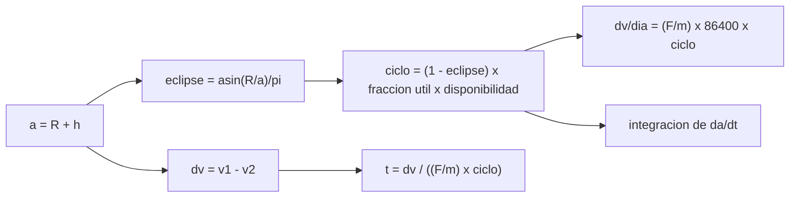

# B78-C22 — Ciclos de trabajo y operación de propulsión eléctrica

<!-- nav:top -->
[🏠 Programa](../../../../README.md) · [📚 Bloque B78](../../../tronco-comun/B78-tecnologias-de-propulsion-espacial.md) · [← Anterior: B78-C21 — Erosión y vida útil de propulsores eléctricos](../B78-C21-erosion-y-vida-util-de-propulsores-electricos/CLASE.md) · [Siguiente: B79-C01 — Conservación de masa en fluidos →](../../B79/B79-C01-conservacion-de-masa-en-fluidos/CLASE.md)
<!-- /nav -->

## 1. Ubicación, nivel y alcance

Clase 22 del bloque B78 (clase programada por la ampliación), última del bloque. Nivel N3. Un propulsor eléctrico no empuja todo el tiempo: la potencia solo está disponible a la luz del Sol, la actitud de la nave limita cuándo se puede empujar en la dirección útil y el calor exige pausas. Esa fracción de tiempo es el **ciclo de trabajo**, y fija el Δv por día. Aquí calculas el eclipse de una órbita baja, el ciclo de trabajo y el tiempo para elevar la órbita, con dos métodos. Usas [C06](../B78-C06-propulsion-electrica-general/CLASE.md) para el empuje por potencia. La nave y el propulsor son sintéticos.

## 2. Por qué esta clase existe

El Δv diario de un propulsor eléctrico es el ideal multiplicado por el ciclo de trabajo, y este puede ser menos de la mitad. La decisión central: **¿cuánto tiempo del día puede empujar un propulsor ilustrativo y cuánto tarda entonces en elevar la órbita?**

## 3. Lo que podrás hacer al terminar

1. Calcular el período y la velocidad circular de una órbita baja.
2. Calcular la fracción de eclipse con sombra cilíndrica.
3. Componer el ciclo de trabajo con eclipse, restricción de actitud y disponibilidad.
4. Calcular el Δv por día y el tiempo de elevación de órbita.
5. Verificar el tiempo analítico con una integración numérica de `da/dt`.
6. Estimar el propelente, el tiempo de encendido y la energía.

La evidencia es la **ficha de ciclo de trabajo y Δv por día** del ejercicio 12 (sección 20).

## 4. Con qué llegas y cómo comprobarlo

1. ¿Qué es una órbita circular y cuál es su velocidad?
2. ¿Qué es un eclipse?
3. ¿Qué es un ciclo de trabajo?
4. ¿Qué es un dato sintético?
5. ¿Qué es una verificación por segunda vía?

<details>
<summary>Ver respuestas</summary>

1. Una órbita de radio constante; `v = √(GM/a)`. 2. El tiempo en que la nave está en la sombra de la Tierra. 3. La fracción de tiempo que un dispositivo está activo. 4. Un dato generado para el ejemplo, no medido. 5. Calcular lo mismo con otro método y comparar.
</details>

Con cuatro o cinco aciertos, sigue; si no, repasa los prerrequisitos.

## 5. Un caso de contexto y casos de referencia

Una nave **ilustrativa** de `300 kg` con un propulsor de `40 mN` (`1500 s`, `700 W`) a `500 km` de altitud tiene un eclipse máximo de `37,79 %`; con una fracción útil de `0,70` su ciclo de trabajo es `0,4355` y gana `5,017 m/s` por día. Elevar la órbita a `1000 km` (`262,47 m/s`) tarda `52,3 días`: el **ejemplo conductor**.

## 6. Vocabulario

El **ciclo de trabajo** es la fracción del tiempo que el propulsor empuja de forma útil. El **eclipse** es el tiempo en sombra; su fracción en sombra cilíndrica es `asin(R/a)/π`. La **fracción útil** es la parte de la órbita con la actitud adecuada. La **elevación de órbita** con empuje tangencial necesita `Δv = v₁ − v₂`. El **plano orbital con `β = 0`** es el de eclipse máximo. La **disponibilidad** es la fracción del tiempo sin pausas térmicas.

## 7. Modelo mental



*Descripción textual:* el radio orbital da el eclipse; con las restricciones forma el ciclo de trabajo; éste da el Δv por día y, con el Δv requerido, el tiempo de elevación, verificado por integración numérica.

Analogía: caminar con una linterna solar de día; solo avanzas mientras hay luz y si apuntas en la dirección correcta. Límite: aquí también hay pausas térmicas y de actitud.

## 8. La explicación, paso a paso

### 8.1 Órbita y eclipse

Con `G = 6,67430×10⁻¹¹ m³ kg⁻¹ s⁻²` (NIST), `M = 5,9722×10²⁴ kg` y `R = 6378,137 km` (NASA/NSSDC), `GM = 3,986025×10¹⁴ m³/s²`.

| Altitud | Período (min) | `v` circular (m/s) | Eclipse (`β = 0`) | Minutos en sombra |
|---|---|---|---|---|
| 500 km | 94,62 | 7612,6 | 37,79 % | 35,75 |
| 1000 km | 105,12 | 7350,2 | 33,23 % | 34,94 |

### 8.2 Ciclo de trabajo

`(1 − 0,3779) × 0,70 × 1,0 = 0,4355`. El propulsor de `40 mN` y `700 W` tiene `57,1 mN/kW`, por debajo del tope de ~75 mN/kW. La aceleración es `0,1333 mm/s²`: `11,520 m/s` por día sin restricciones y `5,017 m/s` con el ciclo.

### 8.3 Elevar la órbita

`Δv = 7612,6 − 7350,2 = 262,47 m/s`. Tiempo analítico `Δv/(a_t × ciclo) = 52,3 días`; la integración numérica de `da/dt = 2 a_t √(a³/GM)` con el mismo ciclo da `52,3 días`.

| Caso | Ciclo | Días |
|---|---|---|
| Ideal | 1,000 | 22,8 |
| Solo eclipse | 0,622 | 36,6 |
| Eclipse + restricción | 0,435 | 52,3 |

### 8.4 Propelente y energía

`m_p = 300 (1 − e^(−262,47/14 710)) = 5,305 kg`. El tiempo de encendido es `22,8 días` y la energía eléctrica, `382,8 kWh`. Empujar también en el eclipse exigiría `417,1 Wh` de batería por órbita, con su masa y su descarga, que no se incluyen.

## 9. Magnitudes, símbolos y unidades

| Símbolo | Qué es | Unidad | Valor / nota |
|---|---|---|---|
| `a` | radio orbital | km | 6878,1 (500 km) |
| eclipse | fracción en sombra | % | 37,79 |
| ciclo | ciclo de trabajo | — | 0,4355 |
| `a_t` | aceleración | mm/s² | 0,1333 |
| `Δv/día` | Δv por día | m/s | 5,017 |
| `t` | tiempo de elevación | días | 52,3 |

## 10. Convenciones y referencias

Órbita circular y coplanar, sombra cilíndrica, plano con `β = 0`, empuje tangencial, masa constante, sistema de referencia geocéntrico inercial. Versiones: NIST CODATA, NASA/NSSDC y NASA SSVI (consulta del 2026-11-10). Nave, propulsor, fracción útil y disponibilidad son **ilustrativos**.

## 11. De dónde sale lo que afirmamos

| ID | Fuente | Localizador | Respalda | Estado |
|---|---|---|---|---|
| S1 | NIST, CODATA Fundamental Physical Constants (tabla ASCII) — https://physics.nist.gov/cuu/Constants/Table/allascii.txt (consultada 2026-11-10) | filas de `G` y `g₀` | `G = 6,67430×10⁻¹¹`; `g₀` | Consultada |
| S2 | NASA/NSSDC, Earth Fact Sheet — https://nssdc.gsfc.nasa.gov/planetary/factsheet/earthfact.html (consultada 2026-11-10) | masa y radio ecuatorial | masa 5,9722×10²⁴ kg; radio ecuatorial 6378,137 km | Consultada |
| S3 | NASA Small Spacecraft Systems Virtual Institute, State-of-the-Art: In-Space Propulsion, Tabla 4-1 — https://www.nasa.gov/smallsat-institute/sst-soa/in-space-propulsion/ (consultada 2026-11-10; solo se leyeron los primeros 100 000 de 289 063 caracteres) | Tabla 4-1, rango de Hall y tope de potencia | Hall: 0,25–55 mN y 200–1920 s; tope ~75 mN/kW | Consultada parcialmente |
| — | Relaciones estándar de la física y la ingeniería de propulsión | — | las verifica el laboratorio con una segunda vía | No consultada en una fuente concreta |

Límites: la penumbra, el achatamiento y la resistencia atmosférica no se incluyen; el propulsor de 40 mN es ilustrativo; la fracción útil de 0,70 y la disponibilidad térmica no provienen de ninguna fuente.

## 12. Cómo ver el resultado

| Magnitud | Valor |
|---|---|
| Eclipse a 500 km | 37,79 % |
| Ciclo de trabajo | 0,4355 |
| `Δv` por día | 5,017 m/s |
| `Δv` requerido | 262,47 m/s |
| Tiempo de elevación | 52,3 días |

Descripción larga: el ciclo de trabajo multiplica el tiempo de elevación por 2,3 respecto del ideal.

## 13. Ejemplo trabajado

**Paso 1 · Eclipse.** `asin(6378,1/6878,1)/π = asin(0,92730)/π = 1,1869/π = 0,3779`.

**Paso 2 · Ciclo.** `(1 − 0,3779) × 0,70 = 0,4355`.

**Paso 3 · Δv por día.** `(0,04/300) × 86 400 × 0,4355 = 5,017 m/s`.

## 14. Distintas formas de describir el problema

**Por geometría:** eclipse. **Por restricciones:** ciclo. **Por Δv:** `v₁ − v₂`. **Por tiempo:** analítico y numérico. **Por energía:** `P t`.

## 15. Práctica guiada

**Ejercicio 1 · guiado (con los pasos indicados).** Calcula `R/a` a 500 km. *Pasos:* `6378,137/6878,137`.

<details><summary>Solución comentada</summary>

`0,9273`.
</details>

**Ejercicio 2 · guiado (con una pista).** Predice si el eclipse sube o baja con la altitud. *Pista:* `R/a` crece o decrece.

<details><summary>Solución comentada</summary>

Baja: de 37,79 % a 33,23 % entre 500 y 1000 km.
</details>

**Ejercicio 3 · guiado (casi autónomo).** ¿Por qué el ciclo de trabajo es menor que `1 − eclipse`? *Casi autónomo.*

<details><summary>Solución comentada</summary>

Porque la fracción útil y la disponibilidad lo reducen todavía más.
</details>

## 16. Práctica autónoma, transferencia e integrador

**Ejercicio 4 · autónomo.** Calcula `a_t` para 40 mN y 300 kg.

<details><summary>Solución comentada</summary>

`1,333×10⁻⁴ m/s²`.
</details>

**Ejercicio 5 · autónomo.** ¿Qué Δv diario da con ciclo 0,3?

<details><summary>Solución comentada</summary>

`11,52 × 0,3 = 3,456 m/s`.
</details>

**Ejercicio 6 · autónomo.** ¿Cuántos días tarda `262,47 m/s` con ciclo 0,3?

<details><summary>Solución comentada</summary>

`262,47/3,456 = 75,9 días`.
</details>

**Ejercicio 7 · autónomo.** ¿Qué propelente consume en 52,3 días con ciclo 0,4355?

<details><summary>Solución comentada</summary>

`5,305 kg` (depende del Δv, no del ciclo).
</details>

**Ejercicio 8 · autónomo.** ¿Qué energía eléctrica se gasta en el encendido?

<details><summary>Solución comentada</summary>

`700 W × 22,8 días = 382,8 kWh`.
</details>

**Ejercicio 9 · transferencia.** Un colega añade una batería para empujar en el eclipse. ¿Qué cuesta?

<details><summary>Solución comentada</summary>

`417,1 Wh` por órbita: masa de batería y ciclos de descarga.
</details>

**Ejercicio 10 · transferencia.** ¿Por qué el tiempo analítico y el numérico coinciden?

<details><summary>Solución comentada</summary>

Porque con empuje tangencial y masa constante el cambio de semieje equivale a `Δv = v₁ − v₂`.
</details>

**Ejercicio 11 · transferencia.** ¿Qué efecto no incluido alargaría la elevación en 500 km?

<details><summary>Solución comentada</summary>

La resistencia atmosférica y la penumbra, que aquí no se tratan.
</details>

**Ejercicio 12 · integrador.** Elabora tu *ficha de ciclo de trabajo y Δv por día*: eclipse, ciclo, Δv diario, tiempo de elevación por dos métodos, propelente, energía y límites.

<details><summary>Solución comentada</summary>

Secciones 8.1–8.4 y la salida del laboratorio.
</details>

## 17. Laboratorio: ciclo de trabajo y elevación de órbita

El script [ciclo_trabajo.py](ciclo_trabajo.py) calcula período, eclipse, ciclo de trabajo, Δv diario y el tiempo de elevación de 500 a 1000 km por vía analítica y numérica (**comprueba** que ambas coinciden dentro de 1 % y que el empuje por potencia queda bajo el tope consultado).

**Datos:** `G`, `g₀` (NIST), masa y radio de la Tierra (NASA/NSSDC) y el tope de potencia (NASA SSVI) **consultados**; nave, propulsor, fracción útil y disponibilidad **ilustrativos**. **Predice antes de ejecutar:** ¿por cuánto se multiplica el tiempo de elevación respecto del ideal? (≈ 2,3.) **Ejecución del 2026-11-10 (Python 3.12.9):**

```text
Python 3.12.9 (biblioteca estandar)
GM = G M_Tierra = 3.986025e+14 m3/s2 (G de NIST, M y R de la ficha de la Tierra de la NASA)
  orbita a 500 km: periodo = 94.62 min ; v circular = 7612.6 m/s ; eclipse (beta = 0) = 37.79 % (35.75 min)
  orbita a 1000 km: periodo = 105.12 min ; v circular = 7350.2 m/s ; eclipse (beta = 0) = 33.23 % (34.94 min)
Ciclo de trabajo a 500 km = (1 - eclipse) x fraccion util x disponibilidad = 0.6221 x 0.7 x 1.0 = 0.4355
Propulsor ILUSTRATIVO: F = 40 mN ; Isp = 1500 s ; P = 700 W -> F/P = 57.1 mN/kW (tope consultado 75)
Aceleracion = 0.1333 mm/s2 ; dv por dia con ese ciclo = 5.017 m/s (sin eclipse ni restricciones seria 11.520 m/s)
Elevacion 500 -> 1000 km: dv = v1 - v2 = 262.47 m/s ; tiempo analitico = 52.3 dias
  integracion numerica de da/dt = 2 a_t sqrt(a^3/GM): 52.3 dias
  propelente = M (1 - exp(-dv/Ve)) = 5.305 kg ; tiempo de encendido = 22.8 dias ; energia electrica = 382.8 kWh
  ideal (sin eclipse ni restriccion)   ciclo = 1.000 ->    22.8 dias
  solo eclipse                         ciclo = 0.622 ->    36.6 dias
  eclipse + restriccion util           ciclo = 0.435 ->    52.3 dias
Energia de bateria por orbita para empujar tambien en eclipse: 417.1 Wh (descarga profunda y masa de bateria; no se incluyen)
Pruebas superadas.
```

```bash
python programa/clases/B78/B78-C22-ciclos-de-trabajo-y-operacion-de-propulsion-electrica/ciclo_trabajo.py
```

**Límites:** sombra cilíndrica sin penumbra, órbita circular coplanar, masa constante, sin resistencia.

## 18. Errores frecuentes y cómo corregirlos

****Olvidar el eclipse.** Se corrige con 8.1.**

****Contar el ciclo solo como `1 − eclipse`.** Se corrige con 8.2.**

****Esperar que el propelente dependa del ciclo.** Se corrige con la pregunta 7.**

****Presentar el propulsor como real.** Se corrige con la sección 10.**

## 19. Cómo sabrás que vas bien

Tras la sección 8: ¿qué ciclo esperabas y cuál obtuviste? Si dudas, repasa el ejemplo 13. Tras el laboratorio: ¿qué comprueba? (ver la sección 17).

## 20. Qué entregas y cómo se evalúa

El producto es tu **ficha de ciclo de trabajo y Δv por día** (ejercicio 12).

| Criterio | Inicial | En desarrollo | Logrado | Destacado |
|---|---|---|---|---|
| Conceptos | Los confunde | Parciales | Calcula el ciclo y el tiempo de elevación | Explica los límites |
| Cálculo | Sin unidades | Con errores | Tablas completas con unidades | Calcula casos nuevos |
| Numérico | Sin comprobar | Un caso | Contraste con una segunda vía | Interpreta las diferencias |
| Fuentes | Sin fuente | Sin fecha | Fuentes con fecha y estado | Declara lo ilustrativo y lo no consultado |
| Límites | No los nombra | Uno | Tres | Discute qué falta del modelo |

**Condiciones críticas (no se compensan con promedio):** rotular nave y propulsor como ilustrativos; no presentar el resultado como plan de misión; citar solo lo consultado.

## 21. Ética, seguridad y límites

Clase educativa y conceptual: los modelos son simplificados, los datos son consultados con fecha o sintéticos rotulados, y ningún resultado es una especificación de diseño, una verificación de hardware ni una instrucción operativa.  Accesibilidad: tablas equivalentes a las gráficas, fórmulas en texto, ejercicios sin conexión.

## 22. Para cerrar y seguir

Con un ciclo de `0,4355`, un propulsor de `40 mN` tarda `52 días` en elevar `300 kg` de 500 a 1000 km, `2,3` veces más que el ideal. Cierra así el bloque: del empuje y el `Isp` a la operación real de un propulsor.

**Glosario español–inglés.** ciclo de trabajo · *duty cycle*; eclipse · *eclipse*; elevación de órbita · *orbit raising*; plano orbital · *orbital plane*; disponibilidad · *availability*.

**Continuidad.** Este es el final del bloque [B78](../../../tronco-comun/B78-tecnologias-de-propulsion-espacial.md); el siguiente es [B79](../../../tronco-comun/B79-fluidos-termodinamica-y-aerotermodinamica-de-propulsion.md).

**Referencias:** ver sección 11.

<!-- nav:bottom -->
---

[← Anterior: B78-C21 — Erosión y vida útil de propulsores eléctricos](../B78-C21-erosion-y-vida-util-de-propulsores-electricos/CLASE.md) · [📚 Bloque B78](../../../tronco-comun/B78-tecnologias-de-propulsion-espacial.md) · [Siguiente: B79-C01 — Conservación de masa en fluidos →](../../B79/B79-C01-conservacion-de-masa-en-fluidos/CLASE.md)
<!-- /nav -->
