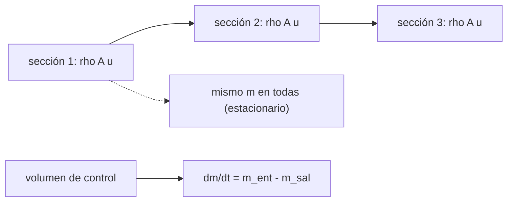

# B79-C01 — Conservación de masa en fluidos

<!-- nav:top -->
[🏠 Programa](../../../../README.md) · [📚 Bloque B79](../../../tronco-comun/B79-fluidos-termodinamica-y-aerotermodinamica-de-propulsion.md) · [← Anterior: B78-C22 — Ciclos de trabajo y operación de propulsión eléctrica](../../../tronco-comun/B78-tecnologias-de-propulsion-espacial.md#b78-c22) · [Siguiente: B79-C02 — Ecuaciones de Euler para flujo no viscoso →](../B79-C02-ecuaciones-de-euler-para-flujo-no-viscoso/CLASE.md)
<!-- /nav -->

## 1. Ubicación, nivel y alcance

Clase 1 del bloque B79. Nivel N3. La masa no se crea ni se destruye: lo que entra a un volumen de control, o sale, o se acumula. Esta clase convierte esa frase en la ecuación de continuidad `ρ A u = constante` para un conducto estacionario y en un balance `dm/dt = ṁ_ent − ṁ_sal` para un depósito. Es la primera clase del bloque y no tiene prerrequisito de fluidos; usa solo álgebra y la noción de densidad. El conducto y el depósito son sintéticos y no corresponden a ningún motor.

## 2. Por qué esta clase existe

El tronco no trata la mecánica de fluidos; solo ve gases y presión. Sin continuidad no se puede entender por qué una tobera acelera el flujo ni cómo se calcula un caudal de propulsante. La decisión central: **¿cuándo puedo tratar la densidad como constante y cuándo debo aceptar que cambia a lo largo del conducto?**

## 3. Lo que podrás hacer al terminar

1. Calcular el flujo másico `ṁ = ρ A u` de una sección.
2. Aplicar continuidad estacionaria para obtener la velocidad en otra sección.
3. Plantear el balance de masa de un volumen de control con acumulación.
4. Integrar numéricamente un depósito y compararlo con su solución exacta.
5. Cuantificar cuánto varía la densidad con el número de Mach en un conducto de aire.
6. Separar lo consultado de lo ilustrativo en un balance de masa.

La evidencia es la **ficha de balance de masa de un conducto** del ejercicio 12 (sección 20).

## 4. Con qué llegas y cómo comprobarlo

1. ¿Qué es la densidad y en qué unidades se mide?
2. ¿Qué es un área de sección y en qué unidades?
3. ¿Qué es una velocidad media de flujo?
4. ¿Qué es un dato sintético?
5. ¿Qué es una verificación por segunda vía?

<details>
<summary>Ver respuestas</summary>

1. masa por unidad de volumen, en kg/m³. 2. la superficie perpendicular al flujo, en m². 3. el caudal volumétrico dividido por el área, en m/s. 4. un dato generado para el ejemplo, no medido. 5. calcular lo mismo con otro método y comparar.
</details>

Con cuatro o cinco aciertos, sigue; si no, repasa los prerrequisitos.

## 5. Un caso de contexto y casos de referencia

Un conducto con áreas `0,010; 0,006; 0,004 y 0,008 m²` conduce aire con `ρ = 1,225 kg/m³` y `u₁ = 20 m/s`: `ṁ = 0,24500 kg/s`, y la velocidad sube a `50 m/s` en la sección más estrecha. Es el **ejemplo conductor**. Todo es **ilustrativo**: ninguna cifra describe un motor real.

## 6. Vocabulario

El **flujo másico** `ṁ = ρ A u` es la masa que cruza una sección por unidad de tiempo. La **continuidad** estacionaria dice que `ṁ` es el mismo en todas las secciones. El **volumen de control** es una región fija del espacio por cuya frontera entra y sale fluido. El **número de Mach** `M = u/a` compara la velocidad con la del sonido `a`. El flujo es **incompresible** si `ρ` se toma constante.

## 7. Modelo mental: una tubería como cadena de relevos



*Descripción textual:* en régimen estacionario el flujo másico es el mismo en todas las secciones; si hay acumulación, la diferencia entre entrada y salida es la variación de masa.

Analogía: una cadena de personas que se pasan cajas; si todas pasan el mismo número por minuto, nada se acumula. Límite: la analogía no muestra que las cajas (la densidad) pueden ocupar más o menos espacio al acelerar.

## 8. La explicación, paso a paso

### 8.1 Continuidad estacionaria

Con `ρ = 1,225 kg/m³`, `A₁ = 0,010 m²` y `u₁ = 20 m/s`: `ṁ = 1,225 × 0,010 × 20 = 0,24500 kg/s`. En la sección 3, `u₃ = ṁ/(ρ A₃) = 0,24500/(1,225 × 0,004) = 50,0 m/s`.

| Sección | `A` (m²) | `u` (m/s) | `ρ A u` (kg/s) |
|---|---|---|---|
| 1 | 0,0100 | 20,000 | 0,24500 |
| 2 | 0,0060 | 33,333 | 0,24500 |
| 3 | 0,0040 | 50,000 | 0,24500 |
| 4 | 0,0080 | 25,000 | 0,24500 |

### 8.2 Cuando la densidad cambia

Con aire isentrópico (`γ = 1,4`, `T₀ = 300 K`, `p₀ = 101325 Pa`) y `M₁ = 0,15`, `ṁ = 0,60462 kg/s`. Al estrecharse el conducto el Mach sube a `0,4082` y la densidad cae a `0,9317` de la de entrada (−6,8 %). El balance `ρ A u` se cumple igual en las cuatro secciones; lo que cambia es que ya no basta con `A u` constante.

### 8.3 Acumulación

Con acumulación, `dm/dt = ṁ_ent − ṁ_sal`. Un depósito de `0,5 m³` con entrada `0,3 kg/s` y salida `0,2 ρ` tiene densidad de equilibrio `ρ_eq = 0,3/0,2 = 1,5 kg/m³` y constante de tiempo `V/c = 2,5 s`. A los 5 s, Euler con `Δt = 0,01 s` da `1,432603` y la solución exacta `1,432332 kg/m³` (error relativo `1,9 × 10⁻⁴`).

### 8.4 Qué cambia y qué no

La masa siempre se conserva. Lo que cambia es qué variable lo absorbe: en flujo incompresible la velocidad crece al estrechar; en flujo compresible también cae la densidad. La regla práctica: la densidad varía menos de un 5 % mientras `M < 0,3`.

## 9. Magnitudes, símbolos y unidades

| Símbolo | Qué es | Unidad | Valor / nota |
|---|---|---|---|
| `ṁ` | flujo másico | kg/s | 0,24500 (caso A) |
| `ρ` | densidad | kg/m³ | 1,225 (ilustrativa) |
| `A` | área de sección | m² | 0,004–0,010 |
| `u` | velocidad media | m/s | 20–50 |
| `M` | número de Mach | — | 0,15–0,41 |
| `V` | volumen del depósito | m³ | 0,5 |

## 10. Convenciones y referencias

Sistema de referencia: volumen de control fijo, flujo unidimensional y estacionario (salvo el depósito). Aire como gas ideal con `γ = 1,4` y `R = 287,05 J/(kg K)` (valores ilustrativos de uso común, no consultados). Python 3.12 con biblioteca estándar. Todos los datos son ilustrativos.

## 11. De dónde sale lo que afirmamos

| ID | Fuente | Localizador | Respalda | Estado |
|---|---|---|---|---|
| S1 | NASA Glenn, Beginner's Guide to Aeronautics, «Mass Flow Rate» — https://www1.grc.nasa.gov/beginners-guide-to-aeronautics/mass-flow-rate/ (consultada 2026-11-10) | página completa | ṁ = ρ A V y que el flujo másico por un tubo es constante (continuidad) | Consultada |
| — | Relaciones estándar de libro de texto que el laboratorio verifica con una segunda vía | — | las verifica el laboratorio | No consultada en una fuente concreta |

Límites: la geometría, la densidad, las condiciones de aire y el depósito son ilustrativos; no se modela ningún motor real.

## 12. Cómo ver el balance de masa

| Magnitud | Valor |
|---|---|
| `ṁ` (caso A) | 0,24500 kg/s |
| `u₃` | 50,000 m/s |
| `ρ₃/ρ₁` (compresible) | 0,9317 |
| error del depósito | 1,9 × 10⁻⁴ |

Descripción larga: la velocidad sube cuando el área baja, `ρ A u` queda plano y, a Mach moderado, la densidad baja unos pocos por ciento.

## 13. Ejemplo trabajado: la velocidad en la sección 2

**Paso 1 · Flujo másico.** `ṁ = 0,24500 kg/s`.

**Paso 2 · Velocidad.** `u₂ = 0,24500/(1,225 × 0,006) = 33,333 m/s`.

**Paso 3 · Comprobación.** `ρ A u = 1,225 × 0,006 × 33,333 = 0,24500 kg/s`.

## 14. Distintas formas de describir un flujo

**Por balance:** `ṁ` constante. **Por velocidad:** `u = ṁ/(ρ A)`. **Por caudal volumétrico:** `Q = A u`, constante solo si `ρ` lo es. **Por acumulación:** `dm/dt`.

## 15. Práctica guiada

**Ejercicio 1 · con los pasos indicados.** Calcula `ṁ` para `ρ = 1,225 kg/m³`, `A = 0,010 m²` y `u = 20 m/s`. *Pasos:* multiplica las tres magnitudes y comprueba las unidades.

<details><summary>Solución comentada</summary>

`1,225 × 0,010 × 20 = 0,24500 kg/s`.
</details>

**Ejercicio 2 · con una pista.** Predice `u` en la sección de `0,004 m²`. *Pista:* `ṁ` no cambia.

<details><summary>Solución comentada</summary>

`0,24500/(1,225 × 0,004) = 50 m/s`; coincide con el laboratorio.
</details>

**Ejercicio 3 · casi autónomo.** ¿Por qué el depósito tiene densidad de equilibrio `m_in/c`? *Casi autónomo:* iguala entrada y salida.

<details><summary>Solución comentada</summary>

En equilibrio `dρ/dt = 0`, de modo que `m_in = c ρ` y `ρ_eq = m_in/c = 1,5 kg/m³`.
</details>

## 16. Práctica autónoma, transferencia e integrador

**Ejercicio 4 · autónomo.** Velocidad en la sección 4 (`0,008 m²`).

<details><summary>Solución comentada</summary>

`0,24500/(1,225 × 0,008) = 25 m/s`.
</details>

**Ejercicio 5 · autónomo.** Si `u₁` se duplica, ¿cómo cambia `ṁ`?

<details><summary>Solución comentada</summary>

Se duplica: `ṁ ∝ u₁`.
</details>

**Ejercicio 6 · autónomo.** Constante de tiempo del depósito.

<details><summary>Solución comentada</summary>

`V/c = 0,5/0,2 = 2,5 s`.
</details>

**Ejercicio 7 · autónomo.** ¿Qué densidad tiene el depósito a los 2,5 s (exacta)?

<details><summary>Solución comentada</summary>

`1,5 + (1 − 1,5) e⁻¹ = 1,3161 kg/m³`.
</details>

**Ejercicio 8 · autónomo.** Reducción relativa de densidad entre las secciones 1 y 3 del caso compresible.

<details><summary>Solución comentada</summary>

`1 − 0,9317 = 6,8 %`.
</details>

**Ejercicio 9 · transferencia.** **Transferencia.** Un colega usa `Q = A u` constante en un conducto de aire a `M = 0,4`. ¿Qué error comete?

<details><summary>Solución comentada</summary>

Ignora que la densidad baja un 7–8 %; el flujo másico calculado variaría esa fracción entre secciones.
</details>

**Ejercicio 10 · transferencia.** **Transferencia.** Un tanque con salida fija `ṁ_sal = 0,2 kg/s` y entrada `0,3 kg/s`: ¿qué pasa con la masa?

<details><summary>Solución comentada</summary>

Crece a `0,1 kg/s`, sin equilibrio, mientras no cambien las condiciones; el modelo `c ρ` es otro caso.
</details>

**Ejercicio 11 · transferencia.** **Transferencia.** ¿Qué falta para aplicar este balance a un motor real?

<details><summary>Solución comentada</summary>

Reacciones químicas (masa de propulsante que cambia de especie), flujo no uniforme en la sección y fuga; todo eso queda fuera de esta clase.
</details>

**Ejercicio 12 · integrador.** **Integrador.** Elabora tu *ficha de balance de masa de un conducto*: tabla de `A`, `u`, `ρ A u` para las cuatro secciones, comparación incompresible-compresible, error del depósito y lista de qué es consultado e ilustrativo.

<details><summary>Solución comentada</summary>

Secciones 8.1–8.4 y la salida del laboratorio.
</details>

## 17. Laboratorio: continuidad en un conducto y en un depósito

El script [masa.py](masa.py) calcula `ṁ` y la velocidad en cada sección, repite el cálculo con flujo isentrópico compresible (resolviendo `M` por bisección) e integra un depósito con Euler frente a su solución exacta (**comprueba** balance < 1e-9 y error del depósito < 5e-3).

**Datos:** el flujo másico y la continuidad se consultaron en la página de NASA Glenn; áreas, densidad, condiciones de aire y depósito son **ilustrativos**. **Predice antes de ejecutar:** ¿cuánto valdrá `ρ A u` en la sección 2? (el mismo `ṁ`: 0,24500 kg/s.) **Ejecución del 2026-11-10:**

```text
Python 3.12.9 (biblioteca estandar)
Conducto ILUSTRATIVO: m = rho A1 u1 = 0.24500 kg/s
 seccion  A [m2]    u [m/s]   rho*A*u [kg/s]
   1     0.0100     20.000   0.24500
   2     0.0060     33.333   0.24500
   3     0.0040     50.000   0.24500
   4     0.0080     25.000   0.24500
Segunda via: flujo isentropico compresible (aire), mismo m
 m = 0.60462 kg/s (M1 = 0.15)
 seccion   M       rho [kg/m3]   u [m/s]   rho*A*u [kg/s]  rho/rho1
   1    0.1500   1.1635        51.97    0.60462      1.0000
   2    0.2565   1.1388        88.49    0.60462      0.9788
   3    0.4082   1.0840       139.44    0.60462      0.9317
   4    0.1890   1.1559        65.39    0.60462      0.9935
Deposito ILUSTRATIVO V = 0.5 m3, m_in = 0.3 kg/s, m_out = 0.2 rho:
 rho(5 s) Euler = 1.432603 ; exacta = 1.432332 ; error relativo = 1.89e-04
Pruebas superadas.
```

```bash
python programa/clases/B79/B79-C01-conservacion-de-masa-en-fluidos/masa.py
```

**Límites:** flujo unidimensional, gas ideal y depósito de parámetros concentrados; el segundo modelo no es una validación independiente de la física, solo comprueba que el código conserva la masa.

## 18. Errores frecuentes y cómo corregirlos

**Suponer `A u` constante en flujo compresible.** Se corrige con 8.2.

**Olvidar la acumulación en un depósito.** Se corrige con 8.3.

**Mezclar kg/s con m³/s.** Revisa las unidades de la sección 9.

**Presentar el conducto sintético como un motor.** Se corrige con la sección 10.

## 19. Cómo sabrás que vas bien

Tras la sección 8: ¿qué velocidad esperabas en la sección 3 y cuál obtuviste? Si dudas, repasa el ejemplo 13. Tras el laboratorio: ¿qué comprueba? (ver la sección 17).

## 20. Qué entregas y cómo se evalúa

El producto es tu **ficha de balance de masa de un conducto** (ejercicio 12).

| Criterio | Inicial | En desarrollo | Logrado | Destacado |
|---|---|---|---|---|
| Conceptos | Los confunde | Parciales | Aplica continuidad y acumulación | Explica los límites |
| Cálculo | Sin unidades | Con errores | Tablas completas con unidades | Calcula casos nuevos |
| Numérico | Sin comprobar | Un caso | Contraste con una segunda vía | Interpreta las diferencias |
| Fuentes | Sin fuente | Sin fecha | Fuentes con fecha y estado | Declara lo ilustrativo y lo no consultado |
| Límites | No los nombra | Uno | Tres | Discute qué falta del modelo |

**Condiciones críticas (no se compensan con promedio):** rotular el conducto y el depósito como ilustrativos; distinguir flujo incompresible de compresible; no presentar un cálculo como medición de un motor real; citar solo lo consultado.

## 21. Ética, seguridad y límites

Clase educativa: los modelos son simplificados y sus datos son sintéticos, ilustrativos o coeficientes publicados con fuente; ningún resultado describe un motor o un vehículo reales ni sustituye al análisis de ingeniería, a las normas o a los datos de fabricante.  Accesibilidad: tablas equivalentes a las gráficas, fórmulas en texto, ejercicios sin conexión.

## 22. Para cerrar y seguir

Un conducto que se estrecha de `0,010` a `0,004 m²` pasa de `20` a `50 m/s` con el mismo `0,245 kg/s`. Queda una pregunta: ¿qué fuerzas aceleran el fluido y cómo cambian la presión? La responde Euler.

**Glosario español–inglés.** flujo másico · *mass flow rate*; continuidad · *continuity*; volumen de control · *control volume*; número de Mach · *Mach number*; incompresible · *incompressible*.

**Continuidad.** [B79-C02](../B79-C02-ecuaciones-de-euler-para-flujo-no-viscoso/CLASE.md) estudia las ecuaciones de Euler.

**Referencias:** ver sección 11.

<!-- nav:bottom -->
---

[← Anterior: B78-C22 — Ciclos de trabajo y operación de propulsión eléctrica](../../../tronco-comun/B78-tecnologias-de-propulsion-espacial.md#b78-c22) · [📚 Bloque B79](../../../tronco-comun/B79-fluidos-termodinamica-y-aerotermodinamica-de-propulsion.md) · [Siguiente: B79-C02 — Ecuaciones de Euler para flujo no viscoso →](../B79-C02-ecuaciones-de-euler-para-flujo-no-viscoso/CLASE.md)
<!-- /nav -->
