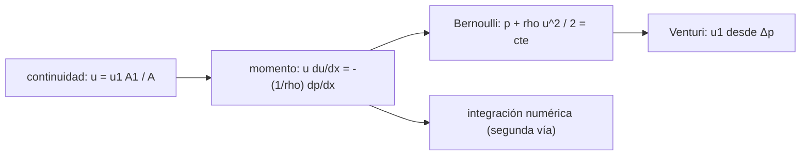

# B79-C02 — Ecuaciones de Euler para flujo no viscoso

<!-- nav:top -->
[🏠 Programa](../../../../README.md) · [📚 Bloque B79](../../../tronco-comun/B79-fluidos-termodinamica-y-aerotermodinamica-de-propulsion.md) · [← Anterior: B79-C01 — Conservación de masa en fluidos](../B79-C01-conservacion-de-masa-en-fluidos/CLASE.md) · [Siguiente: B79-C03 — Ecuaciones de Navier-Stokes →](../B79-C03-ecuaciones-de-navier-stokes/CLASE.md)
<!-- /nav -->

## 1. Ubicación, nivel y alcance

Clase 2 del bloque B79. Nivel N3. Si quitas la viscosidad a las ecuaciones de un fluido quedan las de Euler: masa, cantidad de movimiento y energía con solo términos de convección. Aquí las reduces a una dimensión y a régimen estacionario, obtienes Bernoulli y ves qué predice (una caída de presión en la garganta, una recuperación total a la salida) y qué no puede predecir (pérdidas). Usa la continuidad de [C01](../B79-C01-conservacion-de-masa-en-fluidos/CLASE.md). El Venturi es sintético y no corresponde a ningún instrumento real.

## 2. Por qué esta clase existe

Las ecuaciones de flujo ideal son la base del análisis de toberas y del reconocimiento de cuándo la viscosidad importa. Sin Euler no se sabe qué ignora cada modelo posterior. La decisión central: **¿cuándo puedo ignorar la viscosidad y qué error estoy aceptando al hacerlo?**

## 3. Lo que podrás hacer al terminar

1. Escribir la ecuación de momento de Euler en 1D estacionario.
2. Obtener Bernoulli y la presión total constante a lo largo de una línea de corriente.
3. Calcular la presión en cada sección de un Venturi.
4. Verificar Bernoulli con una integración numérica independiente de la ecuación de momento.
5. Inferir la velocidad de entrada a partir de la caída de presión en la garganta.
6. Explicar por qué un modelo no viscoso recupera toda la presión (y por qué eso no ocurre en la realidad).

La evidencia es la **ficha de presión a lo largo de un conducto** del ejercicio 12 (sección 20).

## 4. Con qué llegas y cómo comprobarlo

1. ¿Qué es la presión y en qué unidades se mide?
2. ¿Qué dice la continuidad `ρ A u` constante?
3. ¿Qué es la presión dinámica?
4. ¿Qué es una línea de corriente?
5. ¿Qué es una integración numérica?

<details>
<summary>Ver respuestas</summary>

1. fuerza por unidad de área, en Pa. 2. que el flujo másico es el mismo en todas las secciones. 3. `½ ρ u²`, en Pa. 4. una curva tangente en cada punto a la velocidad del fluido. 5. aproximar una integral con una suma sobre una malla.
</details>

Con cuatro o cinco aciertos, sigue; si no, repasa los prerrequisitos.

## 5. Un caso de contexto y casos de referencia

Un tubo de agua que baja de `0,010` a `0,004 m²` y vuelve a `0,010 m²` con `u₁ = 2 m/s` y `p₁ = 200000 Pa` tiene `5 m/s` y `189500 Pa` en la garganta (una caída de `10500 Pa`) y recupera `200000 Pa` a la salida. Es el **ejemplo conductor**. Todo es **ilustrativo**: ninguna cifra describe un instrumento real.

## 6. Vocabulario

Las **ecuaciones de Euler** son las de Navier–Stokes sin viscosidad. La **ecuación de Bernoulli** `p + ½ ρ u² = constante` vale a lo largo de una línea de corriente en flujo estacionario, no viscoso e incompresible. La **presión total** `p_t = p + ½ ρ u²` es esa constante. Un **Venturi** es un conducto que se estrecha y se ensancha y permite medir el caudal por la caída de presión.

## 7. Modelo mental: una pelota en una colina de presión



*Descripción textual:* de la continuidad sale la velocidad en cada sección; la ecuación de momento integrada da Bernoulli, que se contrasta con una integración numérica y se usa para inferir la velocidad de entrada.

Analogía: una bola que baja una colina gana velocidad y pierde altura; el fluido que entra en la garganta gana velocidad y pierde presión. Límite: no hay fricción en el modelo; en un conducto real parte de la presión no se recupera.

## 8. La explicación, paso a paso

### 8.1 Momento en 1D

Para flujo estacionario y no viscoso, `ρ u du/dx = −dp/dx`. Con `ρ` constante se integra a `p + ½ ρ u² = p_t`. En el ejemplo `p_t = 200000 + ½ × 1000 × 2² = 202000 Pa` en todas las secciones.

### 8.2 El Venturi

La continuidad da `u(x) = u₁ A₁ / A(x)`. En la garganta `u = 2 × 0,010/0,004 = 5 m/s` y `p = 202000 − ½ × 1000 × 25 = 189500 Pa`.

| `x` (m) | `A` (m²) | `u` (m/s) | `p` Bernoulli (Pa) | `p` numérico (Pa) |
|---|---|---|---|---|
| 0,00 | 0,01000 | 2,000 | 200000,00 | 200000,00 |
| 0,25 | 0,00700 | 2,857 | 197918,37 | 197918,37 |
| 0,50 | 0,00400 | 5,000 | 189500,00 | 189500,01 |
| 0,75 | 0,00700 | 2,857 | 197918,37 | 197918,37 |
| 1,00 | 0,01000 | 2,000 | 200000,00 | 200000,00 |

### 8.3 Dos vías

La segunda vía no usa Bernoulli: integra `dp/dx = −ρ u du/dx` con trapecio sobre 4000 intervalos y `du/dx` por diferencias centrales. La diferencia máxima, dividida por `max|p − p₁|`, es `1,1 × 10⁻⁶`. La comprobación valida que el código integra bien la ecuación de momento.

### 8.4 Qué cambia y qué no

La presión total no cambia y la presión estática se recupera por completo: `p(L) − p₁ = 0`. Eso es una **consecuencia de quitar la viscosidad**, no un hecho de la naturaleza; en un Venturi real hay pérdidas de presión total por fricción y desprendimiento. Como medidor, el modelo recupera `u₁ = 2,0000 m/s` desde `Δp = 10500 Pa`, pero aplicado a un instrumento real exige un coeficiente de descarga.

## 9. Magnitudes, símbolos y unidades

| Símbolo | Qué es | Unidad | Valor / nota |
|---|---|---|---|
| `p` | presión estática | Pa | 189500–200000 |
| `p_t` | presión total | Pa | 202000 |
| `u` | velocidad | m/s | 2–5 |
| `ρ` | densidad del agua | kg/m³ | 1000 (ilustrativa) |
| `A` | área de sección | m² | 0,004–0,010 |
| `Δp` | caída en la garganta | Pa | 10500 |

## 10. Convenciones y referencias

Sistema de referencia: coordenada `x` a lo largo del eje, flujo 1D estacionario, incompresible y no viscoso. Datos ilustrativos; densidad del agua supuesta. Python 3.12 con biblioteca estándar.

## 11. De dónde sale lo que afirmamos

| ID | Fuente | Localizador | Respalda | Estado |
|---|---|---|---|---|
| S1 | NASA Glenn, «Navier-Stokes Equations» — https://www.grc.nasa.gov/www/k-12/airplane/nseqs.html (consultada 2026-11-10) | página completa | Euler = Navier–Stokes sin términos viscosos; NS son ecuaciones acopladas que se resuelven en general con CFD y un modelo de turbulencia | Consultada |
| — | Relaciones estándar de libro de texto que el laboratorio verifica con una segunda vía | — | las verifica el laboratorio | No consultada en una fuente concreta |

Límites: la geometría y las condiciones del Venturi son ilustrativas; Bernoulli y la ecuación de momento 1D son relaciones estándar no consultadas en una fuente concreta; no se modela ningún instrumento real.

## 12. Cómo ver la presión en un Venturi

| Magnitud | Valor |
|---|---|
| `p` en la garganta | 189500 Pa |
| `Δp` | 10500 Pa |
| `p(L) − p₁` | 0 |
| diferencia entre vías | 1,1 × 10⁻⁶ |

Descripción larga: la presión baja en la garganta, sube al ensancharse y vuelve al valor de entrada porque no hay pérdidas.

## 13. Ejemplo trabajado: la presión a `x = 0,25 m`

**Paso 1 · Área.** `A = 0,010 (1 − 0,6 × 0,5) = 0,00700 m²`.

**Paso 2 · Velocidad.** `u = 2 × 0,010/0,007 = 2,857 m/s`.

**Paso 3 · Presión.** `p = 202000 − ½ × 1000 × 2,857² = 197918 Pa`.

## 14. Distintas formas de describir la presión

**Por Bernoulli:** `p = p_t − ½ ρ u²`. **Por integración:** suma de `−ρ u du`. **Por caída:** `Δp = ½ ρ u₁² (A₁²/A²−1)`. **Por energía:** presión total constante.

## 15. Práctica guiada

**Ejercicio 1 · con los pasos indicados.** Calcula `p_t` para `p = 200000 Pa`, `ρ = 1000` y `u = 2 m/s`. *Pasos:* suma la presión dinámica a la estática.

<details><summary>Solución comentada</summary>

`200000 + 2000 = 202000 Pa`.
</details>

**Ejercicio 2 · con una pista.** Predice `u` en la garganta. *Pista:* continuidad.

<details><summary>Solución comentada</summary>

`2 × 0,010/0,004 = 5 m/s`.
</details>

**Ejercicio 3 · casi autónomo.** ¿Qué presión esperas en la garganta? *Casi autónomo:* resta la presión dinámica a `p_t`.

<details><summary>Solución comentada</summary>

`202000 − 12500 = 189500 Pa`.
</details>

## 16. Práctica autónoma, transferencia e integrador

**Ejercicio 4 · autónomo.** Caída de presión si `u₁ = 4 m/s`.

<details><summary>Solución comentada</summary>

`Δp ∝ u₁²`: `10500 × 4 = 42000 Pa`.
</details>

**Ejercicio 5 · autónomo.** Velocidad en la garganta si `u₁ = 4 m/s`.

<details><summary>Solución comentada</summary>

`4 × 0,010/0,004 = 10 m/s`.
</details>

**Ejercicio 6 · autónomo.** ¿Qué relación de áreas da `u_garganta = 2 u₁`?

<details><summary>Solución comentada</summary>

`A₁/A = 2`, o sea `A = 0,005 m²`.
</details>

**Ejercicio 7 · autónomo.** Inferir `u₁` con `Δp = 5250 Pa` en la garganta de `0,004 m²`.

<details><summary>Solución comentada</summary>

`u₁ = √(2 × 5250/(1000 × 5,25)) = 1,414 m/s` (`A₁²/A²−1 = 5,25`).
</details>

**Ejercicio 8 · autónomo.** Presión total en la salida del modelo no viscoso.

<details><summary>Solución comentada</summary>

La misma: `202000 Pa`.
</details>

**Ejercicio 9 · transferencia.** **Transferencia.** Un colega mide `p(L) < p₁` en un tubo real. ¿Contradice a Bernoulli?

<details><summary>Solución comentada</summary>

No: el tubo real tiene pérdidas por fricción y desprendimiento; Bernoulli no las incluye.
</details>

**Ejercicio 10 · transferencia.** **Transferencia.** Con gas a `M = 0,5`, ¿se puede usar Bernoulli incompresible?

<details><summary>Solución comentada</summary>

Con error apreciable: la densidad varía unos 13 % y hay que usar las relaciones isentrópicas de C05.
</details>

**Ejercicio 11 · transferencia.** **Transferencia.** ¿Qué falta para usar este Venturi como medidor real?

<details><summary>Solución comentada</summary>

Un coeficiente de descarga calibrado, el efecto de la viscosidad y la incertidumbre de los sensores; nada de eso está en el modelo.
</details>

**Ejercicio 12 · integrador.** **Integrador.** Elabora tu *ficha de presión a lo largo de un conducto*: tabla de `A`, `u`, `p` y `p_t` en cinco posiciones, diferencia entre las dos vías, caída en la garganta y lista de qué es consultado e ilustrativo.

<details><summary>Solución comentada</summary>

Secciones 8.1–8.4 y la salida del laboratorio.
</details>

## 17. Laboratorio: Venturi no viscoso con dos vías

El script [euler.py](euler.py) calcula la presión de un Venturi con Bernoulli y con una integración numérica de la ecuación de momento y recupera la velocidad de entrada desde la caída de presión (**comprueba** diferencia < 1e-5, recuperación total y `u₁` exacta).

**Datos:** solo se consultó la relación entre Euler y Navier–Stokes (NASA Glenn); geometría, densidad, velocidad y presión de entrada son **ilustrativas**. **Predice antes de ejecutar:** ¿qué `p(L)` tendrá la salida? (la de entrada: 200000 Pa.) **Ejecución del 2026-11-10:**

```text
Python 3.12.9 (biblioteca estandar)
Venturi ILUSTRATIVO: A1 = 0.010 m2, garganta 0.004 m2, rho = 1000 kg/m3, u1 = 2 m/s, p1 = 200000 Pa
   x [m]   A [m2]    u [m/s]   p Bernoulli [Pa]   p numerico [Pa]   pt [Pa]
  0.00    0.01000     2.000       200000.00         200000.00    202000.00
  0.25    0.00700     2.857       197918.37         197918.37    202000.00
  0.50    0.00400     5.000       189500.00         189500.01    202000.00
  0.75    0.00700     2.857       197918.37         197918.37    202000.00
  1.00    0.01000     2.000       200000.00         200000.00    202000.00
Diferencia maxima entre vias / max|p - p1| = 1.10e-06
Caida de presion a la garganta = 10500.0 Pa ; recuperacion en la salida: p(L) - p1 = 0.000e+00 Pa
u1 inferida de la caida de presion = 2.0000 m/s (dato: 2.0)
Pruebas superadas.
```

```bash
python programa/clases/B79/B79-C02-ecuaciones-de-euler-para-flujo-no-viscoso/euler.py
```

**Límites:** flujo 1D, incompresible y sin pérdidas; la concordancia entre vías valida el código, no la ausencia de pérdidas en un instrumento real.

## 18. Errores frecuentes y cómo corregirlos

**Esperar que la presión se pierda en un modelo sin viscosidad.** Se corrige con 8.4.

**Aplicar Bernoulli entre líneas de corriente sin justificar.** Se corrige con 8.1.

**Usar Bernoulli con gas rápido.** Se corrige con la pregunta 2 de transferencia.

**Presentar el Venturi sintético como un instrumento.** Se corrige con la sección 10.

## 19. Cómo sabrás que vas bien

Tras la sección 8: ¿qué presión esperabas en la garganta y cuál obtuviste? Si dudas, repasa el ejemplo 13. Tras el laboratorio: ¿qué comprueba? (ver la sección 17).

## 20. Qué entregas y cómo se evalúa

El producto es tu **ficha de presión a lo largo de un conducto** (ejercicio 12).

| Criterio | Inicial | En desarrollo | Logrado | Destacado |
|---|---|---|---|---|
| Conceptos | Los confunde | Parciales | Aplica Bernoulli y distingue sus límites | Explica los límites |
| Cálculo | Sin unidades | Con errores | Tablas completas con unidades | Calcula casos nuevos |
| Numérico | Sin comprobar | Un caso | Contraste con una segunda vía | Interpreta las diferencias |
| Fuentes | Sin fuente | Sin fecha | Fuentes con fecha y estado | Declara lo ilustrativo y lo no consultado |
| Límites | No los nombra | Uno | Tres | Discute qué falta del modelo |

**Condiciones críticas (no se compensan con promedio):** rotular el Venturi como ilustrativo; no presentar la recuperación total como un resultado físico real; no presentar un cálculo como medición de un motor real; citar solo lo consultado.

## 21. Ética, seguridad y límites

Clase educativa: los modelos son simplificados y sus datos son sintéticos, ilustrativos o coeficientes publicados con fuente; ningún resultado describe un motor o un vehículo reales ni sustituye al análisis de ingeniería, a las normas o a los datos de fabricante.  Accesibilidad: tablas equivalentes a las gráficas, fórmulas en texto, ejercicios sin conexión.

## 22. Para cerrar y seguir

Un Venturi ideal baja `10500 Pa` en la garganta y los recupera a la salida. Queda una pregunta: ¿qué cambia cuando el fluido es viscoso? Lo ve Navier–Stokes.

**Glosario español–inglés.** ecuaciones de Euler · *Euler equations*; presión total · *total pressure*; línea de corriente · *streamline*; Venturi · *Venturi tube*; presión dinámica · *dynamic pressure*.

**Continuidad.** [B79-C03](../B79-C03-ecuaciones-de-navier-stokes/CLASE.md) estudia las ecuaciones de Navier–Stokes.

**Referencias:** ver sección 11.

<!-- nav:bottom -->
---

[← Anterior: B79-C01 — Conservación de masa en fluidos](../B79-C01-conservacion-de-masa-en-fluidos/CLASE.md) · [📚 Bloque B79](../../../tronco-comun/B79-fluidos-termodinamica-y-aerotermodinamica-de-propulsion.md) · [Siguiente: B79-C03 — Ecuaciones de Navier-Stokes →](../B79-C03-ecuaciones-de-navier-stokes/CLASE.md)
<!-- /nav -->
