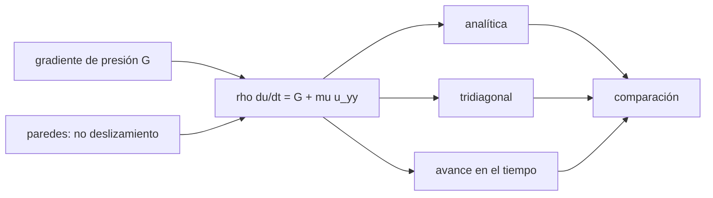

# B79-C03 — Ecuaciones de Navier-Stokes

<!-- nav:top -->
[🏠 Programa](../../../../README.md) · [📚 Bloque B79](../../../tronco-comun/B79-fluidos-termodinamica-y-aerotermodinamica-de-propulsion.md) · [← Anterior: B79-C02 — Ecuaciones de Euler para flujo no viscoso](../B79-C02-ecuaciones-de-euler-para-flujo-no-viscoso/CLASE.md) · [Siguiente: B79-C04 — Regímenes laminar y turbulento →](../B79-C04-regimenes-laminar-y-turbulento/CLASE.md)
<!-- /nav -->

## 1. Ubicación, nivel y alcance

Clase 3 del bloque B79. Nivel N3. Navier–Stokes es Euler más la viscosidad: un término de difusión que frena el fluido contra las paredes. Aquí lo reduces al caso unidireccional entre dos placas (Couette–Poiseuille), donde existe una solución analítica, y la comparas con dos métodos numéricos. Usa [C02](../B79-C02-ecuaciones-de-euler-para-flujo-no-viscoso/CLASE.md) y derivadas simples. El fluido es sintético y no corresponde a un aceite concreto.

## 2. Por qué esta clase existe

Casi todo flujo de ingeniería tiene paredes, y en ellas la viscosidad impone velocidad cero. Sin Navier–Stokes no hay arrastre ni fricción ni calentamiento por pared. La decisión central: **¿qué término de la ecuación de momento controla el perfil de velocidad y qué fija sus condiciones de borde?**

## 3. Lo que podrás hacer al terminar

1. Escribir la ecuación de momento unidireccional con viscosidad.
2. Obtener el perfil de Couette–Poiseuille analítico.
3. Calcular la tensión en cada pared y el caudal.
4. Resolver el perfil con un sistema tridiagonal y con avance en el tiempo.
5. Comparar tres vías y cuantificar su error.
6. Reconocer por qué las ecuaciones completas se resuelven con CFD.

La evidencia es la **perfil de velocidad verificado** del ejercicio 12 (sección 20).

## 4. Con qué llegas y cómo comprobarlo

1. ¿Qué es la viscosidad dinámica y en qué unidades?
2. ¿Qué es una condición de no deslizamiento?
3. ¿Qué es un gradiente de presión?
4. ¿Qué es una derivada segunda?
5. ¿Qué es una verificación por segunda vía?

<details>
<summary>Ver respuestas</summary>

1. la resistencia del fluido a deformarse; Pa·s. 2. que el fluido en contacto con la pared tiene la velocidad de la pared. 3. la variación de la presión por unidad de longitud, en Pa/m. 4. la derivada de la derivada: la curvatura del perfil. 5. calcular lo mismo con otro método y comparar.
</details>

Con cuatro o cinco aciertos, sigue; si no, repasa los prerrequisitos.

## 5. Un caso de contexto y casos de referencia

Entre dos placas separadas `h = 0,010 m` con la superior a `0,5 m/s` y un gradiente `−dp/dx = 2000 Pa/m`, un fluido de `μ = 0,05 Pa·s` alcanza `0,75 m/s` en el centro. Es el **ejemplo conductor**. Todo es **ilustrativo**: ninguna cifra describe un fluido real.

## 6. Vocabulario

La **ecuación de Navier–Stokes** unidireccional es `ρ ∂u/∂t = −dp/dx + μ ∂²u/∂y²`. La **viscosidad cinemática** es `ν = μ/ρ`. El flujo de **Couette** lo arrastra una placa; el de **Poiseuille** lo impulsa un gradiente de presión. La **tensión viscosa** es `τ = μ du/dy`.

## 7. Modelo mental: capas de naipes que se deslizan



*Descripción textual:* el gradiente de presión y las paredes definen la ecuación; se resuelve de tres maneras y se compara.

Analogía: una baraja cuyas cartas se deslizan unas sobre otras; la carta pegada a la mesa no se mueve y la de arriba sigue a la mano. Límite: el flujo 1D no incluye turbulencia ni variación en `x`.

## 8. La explicación, paso a paso

### 8.1 Perfil analítico

Con `u(0) = 0`, `u(h) = U` y estado estacionario: `u(y) = U y/h + G y (h − y)/(2 μ)`. En el centro, `0,25 + 0,5 = 0,75 m/s`.

### 8.2 Tres vías

| `y/h` | analítica (m/s) | tridiagonal (m/s) | FTCS (m/s) |
|---|---|---|---|
| 0,00 | 0,000000 | 0,000000 | 0,000000 |
| 0,10 | 0,230000 | 0,230000 | 0,230000 |
| 0,20 | 0,420000 | 0,420000 | 0,420000 |
| 0,50 | 0,750000 | 0,750000 | 0,750000 |
| 0,80 | 0,720000 | 0,720000 | 0,720000 |
| 0,90 | 0,630000 | 0,630000 | 0,630000 |
| 1,00 | 0,500000 | 0,500000 | 0,500000 |

Los errores máximos relativos a `U` son `1,15 × 10⁻¹⁴` (tridiagonal) y `2,05 × 10⁻¹²` (FTCS a `t = 5 s`). Con un perfil cuadrático las diferencias centrales de segundo orden son exactas, por eso el error es de redondeo.

### 8.3 Tensión y caudal

`τ = μ du/dy`: en la pared inferior `12,500 Pa` y en la superior `−7,500 Pa` (el signo indica que `u` decrece hacia la placa superior). El caudal por unidad de ancho `q = U h/2 + G h³/(12 μ) = 0,005833 m²/s`, velocidad media `0,583333 m/s`; la integral por trapecio coincide.

### 8.4 Qué cambia y qué no

La viscosidad añade el término `μ u_yy`, que impone el no deslizamiento y crea la tensión en pared. Sin ella (C02) el perfil sería plano y no habría arrastre. Un caso con solución exacta es una **prueba del código**, no del modelo: la turbulencia no está aquí.

## 9. Magnitudes, símbolos y unidades

| Símbolo | Qué es | Unidad | Valor / nota |
|---|---|---|---|
| `μ` | viscosidad dinámica | Pa·s | 0,05 (ilustrativa) |
| `ν` | viscosidad cinemática | m²/s | 5,5556 × 10⁻⁵ |
| `h` | separación de placas | m | 0,010 |
| `U` | velocidad de la placa | m/s | 0,5 |
| `G` | `−dp/dx` | Pa/m | 2000 |
| `τ` | tensión viscosa | Pa | 12,5 y −7,5 |
| `q` | caudal por ancho | m²/s | 0,005833 |

## 10. Convenciones y referencias

Sistema de referencia: `y` perpendicular a las placas, `x` en el flujo; flujo unidireccional, incompresible, newtoniano y laminar. Condiciones de no deslizamiento. Datos ilustrativos. Python 3.12.

## 11. De dónde sale lo que afirmamos

| ID | Fuente | Localizador | Respalda | Estado |
|---|---|---|---|---|
| S1 | NASA Glenn, «Navier-Stokes Equations» — https://www.grc.nasa.gov/www/k-12/airplane/nseqs.html (consultada 2026-11-10) | página completa | Euler = Navier–Stokes sin términos viscosos; NS son ecuaciones acopladas que se resuelven en general con CFD y un modelo de turbulencia | Consultada |
| — | Relaciones estándar de libro de texto que el laboratorio verifica con una segunda vía | — | las verifica el laboratorio | No consultada en una fuente concreta |

Límites: los parámetros del fluido son ilustrativos; la solución de Couette–Poiseuille es un resultado estándar no consultado en una fuente concreta.

## 12. Cómo ver el perfil de velocidad

| Magnitud | Valor |
|---|---|
| `u` en el centro | 0,750000 m/s |
| `τ` inferior | 12,500 Pa |
| `q` | 0,005833 m²/s |
| error tridiagonal | 1,15 × 10⁻¹⁴ |

Descripción larga: la velocidad sube de 0 a 0,75 m/s en el centro y baja a 0,5 m/s en la placa móvil.

## 13. Ejemplo trabajado: la velocidad a `y/h = 0,2`

**Paso 1 · Término de Couette.** `0,5 × 0,2 = 0,10 m/s`.

**Paso 2 · Término de Poiseuille.** `2000 × 0,002 × 0,008/(2 × 0,05) = 0,32 m/s`.

**Paso 3 · Suma.** `0,42 m/s`.

## 14. Distintas formas de describir un perfil de velocidad

**Analítica:** polinomio de grado 2. **Tridiagonal:** sistema de 99 incógnitas. **Temporal:** avance hasta el estado estacionario. **Por magnitudes:** `τ` y `q`.

## 15. Práctica guiada

**Ejercicio 1 · con los pasos indicados.** Calcula `ν` para `μ = 0,05` y `ρ = 900`. *Pasos:* divide y comprueba que sale m²/s.

<details><summary>Solución comentada</summary>

`0,05/900 = 5,556 × 10⁻⁵ m²/s`.
</details>

**Ejercicio 2 · con una pista.** Velocidad en el centro. *Pista:* suma `U/2` y `G h²/(8 μ)`.

<details><summary>Solución comentada</summary>

`0,25 + 2000 × 10⁻⁴/0,4 = 0,25 + 0,5 = 0,75 m/s`.
</details>

**Ejercicio 3 · casi autónomo.** ¿Cuánto vale `q` sin gradiente de presión? *Casi autónomo:* usa solo Couette.

<details><summary>Solución comentada</summary>

`U h/2 = 0,0025 m²/s`.
</details>

## 16. Práctica autónoma, transferencia e integrador

**Ejercicio 4 · autónomo.** Velocidad media del caso conductor.

<details><summary>Solución comentada</summary>

`q/h = 0,583333 m/s`.
</details>

**Ejercicio 5 · autónomo.** `τ` en una pared si `G = 0`.

<details><summary>Solución comentada</summary>

`μ U/h = 2,5 Pa`.
</details>

**Ejercicio 6 · autónomo.** Si `μ` se duplica con el mismo `G`, ¿cómo cambia la parte Poiseuille del centro?

<details><summary>Solución comentada</summary>

Se divide por 2: `0,25 m/s`.
</details>

**Ejercicio 7 · autónomo.** Tiempo característico de difusión `h²/ν`.

<details><summary>Solución comentada</summary>

`10⁻⁴/5,5556 × 10⁻⁵ = 1,8 s`.
</details>

**Ejercicio 8 · autónomo.** ¿Por qué el FTCS exige `Δt ≤ 0,5 Δy²/ν`?

<details><summary>Solución comentada</summary>

Por estabilidad: con más, los errores de la difusión explícita crecen; el laboratorio usa `0,4`.
</details>

**Ejercicio 9 · transferencia.** **Transferencia.** ¿Qué efecto tiene el término viscoso en un flujo de gas a número de Reynolds de 10⁷?

<details><summary>Solución comentada</summary>

Solo importa en una capa fina junto a la pared; fuera de ella domina Euler (C02, C04).
</details>

**Ejercicio 10 · transferencia.** **Transferencia.** Un colega afirma que FTCS «valida» Navier–Stokes. ¿Es cierto?

<details><summary>Solución comentada</summary>

No: valida la implementación de un caso con solución exacta; el modelo (laminar, 1D) no se prueba.
</details>

**Ejercicio 11 · transferencia.** **Transferencia.** ¿Qué ocurre con la solución si el flujo se vuelve turbulento?

<details><summary>Solución comentada</summary>

El perfil laminar deja de ser válido; hace falta un modelo de turbulencia y CFD, como indica NASA Glenn.
</details>

**Ejercicio 12 · integrador.** **Integrador.** Elabora tu *perfil de velocidad verificado*: tabla de las tres vías, errores, `τ` y `q` y lista de qué es consultado e ilustrativo.

<details><summary>Solución comentada</summary>

Secciones 8.1–8.4 y la salida del laboratorio.
</details>

## 17. Laboratorio: flujo de Couette–Poiseuille con tres vías

El script [couette_poiseuille.py](couette_poiseuille.py) calcula el perfil con la solución analítica, con un sistema tridiagonal y con avance temporal explícito, y compara también `q` con una integral por trapecio (**comprueba** errores < 1e-6 y < 1e-4).

**Datos:** solo se consultó el planteamiento de las ecuaciones (NASA Glenn); `h`, `μ`, `ρ`, `U` y `G` son **ilustrativos**. **Predice antes de ejecutar:** ¿qué velocidad tendrá el centro? (0,75 m/s.) **Ejecución del 2026-11-10:**

```text
Python 3.12.9 (biblioteca estandar)
Datos ILUSTRATIVOS: h = 0.01 m, mu = 0.05 Pa s, nu = 5.5556e-05 m2/s, U = 0.5 m/s, G = 2000.0 Pa/m
 y/h    u analitica [m/s]   u tridiagonal [m/s]   u FTCS [m/s]
 0.00       0.000000          0.000000          0.000000
 0.10       0.230000          0.230000          0.230000
 0.20       0.420000          0.420000          0.420000
 0.50       0.750000          0.750000          0.750000
 0.80       0.720000          0.720000          0.720000
 0.90       0.630000          0.630000          0.630000
 1.00       0.500000          0.500000          0.500000
Error maximo / U: tridiagonal = 1.15e-14 ; FTCS (t = 5.00 s) = 2.05e-12
Tension en la pared inferior = 12.500 Pa ; en la superior = -7.500 Pa
Caudal por unidad de ancho q = 0.005833 m2/s ; velocidad media = 0.583333 m/s
q por trapecio = 0.005833 m2/s
Pruebas superadas.
```

```bash
python programa/clases/B79/B79-C03-ecuaciones-de-navier-stokes/couette_poiseuille.py
```

**Límites:** flujo unidireccional, laminar y estacionario; el acuerdo prueba el código, no el modelo; no incluye turbulencia ni compresibilidad.

## 18. Errores frecuentes y cómo corregirlos

**Olvidar el no deslizamiento.** Se corrige con 8.1.

**Interpretar el signo de `τ`.** Se corrige con 8.3.

**Usar un `Δt` inestable en FTCS.** Se corrige con el ejercicio 8.

**Presentar el fluido sintético como un aceite real.** Se corrige con la sección 10.

## 19. Cómo sabrás que vas bien

Tras la sección 8: ¿qué velocidad esperabas en el centro y cuál obtuviste? Si dudas, repasa el ejemplo 13. Tras el laboratorio: ¿qué comprueba? (ver la sección 17).

## 20. Qué entregas y cómo se evalúa

El producto es tu **perfil de velocidad verificado** (ejercicio 12).

| Criterio | Inicial | En desarrollo | Logrado | Destacado |
|---|---|---|---|---|
| Conceptos | Los confunde | Parciales | Resuelve el perfil y calcula `τ` y `q` | Explica los límites |
| Cálculo | Sin unidades | Con errores | Tablas completas con unidades | Calcula casos nuevos |
| Numérico | Sin comprobar | Un caso | Contraste con una segunda vía | Interpreta las diferencias |
| Fuentes | Sin fuente | Sin fecha | Fuentes con fecha y estado | Declara lo ilustrativo y lo no consultado |
| Límites | No los nombra | Uno | Tres | Discute qué falta del modelo |

**Condiciones críticas (no se compensan con promedio):** rotular el fluido y las placas como ilustrativos; no presentar la verificación de un caso exacto como validación de la turbulencia; no presentar un cálculo como medición de un motor real; citar solo lo consultado.

## 21. Ética, seguridad y límites

Clase educativa: los modelos son simplificados y sus datos son sintéticos, ilustrativos o coeficientes publicados con fuente; ningún resultado describe un motor o un vehículo reales ni sustituye al análisis de ingeniería, a las normas o a los datos de fabricante.  Accesibilidad: tablas equivalentes a las gráficas, fórmulas en texto, ejercicios sin conexión.

## 22. Para cerrar y seguir

Entre dos placas a 1 cm, el perfil sube de 0 a `0,75 m/s` con `τ = 12,5 Pa` en la pared. Queda una pregunta: ¿cuándo deja de ser válido este perfil ordenado? Lo ve C04.

**Glosario español–inglés.** viscosidad · *viscosity*; no deslizamiento · *no-slip*; tensión viscosa · *viscous stress*; flujo de Couette · *Couette flow*; flujo de Poiseuille · *Poiseuille flow*.

**Continuidad.** [B79-C04](../B79-C04-regimenes-laminar-y-turbulento/CLASE.md) estudia los regímenes laminar y turbulento.

**Referencias:** ver sección 11.

<!-- nav:bottom -->
---

[← Anterior: B79-C02 — Ecuaciones de Euler para flujo no viscoso](../B79-C02-ecuaciones-de-euler-para-flujo-no-viscoso/CLASE.md) · [📚 Bloque B79](../../../tronco-comun/B79-fluidos-termodinamica-y-aerotermodinamica-de-propulsion.md) · [Siguiente: B79-C04 — Regímenes laminar y turbulento →](../B79-C04-regimenes-laminar-y-turbulento/CLASE.md)
<!-- /nav -->
