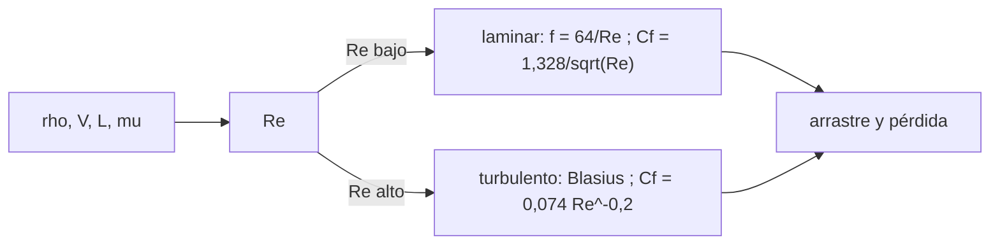

# B79-C04 — Regímenes laminar y turbulento

<!-- nav:top -->
[🏠 Programa](../../../../README.md) · [📚 Bloque B79](../../../tronco-comun/B79-fluidos-termodinamica-y-aerotermodinamica-de-propulsion.md) · [← Anterior: B79-C03 — Ecuaciones de Navier-Stokes](../B79-C03-ecuaciones-de-navier-stokes/CLASE.md) · [Siguiente: B79-C05 — Dinámica de fluidos compresibles →](../B79-C05-dinamica-de-fluidos-compresibles/CLASE.md)
<!-- /nav -->

## 1. Ubicación, nivel y alcance

Clase 4 del bloque B79. Nivel N3. El número de Reynolds decide si la viscosidad ordena el flujo en capas (laminar) o lo deja mezclarse en remolinos (turbulento). Aquí clasificas flujos en un tubo y sobre una placa plana, calculas la fricción y el arrastre en cada régimen y ves dónde se produce la transición. Usa la viscosidad de [C03](../B79-C03-ecuaciones-de-navier-stokes/CLASE.md). Las correlaciones son las clásicas de libro y los fluidos son ilustrativos.

## 2. Por qué esta clase existe

El régimen cambia el arrastre y la transferencia de calor por factores de varios; no distinguirlo lleva a subestimar el calentamiento de una pared o la pérdida de presión de un conducto. El tronco no lo trata. La decisión central: **¿qué régimen tiene este flujo y qué correlación de fricción es legítimo usar?**

## 3. Lo que podrás hacer al terminar

1. Calcular el número de Reynolds de un flujo en tubo y en placa.
2. Clasificar el régimen con el umbral convencional.
3. Calcular el factor de fricción laminar y el de Blasius.
4. Calcular el coeficiente de arrastre de una placa en ambos regímenes.
5. Verificar el arrastre laminar con una integración numérica de la tensión local.
6. Reconocer los límites de las correlaciones y de los umbrales convencionales.

La evidencia es la **tabla de régimen y arrastre** del ejercicio 12 (sección 20).

## 4. Con qué llegas y cómo comprobarlo

1. ¿Qué es la viscosidad cinemática?
2. ¿Qué es un número adimensional?
3. ¿Qué es el arrastre?
4. ¿Qué es una capa límite?
5. ¿Qué es una correlación empírica?

<details>
<summary>Ver respuestas</summary>

1. `ν = μ/ρ`, en m²/s. 2. una combinación de magnitudes cuyas unidades se cancelan. 3. la fuerza del fluido sobre el cuerpo en la dirección del flujo, en N. 4. la región junto a la pared donde la viscosidad cambia la velocidad. 5. una fórmula ajustada a medidas con un rango de validez.
</details>

Con cuatro o cinco aciertos, sigue; si no, repasa los prerrequisitos.

## 5. Un caso de contexto y casos de referencia

El agua a `1 m/s` en un tubo de `5 cm` tiene `Re = 50000` (turbulento, `f = 0,02113`); a `0,02 m/s` tiene `Re = 1000` (laminar, `f = 0,0640`). Una placa de `1 m` en aire a `50 m/s` arrastra `5,505 N`. Es el **ejemplo conductor**. Todo es **ilustrativo**: ninguna cifra describe un tubo o un vehículo reales.

## 6. Vocabulario

El **número de Reynolds** `Re = ρ V L/μ = V L/ν` compara inercia y viscosidad. El flujo es **laminar** si las capas no se mezclan y **turbulento** si hay mezcla caótica. El **factor de fricción de Darcy** `f` da la pérdida de presión de un tubo, `Δp = f (L/D) ½ ρ V²`. El **coeficiente de arrastre** de una placa `C_f = D/(½ ρ V² S)`. La **transición** es el paso de laminar a turbulento, convencionalmente en `Re_x ≈ 5 × 10⁵` en placa y `Re ≈ 2300` en tubo.

## 7. Modelo mental: humo de una vela



*Descripción textual:* el número de Reynolds elige la correlación de fricción y de arrastre.

Analogía: el hilo de humo de una vela sube liso y luego se rompe en remolinos más arriba. Límite: el umbral de transición depende de perturbaciones, rugosidad y gradiente de presión; no es un número exacto.

## 8. La explicación, paso a paso

### 8.1 Reynolds y régimen en tubo

`Re = ρ V D/μ`. Agua a `1 m/s`: `1000 × 1 × 0,05/10⁻³ = 50000` (turbulento). Aire a `0,5 m/s`: `1,2 × 0,5 × 0,05/1,8 × 10⁻⁵ = 1667` (laminar).

| Fluido | `V` (m/s) | `Re` | Régimen | `f` |
|---|---|---|---|---|
| agua | 0,020 | 1000,0 | laminar | 0,06400 |
| agua | 1,000 | 50000,0 | turbulento | 0,02113 |
| aire | 5,000 | 16666,7 | turbulento | 0,02781 |
| aire | 0,500 | 1666,7 | laminar | 0,03840 |

Las dos fórmulas no coinciden en `Re = 2300`: `f` laminar `0,02783` y Blasius `0,04563`. Eso indica que el umbral es una convención y que alrededor de él hay una zona de transición donde ninguna correlación sirve.

### 8.2 Placa plana

| `V` (m/s) | `Re_L` | Régimen | `C_f` | Arrastre (N) |
|---|---|---|---|---|
| 5 | 333333 | laminar | 0,00230 | 0,03450 |
| 50 | 3333333 | turbulento | 0,00367 | 5,50487 |

Con `Re_L = 2 × 10⁶` el `C_f` turbulento es `4,33` veces el laminar. La transición ocurre a `x = 1,5 m` con `5 m/s` y a `0,150 m` con `50 m/s`, de modo que a 50 m/s la placa de 1 m es casi toda turbulenta.

### 8.3 Dos vías

El arrastre laminar a `5 m/s` se calcula con la fórmula cerrada `C_f = 1,328/√Re_L` (`0,034502 N`) y con la integral numérica de la tensión local `0,664/√Re_x` (cambio de variable `x = L s²` para la singularidad en `x = 0`): diferencia `3,1 × 10⁻¹³`. Esto valida el código; no valida la correlación.

### 8.4 Qué cambia y qué no

El régimen turbulento tiene más fricción (en placa, `C_f` mayor y decae más despacio con `Re`) pero también retrasa el desprendimiento. Las correlaciones usadas son de capa completa sin corrección de transición; cerca de `Re_L = 5 × 10⁵` hay mezcla de ambos.

## 9. Magnitudes, símbolos y unidades

| Símbolo | Qué es | Unidad | Valor / nota |
|---|---|---|---|
| `Re` | número de Reynolds | — | 1000–3,3 × 10⁶ |
| `f` | factor de fricción de Darcy | — | 0,02–0,06 |
| `C_f` | coeficiente de arrastre de placa | — | 0,00230–0,00367 |
| `D` | diámetro del tubo | m | 0,05 |
| `L` | longitud de placa | m | 1,0 |
| `μ` | viscosidad dinámica | Pa·s | 1,8 × 10⁻⁵ (aire); 1,0 × 10⁻³ (agua) |

## 10. Convenciones y referencias

Fluidos newtonianos, propiedades constantes, tubo liso, placa lisa sin gradiente de presión. Umbrales convencionales 2300 y 5 × 10⁵. Propiedades de aire y agua de uso común, no consultadas. Python 3.12.

## 11. De dónde sale lo que afirmamos

| ID | Fuente | Localizador | Respalda | Estado |
|---|---|---|---|---|
| S1 | NASA Glenn, «Reynolds Number» — https://www.grc.nasa.gov/www/k-12/airplane/reynolds.html (consultada 2026-11-10) | página completa | Re = ρ V L/μ = V L/ν; Re alto, viscosidad pequeña | Consultada |
| — | Relaciones estándar de libro de texto que el laboratorio verifica con una segunda vía | — | las verifica el laboratorio | No consultada en una fuente concreta |

Límites: las propiedades de aire y agua, las geometrías y las correlaciones (64/Re, Blasius, 1,328/√Re, 0,074 Re^−0,2) no se consultaron; la página de NASA Glenn consultada no trata los regímenes laminar y turbulento.

## 12. Cómo ver el régimen

| Magnitud | Valor |
|---|---|
| `Re` (agua a 1 m/s) | 50000 |
| `f` turbulento | 0,02113 |
| arrastre a 50 m/s | 5,505 N |
| `C_f` turb./lam. a `Re = 2×10⁶` | 4,33 |

Descripción larga: la fricción baja con `Re` en ambos regímenes, pero el turbulento es mucho mayor que el laminar al mismo `Re`.

## 13. Ejemplo trabajado: el régimen del agua a 1 m/s

**Paso 1 · Reynolds.** `Re = 1000 × 1 × 0,05/0,001 = 50000`.

**Paso 2 · Régimen.** `50000 > 2300`: turbulento.

**Paso 3 · Fricción.** `f = 0,316 × 50000^(−0,25) = 0,02113`.

## 14. Distintas formas de describir un régimen

**Por Reynolds:** `Re` frente al umbral. **Por fricción:** `f` o `C_f`. **Por arrastre:** `D` en N. **Por longitud de transición:** `x_t = Re_crit ν/V`.

## 15. Práctica guiada

**Ejercicio 1 · con los pasos indicados.** Calcula `Re` del aire a `5 m/s` en el tubo de `0,05 m`. *Pasos:* aplica la definición con `ρ = 1,2` y `μ = 1,8 × 10⁻⁵`.

<details><summary>Solución comentada</summary>

`1,2 × 5 × 0,05/1,8 × 10⁻⁵ = 16667`.
</details>

**Ejercicio 2 · con una pista.** ¿Qué `f` laminar tiene `Re = 1000`? *Pista:* `64/Re`.

<details><summary>Solución comentada</summary>

`0,0640`.
</details>

**Ejercicio 3 · casi autónomo.** ¿Dónde transiciona la placa a `50 m/s`? *Casi autónomo:* usa `x = 5 × 10⁵ ν/V`.

<details><summary>Solución comentada</summary>

`ν = 1,5 × 10⁻⁵`, `x = 0,150 m`.
</details>

## 16. Práctica autónoma, transferencia e integrador

**Ejercicio 4 · autónomo.** `Re` del agua a `0,02 m/s` en el tubo.

<details><summary>Solución comentada</summary>

`1000`.
</details>

**Ejercicio 5 · autónomo.** Pérdida de presión en `10 m` de tubo con agua a `1 m/s` (`f = 0,02113`).

<details><summary>Solución comentada</summary>

`0,02113 × 10/0,05 × 500 = 2113 Pa`.
</details>

**Ejercicio 6 · autónomo.** Si `V` se duplica en la placa laminar, ¿cómo cambia el arrastre?

<details><summary>Solución comentada</summary>

Escala con `V^1,5`: `2,83` veces.
</details>

**Ejercicio 7 · autónomo.** Arrastre laminar de la placa a `5 m/s`.

<details><summary>Solución comentada</summary>

`0,0345 N`.
</details>

**Ejercicio 8 · autónomo.** ¿Qué pasa con `x_t` si `ν` baja a la mitad?

<details><summary>Solución comentada</summary>

Se reduce a la mitad.
</details>

**Ejercicio 9 · transferencia.** **Transferencia.** Un colega aplica `f = 64/Re` a `Re = 4000`. ¿Qué error comete?

<details><summary>Solución comentada</summary>

Usa la correlación laminar fuera de su rango: `0,016` frente a `0,04` aprox. turbulento, subestima la pérdida más de 2×.
</details>

**Ejercicio 10 · transferencia.** **Transferencia.** ¿Qué régimen espera en la capa límite de una tobera de cohete?

<details><summary>Solución comentada</summary>

Turbulento, por el `Re` alto; pero el modelo de esta clase no incluye compresibilidad ni transferencia de calor.
</details>

**Ejercicio 11 · transferencia.** **Transferencia.** ¿Por qué un valor de `Re` crítico no es una propiedad del fluido?

<details><summary>Solución comentada</summary>

Depende de perturbaciones, rugosidad y gradiente de presión; es una convención.
</details>

**Ejercicio 12 · integrador.** **Integrador.** Elabora tu *tabla de régimen y arrastre*: `Re`, régimen y fricción de cuatro casos de tubo, `C_f` y arrastre de dos casos de placa, comprobación numérica y lista de qué es consultado e ilustrativo.

<details><summary>Solución comentada</summary>

Secciones 8.1–8.4 y la salida del laboratorio.
</details>

## 17. Laboratorio: Reynolds, fricción y arrastre de placa

El script [regimen.py](regimen.py) calcula `Re`, régimen y fricción de cuatro flujos de tubo y el arrastre de una placa a dos velocidades, y verifica el arrastre laminar con una integral numérica (**comprueba** diferencia < 1e-4 y un `Re` exacto).

**Datos:** solo la definición de `Re` se consultó (NASA Glenn); propiedades de aire y agua, geometrías y correlaciones son **ilustrativas** o estándar no consultadas. **Predice antes de ejecutar:** ¿qué régimen tendrá el aire a `5 m/s` en el tubo? (turbulento, `Re ≈ 16667`.) **Ejecución del 2026-11-10:**

```text
Python 3.12.9 (biblioteca estandar)
Tubo ILUSTRATIVO D = 0.05 m
 fluido   V [m/s]     Re      regimen     f (Darcy)
 agua     0.020     1000.0  laminar     0.06400
 agua     1.000    50000.0  turbulento  0.02113
 aire     5.000    16666.7  turbulento  0.02781
 aire     0.500     1666.7  laminar     0.03840
 salto de f en Re = 2300: laminar 0.02783 ; Blasius 0.04563
Placa plana ILUSTRATIVA L = 1 m, ancho 1 m, aire
  V [m/s]    Re_L      regimen    Cf        arrastre D [N]
     5.0      333333   laminar    0.00230   0.03450
    50.0     3333333   turbulento 0.00367   5.50487
Arrastre laminar a 5 m/s: cerrada = 0.034502 N ; integral numerica = 0.034502 N ; diferencia = 3.11e-13
Longitud de transicion (Re_x = 5e5) a 5 m/s: x = 1.500 m ; a 50 m/s: x = 0.150 m
A Re_L = 2e6: Cf turbulento / Cf laminar = 4.33
Pruebas superadas.
```

```bash
python programa/clases/B79/B79-C04-regimenes-laminar-y-turbulento/regimen.py
```

**Límites:** correlaciones de capa completa sin transición, tubo liso, propiedades constantes; la integral numérica valida el código, no la correlación.

## 18. Errores frecuentes y cómo corregirlos

**Usar `f = 64/Re` en régimen turbulento.** Se corrige con 8.1.

**Tomar `Re = 2300` como un límite exacto.** Se corrige con 8.1.

**Aplicar la correlación laminar de placa a `Re_L > 5 × 10⁵`.** Se corrige con 8.2.

**Presentar el tubo sintético como una instalación real.** Se corrige con la sección 10.

## 19. Cómo sabrás que vas bien

Tras la sección 8: ¿qué régimen esperabas para el aire a 5 m/s y cuál obtuviste? Si dudas, repasa el ejemplo 13. Tras el laboratorio: ¿qué comprueba? (ver la sección 17).

## 20. Qué entregas y cómo se evalúa

El producto es tu **tabla de régimen y arrastre** (ejercicio 12).

| Criterio | Inicial | En desarrollo | Logrado | Destacado |
|---|---|---|---|---|
| Conceptos | Los confunde | Parciales | Clasifica el régimen y elige la correlación | Explica los límites |
| Cálculo | Sin unidades | Con errores | Tablas completas con unidades | Calcula casos nuevos |
| Numérico | Sin comprobar | Un caso | Contraste con una segunda vía | Interpreta las diferencias |
| Fuentes | Sin fuente | Sin fecha | Fuentes con fecha y estado | Declara lo ilustrativo y lo no consultado |
| Límites | No los nombra | Uno | Tres | Discute qué falta del modelo |

**Condiciones críticas (no se compensan con promedio):** rotular tubos y placas como ilustrativos; no aplicar una correlación fuera de su rango sin decirlo; no presentar un cálculo como medición de un motor real; citar solo lo consultado.

## 21. Ética, seguridad y límites

Clase educativa: los modelos son simplificados y sus datos son sintéticos, ilustrativos o coeficientes publicados con fuente; ningún resultado describe un motor o un vehículo reales ni sustituye al análisis de ingeniería, a las normas o a los datos de fabricante.  Accesibilidad: tablas equivalentes a las gráficas, fórmulas en texto, ejercicios sin conexión.

## 22. Para cerrar y seguir

Con el mismo fluido, `Re = 2 × 10⁶` da un `C_f` 4,33 veces mayor si la capa es turbulenta. Queda una pregunta: ¿qué pasa cuando el flujo se acerca a la velocidad del sonido? Lo ve C05.

**Glosario español–inglés.** número de Reynolds · *Reynolds number*; laminar · *laminar*; turbulento · *turbulent*; factor de fricción · *friction factor*; capa límite · *boundary layer*.

**Continuidad.** [B79-C05](../B79-C05-dinamica-de-fluidos-compresibles/CLASE.md) estudia la dinámica de fluidos compresibles.

**Referencias:** ver sección 11.

<!-- nav:bottom -->
---

[← Anterior: B79-C03 — Ecuaciones de Navier-Stokes](../B79-C03-ecuaciones-de-navier-stokes/CLASE.md) · [📚 Bloque B79](../../../tronco-comun/B79-fluidos-termodinamica-y-aerotermodinamica-de-propulsion.md) · [Siguiente: B79-C05 — Dinámica de fluidos compresibles →](../B79-C05-dinamica-de-fluidos-compresibles/CLASE.md)
<!-- /nav -->
