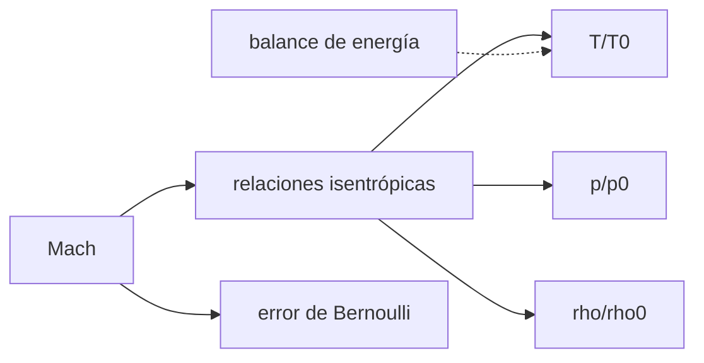

# B79-C05 — Dinámica de fluidos compresibles

<!-- nav:top -->
[🏠 Programa](../../../../README.md) · [📚 Bloque B79](../../../tronco-comun/B79-fluidos-termodinamica-y-aerotermodinamica-de-propulsion.md) · [← Anterior: B79-C04 — Regímenes laminar y turbulento](../B79-C04-regimenes-laminar-y-turbulento/CLASE.md) · [Siguiente: B79-C06 — Flujos supersónicos →](../B79-C06-flujos-supersonicos/CLASE.md)
<!-- /nav -->

## 1. Ubicación, nivel y alcance

Clase 5 del bloque B79. Nivel N3. Cuando el gas va deprisa, su densidad cambia con la presión y la temperatura, y la energía cinética sale de la térmica. Aquí introduces el número de Mach, la velocidad del sonido y las propiedades totales; calculas `T`, `p` y `ρ` de un flujo isentrópico de aire y mides cuándo Bernoulli deja de servir. Usa la continuidad de [C01](../B79-C01-conservacion-de-masa-en-fluidos/CLASE.md) y el flujo ideal de [C02](../B79-C02-ecuaciones-de-euler-para-flujo-no-viscoso/CLASE.md). El aire es un gas ideal ilustrativo.

## 2. Por qué esta clase existe

B77-C03 trata fuerzas aerodinámicas sin flujo compresible; en propulsión la densidad varía mucho y sin este modelo no se pueden calcular toberas ni tomas de aire. La decisión central: **¿a partir de qué Mach no puedo tratar el gas como incompresible, y qué relación uso entonces?**

## 3. Lo que podrás hacer al terminar

1. Calcular la velocidad del sonido y el Mach de un flujo.
2. Aplicar las relaciones isentrópicas `T/T₀`, `p/p₀`, `ρ/ρ₀`.
3. Resolver la temperatura estática con un balance de energía independiente.
4. Cuantificar el error de Bernoulli incompresible en función del Mach.
5. Relacionar `p₀ − p` con la presión dinámica mediante una serie en `M`.
6. Rotular qué es consultado, estándar y ilustrativo.

La evidencia es la **tabla de propiedades estáticas y totales** del ejercicio 12 (sección 20).

## 4. Con qué llegas y cómo comprobarlo

1. ¿Qué es un gas ideal?
2. ¿Qué es la velocidad del sonido?
3. ¿Qué es la energía cinética específica?
4. ¿Qué es un proceso isentrópico?
5. ¿Qué es una serie de potencias?

<details>
<summary>Ver respuestas</summary>

1. un gas que cumple `p = ρ R T`. 2. la velocidad de propagación de perturbaciones pequeñas, `a = √(γ R T)`. 3. `V²/2`, en J/kg. 4. adiabático y reversible, a entropía constante. 5. una suma de términos `M^n` que aproxima una función.
</details>

Con cuatro o cinco aciertos, sigue; si no, repasa los prerrequisitos.

## 5. Un caso de contexto y casos de referencia

Aire con `T₀ = 300 K` y `p₀ = 101325 Pa` a `M = 0,5` tiene `T/T₀ = 0,95238`, `p/p₀ = 0,84302` y `ρ/ρ₀ = 0,88517`: la densidad cae un 11,5 % y Bernoulli incompresible errará un 6,4 %. Es el **ejemplo conductor**. Todo es **ilustrativo**: no describe un motor ni un vehículo.

## 6. Vocabulario

El **número de Mach** `M = V/a`. Las **condiciones totales** o de remanso (`T₀`, `p₀`, `ρ₀`) son las que se alcanzarían al frenar el flujo sin pérdidas. Las **relaciones isentrópicas** son `T₀/T = 1 + (γ−1)M²/2`, `p₀/p = (T₀/T)^(γ/(γ−1))` y `ρ₀/ρ = (T₀/T)^(1/(γ−1))`. La **entalpía total** `c_p T₀ = c_p T + V²/2` se conserva en flujo adiabático estacionario.

## 7. Modelo mental: un resorte de aire que se comprime al frenar



*Descripción textual:* el Mach fija las razones de temperatura, presión y densidad; el balance de energía confirma la temperatura y el Mach mide el error de Bernoulli.

Analogía: el aire frenado se comprime como un resorte; cuanto más rápido, más se comprime. Límite: el modelo es de gas ideal con `γ` constante, sin reacciones químicas.

## 8. La explicación, paso a paso

### 8.1 Propiedades isentrópicas

Con `γ = 1,4`: `T/T₀ = 1/(1 + 0,2 M²)`. A `M = 0,5`, `T/T₀ = 1/1,05 = 0,95238`; `p/p₀ = 0,95238^3,5 = 0,84302`; `ρ/ρ₀ = 0,95238^2,5 = 0,88517`. La velocidad del sonido en `T₀` es `347,22 m/s`.

| `M` | `T/T₀` | `p/p₀` | `ρ/ρ₀` | `V` (m/s) |
|---|---|---|---|---|
| 0,1 | 0,99800 | 0,99303 | 0,99502 | 34,69 |
| 0,3 | 0,98232 | 0,93947 | 0,95638 | 103,24 |
| 0,5 | 0,95238 | 0,84302 | 0,88517 | 169,43 |
| 0,8 | 0,88652 | 0,65602 | 0,73999 | 261,54 |
| 1,0 | 0,83333 | 0,52828 | 0,63394 | 316,97 |
| 2,0 | 0,55556 | 0,12780 | 0,23005 | 517,60 |

### 8.2 Segunda vía: balance de energía

Se parte de `c_p T + V²/2 = c_p T₀` con `V = M √(γ R T)`, se resuelve `T` por punto fijo y se obtiene `p` con la ley isentrópica. La diferencia máxima con las fórmulas cerradas es `1,95 × 10⁻¹⁵`: es la misma ecuación, de modo que comprueba el código y la consistencia de las expresiones.

### 8.3 Cuándo falla Bernoulli

El cociente `(p₀ − p)/(½ ρ V²)` vale 1 en flujo incompresible. Aquí: `1,0025` a `M = 0,1` (0,25 %), `1,0227` a `M = 0,3` (2,27 %), `1,0641` a `0,5`, `1,1704` a `0,8` y `1,2756` a `1,0`. La serie `1 + M²/4 + (2−γ) M⁴/24` da `1,022703` a `M = 0,3`, igual que el cálculo exacto en seis cifras. La densidad cambia un 0,50 % a `M = 0,1` y un 4,36 % a `M = 0,3`.

### 8.4 Qué cambia y qué no

La regla de `M < 0,3` para tratar el flujo como incompresible corresponde a un error de Bernoulli de ~2 % y una variación de densidad de ~4 %; es un criterio práctico, no una frontera. Lo que no cambia es la conservación de la energía total: la temperatura baja al acelerar porque la energía cinética se toma de la térmica.

## 9. Magnitudes, símbolos y unidades

| Símbolo | Qué es | Unidad | Valor / nota |
|---|---|---|---|
| `M` | número de Mach | — | 0,1–2,0 |
| `a` | velocidad del sonido | m/s | 347,22 (en `T₀`) |
| `γ` | razón de calores específicos | — | 1,4 (ilustrativo) |
| `R` | constante del gas (aire) | J/(kg K) | 287,05 |
| `T₀`, `p₀` | condiciones totales | K, Pa | 300; 101325 |
| `c_p` | calor específico a presión constante | J/(kg K) | 1004,675 |

## 10. Convenciones y referencias

Gas ideal, calóricamente perfecto, flujo isentrópico unidimensional. Referencias: condiciones totales dadas. Valores de aire de uso común (no consultados). Python 3.12.

## 11. De dónde sale lo que afirmamos

| ID | Fuente | Localizador | Respalda | Estado |
|---|---|---|---|---|
| S1 | NASA Glenn, «Isentropic Flow Equations» — https://www.grc.nasa.gov/www/k-12/airplane/isentrop.html (consultada 2026-11-10) | página completa | p/pt, T/Tt y ρ/ρt en función del Mach y γ | Consultada |
| — | Relaciones estándar de libro de texto que el laboratorio verifica con una segunda vía | — | las verifica el laboratorio | No consultada en una fuente concreta |

Límites: `γ` y `R` del aire y las condiciones totales son ilustrativos; la serie en `M` y el balance de energía son resultados estándar no consultados.

## 12. Cómo ver las propiedades compresibles

| Magnitud | Valor |
|---|---|
| `ρ/ρ₀` a `M = 0,5` | 0,88517 |
| error de Bernoulli a `M = 0,3` | 2,27 % |
| variación de `ρ` a `M = 0,3` | 4,36 % |
| diferencia entre vías | 1,95 × 10⁻¹⁵ |

Descripción larga: al subir el Mach, la temperatura, la presión y la densidad caen, y el error de Bernoulli crece como `M²/4`.

## 13. Ejemplo trabajado: las propiedades a `M = 0,8`

**Paso 1 · Factor.** `1 + 0,2 × 0,64 = 1,128`.

**Paso 2 · Temperatura.** `T/T₀ = 1/1,128 = 0,88652`.

**Paso 3 · Presión.** `p/p₀ = 0,88652^3,5 = 0,65602`.

## 14. Distintas formas de describir un flujo compresible

**Por Mach:** `M`. **Por razones totales:** `T/T₀`, `p/p₀`, `ρ/ρ₀`. **Por velocidad:** `V = M a`. **Por energía:** `c_p T₀ = c_p T + V²/2`.

## 15. Práctica guiada

**Ejercicio 1 · con los pasos indicados.** Calcula `a` a `T = 300 K` con `γ = 1,4` y `R = 287,05`. *Pasos:* `√(γ R T)`.

<details><summary>Solución comentada</summary>

`√(120561) = 347,22 m/s`.
</details>

**Ejercicio 2 · con una pista.** ¿Cuánto baja `T` a `M = 1`? *Pista:* `T/T₀ = 1/(1+0,2)`.

<details><summary>Solución comentada</summary>

`0,83333`: de 300 a 250 K.
</details>

**Ejercicio 3 · casi autónomo.** Estima el error de Bernoulli a `M = 0,2`. *Casi autónomo:* usa `M²/4`.

<details><summary>Solución comentada</summary>

`≈ 1 %` (`0,04/4`).
</details>

## 16. Práctica autónoma, transferencia e integrador

**Ejercicio 4 · autónomo.** `p/p₀` a `M = 2`.

<details><summary>Solución comentada</summary>

`0,12780`.
</details>

**Ejercicio 5 · autónomo.** `ρ/ρ₀` a `M = 1`.

<details><summary>Solución comentada</summary>

`0,63394`.
</details>

**Ejercicio 6 · autónomo.** Velocidad a `M = 0,8` con `T = 265,96 K`.

<details><summary>Solución comentada</summary>

`0,8 × √(1,4 × 287,05 × 265,96) = 261,5 m/s`.
</details>

**Ejercicio 7 · autónomo.** ¿A qué `M` la densidad cae un 5 %? (aprox.)

<details><summary>Solución comentada</summary>

`≈ 0,32`.
</details>

**Ejercicio 8 · autónomo.** Energía cinética específica a `M = 0,5` (laboratorio).

<details><summary>Solución comentada</summary>

`V²/2 = 169,43²/2 = 14353 J/kg`.
</details>

**Ejercicio 9 · transferencia.** **Transferencia.** Un diseñador usa Bernoulli incompresible en una toma de aire a `M = 0,8`. ¿Qué error comete?

<details><summary>Solución comentada</summary>

Un 17 % en `(p₀ − p)/q`; debe usar las relaciones isentrópicas.
</details>

**Ejercicio 10 · transferencia.** **Transferencia.** ¿Por qué baja la temperatura estática al acelerar un gas?

<details><summary>Solución comentada</summary>

La energía total se conserva y la cinética sale de la térmica.
</details>

**Ejercicio 11 · transferencia.** **Transferencia.** ¿Qué supuesto no vale en un flujo con combustión?

<details><summary>Solución comentada</summary>

`γ` y `R` constantes; C14 los hace depender de la temperatura y la mezcla.
</details>

**Ejercicio 12 · integrador.** **Integrador.** Elabora tu *tabla de propiedades estáticas y totales*: `T/T₀`, `p/p₀`, `ρ/ρ₀`, `V` y error de Bernoulli para seis Mach, la comprobación por balance de energía y la lista de qué es consultado e ilustrativo.

<details><summary>Solución comentada</summary>

Secciones 8.1–8.4 y la salida del laboratorio.
</details>

## 17. Laboratorio: propiedades isentrópicas y error de Bernoulli

El script [compresible.py](compresible.py) calcula `T`, `p`, `ρ` y `V` para seis Mach con las fórmulas cerradas y con un balance de energía, y mide el error de Bernoulli y su serie (**comprueba** diferencia < 1e-10 y serie con 1e-3).

**Datos:** las relaciones isentrópicas se consultaron en NASA Glenn; `γ`, `R`, `T₀` y `p₀` del aire son **ilustrativos**. **Predice antes de ejecutar:** ¿qué `T/T₀` tendrá `M = 1`? (0,83333.) **Ejecución del 2026-11-10:**

```text
Python 3.12.9 (biblioteca estandar)
Aire ILUSTRATIVO: gamma = 1.4, R = 287.05 J/(kg K), T0 = 300.0 K, p0 = 101325 Pa, a0 = 347.22 m/s
   M     T/T0      p/p0      rho/rho0   V [m/s]   (p0-p)/(q)   error Bernoulli [%]
  0.1   0.99800   0.99303   0.99502      34.69    1.00250        0.250
  0.3   0.98232   0.93947   0.95638     103.24    1.02270        2.270
  0.5   0.95238   0.84302   0.88517     169.43    1.06407        6.407
  0.8   0.88652   0.65602   0.73999     261.54    1.17040       17.040
  1.0   0.83333   0.52828   0.63394     316.97    1.27561       27.561
  2.0   0.55556   0.12780   0.23005     517.60    2.43730      143.730
Diferencia maxima entre vias (T y p) = 1.95e-15
A M = 0.3: (p0 - p)/(0.5 gamma p M^2) = 1.022703 ; serie 1 + M^2/4 + (2-gamma) M^4/24 = 1.022703
Variacion de densidad a M = 0.3: 4.36 % ; a M = 0.1: 0.50 %
Pruebas superadas.
```

```bash
python programa/clases/B79/B79-C05-dinamica-de-fluidos-compresibles/compresible.py
```

**Límites:** gas ideal con `γ` constante, flujo isentrópico unidimensional; la segunda vía reescribe la misma física y valida el código, no el modelo del gas.

## 18. Errores frecuentes y cómo corregirlos

**Usar Bernoulli incompresible a `M > 0,3` sin comentar el error.** Se corrige con 8.3.

**Confundir condiciones totales y estáticas.** Se corrige con el vocabulario.

**Pensar que la temperatura no cambia al acelerar.** Se corrige con 8.4.

**Presentar el aire ilustrativo como atmósfera real.** Se corrige con la sección 10.

## 19. Cómo sabrás que vas bien

Tras la sección 8: ¿qué `ρ/ρ₀` esperabas a `M = 0,5` y cuál obtuviste? Si dudas, repasa el ejemplo 13. Tras el laboratorio: ¿qué comprueba? (ver la sección 17).

## 20. Qué entregas y cómo se evalúa

El producto es tu **tabla de propiedades estáticas y totales** (ejercicio 12).

| Criterio | Inicial | En desarrollo | Logrado | Destacado |
|---|---|---|---|---|
| Conceptos | Los confunde | Parciales | Calcula razones isentrópicas y el error de Bernoulli | Explica los límites |
| Cálculo | Sin unidades | Con errores | Tablas completas con unidades | Calcula casos nuevos |
| Numérico | Sin comprobar | Un caso | Contraste con una segunda vía | Interpreta las diferencias |
| Fuentes | Sin fuente | Sin fecha | Fuentes con fecha y estado | Declara lo ilustrativo y lo no consultado |
| Límites | No los nombra | Uno | Tres | Discute qué falta del modelo |

**Condiciones críticas (no se compensan con promedio):** rotular el aire y las condiciones como ilustrativos; no usar Bernoulli incompresible sin declarar el error; no presentar un cálculo como medición de un motor real; citar solo lo consultado.

## 21. Ética, seguridad y límites

Clase educativa: los modelos son simplificados y sus datos son sintéticos, ilustrativos o coeficientes publicados con fuente; ningún resultado describe un motor o un vehículo reales ni sustituye al análisis de ingeniería, a las normas o a los datos de fabricante.  Accesibilidad: tablas equivalentes a las gráficas, fórmulas en texto, ejercicios sin conexión.

## 22. Para cerrar y seguir

A `M = 0,5` la densidad cae un 11,5 % y Bernoulli falla un 6,4 %. Queda una pregunta: ¿qué ocurre más allá de `M = 1`? Lo ve C06.

**Glosario español–inglés.** número de Mach · *Mach number*; condiciones totales · *stagnation conditions*; velocidad del sonido · *speed of sound*; isentrópico · *isentropic*; gas ideal · *ideal gas*.

**Continuidad.** [B79-C06](../B79-C06-flujos-supersonicos/CLASE.md) estudia los flujos supersónicos.

**Referencias:** ver sección 11.

<!-- nav:bottom -->
---

[← Anterior: B79-C04 — Regímenes laminar y turbulento](../B79-C04-regimenes-laminar-y-turbulento/CLASE.md) · [📚 Bloque B79](../../../tronco-comun/B79-fluidos-termodinamica-y-aerotermodinamica-de-propulsion.md) · [Siguiente: B79-C06 — Flujos supersónicos →](../B79-C06-flujos-supersonicos/CLASE.md)
<!-- /nav -->
