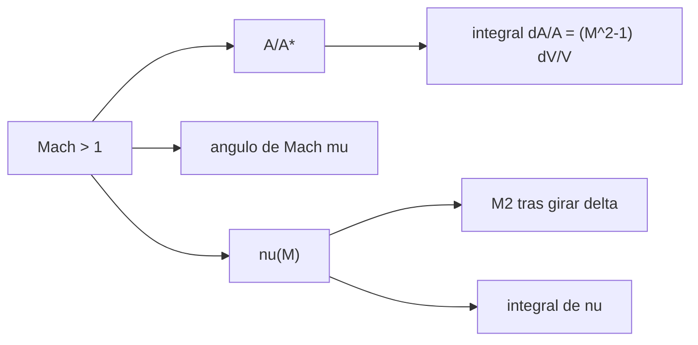

# B79-C06 — Flujos supersónicos

<!-- nav:top -->
[🏠 Programa](../../../../README.md) · [📚 Bloque B79](../../../tronco-comun/B79-fluidos-termodinamica-y-aerotermodinamica-de-propulsion.md) · [← Anterior: B79-C05 — Dinámica de fluidos compresibles](../B79-C05-dinamica-de-fluidos-compresibles/CLASE.md) · [Siguiente: B79-C07 — Ondas de choque normales y oblicuas →](../B79-C07-ondas-de-choque-normales-y-oblicuas/CLASE.md)
<!-- /nav -->

## 1. Ubicación, nivel y alcance

Clase 6 del bloque B79. Nivel N3. Por encima de `M = 1` el gas se comporta al revés que en régimen subsónico: al ensancharse el conducto se acelera, y las perturbaciones solo viajan dentro de un cono. Esta clase presenta la relación área–Mach, el ángulo de Mach y la expansión de Prandtl–Meyer, y las comprueba integrando sus ecuaciones diferenciales. Usa las relaciones isentrópicas de [C05](../B79-C05-dinamica-de-fluidos-compresibles/CLASE.md). Los números son para aire ideal ilustrativo.

## 2. Por qué esta clase existe

El comportamiento de un flujo a `M > 1` en toberas y vehículos no lo trata ninguna clase del tronco. Sin él no se entiende por qué una tobera necesita una parte divergente. La decisión central: **¿qué relación de áreas necesito para un Mach supersónico dado y cómo se expande el flujo al girar alrededor de una esquina?**

## 3. Lo que podrás hacer al terminar

1. Calcular `A/A*` para un Mach dado y el Mach supersónico para un `A/A*` dado.
2. Calcular el ángulo de Mach.
3. Calcular la función de Prandtl–Meyer y el Mach tras una expansión.
4. Verificar la relación área–Mach integrando su ecuación diferencial.
5. Calcular las razones de presión y temperatura de una expansión.
6. Explicar la velocidad límite de un gas expandiéndose al vacío.

La evidencia es la **ficha de un flujo supersónico** del ejercicio 12 (sección 20).

## 4. Con qué llegas y cómo comprobarlo

1. ¿Qué es el número de Mach?
2. ¿Qué es un ángulo en radianes?
3. ¿Qué son las relaciones isentrópicas?
4. ¿Qué es una integral numérica?
5. ¿Qué es una bisección?

<details>
<summary>Ver respuestas</summary>

1. `V/a`, adimensional. 2. la longitud de arco sobre el radio; `π` rad = 180°. 3. `T/T₀`, `p/p₀` y `ρ/ρ₀` en función del Mach. 4. la suma de áreas de pequeños tramos. 5. un método que reduce a la mitad un intervalo que contiene la raíz.
</details>

Con cuatro o cinco aciertos, sigue; si no, repasa los prerrequisitos.

## 5. Un caso de contexto y casos de referencia

Una tobera con `A/A* = 5` produce `M = 3,17478` con ángulo de Mach `18,36°`. Una expansión de `10°` desde `M₁ = 2` da `M₂ = 2,3849` y reduce la presión a `0,5480` de la inicial. Es el **ejemplo conductor**. Todo es **ilustrativo**: no describe una tobera concreta.

## 6. Vocabulario

La **relación área–Mach** es `A/A* = (1/M)[(2/(γ+1))(1 + (γ−1)M²/2)]^((γ+1)/(2(γ−1)))`, donde `A*` es el área donde `M = 1`. El **ángulo de Mach** es `μ = arcsin(1/M)`. La **función de Prandtl–Meyer** `ν(M)` mide el giro total desde `M = 1`. Una **expansión de Prandtl–Meyer** es el giro continuo de un flujo supersónico alrededor de una esquina convexa.

## 7. Modelo mental: un cono de ondas sonoras



*Descripción textual:* el Mach supersónico determina la relación de áreas, el ángulo de Mach y la función de Prandtl–Meyer; las dos relaciones se verifican con integrales numéricas.

Analogía: una lancha más rápida que las olas deja una estela en cuña, y nada adelante se entera. Límite: el modelo es de gas ideal, 1D (área–Mach) y 2D plano (Prandtl–Meyer), sin capa límite.

## 8. La explicación, paso a paso

### 8.1 Área–Mach

`dA/A = (M²−1) dV/V`: para `M > 1`, ensanchar acelera. Resolviendo por bisección la relación cerrada:

| `A/A*` | `M` supersónico | `μ` (°) | `A/A*` por integral | diferencia |
|---|---|---|---|---|
| 2,0 | 2,19720 | 27,073 | 2,000000 | 2,2 × 10⁻¹² |
| 5,0 | 3,17478 | 18,360 | 5,000000 | 8,4 × 10⁻¹² |
| 10,0 | 3,92255 | 14,770 | 10,000000 | 1,6 × 10⁻¹¹ |

Para cada `A/A*` hay una solución subsónica y una supersónica; aquí se toma la segunda.

### 8.2 Prandtl–Meyer

`ν(2) = 26,3798°` y, por integración numérica de `dν = √(M²−1) dV/V`, `26,3798°` (diferencia `9,7 × 10⁻¹³`). El límite para `M → ∞` es `ν_max = 130,454°` con `γ = 1,4`. Una expansión de `10°` desde `M₁ = 2` exige `ν₂ = 36,3798°` y da `M₂ = 2,3849`, `T₂/T₁ = 0,8421` y `p₂/p₁ = 0,5480`.

### 8.3 Velocidad límite

Con energía total fija, el gas expandido al vacío alcanza `V_max = a₀ √(2/(γ−1)) = 2,2361 a₀`, donde `a₀` es la velocidad del sonido en condiciones totales; ese Mach infinito es el límite del modelo, no un valor alcanzable.

### 8.4 Qué cambia y qué no

Al pasar de subsónico a supersónico se invierte el signo de la relación entre área y velocidad. La expansión de Prandtl–Meyer es isentrópica: no hay pérdida de presión total, a diferencia del choque (C07). La integración numérica valida el código de las fórmulas, no el modelo ideal del gas.

## 9. Magnitudes, símbolos y unidades

| Símbolo | Qué es | Unidad | Valor / nota |
|---|---|---|---|
| `A/A*` | relación de áreas | — | 2–10 |
| `M` | número de Mach | — | 2,0–3,92 |
| `μ` | ángulo de Mach | grados | 14,77–27,07 |
| `ν` | función de Prandtl–Meyer | grados | 26,3798 a `M = 2` |
| `δ` | ángulo de giro | grados | 10 |
| `γ` | razón de calores específicos | — | 1,4 (ilustrativo) |

## 10. Convenciones y referencias

Gas ideal con `γ` constante, flujo isentrópico, 1D para área–Mach y 2D plano para Prandtl–Meyer. Ángulos en grados en las tablas y en radianes en el código. Datos ilustrativos. Python 3.12.

## 11. De dónde sale lo que afirmamos

| ID | Fuente | Localizador | Respalda | Estado |
|---|---|---|---|---|
| S1 | NASA Glenn, «Isentropic Flow Equations» — https://www.grc.nasa.gov/www/k-12/airplane/isentrop.html (consultada 2026-11-10) | página completa | p/pt, T/Tt y ρ/ρt en función del Mach y γ | Consultada |
| S2 | NASA Glenn, «Nozzles» — https://www.grc.nasa.gov/www/k-12/airplane/nozzle.html (consultada 2026-11-10) | página completa | tobera convergente-divergente: subsónico antes de la garganta, supersónico después; cohetes con toberas fijas | Consultada |
| — | Relaciones estándar de libro de texto que el laboratorio verifica con una segunda vía | — | las verifica el laboratorio | No consultada en una fuente concreta |

Límites: las relaciones área–Mach, ángulo de Mach y Prandtl–Meyer son resultados estándar no consultados en una fuente concreta; las razones de áreas y la deflexión son ilustrativas.

## 12. Cómo ver un flujo supersónico

| Magnitud | Valor |
|---|---|
| `M` para `A/A* = 5` | 3,17478 |
| `μ` | 18,360° |
| `M₂` tras 10° | 2,3849 |
| `p₂/p₁` | 0,5480 |

Descripción larga: más área da más Mach, el cono de Mach se estrecha y el giro convexo baja la presión.

## 13. Ejemplo trabajado: el ángulo de Mach para `M = 2`

**Paso 1 · Fórmula.** `μ = arcsin(1/M)`.

**Paso 2 · Cálculo.** `arcsin(0,5) = 30°`.

**Paso 3 · Comparación.** A `M = 3,17478` el ángulo baja a `18,36°`.

## 14. Distintas formas de describir un flujo supersónico

**Por área:** `A/A*`. **Por ángulo:** `μ`. **Por giro:** `ν(M)`. **Por razones:** `p₂/p₁` y `T₂/T₁`.

## 15. Práctica guiada

**Ejercicio 1 · con los pasos indicados.** Calcula `A/A*` para `M = 2`, `γ = 1,4`. *Pasos:* evalúa `(1/2)[(2/2,4)(1,8)]^3`.

<details><summary>Solución comentada</summary>

`(1/2)(1,5)^3 = 1,6875`.
</details>

**Ejercicio 2 · con una pista.** ¿Qué `μ` corresponde a `M = 3,17478`? *Pista:* `arcsin(1/M)`.

<details><summary>Solución comentada</summary>

`18,36°`.
</details>

**Ejercicio 3 · casi autónomo.** ¿Qué giro total tiene `M = 2`? *Casi autónomo:* mira `ν(2)`.

<details><summary>Solución comentada</summary>

`26,3798°`.
</details>

## 16. Práctica autónoma, transferencia e integrador

**Ejercicio 4 · autónomo.** `M` supersónico para `A/A* = 10`.

<details><summary>Solución comentada</summary>

`3,92255`.
</details>

**Ejercicio 5 · autónomo.** `ν` necesario para pasar de `M = 2` a `M₂` con 10°.

<details><summary>Solución comentada</summary>

`36,3798°`.
</details>

**Ejercicio 6 · autónomo.** `p₂/p₁` de la expansión, a partir de `T₂/T₁ = 0,8421`.

<details><summary>Solución comentada</summary>

`0,8421^3,5 = 0,5480`.
</details>

**Ejercicio 7 · autónomo.** ¿Qué pasa con `μ` si `M` se duplica de 2 a 4?

<details><summary>Solución comentada</summary>

Baja de `30°` a `14,48°`.
</details>

**Ejercicio 8 · autónomo.** `V_max/a₀` para `γ = 1,4`.

<details><summary>Solución comentada</summary>

`√5 = 2,2361`.
</details>

**Ejercicio 9 · transferencia.** **Transferencia.** Un colega propone ensanchar una tobera subsónica para acelerarla. ¿Es correcto?

<details><summary>Solución comentada</summary>

No: a `M < 1` ensanchar frena; hace falta estrechar hasta la garganta (C08).
</details>

**Ejercicio 10 · transferencia.** **Transferencia.** ¿La expansión de Prandtl–Meyer pierde presión total?

<details><summary>Solución comentada</summary>

No, es isentrópica; la presión estática baja pero `p₀` se conserva.
</details>

**Ejercicio 11 · transferencia.** **Transferencia.** ¿Qué falta para aplicar esto a una tobera de cohete real?

<details><summary>Solución comentada</summary>

Gases calientes con `γ` variable (C14), capa límite y flujo bidimensional, que quedan fuera de la clase.
</details>

**Ejercicio 12 · integrador.** **Integrador.** Elabora tu *ficha de un flujo supersónico*: tabla de `A/A*`, `M`, `μ` para tres áreas, `ν(2)`, expansión de 10° con `M₂` y razones, y lista de qué es consultado e ilustrativo.

<details><summary>Solución comentada</summary>

Secciones 8.1–8.4 y la salida del laboratorio.
</details>

## 17. Laboratorio: área–Mach y Prandtl–Meyer con integrales

El script [supersonico.py](supersonico.py) resuelve el Mach supersónico de tres relaciones de área, calcula `ν(M)` y una expansión de 10°, y verifica las fórmulas con integrales numéricas (**comprueba** diferencia < 1e-7).

**Datos:** solo las relaciones isentrópicas y la descripción de la tobera se consultaron (NASA Glenn); `γ`, áreas y deflexión son **ilustrativos**. **Predice antes de ejecutar:** ¿cuánto vale `μ` para `M = 3,17478`? (18,36°.) **Ejecución del 2026-11-10:**

```text
Python 3.12.9 (biblioteca estandar)
Aire ILUSTRATIVO: gamma = 1.4
 A/A*     M (supersonico)   mu [grados]   A/A* por integral   diferencia
   2.0      2.19720          27.073        2.000000          2.2e-12
   5.0      3.17478          18.360        5.000000          8.4e-12
  10.0      3.92255          14.770        10.000000          1.6e-11
Prandtl-Meyer: nu(2) = 26.3798 grados ; nu(inf) = 130.454 grados
 nu(2) por integral = 26.3798 grados ; diferencia relativa = 9.7e-13
Expansion de 10 grados desde M1 = 2: M2 = 2.3849 ; p2/p1 = 0.5480 ; T2/T1 = 0.8421
Velocidad limite (vacio) V_max / a_0 = 2.2361
Pruebas superadas.
```

```bash
python programa/clases/B79/B79-C06-flujos-supersonicos/supersonico.py
```

**Límites:** gas ideal, `γ` constante, isentrópico, sin capa límite; las integrales validan el código, no la física del gas real.

## 18. Errores frecuentes y cómo corregirlos

**Tomar la solución subsónica de `A/A*`.** Se corrige con 8.1.

**Pensar que una expansión pierde presión total.** Se corrige con 8.4.

**Mezclar grados y radianes.** Se corrige con la sección 10.

**Presentar la tobera sintética como diseño.** Se corrige con la sección 10.

## 19. Cómo sabrás que vas bien

Tras la sección 8: ¿qué `M` esperabas para `A/A* = 5` y cuál obtuviste? Si dudas, repasa el ejemplo 13. Tras el laboratorio: ¿qué comprueba? (ver la sección 17).

## 20. Qué entregas y cómo se evalúa

El producto es tu **ficha de un flujo supersónico** (ejercicio 12).

| Criterio | Inicial | En desarrollo | Logrado | Destacado |
|---|---|---|---|---|
| Conceptos | Los confunde | Parciales | Resuelve área–Mach y Prandtl–Meyer | Explica los límites |
| Cálculo | Sin unidades | Con errores | Tablas completas con unidades | Calcula casos nuevos |
| Numérico | Sin comprobar | Un caso | Contraste con una segunda vía | Interpreta las diferencias |
| Fuentes | Sin fuente | Sin fecha | Fuentes con fecha y estado | Declara lo ilustrativo y lo no consultado |
| Límites | No los nombra | Uno | Tres | Discute qué falta del modelo |

**Condiciones críticas (no se compensan con promedio):** rotular las áreas y el aire como ilustrativos; elegir bien la rama supersónica; no presentar un cálculo como medición de un motor real; citar solo lo consultado.

## 21. Ética, seguridad y límites

Clase educativa: los modelos son simplificados y sus datos son sintéticos, ilustrativos o coeficientes publicados con fuente; ningún resultado describe un motor o un vehículo reales ni sustituye al análisis de ingeniería, a las normas o a los datos de fabricante.  Accesibilidad: tablas equivalentes a las gráficas, fórmulas en texto, ejercicios sin conexión.

## 22. Para cerrar y seguir

`A/A* = 5` da `M = 3,17` y una expansión de 10° baja la presión a `0,548` de la inicial. Queda una pregunta: ¿qué pasa cuando el flujo supersónico se comprime de golpe? Lo ve C07.

**Glosario español–inglés.** ángulo de Mach · *Mach angle*; función de Prandtl–Meyer · *Prandtl–Meyer function*; garganta · *throat*; expansión · *expansion fan*; supersónico · *supersonic*.

**Continuidad.** [B79-C07](../B79-C07-ondas-de-choque-normales-y-oblicuas/CLASE.md) estudia las ondas de choque.

**Referencias:** ver sección 11.

<!-- nav:bottom -->
---

[← Anterior: B79-C05 — Dinámica de fluidos compresibles](../B79-C05-dinamica-de-fluidos-compresibles/CLASE.md) · [📚 Bloque B79](../../../tronco-comun/B79-fluidos-termodinamica-y-aerotermodinamica-de-propulsion.md) · [Siguiente: B79-C07 — Ondas de choque normales y oblicuas →](../B79-C07-ondas-de-choque-normales-y-oblicuas/CLASE.md)
<!-- /nav -->
