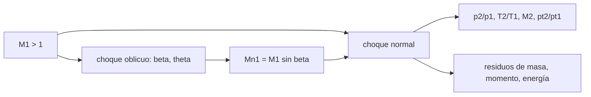

# B79-C07 — Ondas de choque normales y oblicuas

<!-- nav:top -->
[🏠 Programa](../../../../README.md) · [📚 Bloque B79](../../../tronco-comun/B79-fluidos-termodinamica-y-aerotermodinamica-de-propulsion.md) · [← Anterior: B79-C06 — Flujos supersónicos](../B79-C06-flujos-supersonicos/CLASE.md) · [Siguiente: B79-C08 — Flujo en toberas convergente-divergentes →](../B79-C08-flujo-en-toberas-convergente-divergentes/CLASE.md)
<!-- /nav -->

## 1. Ubicación, nivel y alcance

Clase 7 del bloque B79. Nivel N3. Un flujo supersónico no puede frenarse suavemente: lo hace de golpe, en una onda de choque donde presión, densidad y temperatura saltan y la presión total se pierde. Esta clase resuelve el choque normal con las relaciones de Rankine–Hugoniot, el choque oblicuo con la relación θ–β–M y mide cuánta presión total se pierde. Usa [C05](../B79-C05-dinamica-de-fluidos-compresibles/CLASE.md) y [C06](../B79-C06-flujos-supersonicos/CLASE.md). Los valores son para aire ideal ilustrativo.

## 2. Por qué esta clase existe

B30-C14 trata choques astrofísicos, no gasdinámicos. Para tomas de aire, toberas y reentrada hace falta saber cuánto sube la presión y cuánta energía útil se pierde. La decisión central: **¿cuánto sube la presión estática y cuánto baja la presión total en un choque, y cuándo conviene un choque oblicuo en lugar de uno normal?**

## 3. Lo que podrás hacer al terminar

1. Calcular las razones de un choque normal.
2. Comprobar la conservación de masa, momento y energía con las propiedades de ambos lados.
3. Calcular la entropía generada y la pérdida de presión total.
4. Resolver el ángulo del choque oblicuo débil para una deflexión dada.
5. Reconstruir el giro del flujo conservando la componente tangencial.
6. Reconocer cuándo no existe solución oblicua adjunta.

La evidencia es la **ficha de choque con pérdidas** del ejercicio 12 (sección 20).

## 4. Con qué llegas y cómo comprobarlo

1. ¿Qué es la presión total?
2. ¿Qué es la entropía?
3. ¿Qué es un flujo supersónico?
4. ¿Qué es una componente tangencial?
5. ¿Qué es un residuo?

<details>
<summary>Ver respuestas</summary>

1. la presión tras frenar el flujo sin pérdidas, `p₀`. 2. una medida de la irreversibilidad; sube en procesos irreversibles. 3. uno con `M > 1`. 4. la parte de la velocidad paralela a una superficie. 5. la diferencia entre ambos lados de una ecuación que debería cumplirse.
</details>

Con cuatro o cinco aciertos, sigue; si no, repasa los prerrequisitos.

## 5. Un caso de contexto y casos de referencia

Un choque normal a `M₁ = 2` en aire a `250 K` y `50000 Pa` da `p₂/p₁ = 4,5`, `T₂/T₁ = 1,6875`, `M₂ = 0,5774` y conserva el `72,09 %` de la presión total. Un choque oblicuo que desvía el flujo `10°` conserva el `98,46 %`. Es el **ejemplo conductor**. Todo es **ilustrativo**: no describe una toma de aire concreta.

## 6. Vocabulario

Un **choque normal** es perpendicular al flujo; uno **oblicuo** está inclinado un ángulo `β` y desvía el flujo un ángulo `θ`. Las **relaciones de Rankine–Hugoniot** unen los estados a ambos lados por conservación de masa, momento y energía. La solución **débil** del choque oblicuo tiene `M₂ > 1` (casi siempre); la **fuerte**, `M₂ < 1`. El **choque desprendido** aparece cuando `θ` supera el máximo.

## 7. Modelo mental: un tope en una autopista



*Descripción textual:* el choque oblicuo se reduce a un choque normal con la componente normal del Mach; las propiedades se verifican con los balances de conservación.

Analogía: coches frenando de golpe ante un tope; detrás se amontonan (suben densidad y presión). Límite: el modelo es de gas ideal y no incluye disociación ni capa límite.

## 8. La explicación, paso a paso

### 8.1 Choque normal

Con `γ = 1,4`: `p₂/p₁ = (2γM² − (γ−1))/(γ+1)`, `ρ₂/ρ₁ = (γ+1)M²/((γ−1)M² + 2)`, `T₂/T₁ = (p₂/p₁)/(ρ₂/ρ₁)` y `M₂ = √(((γ−1)M² + 2)/(2γM² − (γ−1)))`.

| `M₁` | `p₂/p₁` | `ρ₂/ρ₁` | `T₂/T₁` | `M₂` | `p_t2/p_t1` | `Δs` (J/(kg K)) |
|---|---|---|---|---|---|---|
| 1,5 | 2,4583 | 1,8621 | 1,3202 | 0,7011 | 0,9298 | 20,897 |
| 2,0 | 4,5000 | 2,6667 | 1,6875 | 0,5774 | 0,7209 | 93,949 |
| 3,0 | 10,3333 | 3,8571 | 2,6790 | 0,4752 | 0,3283 | 319,686 |

### 8.2 Segunda vía: conservación

El laboratorio calcula velocidades y densidades en ambos lados y evalúa los balances de masa, momento y energía total: el residuo máximo es `2,57 × 10⁻¹⁶`. Esto comprueba que las relaciones y el código son consistentes con la física que las genera. La pérdida de presión total equivale a `Δs = −R ln(p_t2/p_t1)`; a `M₁ = 2`, `93,949 J/(kg K)`.

### 8.3 Choque oblicuo

El choque oblicuo se reduce a uno normal con `M_n1 = M₁ sin β`; la componente tangencial se conserva. Para `θ = 10°`:

| `M₁` | `β` débil (°) | `M_n1` | `M₂` | `p₂/p₁` | `p_t2/p_t1` | `θ_máx` (°) |
|---|---|---|---|---|---|---|
| 2,0 | 39,3139 | 1,2671 | 1,6405 | 1,7066 | 0,9846 | 22,974 |
| 3,0 | 27,3827 | 1,3798 | 2,5050 | 2,0545 | 0,9631 | 34,073 |

Reconstruir el giro con la componente tangencial conservada devuelve `10,000000°` (error `5,3 × 10⁻¹⁵°`). A `M₁ = 2` una deflexión de `30°` supera `θ_máx` y no tiene solución adjunta (choque desprendido).

### 8.4 Qué cambia y qué no

La energía total (y la temperatura total) se conserva; la presión total no. Comprimir con varios choques oblicuos débiles pierde mucha menos presión total que con uno normal fuerte, razón por la que las tomas supersónicas los usan. Las ecuaciones del oblicuo no se leyeron en la fuente de NASA (solo su descripción): se aplican las estándar y se verifican con el balance tangencial.

## 9. Magnitudes, símbolos y unidades

| Símbolo | Qué es | Unidad | Valor / nota |
|---|---|---|---|
| `M₁` | Mach aguas arriba | — | 1,5–3,0 |
| `p₂/p₁` | razón de presiones estáticas | — | 2,46–10,33 |
| `p_t2/p_t1` | razón de presiones totales | — | 0,3283–0,9846 |
| `β` | ángulo del choque | grados | 27,38–39,31 |
| `θ` | deflexión | grados | 10 |
| `Δs` | entropía generada | J/(kg K) | 20,9–319,7 |

## 10. Convenciones y referencias

Gas ideal con `γ = 1,4` y `R = 287,05 J/(kg K)`; `T₁ = 250 K` y `p₁ = 50000 Pa` ilustrativos. Flujo plano, estacionario, sin viscosidad ni disociación. Ángulos en grados en las tablas. Python 3.12.

## 11. De dónde sale lo que afirmamos

| ID | Fuente | Localizador | Respalda | Estado |
|---|---|---|---|---|
| S1 | NASA Glenn, «Normal Shock Wave Equations» — https://www.grc.nasa.gov/www/k-12/airplane/normal.html (consultada 2026-11-10) | página completa | p2/p1, ρ2/ρ1, T2/T1 y M2 de un choque normal | Consultada |
| S2 | NASA Glenn, «Oblique Shock Waves» — https://www.grc.nasa.gov/www/k-12/airplane/oblique.html (consultada 2026-11-10) | página completa | descripción cualitativa del choque oblicuo (solución débil y fuerte, Tt constante, pt cae); las ecuaciones atribuidas a NACA Report 1135 no se leyeron | Consultada |
| — | Relaciones estándar de libro de texto que el laboratorio verifica con una segunda vía | — | las verifica el laboratorio | No consultada en una fuente concreta |

Límites: la relación θ–β–M y la entropía generada son resultados estándar no consultados; la página de NASA sobre choques oblicuos se leyó en su descripción y no en sus ecuaciones; los datos de aire son ilustrativos.

## 12. Cómo ver las pérdidas de un choque

| Magnitud | Valor |
|---|---|
| `p₂/p₁` a `M₁ = 2` | 4,5000 |
| `p_t2/p_t1` normal | 0,7209 |
| `p_t2/p_t1` oblicuo 10° | 0,9846 |
| residuo máximo | 2,57 × 10⁻¹⁶ |

Descripción larga: la presión estática salta en los dos casos; la presión total cae mucho más en el choque normal.

## 13. Ejemplo trabajado: el choque normal a `M₁ = 2`

**Paso 1 · Presión.** `(2 × 1,4 × 4 − 0,4)/2,4 = 10,8/2,4 = 4,5`.

**Paso 2 · Densidad.** `2,4 × 4/(0,4 × 4 + 2) = 9,6/3,6 = 2,6667`.

**Paso 3 · Temperatura.** `4,5/2,6667 = 1,6875`.

**Paso 4 · Mach aguas abajo.** `√(3,6/10,8) = 0,5774`.

## 14. Distintas formas de describir un choque

**Por razones:** `p₂/p₁`, `ρ₂/ρ₁`, `T₂/T₁`. **Por Mach:** `M₂`. **Por pérdida:** `p_t2/p_t1` o `Δs`. **Por geometría:** `β` y `θ`.

## 15. Práctica guiada

**Ejercicio 1 · con los pasos indicados.** Calcula `p₂/p₁` a `M₁ = 1,5`. *Pasos:* `(2γM² − (γ−1))/(γ+1)`.

<details><summary>Solución comentada</summary>

`(6,3 − 0,4)/2,4 = 2,4583`.
</details>

**Ejercicio 2 · con una pista.** ¿Qué `ρ₂/ρ₁` da `M₁ = 3`? *Pista:* `2,4 × 9/(0,4 × 9 + 2)`.

<details><summary>Solución comentada</summary>

`21,6/5,6 = 3,8571`.
</details>

**Ejercicio 3 · casi autónomo.** ¿Por qué `T_t` no cambia en el choque? *Casi autónomo:* mira el balance de energía.

<details><summary>Solución comentada</summary>

La energía total se conserva y, con `c_p` constante, `T_t` también.
</details>

## 16. Práctica autónoma, transferencia e integrador

**Ejercicio 4 · autónomo.** `M₂` a `M₁ = 3`.

<details><summary>Solución comentada</summary>

`0,4752`.
</details>

**Ejercicio 5 · autónomo.** Entropía generada si `p_t2/p_t1 = 0,3283`.

<details><summary>Solución comentada</summary>

`−R ln 0,3283 = 319,7 J/(kg K)`.
</details>

**Ejercicio 6 · autónomo.** Si `M₁ = 1`, ¿qué valen las razones?

<details><summary>Solución comentada</summary>

Todas son 1: el choque se vuelve onda de Mach, sin pérdida.
</details>

**Ejercicio 7 · autónomo.** `M_n1` para `β = 39,3139°` y `M₁ = 2`.

<details><summary>Solución comentada</summary>

`2 sin 39,3139° = 1,2671`.
</details>

**Ejercicio 8 · autónomo.** Cociente de pérdidas de `p_t` entre el normal a `M = 2` y el oblicuo de 10°.

<details><summary>Solución comentada</summary>

`(1−0,7209)/(1−0,9846) ≈ 18`.
</details>

**Ejercicio 9 · transferencia.** **Transferencia.** Un diseñador de toma supersónica compara un choque normal con dos oblicuos débiles. ¿Cuál conserva más presión total?

<details><summary>Solución comentada</summary>

Los oblicuos, porque el Mach normal es menor en cada choque.
</details>

**Ejercicio 10 · transferencia.** **Transferencia.** ¿Qué le pasa al choque oblicuo si la rampa supera `θ_máx`?

<details><summary>Solución comentada</summary>

Se desprende un choque curvo frente al cuerpo y la solución adjunta deja de existir.
</details>

**Ejercicio 11 · transferencia.** **Transferencia.** ¿Qué efecto real falta en estos números a `M = 5` o más?

<details><summary>Solución comentada</summary>

Disociación y variación de `γ` con la temperatura (C14); están fuera de esta clase.
</details>

**Ejercicio 12 · integrador.** **Integrador.** Elabora tu *ficha de choque con pérdidas*: tabla de tres choques normales, dos oblicuos de 10°, residuos de conservación, `Δs` y lista de qué es consultado e ilustrativo.

<details><summary>Solución comentada</summary>

Secciones 8.1–8.4 y la salida del laboratorio.
</details>

## 17. Laboratorio: choques normales y oblicuos con balances

El script [choques.py](choques.py) calcula tres choques normales, verifica la conservación de masa, momento y energía, resuelve el choque oblicuo débil de 10° y reconstruye el giro con la componente tangencial (**comprueba** residuo < 1e-12 y error de giro < 1e-9°).

**Datos:** las relaciones del choque normal y la descripción del oblicuo se consultaron (NASA Glenn); `γ`, `R`, `T₁`, `p₁` y los Mach son **ilustrativos**. **Predice antes de ejecutar:** ¿qué `p_t2/p_t1` tendrá `M₁ = 2`? (0,7209.) **Ejecución del 2026-11-10:**

```text
Python 3.12.9 (biblioteca estandar)
Aire ILUSTRATIVO: gamma = 1.4, T1 = 250.0 K, p1 = 50000 Pa
Choque normal
  M1    p2/p1   rho2/rho1   T2/T1     M2     pt2/pt1    ds [J/(kg K)]  residuo
  1.5   2.4583    1.8621     1.3202  0.7011   0.9298       20.897      1.7e-16
  2.0   4.5000    2.6667     1.6875  0.5774   0.7209       93.949      2.6e-16
  3.0   10.3333    3.8571     2.6790  0.4752   0.3283      319.686      1.7e-16
Residuo maximo de masa, momento y energia = 2.57e-16
Choque oblicuo, deflexion theta = 10 grados
  M1   beta debil [gr]  Mn1     M2      p2/p1    pt2/pt1   theta reconstruido [gr]  theta_max [gr]
  2.0     39.3139    1.2671  1.6405  1.7066   0.9846       10.000000           22.974
  3.0     27.3827    1.3798  2.5050  2.0545   0.9631       10.000000           34.073
Error maximo del giro reconstruido = 5.33e-15 grados
Deflexion de 30 grados a M1 = 2: sin solucion oblicua adjunta (choque desprendido)
Pruebas superadas.
```

```bash
python programa/clases/B79/B79-C07-ondas-de-choque-normales-y-oblicuas/choques.py
```

**Límites:** gas ideal, `γ` constante, 2D plano, sin viscosidad; el residuo valida la consistencia interna, no el modelo a altas temperaturas.

## 18. Errores frecuentes y cómo corregirlos

**Olvidar que `p_t` cae en un choque.** Se corrige con 8.2.

**Usar el `M₁` y no el `M_n1` en el oblicuo.** Se corrige con 8.3.

**Aplicar el resultado a `M` muy alto con `γ` constante.** Se corrige con la pregunta 3 de transferencia.

**Presentar el aire ilustrativo como atmósfera real.** Se corrige con la sección 10.

## 19. Cómo sabrás que vas bien

Tras la sección 8: ¿qué `M₂` esperabas a `M₁ = 2` y cuál obtuviste? Si dudas, repasa el ejemplo 13. Tras el laboratorio: ¿qué comprueba? (ver la sección 17).

## 20. Qué entregas y cómo se evalúa

El producto es tu **ficha de choque con pérdidas** (ejercicio 12).

| Criterio | Inicial | En desarrollo | Logrado | Destacado |
|---|---|---|---|---|
| Conceptos | Los confunde | Parciales | Resuelve choques y calcula sus pérdidas | Explica los límites |
| Cálculo | Sin unidades | Con errores | Tablas completas con unidades | Calcula casos nuevos |
| Numérico | Sin comprobar | Un caso | Contraste con una segunda vía | Interpreta las diferencias |
| Fuentes | Sin fuente | Sin fecha | Fuentes con fecha y estado | Declara lo ilustrativo y lo no consultado |
| Límites | No los nombra | Uno | Tres | Discute qué falta del modelo |

**Condiciones críticas (no se compensan con promedio):** rotular el aire y las condiciones como ilustrativos; no confundir la verificación por balance con validación experimental; no presentar un cálculo como medición de un motor real; citar solo lo consultado.

## 21. Ética, seguridad y límites

Clase educativa: los modelos son simplificados y sus datos son sintéticos, ilustrativos o coeficientes publicados con fuente; ningún resultado describe un motor o un vehículo reales ni sustituye al análisis de ingeniería, a las normas o a los datos de fabricante.  Accesibilidad: tablas equivalentes a las gráficas, fórmulas en texto, ejercicios sin conexión.

## 22. Para cerrar y seguir

A `M₁ = 2` un choque normal sube la presión 4,5 veces pero conserva solo el 72 % de la presión total; uno oblicuo de 10° conserva el 98 %. Queda una pregunta: ¿cómo se diseña una tobera que acelere sin choques? Lo ve C08.

**Glosario español–inglés.** onda de choque · *shock wave*; choque oblicuo · *oblique shock*; presión total · *total pressure*; choque desprendido · *detached shock*; entropía · *entropy*.

**Continuidad.** [B79-C08](../B79-C08-flujo-en-toberas-convergente-divergentes/CLASE.md) estudia el flujo en toberas convergente-divergentes.

**Referencias:** ver sección 11.

<!-- nav:bottom -->
---

[← Anterior: B79-C06 — Flujos supersónicos](../B79-C06-flujos-supersonicos/CLASE.md) · [📚 Bloque B79](../../../tronco-comun/B79-fluidos-termodinamica-y-aerotermodinamica-de-propulsion.md) · [Siguiente: B79-C08 — Flujo en toberas convergente-divergentes →](../B79-C08-flujo-en-toberas-convergente-divergentes/CLASE.md)
<!-- /nav -->
