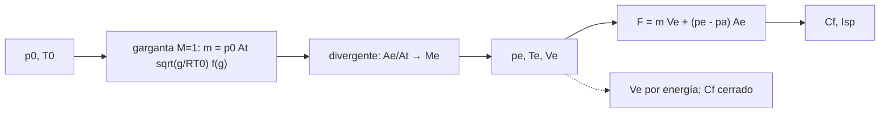

# B79-C08 — Flujo en toberas convergente-divergentes

<!-- nav:top -->
[🏠 Programa](../../../../README.md) · [📚 Bloque B79](../../../tronco-comun/B79-fluidos-termodinamica-y-aerotermodinamica-de-propulsion.md) · [← Anterior: B79-C07 — Ondas de choque normales y oblicuas](../B79-C07-ondas-de-choque-normales-y-oblicuas/CLASE.md) · [Siguiente: B79-C09 — CFD académico: fundamentos y límites →](../B79-C09-cfd-academico-fundamentos-y-limites/CLASE.md)
<!-- /nav -->

## 1. Ubicación, nivel y alcance

Clase 8 del bloque B79. Nivel N3. Una tobera convergente-divergente convierte la energía térmica de un gas a presión en velocidad: el gas se acelera hasta `M = 1` en la garganta y sigue acelerándose en la parte divergente. Aquí combinas isentrópicas, área–Mach y choque para dimensionar una tobera ilustrativa: flujo másico bloqueado, Mach de salida, empuje y regímenes de contrapresión. Usa [C05](../B79-C05-dinamica-de-fluidos-compresibles/CLASE.md)–[C07](../B79-C07-ondas-de-choque-normales-y-oblicuas/CLASE.md). La tobera es sintética y no corresponde a ningún motor.

## 2. Por qué esta clase existe

B78-C03 trata la cámara pero no el flujo por la tobera. La teoría de expansión es lo que une la presión de cámara con el empuje. La decisión central: **¿qué relación de áreas necesito, cuánto flujo pasa y qué ocurre cuando la presión ambiente no coincide con la de salida?**

## 3. Lo que podrás hacer al terminar

1. Calcular el flujo másico bloqueado de una garganta.
2. Calcular el Mach, `T`, `p` y `V` de salida para una relación de áreas.
3. Calcular el empuje, el coeficiente de empuje y el impulso específico.
4. Verificar la velocidad de salida con un balance de energía y el empuje con una fórmula cerrada.
5. Identificar los regímenes según la contrapresión.
6. Reconocer el riesgo de sobreexpansión.

La evidencia es la **ficha de diseño de una tobera** del ejercicio 12 (sección 20).

## 4. Con qué llegas y cómo comprobarlo

1. ¿Qué es la garganta?
2. ¿Qué es el flujo másico?
3. ¿Qué es el empuje?
4. ¿Qué es la presión ambiente?
5. ¿Qué es el impulso específico?

<details>
<summary>Ver respuestas</summary>

1. la sección de área mínima, donde el flujo bloqueado alcanza `M = 1`. 2. `ṁ = ρ A V`, en kg/s. 3. la fuerza neta sobre el motor, en N. 4. la presión del medio donde descarga la tobera. 5. el empuje por unidad de peso de propulsante por segundo, en s.
</details>

Con cuatro o cinco aciertos, sigue; si no, repasa los prerrequisitos.

## 5. Un caso de contexto y casos de referencia

Una tobera ilustrativa con `p₀ = 5 MPa`, `T₀ = 3000 K`, `A_t = 0,010 m²` y `A_e/A_t = 10` pasa `31,645 kg/s`, sale a `M = 3,2783` y `2554,8 m/s` y produce `76,98 kN` al nivel del mar y `87,12 kN` en vacío. Es el **ejemplo conductor**. Todo es **ilustrativo**: no describe un motor concreto.

## 6. Vocabulario

Una tobera **bloqueada** tiene `M = 1` en la garganta y su flujo másico solo depende de `p₀`, `T₀` y `A_t`. La **relación de expansión** `ε = A_e/A_t`. El **empuje** es `F = ṁ V_e + (p_e − p_a) A_e`. El **coeficiente de empuje** es `C_F = F/(p₀ A_t)`. La **tobera adaptada** tiene `p_e = p_a`; **sobreexpandida**, `p_e < p_a`; **subexpandida**, `p_e > p_a`.

## 7. Modelo mental: una manguera con boquilla



*Descripción textual:* la cámara fija el flujo bloqueado; la relación de áreas fija la salida; la salida y la presión ambiente fijan el empuje; dos vías comprueban velocidad, flujo y coeficiente de empuje.

Analogía: al tapar parcialmente una manguera con el dedo, el agua sale más rápida; la tobera hace lo mismo con un gas, pero el divergente sigue acelerándolo en régimen supersónico. Límite: el gas del modelo es ideal con `γ` constante y no reacciona.

## 8. La explicación, paso a paso

### 8.1 Garganta bloqueada

`ṁ = p₀ A_t √(γ/(R T₀)) (2/(γ+1))^((γ+1)/(2(γ−1)))`. Con `γ = 1,2` y `R = 350 J/(kg K)`: `ṁ = 31,645 kg/s`. En la garganta `T* = 2727,3 K`, `p* = 2822370 Pa` y `a* = 1070,26 m/s`.

### 8.2 Salida y empuje

| `A_e/A_t` | `M_e` | `p_e` (Pa) | `T_e` (K) | `V_e` (m/s) | `F` al nivel del mar (kN) | `F` en vacío (kN) | `C_F` | `I_sp` (s) |
|---|---|---|---|---|---|---|---|---|
| 10 | 3,2783 | 62686 | 1446,0 | 2554,80 | 76,98 | 87,12 | 1,5397 | 248,07 |
| 25 | 3,9128 | 19021 | 1185,3 | 2760,74 | 66,79 | 92,12 | 1,3358 | 215,21 |

El `I_sp` se define con `g₀ = 9,80665 m/s²`. Ampliar la salida de 10 a 25 sube el empuje en vacío un 5,7 % pero lo baja un 13,2 % al nivel del mar, porque `p_e = 19021 Pa` queda muy por debajo de `p_a = 101325 Pa`.

### 8.3 Dos vías

`V_e` se recalcula por energía, `√(2 c_p (T₀ − T_e))`; el flujo másico se recalcula en la salida con `ρ_e V_e A_e`; `C_F` se compara con la fórmula cerrada. La diferencia máxima es `2,25 × 10⁻¹⁵`. Son identidades del mismo modelo: comprueban el código y la consistencia de las ecuaciones, no el comportamiento de una tobera real.

### 8.4 Regímenes por contrapresión (`ε = 10`)

Con `p_b ≥ 4989457 Pa` el flujo es subsónico en todo el conducto; entre ese valor y `729272 Pa` aparece un choque dentro del divergente; `729272 Pa` es la contrapresión con el choque justo en la salida; entre ese valor y `62686 Pa` hay choques oblicuos fuera (sobreexpandida); y `62686 Pa` es la presión de diseño. A nivel del mar (`pa/pe = 1,62`) la tobera de `ε = 10` está sobreexpandida y la de `ε = 25` mucho más; la separación de la capa límite (no modelada) limita la sobreexpansión.

## 9. Magnitudes, símbolos y unidades

| Símbolo | Qué es | Unidad | Valor / nota |
|---|---|---|---|
| `p₀`, `T₀` | condiciones de cámara | Pa, K | 5,0 × 10⁶; 3000 (ilustrativas) |
| `A_t` | área de garganta | m² | 0,010 |
| `ṁ` | flujo másico | kg/s | 31,645 |
| `M_e` | Mach de salida | — | 3,2783; 3,9128 |
| `V_e` | velocidad de salida | m/s | 2554,8; 2760,7 |
| `F` | empuje | kN | 76,98; 66,79 (nivel del mar) |
| `C_F` | coeficiente de empuje | — | 1,5397; 1,3358 |
| `I_sp` | impulso específico | s | 248,07; 215,21 |

## 10. Convenciones y referencias

Gas ideal con `γ = 1,2` y `R = 350 J/(kg K)` (ilustrativos para un gas de combustión caliente; no consultados); flujo isentrópico unidimensional y estacionario; `p_a = 101325 Pa` ilustrativa; `g₀ = 9,80665 m/s²` convencional. Python 3.12.

## 11. De dónde sale lo que afirmamos

| ID | Fuente | Localizador | Respalda | Estado |
|---|---|---|---|---|
| S1 | NASA Glenn, «Nozzles» — https://www.grc.nasa.gov/www/k-12/airplane/nozzle.html (consultada 2026-11-10) | página completa | tobera convergente-divergente: subsónico antes de la garganta, supersónico después; cohetes con toberas fijas | Consultada |
| S2 | NASA Glenn, «Isentropic Flow Equations» — https://www.grc.nasa.gov/www/k-12/airplane/isentrop.html (consultada 2026-11-10) | página completa | p/pt, T/Tt y ρ/ρt en función del Mach y γ | Consultada |
| — | Relaciones estándar de libro de texto que el laboratorio verifica con una segunda vía | — | las verifica el laboratorio | No consultada en una fuente concreta |

Límites: las fórmulas de flujo bloqueado, empuje y `C_F` son resultados estándar no consultados; todas las condiciones de cámara y el gas son ilustrativos; no hay reacciones químicas, capa límite ni divergencia de la tobera real.

## 12. Cómo ver una tobera

| Magnitud | Valor |
|---|---|
| `ṁ` | 31,645 kg/s |
| `M_e` (`ε = 10`) | 3,2783 |
| `F` (nivel del mar) | 76,98 kN |
| diferencia entre vías | 2,25 × 10⁻¹⁵ |

Descripción larga: el flujo másico no depende de la relación de áreas, el empuje en vacío sube con ella y el del nivel del mar tiene un máximo cerca de la adaptación.

## 13. Ejemplo trabajado: el empuje de la tobera de `ε = 10`

**Paso 1 · Flujo.** `ṁ = 31,645 kg/s`.

**Paso 2 · Velocidad.** `V_e = 2554,8 m/s`.

**Paso 3 · Término de presión.** `(62686 − 101325) × 0,10 = −3863,9 N`.

**Paso 4 · Empuje.** `31,645 × 2554,8 − 3864 ≈ 76980 N`.

## 14. Distintas formas de describir una tobera

**Por garganta:** `ṁ`. **Por expansión:** `ε`, `M_e`. **Por empuje:** `F`, `C_F`. **Por régimen:** `p_e` frente a `p_a`.

## 15. Práctica guiada

**Ejercicio 1 · con los pasos indicados.** Calcula `T*` con `T₀ = 3000 K` y `γ = 1,2`. *Pasos:* `2 T₀/(γ+1)`.

<details><summary>Solución comentada</summary>

`6000/2,2 = 2727,3 K`.
</details>

**Ejercicio 2 · con una pista.** ¿Qué `a*` tiene? *Pista:* `√(γ R T*)`.

<details><summary>Solución comentada</summary>

`√(1,2 × 350 × 2727,3) = 1070,26 m/s`.
</details>

**Ejercicio 3 · casi autónomo.** ¿Qué pasa con `ṁ` al pasar `ε` de 10 a 25? *Casi autónomo:* la garganta no cambia.

<details><summary>Solución comentada</summary>

Nada: `31,645 kg/s` en ambos.
</details>

## 16. Práctica autónoma, transferencia e integrador

**Ejercicio 4 · autónomo.** `ṁ` si `p₀` se duplica.

<details><summary>Solución comentada</summary>

Se duplica: `63,29 kg/s`.
</details>

**Ejercicio 5 · autónomo.** `I_sp` en vacío para `ε = 10`.

<details><summary>Solución comentada</summary>

`87120/(31,645 × 9,80665) = 280,7 s`.
</details>

**Ejercicio 6 · autónomo.** ¿Está sobreexpandida la tobera de `ε = 25` en vacío?

<details><summary>Solución comentada</summary>

No: en vacío `p_a = 0`, está subexpandida.
</details>

**Ejercicio 7 · autónomo.** Presión de salida para adaptación a nivel del mar.

<details><summary>Solución comentada</summary>

`101325 Pa`, que corresponde a `ε` menor que 10.
</details>

**Ejercicio 8 · autónomo.** `C_F` en vacío para `ε = 10`.

<details><summary>Solución comentada</summary>

`87120/(5 × 10⁶ × 0,01) = 1,742`.
</details>

**Ejercicio 9 · transferencia.** **Transferencia.** Un colega elige `ε = 25` para despegar. ¿Qué riesgo corre?

<details><summary>Solución comentada</summary>

Sobreexpansión fuerte y posible separación del flujo; el empuje al nivel del mar baja 13 % frente a `ε = 10`.
</details>

**Ejercicio 10 · transferencia.** **Transferencia.** ¿Qué le pasa a `ṁ` si la contrapresión sube pero `p_b < 4989457 Pa`?

<details><summary>Solución comentada</summary>

No cambia: la garganta sigue bloqueada.
</details>

**Ejercicio 11 · transferencia.** **Transferencia.** ¿Qué falta para dimensionar una tobera de motor real?

<details><summary>Solución comentada</summary>

Gases con `γ` variable y reacciones (C14), capa límite, pérdida por divergencia, refrigeración y estructura; todo fuera de esta clase.
</details>

**Ejercicio 12 · integrador.** **Integrador.** Elabora tu *ficha de diseño de una tobera*: garganta, tabla de dos relaciones de expansión con `M_e`, `V_e`, `F`, `C_F`, `I_sp`, regímenes por contrapresión y lista de qué es consultado e ilustrativo.

<details><summary>Solución comentada</summary>

Secciones 8.1–8.4 y la salida del laboratorio.
</details>

## 17. Laboratorio: tobera ideal: flujo bloqueado, empuje y regímenes

El script [tobera.py](tobera.py) calcula la garganta, dos relaciones de expansión (Mach de salida, empuje, `C_F`, `I_sp`), las contrapresiones características y las diferencias entre vías (**comprueba** diferencia < 1e-10).

**Datos:** solo la descripción de la tobera y las relaciones isentrópicas se consultaron (NASA Glenn); `γ`, `R`, `p₀`, `T₀`, áreas y `p_a` son **ilustrativos**. **Predice antes de ejecutar:** ¿cuánto valdrá `ṁ` con `ε = 25`? (31,645 kg/s.) **Ejecución del 2026-11-10:**

```text
Python 3.12.9 (biblioteca estandar)
Tobera ILUSTRATIVA: gamma = 1.2, R = 350.0 J/(kg K), p0 = 5.00e+06 Pa, T0 = 3000.0 K, At = 0.01 m2
Garganta: T* = 2727.3 K, p* = 2822370 Pa, a* = 1070.26 m/s ; m = 31.645 kg/s
 Ae/At   Me      pe [Pa]   Te [K]   Ve [m/s]   m(salida) [kg/s]   F(pa) [kN]   F(vacio) [kN]   Cf(pa)   Isp(pa) [s]
  10.0  3.2783      62686   1446.0   2554.80       31.645          76.98         87.12      1.5397    248.07
  25.0  3.9128      19021   1185.3   2760.74       31.645          66.79         92.12      1.3358    215.21
Diferencia maxima entre vias (Ve, m, Cf) = 2.25e-15
Contrapresiones para Ae/At = 10: diseno pe = 62686 Pa ; choque en la salida pb = 729272 Pa ; limite subsonico bloqueado pb = 4989457 Pa
 Con pa = 101325 Pa (> pe): tobera sobreexpandida, pa/pe = 1.62
Pruebas superadas.
```

```bash
python programa/clases/B79/B79-C08-flujo-en-toberas-convergente-divergentes/tobera.py
```

**Límites:** gas ideal, `γ` constante, isentrópico, 1D, sin capa límite ni reacciones; las vías son identidades del mismo modelo y no una validación experimental.

## 18. Errores frecuentes y cómo corregirlos

**Pensar que ampliar la salida siempre sube el empuje.** Se corrige con 8.2.

**Confundir empuje en vacío con empuje a nivel del mar.** Se corrige con 8.2.

**Creer que `ṁ` cambia con `ε`.** Se corrige con 8.1.

**Presentar la tobera sintética como diseño de un motor.** Se corrige con la sección 10.

## 19. Cómo sabrás que vas bien

Tras la sección 8: ¿qué `M_e` esperabas con `ε = 10` y cuál obtuviste? Si dudas, repasa el ejemplo 13. Tras el laboratorio: ¿qué comprueba? (ver la sección 17).

## 20. Qué entregas y cómo se evalúa

El producto es tu **ficha de diseño de una tobera** (ejercicio 12).

| Criterio | Inicial | En desarrollo | Logrado | Destacado |
|---|---|---|---|---|
| Conceptos | Los confunde | Parciales | Dimensiona y analiza una tobera ideal | Explica los límites |
| Cálculo | Sin unidades | Con errores | Tablas completas con unidades | Calcula casos nuevos |
| Numérico | Sin comprobar | Un caso | Contraste con una segunda vía | Interpreta las diferencias |
| Fuentes | Sin fuente | Sin fecha | Fuentes con fecha y estado | Declara lo ilustrativo y lo no consultado |
| Límites | No los nombra | Uno | Tres | Discute qué falta del modelo |

**Condiciones críticas (no se compensan con promedio):** rotular la tobera y el gas como ilustrativos; no presentar el empuje ideal como un resultado de motor real; no presentar un cálculo como medición de un motor real; citar solo lo consultado.

## 21. Ética, seguridad y límites

Clase educativa: los modelos son simplificados y sus datos son sintéticos, ilustrativos o coeficientes publicados con fuente; ningún resultado describe un motor o un vehículo reales ni sustituye al análisis de ingeniería, a las normas o a los datos de fabricante.  Accesibilidad: tablas equivalentes a las gráficas, fórmulas en texto, ejercicios sin conexión.

## 22. Para cerrar y seguir

Una tobera de `ε = 10` con cámara a 5 MPa da `76,98 kN` al nivel del mar y `87,12 kN` en vacío con `31,6 kg/s`. Queda una pregunta: ¿cómo se resuelven numéricamente flujos que ya no tienen solución cerrada? Lo ve C09.

**Glosario español–inglés.** tobera · *nozzle*; garganta · *throat*; bloqueo · *choking*; sobreexpandida · *overexpanded*; impulso específico · *specific impulse*.

**Continuidad.** [B79-C09](../B79-C09-cfd-academico-fundamentos-y-limites/CLASE.md) estudia el CFD académico.

**Referencias:** ver sección 11.

<!-- nav:bottom -->
---

[← Anterior: B79-C07 — Ondas de choque normales y oblicuas](../B79-C07-ondas-de-choque-normales-y-oblicuas/CLASE.md) · [📚 Bloque B79](../../../tronco-comun/B79-fluidos-termodinamica-y-aerotermodinamica-de-propulsion.md) · [Siguiente: B79-C09 — CFD académico: fundamentos y límites →](../B79-C09-cfd-academico-fundamentos-y-limites/CLASE.md)
<!-- /nav -->
