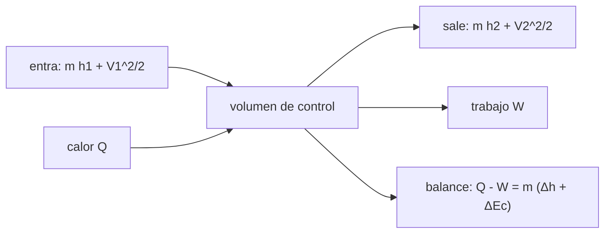

# B79-C10 — Primera ley de la termodinámica en sistemas abiertos

<!-- nav:top -->
[🏠 Programa](../../../../README.md) · [📚 Bloque B79](../../../tronco-comun/B79-fluidos-termodinamica-y-aerotermodinamica-de-propulsion.md) · [← Anterior: B79-C09 — CFD académico: fundamentos y límites](../B79-C09-cfd-academico-fundamentos-y-limites/CLASE.md) · [Siguiente: B79-C11 — Segunda ley y entropía →](../B79-C11-segunda-ley-y-entropia/CLASE.md)
<!-- /nav -->

## 1. Ubicación, nivel y alcance

Clase 10 del bloque B79. Nivel N3. La primera ley dice que la energía se conserva. Para un motor, donde el fluido entra y sale de cada componente, se escribe sobre un volumen de control: el calor y el trabajo que cruzan la frontera igualan el cambio de entalpía y de energía cinética del flujo. Aquí aplicas ese balance a un compresor, una turbina, una tobera, una válvula y un depósito que se llena. Usa [C05](../B79-C05-dinamica-de-fluidos-compresibles/CLASE.md) para la energía total. Los componentes son sintéticos y no corresponden a un motor.

## 2. Por qué esta clase existe

B05-C13 ve temperatura y energía térmica, pero no la formulación de volumen de control usada en propulsión. Sin ella no se calcula el trabajo de un compresor ni la velocidad de una tobera. La decisión central: **¿qué entra, qué sale y qué se acumula en cada componente, y qué energía lo compensa?**

## 3. Lo que podrás hacer al terminar

1. Escribir el balance de energía de un volumen de control estacionario.
2. Calcular el trabajo de un compresor y de una turbina con rendimiento isentrópico.
3. Calcular la velocidad de salida de una tobera por balance de entalpía.
4. Reconocer el estrangulamiento como proceso a entalpía constante.
5. Resolver el llenado de un depósito y explicar `T_f = γ T_línea`.
6. Contrastar el trabajo con la integral `∫ v dp`.

La evidencia es la **balance de energía de una turbina** del ejercicio 12 (sección 20).

## 4. Con qué llegas y cómo comprobarlo

1. ¿Qué es la entalpía?
2. ¿Qué es el calor específico?
3. ¿Qué es un proceso adiabático?
4. ¿Qué es el régimen estacionario?
5. ¿Qué es el rendimiento isentrópico?

<details>
<summary>Ver respuestas</summary>

1. `h = u + p v`, en J/kg. 2. la energía por kg y por K para cambiar la temperatura, en J/(kg K). 3. uno sin transferencia de calor. 4. que las propiedades en cada punto no cambian con el tiempo. 5. el cociente entre el trabajo ideal y el real (compresor) o real e ideal (turbina).
</details>

Con cuatro o cinco aciertos, sigue; si no, repasa los prerrequisitos.

## 5. Un caso de contexto y casos de referencia

Un compresor ilustrativo de relación de presiones 8 que comprime `2 kg/s` de aire desde `300 K` con rendimiento `0,85` consume `287,73 kJ/kg` (`575,46 kW`). Una turbina de relación 6 desde `1400 K` con rendimiento `0,88` entrega `495,93 kJ/kg` (`991,85 kW`). Es el **ejemplo conductor**. Todo es **ilustrativo**: no describe un motor concreto.

## 6. Vocabulario

El **balance de energía** estacionario de un volumen de control con una entrada y una salida es `Q̇ − Ẇ = ṁ[(h₂ − h₁) + (V₂² − V₁²)/2]`. La **entalpía** `h = u + p v` incluye el trabajo de flujo. El **rendimiento isentrópico** compara el proceso real con el ideal adiabático reversible. El **estrangulamiento** es la expansión sin trabajo ni calor (`h₁ = h₂`).

## 7. Modelo mental: una cuenta bancaria con entradas y salidas



*Descripción textual:* la energía que entra con el flujo más el calor debe igualar la que sale con el flujo más el trabajo; el balance se cierra en cada componente.

Analogía: una cuenta donde cada ingreso y gasto debe aparecer en el extracto. Límite: el balance no dice si el proceso es posible; para eso hace falta la segunda ley (C11).

## 8. La explicación, paso a paso

### 8.1 Compresor

Con `γ = 1,4`, `c_p = 1004,675 J/(kg K)`: `T₂s = 300 × 8^0,2857 = 543,43 K`, `w_s = c_p(T₂s − T₁) = 244,572 kJ/kg`. Con `η = 0,85`: `T₂ = 586,39 K` y `w = 287,732 kJ/kg`; potencia `2 × 287,732 = 575,46 kW`. La integral numérica de `∫ v dp` sobre la isentrópica da el mismo `244,572 kJ/kg`: es una segunda vía para el trabajo ideal.

### 8.2 Turbina

`T₄s = 1400 × 6^(−0,2857) = 839,07 K`; `T₄ = 1400 − 0,88 (1400 − 839,07) = 906,38 K`; `w = 495,925 kJ/kg`; potencia `991,85 kW`. El balance adiabático `ṁ(h₄ − h₃) + Ẇ` da cero por construcción: confirma el signo y las unidades, no es una prueba independiente.

### 8.3 Tobera, válvula y depósito

En la tobera, con `V₁ ≈ 0` y `T` de `900` a `600 K`: `V₂ = √(2 c_p ΔT) = 776,41 m/s`. En la válvula `h₂ = h₁` y, para gas ideal, `T₂ = T₁` (el efecto Joule–Thomson de un gas real no está en el modelo). Un depósito inicialmente vacío que se llena desde una línea a `300 K` queda a `T = γ T_línea = 420 K`, aunque sea adiabático: la energía de flujo `p v` entra como energía interna.

### 8.4 Qué cambia y qué no

Los balances determinan la energía, no la dirección del proceso. Sin segunda ley no se puede decir que un compresor real consuma más que uno isentrópico (eso lo da el rendimiento, un dato). Y el modelo de gas ideal calórico (`c_p` constante) falla a las temperaturas de una turbina: C14 lo corrige.

## 9. Magnitudes, símbolos y unidades

| Símbolo | Qué es | Unidad | Valor / nota |
|---|---|---|---|
| `h` | entalpía específica | J/kg | `c_p T` |
| `w` | trabajo específico | kJ/kg | 287,73 (compresor); 495,93 (turbina) |
| `Ẇ` | potencia | kW | 575,46; 991,85 |
| `η_s` | rendimiento isentrópico | — | 0,85; 0,88 |
| `V₂` | velocidad de salida de la tobera | m/s | 776,41 |
| `T_f` | temperatura final del depósito | K | 420 |

## 10. Convenciones y referencias

Gas ideal calórico con `γ = 1,4`, `R = 287,05 J/(kg K)`. Régimen estacionario salvo el depósito (parámetros concentrados). Signos: el trabajo del compresor es entrada. Datos ilustrativos. Python 3.12.

## 11. De dónde sale lo que afirmamos

| ID | Fuente | Localizador | Respalda | Estado |
|---|---|---|---|---|
| S1 | NASA Glenn, «First Law of Thermodynamics» — https://www.grc.nasa.gov/www/k-12/airplane/thermo1.html (consultada 2026-11-10) | página completa | E2 − E1 = Q − W (cambio de energía interna = calor − trabajo) | Consultada |
| — | Relaciones estándar de libro de texto que el laboratorio verifica con una segunda vía | — | las verifica el laboratorio | No consultada en una fuente concreta |

Límites: la forma de volumen de control, los rendimientos isentrópicos y `T_f = γ T_línea` son resultados estándar no consultados; todos los datos de los componentes son ilustrativos.

## 12. Cómo ver un balance de energía

| Magnitud | Valor |
|---|---|
| `w` compresor | 287,732 kJ/kg |
| `w` turbina | 495,925 kJ/kg |
| `V₂` tobera | 776,41 m/s |
| `T_f` depósito | 420 K |

Descripción larga: el compresor consume trabajo, la turbina lo entrega y la tobera convierte entalpía en velocidad.

## 13. Ejemplo trabajado: el trabajo ideal del compresor

**Paso 1 · Temperatura ideal.** `T₂s = 300 × 8^(0,2857) = 543,43 K`.

**Paso 2 · Salto de entalpía.** `c_p ΔT = 1004,675 × 243,43 = 244,57 kJ/kg`.

**Paso 3 · Real.** `244,57/0,85 = 287,73 kJ/kg`.

## 14. Distintas formas de describir un balance

**Por entalpía:** `Δh`. **Por temperatura:** `c_p ΔT`. **Por presión:** `∫ v dp`. **Por potencia:** `ṁ w`.

## 15. Práctica guiada

**Ejercicio 1 · con los pasos indicados.** Calcula `T₂s` para relación 8 desde `300 K`. *Pasos:* `300 × 8^(0,4/1,4)`.

<details><summary>Solución comentada</summary>

`543,43 K`.
</details>

**Ejercicio 2 · con una pista.** ¿Qué trabajo real pide el compresor? *Pista:* divide el ideal por `η`.

<details><summary>Solución comentada</summary>

`244,572/0,85 = 287,73 kJ/kg`.
</details>

**Ejercicio 3 · casi autónomo.** ¿Qué `V₂` da `ΔT = 300 K`? *Casi autónomo:* `√(2 c_p ΔT)`.

<details><summary>Solución comentada</summary>

`776,41 m/s`.
</details>

## 16. Práctica autónoma, transferencia e integrador

**Ejercicio 4 · autónomo.** Potencia de la turbina con `ṁ = 2 kg/s`.

<details><summary>Solución comentada</summary>

`991,85 kW`.
</details>

**Ejercicio 5 · autónomo.** Potencia neta compresor + turbina (mismo `ṁ`).

<details><summary>Solución comentada</summary>

`991,85 − 575,46 = 416,39 kW`.
</details>

**Ejercicio 6 · autónomo.** Temperatura final del depósito si la línea está a `350 K`.

<details><summary>Solución comentada</summary>

`1,4 × 350 = 490 K`.
</details>

**Ejercicio 7 · autónomo.** ¿Cambia `T` en una válvula de gas ideal?

<details><summary>Solución comentada</summary>

No: `h` constante implica `T` constante.
</details>

**Ejercicio 8 · autónomo.** Trabajo ideal si la relación de presiones fuera 4.

<details><summary>Solución comentada</summary>

`c_p × 300 × (4^0,2857 − 1) = 1004,675 × 300 × 0,4859 = 146,5 kJ/kg`.
</details>

**Ejercicio 9 · transferencia.** **Transferencia.** Un colega afirma que la turbina del ejemplo «viola» la primera ley si `W > Q`. ¿Es cierto?

<details><summary>Solución comentada</summary>

No: es adiabática; el trabajo sale del cambio de entalpía del flujo.
</details>

**Ejercicio 10 · transferencia.** **Transferencia.** ¿Por qué se calienta más el depósito que la línea?

<details><summary>Solución comentada</summary>

Porque el trabajo de flujo `p v` del gas que entra se convierte en energía interna.
</details>

**Ejercicio 11 · transferencia.** **Transferencia.** ¿Qué falta para aplicar esto a una turbina real?

<details><summary>Solución comentada</summary>

`c_p` variable con la temperatura (C14), pérdidas, refrigeración y mezcla; el modelo es un ejemplo ilustrativo.
</details>

**Ejercicio 12 · integrador.** **Integrador.** Elabora tu *balance de energía de una turbina*: datos de entrada, `T₄s`, `T₄`, `w`, potencia, cierre del balance, comparación con `∫ v dp` para el compresor y lista de qué es consultado e ilustrativo.

<details><summary>Solución comentada</summary>

Secciones 8.1–8.4 y la salida del laboratorio.
</details>

## 17. Laboratorio: balances de energía de un compresor, una turbina y un depósito

El script [primera_ley.py](primera_ley.py) calcula compresor y turbina con rendimiento isentrópico, la tobera, y el llenado de un depósito, y verifica el trabajo ideal con una integral `∫ v dp` y la temperatura del depósito con un balance integrado (**comprueba** diferencia < 1e-6 y `T_f = γ T_línea`).

**Datos:** solo el enunciado de la primera ley se consultó (NASA Glenn); gas, relaciones de presión y rendimientos son **ilustrativos**. **Predice antes de ejecutar:** ¿qué `T_f` tendrá el depósito? (420 K.) **Ejecución del 2026-11-10:**

```text
Python 3.12.9 (biblioteca estandar)
Aire ILUSTRATIVO: gamma = 1.4, R = 287.05 J/(kg K), cp = 1004.675 J/(kg K)
Compresor: T2s = 543.43 K ; w_ideal (entalpia) = 244.572 kJ/kg ; w_ideal (integral v dp) = 244.572 kJ/kg
           T2 real = 586.39 K ; w_real = 287.732 kJ/kg ; potencia = 575.46 kW
Turbina:   T4s = 839.07 K ; T4 real = 906.38 K ; w = 495.925 kJ/kg ; potencia = 991.85 kW
           balance adiabatico: m(h4 - h3) + W = 0.000e+00 W
Tobera:    V2 = 776.41 m/s (h1 = h2 + V2^2/2, V1 = 0)
Valvula (estrangulamiento adiabatico, gas ideal): h2 = h1, por tanto T2 = T1
Deposito (inicialmente vacio) llenado desde la linea a 300.0 K: T_final = 420.0000 K ; gamma T_linea = 420.0000 K
Pruebas superadas.
```

```bash
python programa/clases/B79/B79-C10-primera-ley-de-la-termodinamica-en-sistemas-abiertos/primera_ley.py
```

**Límites:** gas ideal calórico, régimen estacionario; el balance de la turbina cierra por construcción y el depósito verifica el código con una integración de la misma física.

## 18. Errores frecuentes y cómo corregirlos

**Olvidar el término de energía cinética.** Se corrige con 8.3.

**Creer que el depósito se calienta por una fuente externa.** Se corrige con 8.3.

**Usar el rendimiento al revés (compresor y turbina).** Se corrige con 8.1 y 8.2.

**Presentar los componentes sintéticos como un motor.** Se corrige con la sección 10.

## 19. Cómo sabrás que vas bien

Tras la sección 8: ¿qué trabajo esperabas para el compresor y cuál obtuviste? Si dudas, repasa el ejemplo 13. Tras el laboratorio: ¿qué comprueba? (ver la sección 17).

## 20. Qué entregas y cómo se evalúa

El producto es tu **balance de energía de una turbina** (ejercicio 12).

| Criterio | Inicial | En desarrollo | Logrado | Destacado |
|---|---|---|---|---|
| Conceptos | Los confunde | Parciales | Plantea y cierra balances de energía | Explica los límites |
| Cálculo | Sin unidades | Con errores | Tablas completas con unidades | Calcula casos nuevos |
| Numérico | Sin comprobar | Un caso | Contraste con una segunda vía | Interpreta las diferencias |
| Fuentes | Sin fuente | Sin fecha | Fuentes con fecha y estado | Declara lo ilustrativo y lo no consultado |
| Límites | No los nombra | Uno | Tres | Discute qué falta del modelo |

**Condiciones críticas (no se compensan con promedio):** rotular los componentes como ilustrativos; no presentar el cierre por construcción como validación; no presentar un cálculo como medición de un motor real; citar solo lo consultado.

## 21. Ética, seguridad y límites

Clase educativa: los modelos son simplificados y sus datos son sintéticos, ilustrativos o coeficientes publicados con fuente; ningún resultado describe un motor o un vehículo reales ni sustituye al análisis de ingeniería, a las normas o a los datos de fabricante.  Accesibilidad: tablas equivalentes a las gráficas, fórmulas en texto, ejercicios sin conexión.

## 22. Para cerrar y seguir

Un compresor consume 576 kW y una turbina entrega 992 kW con el mismo `2 kg/s`. Queda una pregunta: ¿qué impide que un proceso que cumple la primera ley ocurra al revés? La respuesta es la segunda ley (C11).

**Glosario español–inglés.** volumen de control · *control volume*; entalpía · *enthalpy*; rendimiento isentrópico · *isentropic efficiency*; estrangulamiento · *throttling*; trabajo de flujo · *flow work*.

**Continuidad.** [B79-C11](../B79-C11-segunda-ley-y-entropia/CLASE.md) estudia la segunda ley y la entropía.

**Referencias:** ver sección 11.

<!-- nav:bottom -->
---

[← Anterior: B79-C09 — CFD académico: fundamentos y límites](../B79-C09-cfd-academico-fundamentos-y-limites/CLASE.md) · [📚 Bloque B79](../../../tronco-comun/B79-fluidos-termodinamica-y-aerotermodinamica-de-propulsion.md) · [Siguiente: B79-C11 — Segunda ley y entropía →](../B79-C11-segunda-ley-y-entropia/CLASE.md)
<!-- /nav -->
