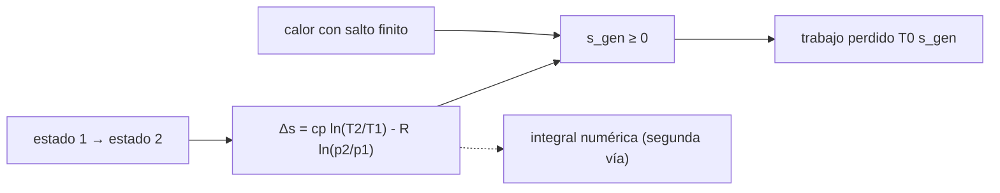

# B79-C11 — Segunda ley y entropía

<!-- nav:top -->
[🏠 Programa](../../../../README.md) · [📚 Bloque B79](../../../tronco-comun/B79-fluidos-termodinamica-y-aerotermodinamica-de-propulsion.md) · [← Anterior: B79-C10 — Primera ley de la termodinámica en sistemas abiertos](../B79-C10-primera-ley-de-la-termodinamica-en-sistemas-abiertos/CLASE.md) · [Siguiente: B79-C12 — Procesos adiabáticos e isentrópicos →](../B79-C12-procesos-adiabaticos-e-isentropicos/CLASE.md)
<!-- /nav -->

## 1. Ubicación, nivel y alcance

Clase 11 del bloque B79. Nivel N3. La primera ley cuenta la energía; la segunda dice en qué sentido ocurren los procesos y cuánta capacidad de trabajo se pierde. La entropía generada es la contabilidad de esa pérdida. Aquí calculas la entropía generada en un compresor, una turbina, una válvula y una transferencia de calor entre dos cuerpos, y la conviertes en trabajo perdido. Usa los balances de [C10](../B79-C10-primera-ley-de-la-termodinamica-en-sistemas-abiertos/CLASE.md). Los componentes son sintéticos.

## 2. Por qué esta clase existe

Ninguna clase del tronco trata entropía ni irreversibilidad, necesarias para entender por qué un compresor real consume más que uno ideal y por qué un choque pierde presión total. La decisión central: **¿cuánta capacidad de trabajo pierde cada componente y por qué mecanismo?**

## 3. Lo que podrás hacer al terminar

1. Calcular el cambio de entropía de un gas ideal entre dos estados.
2. Calcular la entropía generada por un compresor y una turbina con rendimiento isentrópico.
3. Calcular la entropía generada por un estrangulamiento.
4. Calcular la entropía generada por transferencia de calor con salto finito.
5. Convertir la entropía generada en trabajo perdido.
6. Contrastar el método de temperaturas medias con el logaritmo exacto.

La evidencia es la **ficha de generación de entropía** del ejercicio 12 (sección 20).

## 4. Con qué llegas y cómo comprobarlo

1. ¿Qué es la entropía?
2. ¿Qué dice el enunciado de Clausius?
3. ¿Qué es un proceso reversible?
4. ¿Qué es una función logaritmo natural?
5. ¿Qué es el rendimiento isentrópico?

<details>
<summary>Ver respuestas</summary>

1. una propiedad de estado cuyo cambio mide la irreversibilidad, en J/(kg K). 2. que el calor no pasa por sí solo de un cuerpo frío a uno caliente. 3. uno que puede invertirse sin dejar rastro en el entorno. 4. la inversa de la exponencial; `ln e = 1`. 5. la razón entre el trabajo ideal y el real (o al revés) respecto al proceso isentrópico.
</details>

Con cuatro o cinco aciertos, sigue; si no, repasa los prerrequisitos.

## 5. Un caso de contexto y casos de referencia

Un compresor de relación 8 con rendimiento `0,85` genera `76,438 J/(kg K)`, una turbina de relación 6 con rendimiento `0,88` genera `77,527 J/(kg K)` y una válvula 8→1 genera `596,904 J/(kg K)`. Es el **ejemplo conductor**. Todo es **ilustrativo**: no describe una máquina real.

## 6. Vocabulario

La **segunda ley** dice que la entropía generada es no negativa: `s_gen ≥ 0`. Para un gas ideal calórico `Δs = c_p ln(T₂/T₁) − R ln(p₂/p₁)`. Un proceso **isentrópico** tiene `s_gen = 0`. El **trabajo perdido** (Gouy–Stodola) es `T₀ s_gen` con `T₀` la temperatura del ambiente. Una **fuente de irreversibilidad** puede ser fricción, mezcla, transferencia de calor con salto finito o estrangulamiento.

## 7. Modelo mental: una cascada que no sube sola



*Descripción textual:* el cambio de entropía entre estados da la entropía generada, que se traduce en trabajo perdido; una integral numérica comprueba la fórmula.

Analogía: el agua cae por una cascada y no sube sola; la entropía crece en el sentido del proceso. Límite: la analogía no explica por qué cada mecanismo genera distinta cantidad.

## 8. La explicación, paso a paso

### 8.1 Generación de entropía

En un componente adiabático, `s_gen = s₂ − s₁`. Con aire (`c_p = 1004,675 J/(kg K)`, `R = 287,05`):

| Componente | `s_gen` (J/(kg K)) | `T₀ s_gen` (kJ/kg) |
|---|---|---|
| compresor (relación 8, `η = 0,85`) | 76,438 | 22,931 |
| turbina (relación 6, `η = 0,88`) | 77,527 | 23,258 |
| válvula 8 → 1 | 596,904 | — |
| compresor isentrópico | 1,14 × 10⁻¹³ | 0 |

La válvula genera `−R ln(1/8) = 596,904 J/(kg K)`: no hay trabajo extraído y toda la energía de presión se degrada.

### 8.2 Trabajo perdido

`T₀ s_gen` es el trabajo adicional frente a un componente **reversible entre los mismos estados** que intercambia calor con el ambiente a `T₀`; no es la diferencia con el isentrópico. En el compresor, el trabajo real es `287,73 kJ/kg`, el isentrópico `244,57` (diferencia `43,16`) y `T₀ s_gen = 22,93`.

### 8.3 Transferencia de calor

Dos cuerpos con `m c = 1000 J/K` a `400 K` y `300 K` llegan a `350 K` con `Q = 50 kJ`. La entropía generada exacta es `1000[ln(350/400) + ln(350/300)] = 20,619 J/K`. El método de temperaturas medias de NASA Glenn da `20,513 J/K`, un `−0,52 %`. Con saltos iniciales de `100`, `10` y `1 K`, la entropía generada vale `20,619`, `0,2688` y `0,002769 J/K`: se anula al reducir el salto, porque en el límite el intercambio es reversible.

### 8.4 Qué cambia y qué no

El flujo de energía total no cambia por la irreversibilidad, pero se degrada su capacidad de producir trabajo. Una integral numérica de `c_p dT/T − R dp/p` por un camino isóbaro más isotermo coincide con la fórmula con diferencia máxima < 1e-9: valida el código, y el valor de un componente real se mide, no se calcula.

## 9. Magnitudes, símbolos y unidades

| Símbolo | Qué es | Unidad | Valor / nota |
|---|---|---|---|
| `s` | entropía específica | J/(kg K) | — |
| `s_gen` | entropía generada | J/(kg K) | 76,438; 77,527; 596,904 |
| `T₀` | temperatura ambiente | K | 300 (ilustrativa) |
| `T₀ s_gen` | trabajo perdido | kJ/kg | 22,931; 23,258 |
| `S_gen` | entropía generada total (cuerpos) | J/K | 20,619 |
| `m c` | capacidad térmica | J/K | 1000 |

## 10. Convenciones y referencias

Gas ideal calórico, componentes adiabáticos, presión adimensionada (solo cuenta la relación). `T₀ = 300 K`. Datos ilustrativos. Python 3.12.

## 11. De dónde sale lo que afirmamos

| ID | Fuente | Localizador | Respalda | Estado |
|---|---|---|---|---|
| S1 | NASA Glenn, «Second Law – Entropy» — https://www1.grc.nasa.gov/beginners-guide-to-aeronautics/second-law-entropy/ (consultada 2026-11-10) | página completa | ΔS = ΔQ/T; S_f = S_i reversible, S_f > S_i irreversible | Consultada |
| — | Relaciones estándar de libro de texto que el laboratorio verifica con una segunda vía | — | las verifica el laboratorio | No consultada en una fuente concreta |

Límites: `Δs` del gas ideal y Gouy–Stodola son resultados estándar no consultados; los componentes y el par de cuerpos son ilustrativos.

## 12. Cómo ver la generación de entropía

| Magnitud | Valor |
|---|---|
| `s_gen` compresor | 76,438 J/(kg K) |
| `s_gen` válvula | 596,904 J/(kg K) |
| `S_gen` dos cuerpos | 20,619 J/K |
| error de temperaturas medias | −0,52 % |

Descripción larga: la válvula degrada mucho más que un compresor real, y el calor con salto grande genera mucha más entropía que con salto pequeño.

## 13. Ejemplo trabajado: la entropía generada por la válvula

**Paso 1 · Temperatura constante.** `ΔT = 0` (C10).

**Paso 2 · Presión.** `p₂/p₁ = 1/8`.

**Paso 3 · Entropía.** `Δs = −R ln(1/8) = 287,05 × 2,0794 = 596,904 J/(kg K)`.

## 14. Distintas formas de describir la irreversibilidad

**Por entropía generada:** `s_gen`. **Por trabajo perdido:** `T₀ s_gen`. **Por rendimiento:** `η_s`. **Por pérdida de presión total:** `p_t2/p_t1 = e^(−Δs/R)`.

## 15. Práctica guiada

**Ejercicio 1 · con los pasos indicados.** Calcula `Δs` entre `300 K, 8` y `300 K, 1` (unidades relativas). *Pasos:* solo el término de presión.

<details><summary>Solución comentada</summary>

`−R ln(1/8) = 596,904 J/(kg K)`.
</details>

**Ejercicio 2 · con una pista.** ¿Qué `s_gen` tiene un componente isentrópico? *Pista:* definición.

<details><summary>Solución comentada</summary>

Cero.
</details>

**Ejercicio 3 · casi autónomo.** ¿Cuánto trabajo pierde la turbina frente a un reversible con intercambio a `T₀`? *Casi autónomo:* `T₀ s_gen`.

<details><summary>Solución comentada</summary>

`300 × 77,527 = 23,26 kJ/kg`.
</details>

## 16. Práctica autónoma, transferencia e integrador

**Ejercicio 4 · autónomo.** `p_t2/p_t1` equivalente a `s_gen = 93,949 J/(kg K)`.

<details><summary>Solución comentada</summary>

`e^(−93,949/287,05) = 0,721`.
</details>

**Ejercicio 5 · autónomo.** Entropía generada si el salto inicial entre cuerpos es de `50 K`.

<details><summary>Solución comentada</summary>

`1000[ln(325/350)+ln(325/300)] = 5,9 J/K` aprox.
</details>

**Ejercicio 6 · autónomo.** ¿Puede `s_gen` ser negativa?

<details><summary>Solución comentada</summary>

No: sería violar la segunda ley.
</details>

**Ejercicio 7 · autónomo.** `T₀ s_gen` de una válvula 8→1.

<details><summary>Solución comentada</summary>

`300 × 596,904 = 179,07 kJ/kg`.
</details>

**Ejercicio 8 · autónomo.** Efecto de subir `η` del compresor a 1.

<details><summary>Solución comentada</summary>

`s_gen = 0` y `w = 244,57 kJ/kg`.
</details>

**Ejercicio 9 · transferencia.** **Transferencia.** Un colega propone eliminar la válvula para recuperar energía. ¿Qué puede ganar?

<details><summary>Solución comentada</summary>

Hasta `179 kJ/kg` de capacidad de trabajo, que se recuperaría con una turbina.
</details>

**Ejercicio 10 · transferencia.** **Transferencia.** ¿Por qué el método de temperaturas medias subestima la entropía?

<details><summary>Solución comentada</summary>

Es una aproximación lineal del logaritmo; con saltos pequeños el error se vuelve despreciable.
</details>

**Ejercicio 11 · transferencia.** **Transferencia.** ¿Qué fuente de irreversibilidad no está en el modelo de turbina?

<details><summary>Solución comentada</summary>

Fugas, mezcla con aire de refrigeración y transferencia de calor al metal; todo fuera de la clase.
</details>

**Ejercicio 12 · integrador.** **Integrador.** Elabora tu *ficha de generación de entropía*: `s_gen` y `T₀ s_gen` de compresor, turbina y válvula, entropía del par de cuerpos con ambos métodos, y lista de qué es consultado e ilustrativo.

<details><summary>Solución comentada</summary>

Secciones 8.1–8.4 y la salida del laboratorio.
</details>

## 17. Laboratorio: entropía generada en componentes

El script [entropia.py](entropia.py) calcula `s_gen` de compresor, turbina y válvula, la entropía generada por el calor entre dos cuerpos con el logaritmo exacto y con temperaturas medias, y verifica `Δs` con una integral numérica (**comprueba** diferencia < 1e-9 y `s_gen ≥ 0`).

**Datos:** el enunciado de la segunda ley y el ejemplo de temperaturas medias se consultaron (NASA Glenn); gas, componentes y cuerpos son **ilustrativos**. **Predice antes de ejecutar:** ¿cuánta entropía genera un componente isentrópico? (cero.) **Ejecución del 2026-11-10:**

```text
Python 3.12.9 (biblioteca estandar)
Aire ILUSTRATIVO: cp = 1004.675 J/(kg K), R = 287.05 J/(kg K), T0 = 300.0 K
Compresor: s_gen = 76.438 J/(kg K) ; trabajo perdido T0 s_gen = 22.931 kJ/kg ; isentropico s_gen = 1.14e-13
Turbina:   s_gen = 77.527 J/(kg K) ; trabajo perdido T0 s_gen = 23.258 kJ/kg
Valvula 8 -> 1: s_gen = 596.904 J/(kg K) ; = -R ln(1/8) = 596.904
Dos cuerpos (m c = 1000 J/K): Tf = 350.0 K ; Q = 50.0 kJ ; S_gen exacta = 20.619 J/K ; con temperaturas medias = 20.513 J/K
 error del metodo de temperaturas medias = -0.52 %
 salto inicial de  100.0 K: S_gen = 20.619287 J/K
 salto inicial de   10.0 K: S_gen = 0.268781 J/K
 salto inicial de    1.0 K: S_gen = 0.002769 J/K
Pruebas superadas.
```

```bash
python programa/clases/B79/B79-C11-segunda-ley-y-entropia/entropia.py
```

**Límites:** gas ideal calórico y componentes adiabáticos; la integral numérica valida el código, no la ley; los componentes reales no se calculan.

## 18. Errores frecuentes y cómo corregirlos

**Confundir trabajo perdido con la diferencia respecto al isentrópico.** Se corrige con 8.2.

**Usar `ΔT` sin considerar el término de presión.** Se corrige con 8.1.

**Creer que la irreversibilidad gasta energía.** Se corrige con 8.4.

**Presentar los componentes sintéticos como máquinas reales.** Se corrige con la sección 10.

## 19. Cómo sabrás que vas bien

Tras la sección 8: ¿qué `s_gen` esperabas para la válvula y cuál obtuviste? Si dudas, repasa el ejemplo 13. Tras el laboratorio: ¿qué comprueba? (ver la sección 17).

## 20. Qué entregas y cómo se evalúa

El producto es tu **ficha de generación de entropía** (ejercicio 12).

| Criterio | Inicial | En desarrollo | Logrado | Destacado |
|---|---|---|---|---|
| Conceptos | Los confunde | Parciales | Calcula `s_gen` y trabajo perdido | Explica los límites |
| Cálculo | Sin unidades | Con errores | Tablas completas con unidades | Calcula casos nuevos |
| Numérico | Sin comprobar | Un caso | Contraste con una segunda vía | Interpreta las diferencias |
| Fuentes | Sin fuente | Sin fecha | Fuentes con fecha y estado | Declara lo ilustrativo y lo no consultado |
| Límites | No los nombra | Uno | Tres | Discute qué falta del modelo |

**Condiciones críticas (no se compensan con promedio):** rotular los componentes como ilustrativos; no confundir trabajo perdido con la diferencia al isentrópico; no presentar un cálculo como medición de un motor real; citar solo lo consultado.

## 21. Ética, seguridad y límites

Clase educativa: los modelos son simplificados y sus datos son sintéticos, ilustrativos o coeficientes publicados con fuente; ningún resultado describe un motor o un vehículo reales ni sustituye al análisis de ingeniería, a las normas o a los datos de fabricante.  Accesibilidad: tablas equivalentes a las gráficas, fórmulas en texto, ejercicios sin conexión.

## 22. Para cerrar y seguir

Una válvula 8→1 genera `597 J/(kg K)` y destruye `179 kJ/kg` de capacidad de trabajo. Queda una pregunta: ¿qué relaciones cumplen los procesos ideales sin esa pérdida? Lo ve C12.

**Glosario español–inglés.** segunda ley · *second law*; entropía generada · *entropy generation*; irreversibilidad · *irreversibility*; trabajo perdido · *lost work*; estrangulamiento · *throttling*.

**Continuidad.** [B79-C12](../B79-C12-procesos-adiabaticos-e-isentropicos/CLASE.md) estudia los procesos adiabáticos e isentrópicos.

**Referencias:** ver sección 11.

<!-- nav:bottom -->
---

[← Anterior: B79-C10 — Primera ley de la termodinámica en sistemas abiertos](../B79-C10-primera-ley-de-la-termodinamica-en-sistemas-abiertos/CLASE.md) · [📚 Bloque B79](../../../tronco-comun/B79-fluidos-termodinamica-y-aerotermodinamica-de-propulsion.md) · [Siguiente: B79-C12 — Procesos adiabáticos e isentrópicos →](../B79-C12-procesos-adiabaticos-e-isentropicos/CLASE.md)
<!-- /nav -->
