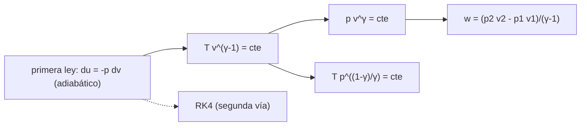

# B79-C12 — Procesos adiabáticos e isentrópicos

<!-- nav:top -->
[🏠 Programa](../../../../README.md) · [📚 Bloque B79](../../../tronco-comun/B79-fluidos-termodinamica-y-aerotermodinamica-de-propulsion.md) · [← Anterior: B79-C11 — Segunda ley y entropía](../B79-C11-segunda-ley-y-entropia/CLASE.md) · [Siguiente: B79-C13 — Entalpía de flujo y entalpía total →](../B79-C13-entalpia-de-flujo-y-entalpia-total/CLASE.md)
<!-- /nav -->

## 1. Ubicación, nivel y alcance

Clase 12 del bloque B79. Nivel N3. Un proceso adiabático no intercambia calor; si además es reversible, es isentrópico y sus propiedades quedan ligadas por potencias de `γ`. Esta clase deduce esas relaciones desde la primera ley, las compara con el proceso isotermo y con uno politrópico en un cilindro y verifica el resultado integrando la ecuación diferencial. Usa [C10](../B79-C10-primera-ley-de-la-termodinamica-en-sistemas-abiertos/CLASE.md) y [C11](../B79-C11-segunda-ley-y-entropia/CLASE.md). El gas es aire ideal ilustrativo.

## 2. Por qué esta clase existe

Las relaciones isentrópicas son el núcleo del análisis de toberas, compresores y turbinas; el tronco no las trata. Aquí se obtienen desde primeros principios y se ve cuándo valen. La decisión central: **¿qué exponente describe mi proceso y cuánto trabajo cambia según el exponente?**

## 3. Lo que podrás hacer al terminar

1. Escribir `p v^γ`, `T v^(γ−1)` y `T p^((1−γ)/γ)` constantes.
2. Calcular estado final y trabajo de una compresión isentrópica.
3. Comparar isotermo, politrópico e isentrópico.
4. Calcular el exponente politrópico de dos estados.
5. Verificar la temperatura final integrando `dT = −p dv/c_v` con RK4.
6. Explicar cuándo la hipótesis adiabática reversible no vale.

La evidencia es la **tabla de compresión y expansión** del ejercicio 12 (sección 20).

## 4. Con qué llegas y cómo comprobarlo

1. ¿Qué es un proceso adiabático?
2. ¿Qué es `γ`?
3. ¿Qué es un exponente?
4. ¿Qué es un método de Runge–Kutta?
5. ¿Qué es el trabajo de compresión?

<details>
<summary>Ver respuestas</summary>

1. uno sin transferencia de calor. 2. `c_p/c_v`, adimensional; 1,4 para aire frío. 3. el número al que se eleva una base. 4. un esquema numérico para integrar ecuaciones diferenciales ordinarias. 5. la energía que se entrega al gas al reducir su volumen.
</details>

Con cuatro o cinco aciertos, sigue; si no, repasa los prerrequisitos.

## 5. Un caso de contexto y casos de referencia

Comprimir aire de `300 K` y `100 kPa` a un décimo de su volumen da `753,57 K` y `2511,9 kPa` con `325,49 kJ/kg` si es isentrópico, `533,48 K` y `1778,3 kPa` con `268,09 kJ/kg` si es politrópico con `n = 1,25` y `300 K` y `1000 kPa` con `198,29 kJ/kg` si es isotermo. Es el **ejemplo conductor**. Todo es **ilustrativo**: no describe un motor.

## 6. Vocabulario

Un proceso **isentrópico** es adiabático y reversible. Un proceso **politrópico** sigue `p v^n = constante`, con `n` entre 1 (isotermo) y `γ` (isentrópico). La **relación de volúmenes** es `v₁/v₂`. Las relaciones isentrópicas son `p v^γ = c`, `T v^(γ−1) = c`, `T p^((1−γ)/γ) = c`. El **trabajo de compresión** por kg es `w = (p₂ v₂ − p₁ v₁)/(n−1)`.

## 7. Modelo mental: una bomba de bicicleta



*Descripción textual:* desde la primera ley adiabática se obtienen las tres relaciones isentrópicas y el trabajo; un integrador numérico comprueba la temperatura final.

Analogía: al bombear una bomba de bicicleta rápido, el tubo se calienta porque el aire no tiene tiempo de ceder calor. Límite: en una bomba real hay fricción y calor cedido a las paredes.

## 8. La explicación, paso a paso

### 8.1 Relaciones isentrópicas

Con `c_v dT = −p dv` y `p v = R T`: `dT/T = −(γ−1) dv/v`, de donde `T v^(γ−1) = constante`, y de ella `p v^γ = c` y `T p^((1−γ)/γ) = c`.

### 8.2 Tres procesos de compresión (volumen a 1/10)

| Proceso | `n` | `T₂` (K) | `p₂` (kPa) | `w` (kJ/kg) | `Δs` (J/(kg K)) |
|---|---|---|---|---|---|
| isotermo | 1,00 | 300,00 | 1000,0 | 198,287 | −660,957 |
| politrópico | 1,25 | 533,48 | 1778,3 | 268,086 | −247,859 |
| isentrópico | 1,40 | 753,57 | 2511,9 | 325,490 | 0,000 |

El trabajo por la integral `∫ p dv` coincide con la forma cerrada en los tres casos (diferencia < 1e-8). El proceso isotermo exige ceder `198,287 kJ/kg` de calor, y ahorra `127,203 kJ/kg` de trabajo frente al isentrópico; el `Δs` negativo corresponde a ese calor cedido y no viola la segunda ley.

### 8.3 Segunda vía: integrar la primera ley

Integrando `dT/dv = −R T/(c_v v)` con RK4 (2000 pasos) desde `v₁ = 0,8611 m³/kg` hasta `v₂ = v₁/10`: `T₂ = 753,5659 K`, igual a la cerrada con diferencia `2,7 × 10⁻¹³`. El trabajo isentrópico también es `c_v (T₂ − T₁) = 325,490 kJ/kg`.

### 8.4 Qué cambia y qué no

Si el proceso real tiene fricción o transferencia de calor, ya no es isentrópico: la temperatura final depende del camino y `n` real se mide, no se supone. En compresores, `n` entre 1 y `γ` aparece cuando hay enfriamiento. Las relaciones valen para `γ` constante; a altas temperaturas (C14) hay que usar `c_p(T)`.

## 9. Magnitudes, símbolos y unidades

| Símbolo | Qué es | Unidad | Valor / nota |
|---|---|---|---|
| `γ` | razón de calores específicos | — | 1,4 |
| `n` | exponente politrópico | — | 1; 1,25; 1,4 |
| `v₁/v₂` | relación de volúmenes | — | 10 |
| `T₂` | temperatura final | K | 300; 533,48; 753,57 |
| `w` | trabajo de compresión | kJ/kg | 198,287; 268,086; 325,490 |
| `Δs` | cambio de entropía | J/(kg K) | −660,957; −247,859; 0 |

## 10. Convenciones y referencias

Gas ideal calórico con `γ = 1,4` y `R = 287,05 J/(kg K)`; sistema cerrado (cilindro), compresión cuasi-estática; el trabajo es el recibido por el gas. Datos ilustrativos. Python 3.12.

## 11. De dónde sale lo que afirmamos

| ID | Fuente | Localizador | Respalda | Estado |
|---|---|---|---|---|
| S1 | NASA Glenn, «Isentropic Flow Equations» — https://www.grc.nasa.gov/www/k-12/airplane/isentrop.html (consultada 2026-11-10) | página completa | p/pt, T/Tt y ρ/ρt en función del Mach y γ | Consultada |
| S2 | NASA Glenn, «First Law of Thermodynamics» — https://www.grc.nasa.gov/www/k-12/airplane/thermo1.html (consultada 2026-11-10) | página completa | E2 − E1 = Q − W (cambio de energía interna = calor − trabajo) | Consultada |
| S3 | NASA Glenn, «Second Law – Entropy» — https://www1.grc.nasa.gov/beginners-guide-to-aeronautics/second-law-entropy/ (consultada 2026-11-10) | página completa | ΔS = ΔQ/T; S_f = S_i reversible, S_f > S_i irreversible | Consultada |
| — | Relaciones estándar de libro de texto que el laboratorio verifica con una segunda vía | — | las verifica el laboratorio | No consultada en una fuente concreta |

Límites: las relaciones `p v^γ`, el trabajo politrópico y la integración con RK4 son resultados estándar no consultados; las condiciones y el cilindro son ilustrativos.

## 12. Cómo ver la compresión

| Magnitud | Valor |
|---|---|
| `T₂` isentrópica | 753,57 K |
| `p₂` isentrópica | 2511,9 kPa |
| `w` isentrópico | 325,490 kJ/kg |
| diferencia RK4 | 2,7 × 10⁻¹³ |

Descripción larga: más cerca del isentrópico, más calienta y más trabajo cuesta; el isotermo es el más barato pero exige ceder calor.

## 13. Ejemplo trabajado: la temperatura isentrópica a `v₁/v₂ = 10`

**Paso 1 · Relación.** `T₂/T₁ = 10^0,4 = 2,5119`.

**Paso 2 · Temperatura.** `T₂ = 300 × 2,5119 = 753,57 K`.

**Paso 3 · Presión.** `p₂ = 100 × 10^1,4 = 2511,9 kPa`.

## 14. Distintas formas de describir un proceso de compresión

**Por exponente:** `n`. **Por estados:** `T₂`, `p₂`. **Por trabajo:** `w`. **Por calor:** `q = w_neto − Δu`.

## 15. Práctica guiada

**Ejercicio 1 · con los pasos indicados.** Calcula `T₂` isentrópica con relación de volúmenes 5. *Pasos:* `300 × 5^0,4`.

<details><summary>Solución comentada</summary>

`300 × 1,9037 = 571,1 K`.
</details>

**Ejercicio 2 · con una pista.** ¿Qué `p₂` da el isentrópico con relación 10? *Pista:* `p₁ × 10^1,4`.

<details><summary>Solución comentada</summary>

`2511,9 kPa`.
</details>

**Ejercicio 3 · casi autónomo.** ¿Qué `n` da `p₂ = 1000 kPa`? *Casi autónomo:* `log(p₂/p₁)/log(10)`.

<details><summary>Solución comentada</summary>

`n = 1` (isotermo).
</details>

## 16. Práctica autónoma, transferencia e integrador

**Ejercicio 4 · autónomo.** Trabajo isotermo `p₁v₁ ln(r)`.

<details><summary>Solución comentada</summary>

`100000 × 0,8611 × 2,3026 ≈ 198,3 kJ/kg`.
</details>

**Ejercicio 5 · autónomo.** `n` de un proceso con `p₂/p₁ = 15` y `v₁/v₂ = 10`.

<details><summary>Solución comentada</summary>

`ln 15/ln 10 = 1,176`.
</details>

**Ejercicio 6 · autónomo.** `w` isentrópico con `r = 10` usando `c_v(T₂ − T₁)`.

<details><summary>Solución comentada</summary>

`717,6 × 453,57 = 325,5 kJ/kg`.
</details>

**Ejercicio 7 · autónomo.** Si la compresión es isentrópica, ¿cuánto vale `Δs`?

<details><summary>Solución comentada</summary>

Cero.
</details>

**Ejercicio 8 · autónomo.** Razón `w_isentrópico/w_isotermo`.

<details><summary>Solución comentada</summary>

`325,49/198,29 = 1,64`.
</details>

**Ejercicio 9 · transferencia.** **Transferencia.** Un diseñador de compresor enfría entre etapas. ¿Qué busca?

<details><summary>Solución comentada</summary>

Acercarse al isotermo para bajar el trabajo, a costa de ceder calor.
</details>

**Ejercicio 10 · transferencia.** **Transferencia.** ¿Qué le ocurre al exponente real si la compresión es rápida?

<details><summary>Solución comentada</summary>

Se acerca a `γ`, porque no hay tiempo de transferir calor, pero la fricción lo desvía.
</details>

**Ejercicio 11 · transferencia.** **Transferencia.** ¿Por qué no se pueden usar estas relaciones en una tobera con combustión?

<details><summary>Solución comentada</summary>

`γ` y la composición cambian con la temperatura (C14) y hay reacciones.
</details>

**Ejercicio 12 · integrador.** **Integrador.** Elabora tu *tabla de compresión y expansión*: `T₂`, `p₂`, `w` y `Δs` de tres procesos, la comparación RK4 y la lista de qué es consultado e ilustrativo.

<details><summary>Solución comentada</summary>

Secciones 8.1–8.4 y la salida del laboratorio.
</details>

## 17. Laboratorio: compresión isotérmica, politrópica e isentrópica

El script [isentropico.py](isentropico.py) calcula tres compresiones de un cilindro, verifica el trabajo con la integral `∫ p dv` y la temperatura isentrópica con RK4 (**comprueba** diferencia < 1e-9 y trabajo < 1e-8).

**Datos:** solo las relaciones isentrópicas y los enunciados de la primera y la segunda ley se consultaron (NASA Glenn); gas, estado inicial y exponentes son **ilustrativos**. **Predice antes de ejecutar:** ¿qué `T₂` tendrá la compresión isentrópica? (753,57 K.) **Ejecución del 2026-11-10:**

```text
Python 3.12.9 (biblioteca estandar)
Aire ILUSTRATIVO: gamma = 1.4, estado 1: T = 300.0 K, p = 100000 Pa, v = 0.8611 m3/kg ; compresion a v2 = v1/10
 proceso        n      T2 [K]     p2 [kPa]    w [kJ/kg]   w (integral p dv) [kJ/kg]   Delta s [J/(kg K)]
 isotermo      1.00    300.00      1000.0     198.287         198.287                    -660.957
 politropico   1.25    533.48      1778.3     268.086         268.086                    -247.859
 isentropico   1.40    753.57      2511.9     325.490         325.490                       0.000
Isentropico: T2 cerrada = 753.5659 K ; T2 por RK4 (primera ley, dT = -p dv / cv) = 753.5659 K ; diferencia = 2.66e-13
Trabajo isentropico por cv (T2 - T1) = 325.490 kJ/kg
Isotermo: calor cedido = 198.287 kJ/kg ; ahorro de trabajo frente al isentropico = 127.203 kJ/kg
Pruebas superadas.
```

```bash
python programa/clases/B79/B79-C12-procesos-adiabaticos-e-isentropicos/isentropico.py
```

**Límites:** gas ideal calórico, compresión cuasi-estática y sistema cerrado; RK4 verifica el código, no los procesos reales con fricción y calor.

## 18. Errores frecuentes y cómo corregirlos

**Usar `T v^γ = c` en vez de `T v^(γ−1) = c`.** Se corrige con 8.1.

**Pensar que el isotermo es adiabático.** Se corrige con 8.2.

**Creer que `Δs < 0` viola la segunda ley.** Se corrige con 8.2.

**Presentar el cilindro sintético como un motor.** Se corrige con la sección 10.

## 19. Cómo sabrás que vas bien

Tras la sección 8: ¿qué `T₂` esperabas y cuál obtuviste? Si dudas, repasa el ejemplo 13. Tras el laboratorio: ¿qué comprueba? (ver la sección 17).

## 20. Qué entregas y cómo se evalúa

El producto es tu **tabla de compresión y expansión** (ejercicio 12).

| Criterio | Inicial | En desarrollo | Logrado | Destacado |
|---|---|---|---|---|
| Conceptos | Los confunde | Parciales | Aplica las relaciones isentrópicas y politrópicas | Explica los límites |
| Cálculo | Sin unidades | Con errores | Tablas completas con unidades | Calcula casos nuevos |
| Numérico | Sin comprobar | Un caso | Contraste con una segunda vía | Interpreta las diferencias |
| Fuentes | Sin fuente | Sin fecha | Fuentes con fecha y estado | Declara lo ilustrativo y lo no consultado |
| Límites | No los nombra | Uno | Tres | Discute qué falta del modelo |

**Condiciones críticas (no se compensan con promedio):** rotular el cilindro y el aire como ilustrativos; no suponer isentrópico un proceso con fricción sin decirlo; no presentar un cálculo como medición de un motor real; citar solo lo consultado.

## 21. Ética, seguridad y límites

Clase educativa: los modelos son simplificados y sus datos son sintéticos, ilustrativos o coeficientes publicados con fuente; ningún resultado describe un motor o un vehículo reales ni sustituye al análisis de ingeniería, a las normas o a los datos de fabricante.  Accesibilidad: tablas equivalentes a las gráficas, fórmulas en texto, ejercicios sin conexión.

## 22. Para cerrar y seguir

Comprimir 10:1 calienta de 300 a 753,6 K y cuesta 325,5 kJ/kg. Queda una pregunta: ¿qué combinación de energía interna y presión viaja con el flujo? Es la entalpía (C13).

**Glosario español–inglés.** proceso isentrópico · *isentropic process*; politrópico · *polytropic*; relación de compresión · *compression ratio*; adiabático · *adiabatic*; exponente politrópico · *polytropic exponent*.

**Continuidad.** [B79-C13](../B79-C13-entalpia-de-flujo-y-entalpia-total/CLASE.md) estudia la entalpía de flujo y la entalpía total.

**Referencias:** ver sección 11.

<!-- nav:bottom -->
---

[← Anterior: B79-C11 — Segunda ley y entropía](../B79-C11-segunda-ley-y-entropia/CLASE.md) · [📚 Bloque B79](../../../tronco-comun/B79-fluidos-termodinamica-y-aerotermodinamica-de-propulsion.md) · [Siguiente: B79-C13 — Entalpía de flujo y entalpía total →](../B79-C13-entalpia-de-flujo-y-entalpia-total/CLASE.md)
<!-- /nav -->
