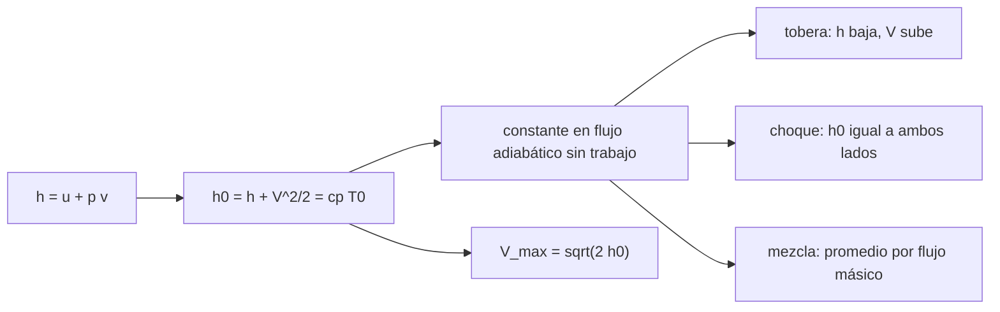

# B79-C13 — Entalpía de flujo y entalpía total

<!-- nav:top -->
[🏠 Programa](../../../../README.md) · [📚 Bloque B79](../../../tronco-comun/B79-fluidos-termodinamica-y-aerotermodinamica-de-propulsion.md) · [← Anterior: B79-C12 — Procesos adiabáticos e isentrópicos](../B79-C12-procesos-adiabaticos-e-isentropicos/CLASE.md) · [Siguiente: B79-C14 — Propiedades de gases calientes →](../B79-C14-propiedades-de-gases-calientes/CLASE.md)
<!-- /nav -->

## 1. Ubicación, nivel y alcance

Clase 13 del bloque B79. Nivel N3. La entalpía `h = u + p v` es la energía que lleva consigo un fluido que se mueve: la interna más el trabajo necesario para empujarlo. Sumada a la energía cinética da la entalpía total `h₀`, que se conserva en un flujo adiabático sin trabajo. Esta clase usa ese hecho para recorrer una tobera, medir cuánta entalpía se convierte en velocidad, comprobar que un choque no la cambia y calcular la mezcla de dos corrientes. Usa [C10](../B79-C10-primera-ley-de-la-termodinamica-en-sistemas-abiertos/CLASE.md) y [C12](../B79-C12-procesos-adiabaticos-e-isentropicos/CLASE.md). El gas es el de la tobera ilustrativa de [C08](../B79-C08-flujo-en-toberas-convergente-divergentes/CLASE.md).

## 2. Por qué esta clase existe

El concepto de energía de flujo es la base del análisis de motores; ninguna clase del tronco lo trata. Con `h₀` se obtiene el límite de velocidad de escape y se entiende por qué la temperatura total no cambia en un choque. La decisión central: **¿cuánta de la entalpía total puedo convertir en velocidad y qué límite impone la presión de salida?**

## 3. Lo que podrás hacer al terminar

1. Definir entalpía de flujo y entalpía total.
2. Comprobar que `h₀` es constante a lo largo de una tobera adiabática.
3. Calcular la velocidad máxima `√(2 h₀)`.
4. Calcular la velocidad de escape en función de `p_e/p₀`.
5. Verificar que un choque normal conserva `h₀`.
6. Calcular la temperatura total de una mezcla adiabática.

La evidencia es la **ficha de entalpía total de un flujo** del ejercicio 12 (sección 20).

## 4. Con qué llegas y cómo comprobarlo

1. ¿Qué es la energía interna?
2. ¿Qué es el trabajo de flujo?
3. ¿Qué es la energía cinética específica?
4. ¿Qué es una mezcla adiabática?
5. ¿Qué es una temperatura total?

<details>
<summary>Ver respuestas</summary>

1. la energía de los movimientos moleculares, `u`, en J/kg. 2. `p v`, la energía para empujar el fluido a través de la frontera. 3. `V²/2`, en J/kg. 4. una mezcla sin calor intercambiado con el exterior. 5. la que alcanzaría el flujo al frenarse sin pérdidas.
</details>

Con cuatro o cinco aciertos, sigue; si no, repasa los prerrequisitos.

## 5. Un caso de contexto y casos de referencia

El gas de la tobera ilustrativa tiene `h₀ = c_p T₀ = 6,3000 MJ/kg`; en la salida (`M = 3,2783`) solo `3,0365 MJ/kg` es entalpía y `3,2635 MJ/kg` es energía cinética: se convierte el `51,8 %` de `h₀` en velocidad (`2554,8 m/s` de un máximo de `3549,6 m/s`). Es el **ejemplo conductor**. Todo es **ilustrativo**.

## 6. Vocabulario

La **entalpía** `h = u + p v` (para gas ideal calórico, `h = c_p T`) es la energía de flujo por kg. La **entalpía total** `h₀ = h + V²/2 = c_p T₀`. La **velocidad máxima** de escape es `√(2 h₀)`, el límite de expandir hasta `T → 0`. La **fracción convertida** es `V_e²/V_max²`.

## 7. Modelo mental: un pasajero con equipaje



*Descripción textual:* la entalpía total se conserva en la tobera, en el choque y en la mezcla; con ella se obtiene la velocidad máxima y la de escape para cada presión de salida.

Analogía: un pasajero que lleva el equipaje (su energía interna) y el billete (el trabajo de flujo) viaja en un tren cuya velocidad se paga con parte del equipaje. Límite: la analogía no explica las pérdidas por irreversibilidad.

## 8. La explicación, paso a paso

### 8.1 Entalpía total en la tobera

Con `γ = 1,2`, `R = 350`: `c_p = 2100 J/(kg K)` y `h₀ = 6,3000 MJ/kg`. En cuatro estaciones, calculadas con las isentrópicas y `V = M a`:

| Estación `M` | `T` (K) | `V` (m/s) | `h` (MJ/kg) | `V²/2` (MJ/kg) | `h₀` (MJ/kg) |
|---|---|---|---|---|---|
| 0,2 | 2988,0 | 224,1 | 6,2749 | 0,0251 | 6,3000 |
| 1,0 | 2727,3 | 1070,3 | 5,7273 | 0,5727 | 6,3000 |
| 2,0 | 2142,9 | 1897,4 | 4,5000 | 1,8000 | 6,3000 |
| 3,2783 | 1446,0 | 2554,8 | 3,0365 | 3,2635 | 6,3000 |

La suma da `h₀` a 16 cifras; es una comprobación de consistencia de las isentrópicas con el balance, no una medida.

### 8.2 Velocidad máxima y de escape

`V_max = √(2 h₀) = 3549,6 m/s`. La velocidad de escape depende de la razón de presiones, `V_e = √(2 c_p T₀ [1 − (p_e/p₀)^((γ−1)/γ)])`:

| `p_e/p₀` | `V_e` (m/s) | `V_e/V_max` | fracción de `h₀` |
|---|---|---|---|
| 0,5000 | 1172,5 | 0,3303 | 0,1091 |
| 0,1000 | 2003,9 | 0,5645 | 0,3187 |
| 0,0125 | 2555,4 | 0,7199 | 0,5183 |
| 0,0010 | 2935,2 | 0,8269 | 0,6838 |
| 0,0001 | 3144,1 | 0,8858 | 0,7846 |

Para `M = 3,2783` los tres cálculos (por `M` y `a`, por balance y por `p_e/p₀ = 0,012538`) dan `2554,781 m/s`.

### 8.3 Choque y mezcla

En un choque normal en aire a `M₁ = 2`, `h₀ = 452,104 kJ/kg` a ambos lados: la presión total baja, pero la entalpía total se conserva; la pérdida está en la presión total (C07). Una mezcla adiabática de `3 kg/s` a `1100 K` y `1 kg/s` a `700 K` con el mismo `c_p` queda a `T₀ = 1000 K`.

### 8.4 Qué cambia y qué no

La entalpía total no cambia en el flujo adiabático sin trabajo, pero la **presión total** sí cae si hay irreversibilidades. Para convertir más entalpía en velocidad hay que bajar `p_e/p₀`, con rendimientos decrecientes: pasar de `0,001` a `0,0001` solo suma 9 puntos de `V_e/V_max`. La conversión total (`V_max`) es un límite teórico inalcanzable.

## 9. Magnitudes, símbolos y unidades

| Símbolo | Qué es | Unidad | Valor / nota |
|---|---|---|---|
| `h` | entalpía específica | MJ/kg | 3,04–6,27 |
| `h₀` | entalpía total específica | MJ/kg | 6,3000 |
| `c_p` | calor específico a presión constante | J/(kg K) | 2100 (ilustrativo) |
| `T₀` | temperatura total | K | 3000 (ilustrativa) |
| `V_max` | velocidad máxima de escape | m/s | 3549,6 |
| `p_e/p₀` | razón de presiones | — | 0,0001–0,5 |

## 10. Convenciones y referencias

Gas ideal calórico con `γ = 1,2` y `R = 350 J/(kg K)` para la tobera y `γ = 1,4` para el choque en aire; flujo adiabático y sin trabajo; sin reacciones químicas. Datos ilustrativos. Python 3.12.

## 11. De dónde sale lo que afirmamos

| ID | Fuente | Localizador | Respalda | Estado |
|---|---|---|---|---|
| S1 | NASA Glenn, «Isentropic Flow Equations» — https://www.grc.nasa.gov/www/k-12/airplane/isentrop.html (consultada 2026-11-10) | página completa | p/pt, T/Tt y ρ/ρt en función del Mach y γ | Consultada |
| S2 | NASA Glenn, «First Law of Thermodynamics» — https://www.grc.nasa.gov/www/k-12/airplane/thermo1.html (consultada 2026-11-10) | página completa | E2 − E1 = Q − W (cambio de energía interna = calor − trabajo) | Consultada |
| — | Relaciones estándar de libro de texto que el laboratorio verifica con una segunda vía | — | las verifica el laboratorio | No consultada en una fuente concreta |

Límites: la definición de entalpía total, `V_max` y la fórmula de escape son resultados estándar no consultados; el gas y las condiciones son ilustrativos.

## 12. Cómo ver la entalpía total

| Magnitud | Valor |
|---|---|
| `h₀` | 6,3000 MJ/kg |
| `V_max` | 3549,6 m/s |
| `V_e/V_max` (`ε = 10`) | 0,7199 |
| diferencia entre vías | 3,56 × 10⁻¹⁶ |

Descripción larga: a lo largo de la tobera, la entalpía baja y la energía cinética sube con suma constante.

## 13. Ejemplo trabajado: la velocidad de escape a `p_e/p₀ = 0,1`

**Paso 1 · Exponente.** `(γ−1)/γ = 0,16667`.

**Paso 2 · Factor.** `1 − 0,1^0,16667 = 0,31870`.

**Paso 3 · Velocidad.** `V_e = √(2 × 6,3 × 10⁶ × 0,31870) = 2003,9 m/s`.

## 14. Distintas formas de describir la energía de un flujo

**Por entalpía:** `h = c_p T`. **Por velocidad:** `V²/2`. **Por total:** `h₀ = c_p T₀`. **Por fracción:** `V_e²/V_max²`.

## 15. Práctica guiada

**Ejercicio 1 · con los pasos indicados.** Calcula `h₀` con `c_p = 2100` y `T₀ = 3000 K`. *Pasos:* producto.

<details><summary>Solución comentada</summary>

`6,3 × 10⁶ J/kg`.
</details>

**Ejercicio 2 · con una pista.** ¿Qué `V_max` da? *Pista:* `√(2 h₀)`.

<details><summary>Solución comentada</summary>

`3549,6 m/s`.
</details>

**Ejercicio 3 · casi autónomo.** ¿Qué `T` da `V = 1897,4 m/s`? *Casi autónomo:* `T = (h₀ − V²/2)/c_p`.

<details><summary>Solución comentada</summary>

`(6,3 − 1,8)/2100 × 10⁶ = 2142,9 K`.
</details>

## 16. Práctica autónoma, transferencia e integrador

**Ejercicio 4 · autónomo.** Fracción convertida a `p_e/p₀ = 0,1`.

<details><summary>Solución comentada</summary>

`0,3187`.
</details>

**Ejercicio 5 · autónomo.** `T₀` de una mezcla de `2 kg/s` a `900 K` y `2 kg/s` a `500 K`.

<details><summary>Solución comentada</summary>

`700 K`.
</details>

**Ejercicio 6 · autónomo.** `T₀` tras un choque normal con `T₀ = 400 K`.

<details><summary>Solución comentada</summary>

`400 K`.
</details>

**Ejercicio 7 · autónomo.** `V_e` si `T₀` baja a 2000 K con la misma razón 0,1.

<details><summary>Solución comentada</summary>

`2003,9 × √(2000/3000) = 1636 m/s`.
</details>

**Ejercicio 8 · autónomo.** Razón `V_e/V_max` si `p_e/p₀ → 0`.

<details><summary>Solución comentada</summary>

Tiende a 1.
</details>

**Ejercicio 9 · transferencia.** **Transferencia.** Un colega sube `p₀` pero mantiene `p_e/p₀`. ¿Cambia la velocidad de escape?

<details><summary>Solución comentada</summary>

No: `V_e` solo depende de `T₀` y de `p_e/p₀` en este modelo.
</details>

**Ejercicio 10 · transferencia.** **Transferencia.** ¿Por qué la entalpía total no cambia en un choque pero la presión total sí?

<details><summary>Solución comentada</summary>

El choque es adiabático y sin trabajo (conserva `h₀`) pero irreversible (genera entropía y baja `p₀`).
</details>

**Ejercicio 11 · transferencia.** **Transferencia.** ¿Qué falta para aplicar esto a una cámara con combustión?

<details><summary>Solución comentada</summary>

Calor liberado por reacción y `c_p(T)` (C14); aquí `h₀` es dato.
</details>

**Ejercicio 12 · integrador.** **Integrador.** Elabora tu *ficha de entalpía total de un flujo*: tabla de `h`, `V²/2` y `h₀` en cuatro estaciones, `V_max`, tabla de `V_e/V_max` y lista de qué es consultado e ilustrativo.

<details><summary>Solución comentada</summary>

Secciones 8.1–8.4 y la salida del laboratorio.
</details>

## 17. Laboratorio: entalpía total en una tobera, un choque y una mezcla

El script [entalpia.py](entalpia.py) recorre cuatro estaciones de la tobera, calcula `V_max` y la velocidad de escape para cinco razones de presión con tres vías y comprueba la conservación de `h₀` en un choque normal y en una mezcla (**comprueba** diferencia < 1e-10).

**Datos:** solo las isentrópicas y el enunciado de la primera ley se consultaron (NASA Glenn); el gas y las condiciones son **ilustrativos**. **Predice antes de ejecutar:** ¿cuánto valdrá `h₀` en la salida? (el mismo 6,3000 MJ/kg.) **Ejecución del 2026-11-10:**

```text
Python 3.12.9 (biblioteca estandar)
Gas caliente ILUSTRATIVO: gamma = 1.2, R = 350.0 J/(kg K), cp = 2100.0 J/(kg K), T0 = 3000.0 K, h0 = cp T0 = 6.3000 MJ/kg
 estacion   M      T [K]    V [m/s]    h [MJ/kg]   V^2/2 [MJ/kg]   h0 [MJ/kg]
   M=0.2000  0.2000   2988.0      224.1     6.2749       0.0251        6.3000
   M=1.0000  1.0000   2727.3     1070.3     5.7273       0.5727        6.3000
   M=2.0000  2.0000   2142.9     1897.4     4.5000       1.8000        6.3000
   M=3.2783  3.2783   1446.0     2554.8     3.0365       3.2635        6.3000
Velocidad maxima (expansion hasta T = 0): V_max = sqrt(2 h0) = 3549.6 m/s
 pe/p0       Ve [m/s]   Ve/Vmax   fraccion de h0 convertida
   0.5000      1172.5   0.3303      0.1091
   0.1000      2003.9   0.5645      0.3187
   0.0125      2555.4   0.7199      0.5183
   0.0010      2935.2   0.8269      0.6838
   0.0001      3144.1   0.8858      0.7846
Escape a Me = 3.2783: por M y a = 2554.781 ; por balance = 2554.781 ; por pe/p0 = 0.012538: 2554.781 m/s
Choque normal en aire (M1 = 2): h01 = 452.104 kJ/kg ; h02 = 452.104 kJ/kg (la entalpia total no cambia)
Mezcla adiabatica de 3 kg/s a 1100 K y 1 kg/s a 700 K (cp igual): T0 mezcla = 1000.0 K
Diferencia maxima de h0 / escape entre vias = 3.56e-16
Pruebas superadas.
```

```bash
python programa/clases/B79/B79-C13-entalpia-de-flujo-y-entalpia-total/entalpia.py
```

**Límites:** gas ideal calórico y flujo adiabático; la constancia de `h₀` se comprueba por consistencia del modelo y no mide una tobera real.

## 18. Errores frecuentes y cómo corregirlos

**Confundir `h` con `h₀`.** Se corrige con 8.1.

**Creer que un choque cambia `h₀`.** Se corrige con 8.3.

**Esperar convertir toda `h₀` en velocidad.** Se corrige con 8.4.

**Presentar el gas sintético como combustión real.** Se corrige con la sección 10.

## 19. Cómo sabrás que vas bien

Tras la sección 8: ¿qué `h₀` esperabas en la salida y cuál obtuviste? Si dudas, repasa el ejemplo 13. Tras el laboratorio: ¿qué comprueba? (ver la sección 17).

## 20. Qué entregas y cómo se evalúa

El producto es tu **ficha de entalpía total de un flujo** (ejercicio 12).

| Criterio | Inicial | En desarrollo | Logrado | Destacado |
|---|---|---|---|---|
| Conceptos | Los confunde | Parciales | Usa `h₀` para velocidad y conservación | Explica los límites |
| Cálculo | Sin unidades | Con errores | Tablas completas con unidades | Calcula casos nuevos |
| Numérico | Sin comprobar | Un caso | Contraste con una segunda vía | Interpreta las diferencias |
| Fuentes | Sin fuente | Sin fecha | Fuentes con fecha y estado | Declara lo ilustrativo y lo no consultado |
| Límites | No los nombra | Uno | Tres | Discute qué falta del modelo |

**Condiciones críticas (no se compensan con promedio):** rotular el gas y las condiciones como ilustrativos; no presentar la conservación de `h₀` como medida de una tobera real; no presentar un cálculo como medición de un motor real; citar solo lo consultado.

## 21. Ética, seguridad y límites

Clase educativa: los modelos son simplificados y sus datos son sintéticos, ilustrativos o coeficientes publicados con fuente; ningún resultado describe un motor o un vehículo reales ni sustituye al análisis de ingeniería, a las normas o a los datos de fabricante.  Accesibilidad: tablas equivalentes a las gráficas, fórmulas en texto, ejercicios sin conexión.

## 22. Para cerrar y seguir

La tobera ilustrativa convierte el 51,8 % de `h₀` en velocidad. Queda una pregunta: ¿qué valor de `c_p` y `γ` usar cuando el gas está a 3000 K? Lo ve C14.

**Glosario español–inglés.** entalpía · *enthalpy*; entalpía total · *total enthalpy*; temperatura total · *total temperature*; trabajo de flujo · *flow work*; velocidad de escape · *exhaust velocity*.

**Continuidad.** [B79-C14](../B79-C14-propiedades-de-gases-calientes/CLASE.md) estudia las propiedades de los gases calientes.

**Referencias:** ver sección 11.

<!-- nav:bottom -->
---

[← Anterior: B79-C12 — Procesos adiabáticos e isentrópicos](../B79-C12-procesos-adiabaticos-e-isentropicos/CLASE.md) · [📚 Bloque B79](../../../tronco-comun/B79-fluidos-termodinamica-y-aerotermodinamica-de-propulsion.md) · [Siguiente: B79-C14 — Propiedades de gases calientes →](../B79-C14-propiedades-de-gases-calientes/CLASE.md)
<!-- /nav -->
