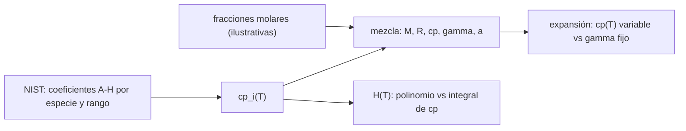

# B79-C14 — Propiedades de gases calientes

<!-- nav:top -->
[🏠 Programa](../../../../README.md) · [📚 Bloque B79](../../../tronco-comun/B79-fluidos-termodinamica-y-aerotermodinamica-de-propulsion.md) · [← Anterior: B79-C13 — Entalpía de flujo y entalpía total](../B79-C13-entalpia-de-flujo-y-entalpia-total/CLASE.md) · [Siguiente: B79-C15 — Ciclos termodinámicos de propulsión →](../B79-C15-ciclos-termodinamicos-de-propulsion/CLASE.md)
<!-- /nav -->

## 1. Ubicación, nivel y alcance

Clase 14 del bloque B79. Nivel N3. A las temperaturas de una cámara de combustión, el aire frío con `γ = 1,4` deja de ser un modelo aceptable: el calor específico crece con la temperatura y la composición pasa a ser dióxido de carbono, vapor de agua y nitrógeno. Esta clase usa los polinomios de Shomate publicados por NIST para calcular `c_p(T)`, `γ(T)` y la velocidad del sonido de una mezcla ilustrativa, verifica la entalpía con una integral y mide cuánto cambia una expansión al usar `c_p(T)` en lugar de un `γ` fijo. Usa [C12](../B79-C12-procesos-adiabaticos-e-isentropicos/CLASE.md) y [C13](../B79-C13-entalpia-de-flujo-y-entalpia-total/CLASE.md). La composición es ilustrativa y sin disociación.

## 2. Por qué esta clase existe

B06-C09 trata gases en general; aquí hacen falta propiedades termofísicas a alta temperatura con fuente. Sin ellas, las toberas y las turbinas se dimensionan con un `γ` que no existe a 2000–3000 K. La decisión central: **¿qué `c_p` y `γ` uso a esta temperatura, con qué fuente, y cuánto cambia el resultado respecto al aire frío?**

## 3. Lo que podrás hacer al terminar

1. Evaluar `c_p(T)` y `H(T) − H₂₉₈` con un polinomio de Shomate.
2. Mezclar especies por fracción molar y calcular masa molar, `R`, `c_p`, `γ` y `a`.
3. Detectar el salto de `c_p` en el empalme de dos rangos.
4. Verificar la entalpía con una integral numérica de `c_p`.
5. Comparar una expansión con `c_p(T)` frente a `γ` constante.
6. Declarar el rango de validez y lo que el modelo omite (disociación).

La evidencia es la **tabla de propiedades de una mezcla** del ejercicio 12 (sección 20).

## 4. Con qué llegas y cómo comprobarlo

1. ¿Qué es el calor específico a presión constante?
2. ¿Qué es una fracción molar?
3. ¿Qué es la masa molar?
4. ¿Qué es la constante universal de los gases?
5. ¿Qué es un polinomio ajustado?

<details>
<summary>Ver respuestas</summary>

1. la energía por unidad de masa o de mol y por K para calentar a presión constante. 2. los moles de una especie divididos entre los moles totales. 3. la masa de un mol, en g/mol. 4. `R_u = 8,314 J/(mol K)`, cuyo valor por kg es `R_u/M`. 5. una fórmula con coeficientes ajustados a datos, válida solo en su rango.
</details>

Con cuatro o cinco aciertos, sigue; si no, repasa los prerrequisitos.

## 5. Un caso de contexto y casos de referencia

La mezcla de productos de metano y aire (`CO₂ 0,0951`, `H₂O 0,1901`, `N₂ 0,7148`) tiene `M = 27,6332 g/mol`, `R = 300,89 J/(kg K)` y `γ` de `1,2963` a `1000 K` a `1,2398` a `3000 K` (frente a 1,4 del aire frío). Es el **ejemplo conductor**. Todo es **ilustrativo** salvo los coeficientes de NIST: la composición no es un cálculo de equilibrio.

## 6. Vocabulario

Los **polinomios de Shomate** son `c_p = A + B t + C t² + D t³ + E/t²` con `t = T/1000` y coeficientes por rango de temperatura. La **entalpía sensible** es `H(T) − H₂₉₈`. Una **mezcla ideal** suma por fracción molar. La **disociación** es la ruptura de moléculas a muy alta temperatura (no modelada). `γ = c_p/(c_p − R)` con `c_p` y `R` en la misma base.

## 7. Modelo mental: una paleta de pinturas



*Descripción textual:* los coeficientes de NIST dan `c_p` de cada especie; la mezcla da `γ` y `a`; la entalpía se verifica por integral y se evalúa el efecto sobre una expansión.

Analogía: una paleta cuyo color mezclado depende de cuánta pintura de cada tono hay y de la temperatura de la paleta. Límite: la mezcla ideal supone que las moléculas no interactúan ni se disocian.

## 8. La explicación, paso a paso

### 8.1 Propiedades de la mezcla

Composición de la ecuación balanceada `CH₄ + 2 O₂ + 7,52 N₂ → CO₂ + 2 H₂O + 7,52 N₂`: `x = 0,0951; 0,1901; 0,7148`. `M = 27,6332 g/mol` y `R = 300,89 J/(kg K)`.

| `T` (K) | `c_p` CO₂ | `c_p` H₂O | `c_p` N₂ | `c_p` mezcla (J/(mol K)) | `c_p` (J/(kg K)) | `γ` | `a` (m/s) |
|---|---|---|---|---|---|---|---|
| 500 | 44,615 | 35,218 | 29,581 | 32,082 | 1161,0 | 1,3498 | 450,6 |
| 1000 | 54,305 | 41,266 | 32,692 | 36,376 | 1316,4 | 1,2963 | 624,5 |
| 1500 | 58,404 | 47,109 | 34,847 | 39,418 | 1426,5 | 1,2673 | 756,3 |
| 2000 | 60,336 | 51,205 | 35,976 | 41,187 | 1490,5 | 1,2529 | 868,3 |
| 3000 | 62,228 | 55,742 | 37,030 | 42,983 | 1555,5 | 1,2398 | 1057,9 |

### 8.2 Calidad del ajuste

En los empalmes de rango el `c_p` salta `−0,0346` (CO₂ a 1200 K), `−0,0082` (H₂O a 1700 K) y `−0,0053` (N₂ a 2000 K) J/(mol K): un ajuste, no una discontinuidad física. La entalpía por polinomio y por integral de `c_p` coincide con diferencia `6,9 × 10⁻¹³` dentro de un rango (por ejemplo CO₂ 1300–2500 K: `71,7690 kJ/mol`) y `4,0 × 10⁻⁵` cuando se cruza un empalme (CO₂ 800–2500 K: `99,1069` frente a `99,1101 kJ/mol`), porque los ajustes no son exactamente continuos en `H`.

### 8.3 Efecto sobre una expansión

Expandir de `3000 K` con `p₂/p₁ = 1/50`: con `c_p(T)` variable, `T₂ = 1359,7 K`; con `γ` y `c_p` fijos a `3000 K` (`γ = 1,2398`), `1407,6 K`; con `γ = 1,4`, `981,1 K`. Usar aire frío da un error de más de 370 K. La velocidad de escape resultante es `2216,4 m/s` con `c_p(T)` y `2225,7 m/s` con `γ` constante a 3000 K, una diferencia de `0,4 %`: aunque la temperatura de salida difiere, la velocidad es poco sensible a este detalle, y sí lo es al valor de `γ` elegido.

### 8.4 Qué cambia y qué no

`c_p` y `γ` dependen de `T` y de la composición; las relaciones isentrópicas con `γ` fijo son una aproximación cuya calidad se mide como aquí. No se modela disociación, que a más de ~2500 K y con presión baja cambia mucho la composición, ni especies como CO, OH o NO. Los coeficientes valen solo en el rango de la ficha (CO₂ 298–6000 K; H₂O 500–6000 K; N₂ 100–6000 K).

## 9. Magnitudes, símbolos y unidades

| Símbolo | Qué es | Unidad | Valor / nota |
|---|---|---|---|
| `c_p` | calor específico molar | J/(mol K) | 29,6–62,2 |
| `γ` | razón de calores específicos | — | 1,2398–1,3498 |
| `a` | velocidad del sonido | m/s | 450,6–1057,9 |
| `M` | masa molar de la mezcla | g/mol | 27,6332 |
| `R` | constante de la mezcla | J/(kg K) | 300,89 |
| `x` | fracción molar | — | 0,0951; 0,1901; 0,7148 |
| `H − H₂₉₈` | entalpía sensible | kJ/mol | — |

## 10. Convenciones y referencias

Mezcla ideal de CO₂, H₂O y N₂ con fracciones molares de la ecuación balanceada; sin disociación ni CO ni NO. Coeficientes de Shomate de NIST (Chase 1998) por rango; se usan `T ≥ 500 K`. Constante universal `R_u = 8,314462618 J/(mol K)` (no consultada en esta clase). Python 3.12.

## 11. De dónde sale lo que afirmamos

| ID | Fuente | Localizador | Respalda | Estado |
|---|---|---|---|---|
| S1 | NIST Chemistry WebBook, dióxido de carbono (C124389), Mask=1 — https://webbook.nist.gov/cgi/cbook.cgi?ID=C124389&Mask=1 (consultada 2026-11-10) | Gas phase thermochemistry, Shomate | M = 44,0095 g/mol; coeficientes de Shomate 298–1200 K y 1200–6000 K (Chase 1998) | Consultada |
| S2 | NIST Chemistry WebBook, agua (C7732185), Mask=1 — https://webbook.nist.gov/cgi/cbook.cgi?ID=C7732185&Mask=1 (consultada 2026-11-10) | Gas phase thermochemistry, Shomate | M = 18,0153 g/mol; coeficientes de Shomate 500–1700 K y 1700–6000 K | Consultada |
| S3 | NIST Chemistry WebBook, nitrógeno (C7727379), Mask=1 — https://webbook.nist.gov/cgi/cbook.cgi?ID=C7727379&Mask=1 (consultada 2026-11-10) | Gas phase thermochemistry, Shomate | M = 28,0134 g/mol; coeficientes de Shomate 100–500, 500–2000 y 2000–6000 K | Consultada |
| — | Relaciones estándar de libro de texto que el laboratorio verifica con una segunda vía | — | las verifica el laboratorio | No consultada en una fuente concreta |

Límites: la composición es una ilustración de una ecuación balanceada y no un cálculo de equilibrio; `R_u` y la mezcla ideal son estándar no consultados; no se consultó ninguna base de datos de gases de combustión reales.

## 12. Cómo ver las propiedades de un gas caliente

| Magnitud | Valor |
|---|---|
| `γ` a 1000 K | 1,2963 |
| `γ` a 3000 K | 1,2398 |
| `T₂` con `c_p(T)` | 1359,7 K |
| `T₂` con `γ = 1,4` | 981,1 K |

Descripción larga: `γ` baja al subir la temperatura y usar 1,4 subestima la temperatura final de una expansión en cientos de kelvin.

## 13. Ejemplo trabajado: `γ` a 1000 K

**Paso 1 · Cp de la mezcla.** `0,0951×54,305 + 0,1901×41,266 + 0,7148×32,692 = 36,376 J/(mol K)`.

**Paso 2 · Cv.** `36,376 − 8,3145 = 28,062`.

**Paso 3 · γ.** `36,376/28,062 = 1,2963`.

## 14. Distintas formas de describir un gas caliente

**Por especie:** `c_p,i(T)`. **Por mezcla:** `Σ x_i c_p,i`. **Por razón:** `γ`. **Por velocidad:** `a = √(γ R T)`.

## 15. Práctica guiada

**Ejercicio 1 · con los pasos indicados.** Calcula `R` de la mezcla con `M = 27,6332 g/mol`. *Pasos:* `R_u/M` con `M` en kg/mol.

<details><summary>Solución comentada</summary>

`8,3145/0,0276332 = 300,89 J/(kg K)`.
</details>

**Ejercicio 2 · con una pista.** ¿Qué `γ` da `c_p = 42,983 J/(mol K)`? *Pista:* `c_p/(c_p − R_u)`.

<details><summary>Solución comentada</summary>

`42,983/34,669 = 1,2398`.
</details>

**Ejercicio 3 · casi autónomo.** ¿Qué `a` da `γ = 1,2963`, `R = 300,89`, `T = 1000 K`? *Casi autónomo:* `√(γ R T)`.

<details><summary>Solución comentada</summary>

`624,5 m/s`.
</details>

## 16. Práctica autónoma, transferencia e integrador

**Ejercicio 4 · autónomo.** `c_p` en J/(kg K) de la mezcla a 2000 K.

<details><summary>Solución comentada</summary>

`41,187/0,0276332 = 1490,5`.
</details>

**Ejercicio 5 · autónomo.** Cambio de `γ` entre 500 y 3000 K.

<details><summary>Solución comentada</summary>

`1,3498 − 1,2398 = 0,110`.
</details>

**Ejercicio 6 · autónomo.** ¿Cuántos kelvin separan `T₂` con `c_p(T)` y con `γ = 1,4`?

<details><summary>Solución comentada</summary>

`1359,7 − 981,1 = 378,6 K`.
</details>

**Ejercicio 7 · autónomo.** Si la temperatura final fuera de 1407,6 K, ¿cuál es la diferencia respecto al `c_p(T)`?

<details><summary>Solución comentada</summary>

`47,9 K`.
</details>

**Ejercicio 8 · autónomo.** Masa molar de una mezcla que fuera solo N₂.

<details><summary>Solución comentada</summary>

`28,0134 g/mol`: la composición determina `R` y `γ`.
</details>

**Ejercicio 9 · transferencia.** **Transferencia.** Un colega usa `γ = 1,4` para la turbina de un motor. ¿Qué error comete en la temperatura de salida?

<details><summary>Solución comentada</summary>

Cientos de kelvin, como en 8.3.
</details>

**Ejercicio 10 · transferencia.** **Transferencia.** ¿Por qué el resultado de la velocidad de escape fue poco sensible al modelo de `c_p` pero la temperatura no?

<details><summary>Solución comentada</summary>

Porque la velocidad depende del salto de entalpía total, que varía poco, mientras que la temperatura final depende del `c_p` local.
</details>

**Ejercicio 11 · transferencia.** **Transferencia.** ¿Qué efecto no incluye el modelo a 3000 K y presión baja?

<details><summary>Solución comentada</summary>

Disociación (CO₂ → CO + O, H₂O → OH + H) y sus calores de reacción.
</details>

**Ejercicio 12 · integrador.** **Integrador.** Elabora tu *tabla de propiedades de una mezcla*: `c_p`, `γ` y `a` a cinco temperaturas, la verificación de la entalpía con la integral, el efecto en la expansión y la lista de qué es consultado e ilustrativo.

<details><summary>Solución comentada</summary>

Secciones 8.1–8.4 y la salida del laboratorio.
</details>

## 17. Laboratorio: polinomios de Shomate de NIST para CO₂, H₂O y N₂

El script [gases.py](gases.py) evalúa `c_p(T)` de cada especie y de la mezcla, `γ` y `a`, mide los saltos en los empalmes, verifica la entalpía con una integral numérica y compara una expansión con `c_p(T)` y con `γ` fijo (**comprueba** 1e-8 en un rango y 1e-4 cruzando un empalme).

**Datos:** los coeficientes de Shomate y las masas molares se tomaron de las fichas de NIST consultadas el 2026-11-10; la composición, la razón de presiones y la temperatura son **ilustrativas**. **Predice antes de ejecutar:** ¿subirá o bajará `γ` al calentar la mezcla? (baja de 1,35 a 1,24.) **Ejecución del 2026-11-10:**

```text
Python 3.12.9 (biblioteca estandar)
Mezcla ILUSTRATIVA (CH4 + 2 O2 + 7.52 N2 -> CO2 + 2 H2O + 7.52 N2): x_CO2 = 0.0951, x_H2O = 0.1901, x_N2 = 0.7148
M = 27.6332 g/mol ; R = 300.89 J/(kg K)
   T [K]   cp CO2   cp H2O   cp N2    cp mezcla [J/(mol K)]   cp [J/(kg K)]   gamma    a [m/s]
     500   44.615   35.218   29.581        32.082              1161.0      1.3498    450.6
    1000   54.305   41.266   32.692        36.376              1316.4      1.2963    624.5
    1500   58.404   47.109   34.847        39.418              1426.5      1.2673    756.3
    2000   60.336   51.205   35.976        41.187              1490.5      1.2529    868.3
    3000   62.228   55.742   37.030        42.983              1555.5      1.2398   1057.9
Discontinuidad de cp en los empalmes de rangos [J/(mol K)]:
  CO2 en 1200 K: salto = -0.0346
  H2O en 1700 K: salto = -0.0082
  N2 en 2000 K: salto = -0.0053
  CO2: un solo rango 1300-2500 K: polinomio = 71.7690 kJ/mol ; integral de cp = 71.7690 kJ/mol ; cruzando el empalme 800-2500 K: 99.1069 frente a 99.1101
  H2O: un solo rango 600-1600 K: polinomio = 42.4091 kJ/mol ; integral de cp = 42.4091 kJ/mol ; cruzando el empalme 1000-2500 K: 73.1088 frente a 73.1117
  N2: un solo rango 600-1900 K: polinomio = 43.6541 kJ/mol ; integral de cp = 43.6541 kJ/mol ; cruzando el empalme 1000-2500 K: 52.8337 frente a 52.8336
Diferencia relativa maxima: un rango = 6.88e-13 ; cruzando el empalme = 4.01e-05
Expansion isentropica 3000 K, p2/p1 = 1/50: cp(T) variable -> T2 = 1359.7 K ; gamma constante a 3000 K (1.2398) -> 1407.6 K ; gamma = 1.4 -> 981.1 K
 velocidad de escape de esa expansion: cp(T) variable = 2216.4 m/s ; gamma y cp constantes a 3000 K = 2225.7 m/s ; diferencia = 0.4 %
Pruebas superadas.
```

```bash
python programa/clases/B79/B79-C14-propiedades-de-gases-calientes/gases.py
```

**Límites:** mezcla ideal sin disociación; los coeficientes valen solo en el rango publicado; no es un cálculo de equilibrio químico; los gases de combustión reales llevan más especies.

## 18. Errores frecuentes y cómo corregirlos

**Usar `γ = 1,4` a 2000 K.** Se corrige con 8.3.

**Aplicar el polinomio fuera de su rango.** Se corrige con 8.4.

**Mezclar `c_p` molar y `R` por kg.** Se corrige con la sección 9.

**Presentar la composición ilustrativa como el gas de un motor real.** Se corrige con la sección 10.

## 19. Cómo sabrás que vas bien

Tras la sección 8: ¿qué `γ` esperabas a 3000 K y cuál obtuviste? Si dudas, repasa el ejemplo 13. Tras el laboratorio: ¿qué comprueba? (ver la sección 17).

## 20. Qué entregas y cómo se evalúa

El producto es tu **tabla de propiedades de una mezcla** (ejercicio 12).

| Criterio | Inicial | En desarrollo | Logrado | Destacado |
|---|---|---|---|---|
| Conceptos | Los confunde | Parciales | Calcula propiedades de mezcla con polinomios | Explica los límites |
| Cálculo | Sin unidades | Con errores | Tablas completas con unidades | Calcula casos nuevos |
| Numérico | Sin comprobar | Un caso | Contraste con una segunda vía | Interpreta las diferencias |
| Fuentes | Sin fuente | Sin fecha | Fuentes con fecha y estado | Declara lo ilustrativo y lo no consultado |
| Límites | No los nombra | Uno | Tres | Discute qué falta del modelo |

**Condiciones críticas (no se compensan con promedio):** citar solo los coeficientes consultados; rotular la composición como ilustrativa; no aplicar un polinomio fuera de su rango; no presentar un cálculo como medición de un motor real; citar solo lo consultado.

## 21. Ética, seguridad y límites

Clase educativa: los modelos son simplificados y sus datos son sintéticos, ilustrativos o coeficientes publicados con fuente; ningún resultado describe un motor o un vehículo reales ni sustituye al análisis de ingeniería, a las normas o a los datos de fabricante.  Accesibilidad: tablas equivalentes a las gráficas, fórmulas en texto, ejercicios sin conexión.

## 22. Para cerrar y seguir

A 3000 K la mezcla tiene `γ = 1,24` y `c_p = 1555 J/(kg K)`. Queda una pregunta: ¿cómo se usa todo esto para el ciclo completo de un motor? Lo ve C15.

**Glosario español–inglés.** polinomio de Shomate · *Shomate polynomial*; calor específico · *specific heat*; fracción molar · *mole fraction*; disociación · *dissociation*; entalpía sensible · *sensible enthalpy*.

**Continuidad.** [B79-C15](../B79-C15-ciclos-termodinamicos-de-propulsion/CLASE.md) estudia los ciclos termodinámicos de propulsión.

**Referencias:** ver sección 11.

<!-- nav:bottom -->
---

[← Anterior: B79-C13 — Entalpía de flujo y entalpía total](../B79-C13-entalpia-de-flujo-y-entalpia-total/CLASE.md) · [📚 Bloque B79](../../../tronco-comun/B79-fluidos-termodinamica-y-aerotermodinamica-de-propulsion.md) · [Siguiente: B79-C15 — Ciclos termodinámicos de propulsión →](../B79-C15-ciclos-termodinamicos-de-propulsion/CLASE.md)
<!-- /nav -->
