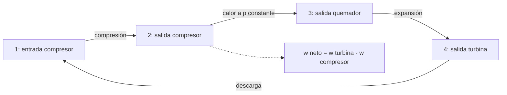

# B79-C15 — Ciclos termodinámicos de propulsión

<!-- nav:top -->
[🏠 Programa](../../../../README.md) · [📚 Bloque B79](../../../tronco-comun/B79-fluidos-termodinamica-y-aerotermodinamica-de-propulsion.md) · [← Anterior: B79-C14 — Propiedades de gases calientes](../B79-C14-propiedades-de-gases-calientes/CLASE.md) · [Siguiente: B79-C16 — Eficiencias termodinámicas de motores →](../B79-C16-eficiencias-termodinamicas-de-motores/CLASE.md)
<!-- /nav -->

## 1. Ubicación, nivel y alcance

Clase 15 del bloque B79. Nivel N3. Un motor de turbina de gas sigue un ciclo de Brayton: el aire se comprime, se calienta a presión constante en el quemador, se expande en la turbina y se descarga. Esta clase calcula ese ciclo ideal y con pérdidas, halla qué relación de presiones da más trabajo y cuál más rendimiento y verifica el cálculo estado a estado. Usa [C10](../B79-C10-primera-ley-de-la-termodinamica-en-sistemas-abiertos/CLASE.md), [C12](../B79-C12-procesos-adiabaticos-e-isentropicos/CLASE.md) y [C14](../B79-C14-propiedades-de-gases-calientes/CLASE.md). El ciclo es sintético y no es un motor concreto.

## 2. Por qué esta clase existe

B85-C11 trata ciclos térmicos de ensayo, no termodinámicos. Para entender el rendimiento de una turbina de gas hay que ver el ciclo que lo origina. La decisión central: **¿qué relación de presiones elijo si quiero más trabajo por kg de aire y cuál si quiero más rendimiento?**

## 3. Lo que podrás hacer al terminar

1. Describir las estaciones del ciclo de Brayton.
2. Calcular el rendimiento ideal `1 − r^(−(γ−1)/γ)` y verificarlo estado a estado.
3. Calcular la relación de presiones de trabajo máximo.
4. Calcular el ciclo con rendimientos de compresor y turbina y pérdida de presión en el quemador.
5. Comparar la relación de presiones óptima para trabajo y para rendimiento.
6. Reconocer el efecto de la temperatura máxima.

La evidencia es la **ficha de un ciclo de Brayton** del ejercicio 12 (sección 20).

## 4. Con qué llegas y cómo comprobarlo

1. ¿Qué es una relación de presiones?
2. ¿Qué es el rendimiento térmico?
3. ¿Qué es el trabajo neto?
4. ¿Qué es un ciclo?
5. ¿Qué es el rendimiento isentrópico?

<details>
<summary>Ver respuestas</summary>

1. `r = p₂/p₁`, adimensional. 2. el trabajo neto entre el calor aportado. 3. el de la turbina menos el del compresor. 4. una serie de procesos que devuelve el fluido al estado inicial. 5. la razón entre el trabajo ideal y el real (o al revés).
</details>

Con cuatro o cinco aciertos, sigue; si no, repasa los prerrequisitos.

## 5. Un caso de contexto y casos de referencia

Con `T₁ = 288 K` y `T_max = 1400 K`, el ciclo ideal a `r = 20` da `0,5751` de rendimiento y `417,27 kJ/kg`; el ciclo con pérdidas da `0,3238` y `277,55 kJ/kg`; el trabajo máximo ideal está en `r = 15,9`. Es el **ejemplo conductor**. Todo es **ilustrativo**: no describe un motor.

## 6. Vocabulario

El **ciclo de Brayton** tiene compresión isentrópica, calentamiento isobaro, expansión isentrópica y enfriamiento isobaro. Su **rendimiento ideal** es `η = 1 − r^(−(γ−1)/γ)`. El **trabajo neto** es `w = c_p T₁ [τ (1 − r^(−k)) − (r^k − 1)]` con `k = (γ−1)/γ` y `τ = T_max/T₁`. La **relación de presiones de trabajo máximo** es `r = τ^(γ/(2(γ−1)))`.

## 7. Modelo mental: un rectángulo en el plano temperatura–entropía



*Descripción textual:* cuatro estaciones unidas por compresión, combustión a presión constante, expansión y descarga; el trabajo neto es el de la turbina menos el del compresor.

Analogía: un motor de turbina de gas funciona como una noria de aire: se sube presión, se añade calor y se baja la presión en la turbina. Límite: en un motor real el combustible cambia la masa y la composición y el ciclo no se cierra.

## 8. La explicación, paso a paso

### 8.1 Ciclo ideal

Con `γ = 1,4`: `T₂ = T₁ r^0,2857`, `T₄ = T_max/r^0,2857`, `q_ent = c_p (T_max − T₂)`, `q_sal = c_p (T₄ − T₁)`, `w = q_ent − q_sal`.

| `r` | `T₂` (K) | `T₄` (K) | `w` ideal (kJ/kg) | `η` ideal | `w` real (kJ/kg) | `η` real |
|---|---|---|---|---|---|---|
| 5 | 456,1 | 883,9 | 349,55 | 0,3686 | 259,79 | 0,2321 |
| 10 | 556,0 | 725,1 | 408,73 | 0,4821 | 293,68 | 0,2934 |
| 15 | 624,3 | 645,8 | 419,81 | 0,5387 | 290,39 | 0,3155 |
| 20 | 677,8 | 594,8 | 417,27 | 0,5751 | 277,55 | 0,3238 |
| 30 | 761,1 | 529,8 | 399,00 | 0,6216 | 244,26 | 0,3220 |
| 40 | 826,3 | 488,0 | 375,50 | 0,6514 | 209,56 | 0,3074 |

El cálculo estado a estado coincide con la fórmula cerrada con diferencia `3,3 × 10⁻¹⁶`.

### 8.2 Dos óptimos distintos

En el ciclo ideal el trabajo máximo (`419,99 kJ/kg`) está en `r = 15,91` (analítica `15,914`) con `η = 0,5464`, mientras que el rendimiento crece sin límite con `r`. En el ciclo con pérdidas (`η_c = 0,85`, `η_t = 0,88`, caída de presión de 4 %, lado caliente con `c_p = 1148` y `γ = 1,333`) el trabajo máximo es `294,50 kJ/kg` en `r = 11,33` y el rendimiento máximo `0,3252` en `r = 23,63`: existe un óptimo real, porque las pérdidas crecen con `r`. Con `T_max = 1600 K`, `r` de trabajo máximo ideal sube a `20,10`.

### 8.3 Qué cambia con las pérdidas

El rendimiento real a `r = 20` cae de `0,5751` a `0,3238`: las ineficiencias de compresor y turbina se acumulan sobre un calor aportado que pasa casi sin cambio. Cada rendimiento isentrópico afecta al trabajo neto, que es una diferencia de dos grandes.

### 8.4 Qué cambia y qué no

El ciclo ideal sirve para entender la tendencia; no predice un motor. Los valores `c_p` y `γ` calientes son de texto de uso común y no fueron consultados (C14 da las propiedades de NIST). La página de NASA Glenn consultada describe las estaciones del ciclo y no da expresión de rendimiento: las fórmulas son estándar y las verifica el laboratorio.

## 9. Magnitudes, símbolos y unidades

| Símbolo | Qué es | Unidad | Valor / nota |
|---|---|---|---|
| `r` | relación de presiones | — | 5–40 |
| `T₁` | temperatura de entrada | K | 288 (ilustrativa) |
| `T_max` | temperatura máxima | K | 1400 (ilustrativa) |
| `η` | rendimiento térmico | — | 0,2321–0,6514 |
| `w` | trabajo neto | kJ/kg | 209,56–419,81 |
| `η_c`, `η_t` | rendimientos isentrópicos | — | 0,85; 0,88 |

## 10. Convenciones y referencias

Aire frío `γ = 1,4`, `c_p = 1004,675 J/(kg K)` en el ciclo ideal; lado caliente `c_p = 1148`, `γ = 1,333` (de texto, no consultados) en el real. Se ignora la masa de combustible. Estaciones: 1 entrada del compresor, 2 salida del compresor, 3 salida del quemador, 4 salida de la turbina (numeración propia de la clase, distinta de la de NASA). Python 3.12.

## 11. De dónde sale lo que afirmamos

| ID | Fuente | Localizador | Respalda | Estado |
|---|---|---|---|---|
| S1 | NASA Glenn, «Turbine Engine Thermodynamic Cycle – Brayton Cycle» — https://www.grc.nasa.gov/www/k-12/airplane/brayton.html (consultada 2026-11-10) | página completa | estaciones 0–8 del ciclo (compresor, quemador a presión constante, turbina, tobera); la página no da expresión de eficiencia | Consultada |
| S2 | NASA Glenn, «First Law of Thermodynamics» — https://www.grc.nasa.gov/www/k-12/airplane/thermo1.html (consultada 2026-11-10) | página completa | E2 − E1 = Q − W (cambio de energía interna = calor − trabajo) | Consultada |
| — | Relaciones estándar de libro de texto que el laboratorio verifica con una segunda vía | — | las verifica el laboratorio | No consultada en una fuente concreta |

Límites: las fórmulas del ciclo, el trabajo óptimo y los datos del lado caliente son estándar o ilustrativos no consultados; la página de NASA describe las estaciones y no da el rendimiento.

## 12. Cómo ver el ciclo

| Magnitud | Valor |
|---|---|
| `η` ideal a `r = 20` | 0,5751 |
| `η` real a `r = 20` | 0,3238 |
| `r` de trabajo máximo (ideal) | 15,91 |
| `r` de rendimiento máximo (real) | 23,63 |

Descripción larga: el trabajo neto tiene un máximo con `r` y el rendimiento real también, pero en puntos distintos.

## 13. Ejemplo trabajado: el rendimiento ideal a `r = 10`

**Paso 1 · Exponente.** `k = 0,4/1,4 = 0,2857`.

**Paso 2 · Factor.** `10^0,2857 = 1,9307`.

**Paso 3 · Rendimiento.** `1 − 1/1,9307 = 0,4821`.

## 14. Distintas formas de describir un ciclo

**Por estados:** `T₂`, `T₄`. **Por energía:** `q_ent`, `q_sal`, `w`. **Por rendimiento:** `η`. **Por relación de presiones:** `r`.

## 15. Práctica guiada

**Ejercicio 1 · con los pasos indicados.** Calcula `η` ideal a `r = 20`. *Pasos:* `1 − 20^(−0,2857)`.

<details><summary>Solución comentada</summary>

`1 − 0,4249 = 0,5751`.
</details>

**Ejercicio 2 · con una pista.** ¿Qué `T₂` da `r = 10` desde `288 K`? *Pista:* `288 × 10^0,2857`.

<details><summary>Solución comentada</summary>

`556,0 K`.
</details>

**Ejercicio 3 · casi autónomo.** ¿Qué `r` maximiza el trabajo ideal con `T_max = 1400`? *Casi autónomo:* `(1400/288)^(3,5/2)`.

<details><summary>Solución comentada</summary>

`15,91`.
</details>

## 16. Práctica autónoma, transferencia e integrador

**Ejercicio 4 · autónomo.** `q_ent` a `r = 10`.

<details><summary>Solución comentada</summary>

`1004,675 × (1400 − 556,0) = 848 kJ/kg`.
</details>

**Ejercicio 5 · autónomo.** `q_sal` a `r = 10`.

<details><summary>Solución comentada</summary>

`1004,675 × (725,1 − 288) = 439,2 kJ/kg`.
</details>

**Ejercicio 6 · autónomo.** `w` a `r = 10` por `q_ent − q_sal`.

<details><summary>Solución comentada</summary>

`408,7 kJ/kg`.
</details>

**Ejercicio 7 · autónomo.** ¿Cómo cambia `r_opt` ideal al subir `T_max` a 1600 K?

<details><summary>Solución comentada</summary>

Sube a `20,10`.
</details>

**Ejercicio 8 · autónomo.** `η` real máxima del ejemplo.

<details><summary>Solución comentada</summary>

`0,3252` en `r = 23,63`.
</details>

**Ejercicio 9 · transferencia.** **Transferencia.** Un diseñador sube `r` a 40 para aumentar el rendimiento. ¿Qué pierde?

<details><summary>Solución comentada</summary>

Trabajo neto por kg y, con pérdidas, también rendimiento real: el óptimo real está en `r ≈ 23,6`.
</details>

**Ejercicio 10 · transferencia.** **Transferencia.** ¿Qué efecto tiene subir `T_max` en el rendimiento ideal para `r` fijo?

<details><summary>Solución comentada</summary>

Ninguno en el rendimiento ideal, pero sí sube el trabajo por kg.
</details>

**Ejercicio 11 · transferencia.** **Transferencia.** ¿Qué falta para comparar con un motor real?

<details><summary>Solución comentada</summary>

Masa de combustible, refrigeración de álabes, pérdidas de entrada y escape y `c_p(T)` (C14).
</details>

**Ejercicio 12 · integrador.** **Integrador.** Elabora tu *ficha de un ciclo de Brayton*: tabla de estados y rendimientos ideal y real para seis relaciones de presiones, relación de presiones óptima para trabajo y rendimiento, y la lista de qué es consultado e ilustrativo.

<details><summary>Solución comentada</summary>

Secciones 8.1–8.4 y la salida del laboratorio.
</details>

## 17. Laboratorio: Brayton ideal y con pérdidas

El script [brayton.py](brayton.py) calcula el ciclo ideal estado a estado y con la fórmula cerrada, el ciclo con pérdidas, y busca por barrido las relaciones de presiones óptimas (**comprueba** diferencia < 1e-12 y `r_opt` con 1e-3).

**Datos:** solo las estaciones del ciclo se consultaron (NASA Glenn); temperaturas, rendimientos y `c_p`, `γ` calientes son **ilustrativos**. **Predice antes de ejecutar:** ¿se mueve a la derecha o a la izquierda el óptimo de trabajo al introducir pérdidas? (a la izquierda: de 15,9 a 11,3.) **Ejecución del 2026-11-10:**

```text
Python 3.12.9 (biblioteca estandar)
Ciclo ILUSTRATIVO: T1 = 288.0 K, T maxima = 1400.0 K, aire frio gamma = 1.4
   r    T2 [K]  T4 [K]   w ideal [kJ/kg]  eta ideal   eta cerrada   w real [kJ/kg]  eta real
    5    456.1   883.9        349.55       0.3686      0.3686         259.79      0.2321
   10    556.0   725.1        408.73       0.4821      0.4821         293.68      0.2934
   15    624.3   645.8        419.81       0.5387      0.5387         290.39      0.3155
   20    677.8   594.8        417.27       0.5751      0.5751         277.55      0.3238
   30    761.1   529.8        399.00       0.6216      0.6216         244.26      0.3220
   40    826.3   488.0        375.50       0.6514      0.6514         209.56      0.3074
Diferencia maxima estado a estado frente a cerrada = 3.33e-16
Relacion de presiones de trabajo maximo (ideal): numerica = 15.91 ; analitica = 15.914 ; w_max = 419.99 kJ/kg ; eta en ese punto = 0.5464
Ciclo real: trabajo maximo 294.50 kJ/kg en r = 11.33 ; eficiencia maxima 0.3252 en r = 23.63
Con T3 = 1600 K el r de trabajo maximo ideal sube a 20.10
Pruebas superadas.
```

```bash
python programa/clases/B79/B79-C15-ciclos-termodinamicos-de-propulsion/brayton.py
```

**Límites:** ciclo de aire estándar con masa constante, sin combustible, sin refrigeración, `c_p` y `γ` constantes; no es un motor.

## 18. Errores frecuentes y cómo corregirlos

**Maximizar solo el rendimiento ideal.** Se corrige con 8.2.

**Olvidar las pérdidas.** Se corrige con 8.3.

**Usar `γ = 1,4` en el lado caliente sin declararlo.** Se corrige con 8.4.

**Presentar el ciclo sintético como un motor concreto.** Se corrige con la sección 10.

## 19. Cómo sabrás que vas bien

Tras la sección 8: ¿qué `η` esperabas a `r = 10` y cuál obtuviste? Si dudas, repasa el ejemplo 13. Tras el laboratorio: ¿qué comprueba? (ver la sección 17).

## 20. Qué entregas y cómo se evalúa

El producto es tu **ficha de un ciclo de Brayton** (ejercicio 12).

| Criterio | Inicial | En desarrollo | Logrado | Destacado |
|---|---|---|---|---|
| Conceptos | Los confunde | Parciales | Calcula ciclos ideal y real y sus óptimos | Explica los límites |
| Cálculo | Sin unidades | Con errores | Tablas completas con unidades | Calcula casos nuevos |
| Numérico | Sin comprobar | Un caso | Contraste con una segunda vía | Interpreta las diferencias |
| Fuentes | Sin fuente | Sin fecha | Fuentes con fecha y estado | Declara lo ilustrativo y lo no consultado |
| Límites | No los nombra | Uno | Tres | Discute qué falta del modelo |

**Condiciones críticas (no se compensan con promedio):** rotular el ciclo y los datos como ilustrativos; distinguir el óptimo de trabajo y el de rendimiento; no presentar un cálculo como medición de un motor real; citar solo lo consultado.

## 21. Ética, seguridad y límites

Clase educativa: los modelos son simplificados y sus datos son sintéticos, ilustrativos o coeficientes publicados con fuente; ningún resultado describe un motor o un vehículo reales ni sustituye al análisis de ingeniería, a las normas o a los datos de fabricante.  Accesibilidad: tablas equivalentes a las gráficas, fórmulas en texto, ejercicios sin conexión.

## 22. Para cerrar y seguir

El ciclo ideal sube el rendimiento con `r` pero el real alcanza su máximo (0,325) en `r ≈ 23,6`, y el de trabajo está en 11,3. Queda una pregunta: ¿cómo se convierte ese trabajo en empuje y cuánto cuesta cada etapa? Lo ve C16.

**Glosario español–inglés.** ciclo de Brayton · *Brayton cycle*; relación de presiones · *pressure ratio*; trabajo neto · *net work*; quemador · *combustor*; rendimiento térmico · *thermal efficiency*.

**Continuidad.** [B79-C16](../B79-C16-eficiencias-termodinamicas-de-motores/CLASE.md) estudia las eficiencias termodinámicas de motores.

**Referencias:** ver sección 11.

<!-- nav:bottom -->
---

[← Anterior: B79-C14 — Propiedades de gases calientes](../B79-C14-propiedades-de-gases-calientes/CLASE.md) · [📚 Bloque B79](../../../tronco-comun/B79-fluidos-termodinamica-y-aerotermodinamica-de-propulsion.md) · [Siguiente: B79-C16 — Eficiencias termodinámicas de motores →](../B79-C16-eficiencias-termodinamicas-de-motores/CLASE.md)
<!-- /nav -->
