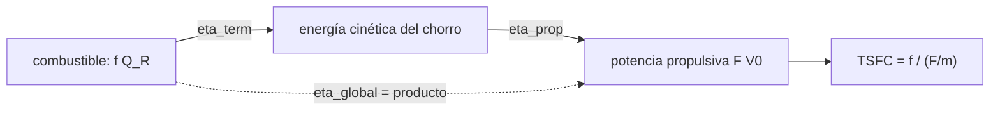

# B79-C16 — Eficiencias termodinámicas de motores

<!-- nav:top -->
[🏠 Programa](../../../../README.md) · [📚 Bloque B79](../../../tronco-comun/B79-fluidos-termodinamica-y-aerotermodinamica-de-propulsion.md) · [← Anterior: B79-C15 — Ciclos termodinámicos de propulsión](../B79-C15-ciclos-termodinamicos-de-propulsion/CLASE.md) · [Siguiente: B80-C01 — Principios de navegación inercial espacial →](../../../tronco-comun/B80-navegacion-inercial-y-fusion-multisensorial.md#b80-c01)
<!-- /nav -->

## 1. Ubicación, nivel y alcance

Clase 16 del bloque B79. Nivel N3. Un motor convierte la energía química del combustible en energía cinética del chorro (eficiencia térmica) y esa en trabajo útil sobre el vehículo (eficiencia propulsiva); su producto es la eficiencia global. Esta clase calcula un turborreactor ilustrativo, ideal y con pérdidas, para varias velocidades de vuelo y relaciones de presiones, y verifica el producto de eficiencias. Cierra el bloque y usa [C13](../B79-C13-entalpia-de-flujo-y-entalpia-total/CLASE.md), [C14](../B79-C14-propiedades-de-gases-calientes/CLASE.md) y [C15](../B79-C15-ciclos-termodinamicos-de-propulsion/CLASE.md). El motor es sintético y no corresponde a ningún modelo real.

## 2. Por qué esta clase existe

Ninguna clase cubre cómo se cuantifica la conversión de energía en propulsión. Sin eficiencias separadas, un cambio de diseño se evalúa a ciegas: no se sabe si mejora el ciclo o el aprovechamiento del chorro. La decisión central: **¿qué parte del combustible acaba en el chorro, qué parte de ese chorro empuja al vehículo y qué diseño mejora cada una?**

## 3. Lo que podrás hacer al terminar

1. Calcular el flujo de combustible, el empuje específico y el consumo específico.
2. Calcular las eficiencias térmica, propulsiva y global.
3. Verificar `η_global = η_térmica η_propulsiva` con el cálculo directo.
4. Ver el efecto de la velocidad de vuelo y de la relación de presiones.
5. Cuantificar la pérdida por componentes frente al caso ideal.
6. Reconocer el límite de la aproximación `η_p = 2V₀/(V_e+V₀)`.

La evidencia es la **ficha de eficiencias de un turborreactor** del ejercicio 12 (sección 20).

## 4. Con qué llegas y cómo comprobarlo

1. ¿Qué es el empuje específico?
2. ¿Qué es el poder calorífico?
3. ¿Qué es la eficiencia térmica?
4. ¿Qué es el consumo específico de empuje?
5. ¿Qué es la velocidad de vuelo?

<details>
<summary>Ver respuestas</summary>

1. el empuje por kg/s de aire, en N·s/kg. 2. la energía liberada por kg de combustible, en J/kg. 3. la energía cinética ganada por el chorro dividida entre la energía del combustible. 4. el flujo de combustible por unidad de empuje, kg/(N·s). 5. la velocidad del vehículo respecto al aire, en m/s.
</details>

Con cuatro o cinco aciertos, sigue; si no, repasa los prerrequisitos.

## 5. Un caso de contexto y casos de referencia

Un turborreactor ilustrativo a `M₀ = 0,8` (`V₀ = 237,9 m/s`), relación de presiones 15 y `T_4t = 1500 K` da, con pérdidas, `F/ṁ = 838,2 N·s/kg`, `η_térmica = 0,4498`, `η_propulsiva = 0,3726` y `η_global = 0,1676`; el ideal da `0,5159`, `0,3471` y `0,1791`. Es el **ejemplo conductor**. Todo es **ilustrativo**: no describe un motor concreto.

## 6. Vocabulario

La **eficiencia térmica** es `η_th = [½(1+f)V_e² − ½V₀²]/(f Q_R)`. La **eficiencia propulsiva** es `η_p = F V₀/{ṁ[½(1+f)V_e² − ½V₀²]}`. La **eficiencia global** `η_o = η_th η_p = F V₀/(ṁ_c Q_R)`. El **consumo específico** `TSFC = f/(F/ṁ)`. La razón combustible/aire es `f`.

## 7. Modelo mental: una cascada de dos turbinas de agua



*Descripción textual:* la energía del combustible se convierte en energía cinética del chorro y esta en potencia propulsiva; la eficiencia global es el producto de las dos.

Analogía: dos turbinas de agua en cascada: la primera extrae parte del salto, la segunda parte de lo que queda. Límite: el modelo no incluye el efecto del tamaño ni la altitud.

## 8. La explicación, paso a paso

### 8.1 Empuje y consumo

Con `T₀ = 220 K`, `p₀ = 23000 Pa`, `r = 15`, `T_4t = 1500 K`, `Q_R = 43 MJ/kg`, `η_b = 0,99` (todo ilustrativo), el empuje específico es `F/ṁ = (1+f) V_e − V₀` con la tobera adaptada (`p_e = p₀`).

| Caso | `M₀` | `V₀` (m/s) | `f` | `V_e` (m/s) | `F/ṁ` (N·s/kg) | `η_th` | `η_p` | `η_o` | TSFC (mg/(N·s)) |
|---|---|---|---|---|---|---|---|---|---|
| ideal | 0,0 | 0,0 | 0,03043 | 1091,8 | 1125,1 | 0,4694 | 0,0000 | 0,0000 | n/a |
| ideal | 0,5 | 148,7 | 0,02984 | 1113,5 | 998,0 | 0,4890 | 0,2365 | 0,1156 | 29,90 |
| ideal | 0,8 | 237,9 | 0,02892 | 1141,1 | 936,3 | 0,5159 | 0,3471 | 0,1791 | 30,89 |
| ideal | 1,2 | 356,8 | 0,02705 | 1180,4 | 855,5 | 0,5604 | 0,4683 | 0,2624 | 31,62 |
| ideal | 2,0 | 594,7 | 0,02104 | 1219,3 | 650,2 | 0,6434 | 0,6643 | 0,4274 | 32,36 |
| con pérdidas | 0,0 | 0,0 | 0,02931 | 999,7 | 1029,0 | 0,4081 | 0,0000 | 0,0000 | n/a |
| con pérdidas | 0,5 | 148,7 | 0,02867 | 1020,9 | 901,5 | 0,4258 | 0,2553 | 0,1087 | 31,80 |
| con pérdidas | 0,8 | 237,9 | 0,02767 | 1047,1 | 838,2 | 0,4498 | 0,3726 | 0,1676 | 33,01 |
| con pérdidas | 1,2 | 356,8 | 0,02561 | 1082,2 | 753,1 | 0,4875 | 0,5005 | 0,2440 | 34,01 |
| con pérdidas | 2,0 | 594,7 | 0,01903 | 1100,1 | 526,4 | 0,5374 | 0,7117 | 0,3825 | 36,16 |

La eficiencia propulsiva es cero con el avión parado (todo el empuje es estático y ninguna potencia útil) y sube con la velocidad; la térmica sube con el Mach por la compresión dinámica de la toma. El producto `η_th η_p` coincide con `F V₀/(ṁ_c Q_R)` con diferencia `5,6 × 10⁻¹⁷`.

### 8.2 Efecto de la relación de presiones (`M₀ = 0,8`, con pérdidas)

| `r` | `F/ṁ` (N·s/kg) | TSFC (mg/(N·s)) | `η_th` | `η_o` |
|---|---|---|---|---|
| 5 | 768,2 | 41,47 | 0,3374 | 0,1334 |
| 10 | 827,6 | 35,49 | 0,4142 | 0,1559 |
| 15 | 838,2 | 33,01 | 0,4498 | 0,1676 |
| 25 | 827,2 | 30,49 | 0,4841 | 0,1814 |
| 35 | 804,3 | 29,10 | 0,4992 | 0,1901 |

El empuje específico máximo (`838,4 N·s/kg`) está en `r = 15,80`, mientras que el consumo mínimo del barrido (`28,60`) está en el borde (`r = 40`): subir `r` ahorra combustible pero a costa de empuje por kg de aire, es decir, de tamaño del motor. Este es el mismo conflicto de C15.

### 8.3 Compromiso entre chorro y vehículo

Para un chorro simple (`f → 0`), `η_p ≈ 2V₀/(V_e+V₀)`; en el caso ideal a `M₀ = 0,8` da `0,3450` frente al valor exacto `0,3471`. Esto explica por qué un turborreactor puro, con chorro muy rápido, es poco eficiente a baja velocidad y un motor de mayor derivación (que mueve más aire más despacio) lo sería más (afirmación estándar, no consultada); este laboratorio no modela esa derivación.

### 8.4 Qué cambia y qué no

Las pérdidas por componentes (toma, compresor, turbina, quemador, tobera) reducen `η_th` de `0,5159` a `0,4498` y `η_o` de `0,1791` a `0,1676` a `M₀ = 0,8`. La eficiencia global depende de las dos: mejorar el ciclo sin mirar el chorro (o al revés) deja a la otra intacta. Las cifras absolutas son de un modelo con `c_p` y `γ` supuestos y no deben compararse con motores reales.

## 9. Magnitudes, símbolos y unidades

| Símbolo | Qué es | Unidad | Valor / nota |
|---|---|---|---|
| `f` | razón combustible/aire | — | 0,019–0,030 |
| `V₀` | velocidad de vuelo | m/s | 0–594,7 |
| `V_e` | velocidad de salida | m/s | 999,7–1219,3 |
| `F/ṁ` | empuje específico | N·s/kg | 526,4–1125,1 |
| `η_th`, `η_p`, `η_o` | eficiencias | — | 0,34–0,64; 0–0,71; 0–0,43 |
| `TSFC` | consumo específico | mg/(N·s) | 29,10–36,16 |
| `Q_R` | poder calorífico | MJ/kg | 43 (ilustrativo) |

## 10. Convenciones y referencias

Turborreactor de flujo único con tobera adaptada (`p_e = p₀`), gas de dos zonas con `c_p` y `γ` constantes por zona; atmósfera ilustrativa (`T₀ = 220 K`, `p₀ = 23000 Pa`, no consultadas). Se incluye la masa de combustible `f` en el empuje. Python 3.12.

## 11. De dónde sale lo que afirmamos

| ID | Fuente | Localizador | Respalda | Estado |
|---|---|---|---|---|
| S1 | NASA Glenn, «Turbine Engine Thermodynamic Cycle – Brayton Cycle» — https://www.grc.nasa.gov/www/k-12/airplane/brayton.html (consultada 2026-11-10) | página completa | estaciones 0–8 del ciclo (compresor, quemador a presión constante, turbina, tobera); la página no da expresión de eficiencia | Consultada |
| S2 | NASA Glenn, «First Law of Thermodynamics» — https://www.grc.nasa.gov/www/k-12/airplane/thermo1.html (consultada 2026-11-10) | página completa | E2 − E1 = Q − W (cambio de energía interna = calor − trabajo) | Consultada |
| S3 | NASA Glenn, «Second Law – Entropy» — https://www1.grc.nasa.gov/beginners-guide-to-aeronautics/second-law-entropy/ (consultada 2026-11-10) | página completa | ΔS = ΔQ/T; S_f = S_i reversible, S_f > S_i irreversible | Consultada |
| — | Relaciones estándar de libro de texto que el laboratorio verifica con una segunda vía | — | las verifica el laboratorio | No consultada en una fuente concreta |

Límites: las definiciones de eficiencia, la razón `f` y el empuje son estándar no consultados; la página de eficiencia térmica de NASA Glenn devolvió error 404 y no se consultó; la atmósfera, el motor y el combustible son ilustrativos.

## 12. Cómo ver las eficiencias

| Magnitud | Valor |
|---|---|
| `η_th` (con pérdidas, `M₀ = 0,8`) | 0,4498 |
| `η_p` | 0,3726 |
| `η_o` | 0,1676 |
| diferencia del producto | 5,6 × 10⁻¹⁷ |

Descripción larga: la eficiencia térmica y la propulsiva suben con la velocidad de vuelo, y la global es su producto.

## 13. Ejemplo trabajado: la eficiencia global a `M₀ = 0,8` con pérdidas

**Paso 1 · Térmica.** `0,4498`.

**Paso 2 · Propulsiva.** `0,3726`.

**Paso 3 · Global.** `0,4498 × 0,3726 = 0,1676`.

## 14. Distintas formas de describir la eficiencia de un motor

**Por etapas:** `η_th`, `η_p`. **Por producto:** `η_o`. **Por consumo:** `TSFC`. **Por empuje:** `F/ṁ`.

## 15. Práctica guiada

**Ejercicio 1 · con los pasos indicados.** Calcula `η_o` con `η_th = 0,5159` y `η_p = 0,3471`. *Pasos:* producto.

<details><summary>Solución comentada</summary>

`0,1791`.
</details>

**Ejercicio 2 · con una pista.** ¿Qué `TSFC` da `f = 0,02767` y `F/ṁ = 838,2`? *Pista:* `f/(F/ṁ)`.

<details><summary>Solución comentada</summary>

`3,301 × 10⁻⁵ kg/(N·s) = 33,0 mg/(N·s)`.
</details>

**Ejercicio 3 · casi autónomo.** ¿Por qué `η_p = 0` en tierra? *Casi autónomo:* mira `V₀`.

<details><summary>Solución comentada</summary>

Porque `F V₀ = 0`: no hay potencia útil aunque haya empuje.
</details>

## 16. Práctica autónoma, transferencia e integrador

**Ejercicio 4 · autónomo.** `η_p` aproximada con `V_e = 1047,1` y `V₀ = 237,9`.

<details><summary>Solución comentada</summary>

`2 × 237,9/(1047,1 + 237,9) = 0,370`.
</details>

**Ejercicio 5 · autónomo.** Pérdida de `η_th` por componentes a `M₀ = 0,8`.

<details><summary>Solución comentada</summary>

`0,5159 − 0,4498 = 0,0661`.
</details>

**Ejercicio 6 · autónomo.** `F` para `ṁ = 20 kg/s` con `F/ṁ = 838,2`.

<details><summary>Solución comentada</summary>

`16,76 kN`.
</details>

**Ejercicio 7 · autónomo.** Combustible por segundo para ese empuje y `f = 0,02767`.

<details><summary>Solución comentada</summary>

`0,5534 kg/s`.
</details>

**Ejercicio 8 · autónomo.** `η_o` con pérdidas a `M₀ = 2,0`.

<details><summary>Solución comentada</summary>

`0,3825`.
</details>

**Ejercicio 9 · transferencia.** **Transferencia.** Un colega sube `r` de 15 a 35 para reducir el consumo. ¿Qué paga?

<details><summary>Solución comentada</summary>

El empuje específico baja de 838,2 a 804,3 N·s/kg, así que necesita más caudal de aire, es decir, un motor mayor, para el mismo empuje.
</details>

**Ejercicio 10 · transferencia.** **Transferencia.** ¿Por qué crece la eficiencia propulsiva con el Mach?

<details><summary>Solución comentada</summary>

Porque `V_e/V₀` baja y el chorro cede más energía útil al vehículo.
</details>

**Ejercicio 11 · transferencia.** **Transferencia.** ¿Qué falta para comparar con un motor comercial?

<details><summary>Solución comentada</summary>

Derivación, mezcla de flujos, refrigeración, pérdidas de instalación, datos de motor y propiedades reales de gas; nada de eso está aquí.
</details>

**Ejercicio 12 · integrador.** **Integrador.** Elabora tu *ficha de eficiencias de un turborreactor*: tabla ideal y con pérdidas a cinco velocidades de vuelo, barrido de `r`, producto de eficiencias y la lista de qué es consultado e ilustrativo.

<details><summary>Solución comentada</summary>

Secciones 8.1–8.4 y la salida del laboratorio.
</details>

## 17. Laboratorio: eficiencias de un turborreactor ideal y con pérdidas

El script [eficiencias.py](eficiencias.py) calcula un turborreactor de flujo único ideal y con pérdidas a cinco velocidades de vuelo y cinco relaciones de presiones, busca por barrido el empuje específico máximo y verifica el producto de eficiencias (**comprueba** diferencia < 1e-12).

**Datos:** solo las estaciones del ciclo y los enunciados de las leyes se consultaron (NASA Glenn); atmósfera, temperaturas, rendimientos y combustible son **ilustrativos**. **Predice antes de ejecutar:** ¿cuánto valdrá `η_p` con el avión parado? (cero.) **Ejecución del 2026-11-10:**

```text
Python 3.12.9 (biblioteca estandar)
Turborreactor ILUSTRATIVO: T0 = 220.0 K, p0 = 23000 Pa, r = 15, T4t = 1500.0 K, Q_R = 43 MJ/kg
Caso               M0     V0 [m/s]  f        Ve [m/s]   F/m [N s/kg]  eta_term  eta_prop  eta_global  TSFC [mg/(N s)]
ideal            0.0       0.0  0.03043    1091.8      1125.1    0.4694    0.0000    0.0000           n/a
ideal            0.5     148.7  0.02984    1113.5       998.0    0.4890    0.2365    0.1156         29.90
ideal            0.8     237.9  0.02892    1141.1       936.3    0.5159    0.3471    0.1791         30.89
ideal            1.2     356.8  0.02705    1180.4       855.5    0.5604    0.4683    0.2624         31.62
ideal            2.0     594.7  0.02104    1219.3       650.2    0.6434    0.6643    0.4274         32.36
con perdidas     0.0       0.0  0.02931     999.7      1029.0    0.4081    0.0000    0.0000           n/a
con perdidas     0.5     148.7  0.02867    1020.9       901.5    0.4258    0.2553    0.1087         31.80
con perdidas     0.8     237.9  0.02767    1047.1       838.2    0.4498    0.3726    0.1676         33.01
con perdidas     1.2     356.8  0.02561    1082.2       753.1    0.4875    0.5005    0.2440         34.01
con perdidas     2.0     594.7  0.01903    1100.1       526.4    0.5374    0.7117    0.3825         36.16
Diferencia maxima |eta_term eta_prop - eta_global| = 5.55e-17
Barrido de r (M0 = 0.8, con perdidas)
    r    F/m [N s/kg]  TSFC [mg/(N s)]  eta_term  eta_global
    5        768.2         41.47        0.3374    0.1334
   10        827.6         35.49        0.4142    0.1559
   15        838.2         33.01        0.4498    0.1676
   25        827.2         30.49        0.4841    0.1814
   35        804.3         29.10        0.4992    0.1901
Empuje especifico maximo 838.4 N s/kg en r = 15.80 ; TSFC minimo del barrido 28.60 mg/(N s) en r = 40.00 (borde del barrido)
Aproximacion eta_prop = 2 V0/(Ve + V0) (f -> 0), ideal M0 = 0.8: 0.3450 frente a 0.3471
Pruebas superadas.
```

```bash
python programa/clases/B79/B79-C16-eficiencias-termodinamicas-de-motores/eficiencias.py
```

**Límites:** turborreactor de flujo único con `c_p` y `γ` por zona constantes, sin derivación, refrigeración ni pérdidas de instalación; no es un motor.

## 18. Errores frecuentes y cómo corregirlos

**Maximizar solo la eficiencia térmica.** Se corrige con 8.3.

**Dividir el empuje por el combustible sin considerar `V₀`.** Se corrige con 8.1.

**Confundir `η_p` con `η_o`.** Se corrige con el vocabulario.

**Presentar el motor sintético como uno real.** Se corrige con la sección 10.

## 19. Cómo sabrás que vas bien

Tras la sección 8: ¿qué `η_o` esperabas a `M₀ = 0,8` con pérdidas y cuál obtuviste? Si dudas, repasa el ejemplo 13. Tras el laboratorio: ¿qué comprueba? (ver la sección 17).

## 20. Qué entregas y cómo se evalúa

El producto es tu **ficha de eficiencias de un turborreactor** (ejercicio 12).

| Criterio | Inicial | En desarrollo | Logrado | Destacado |
|---|---|---|---|---|
| Conceptos | Los confunde | Parciales | Calcula y distingue las tres eficiencias | Explica los límites |
| Cálculo | Sin unidades | Con errores | Tablas completas con unidades | Calcula casos nuevos |
| Numérico | Sin comprobar | Un caso | Contraste con una segunda vía | Interpreta las diferencias |
| Fuentes | Sin fuente | Sin fecha | Fuentes con fecha y estado | Declara lo ilustrativo y lo no consultado |
| Límites | No los nombra | Uno | Tres | Discute qué falta del modelo |

**Condiciones críticas (no se compensan con promedio):** rotular el motor y la atmósfera como ilustrativos; no comparar con un motor real sin datos; no presentar un cálculo como medición de un motor real; citar solo lo consultado.

## 21. Ética, seguridad y límites

Clase educativa: los modelos son simplificados y sus datos son sintéticos, ilustrativos o coeficientes publicados con fuente; ningún resultado describe un motor o un vehículo reales ni sustituye al análisis de ingeniería, a las normas o a los datos de fabricante.  Accesibilidad: tablas equivalentes a las gráficas, fórmulas en texto, ejercicios sin conexión.

## 22. Para cerrar y seguir

A `M₀ = 0,8` el motor ilustrativo convierte el 45 % de la energía del combustible en chorro, el 37 % de este en empuje útil y el 16,8 % del total. Con esto se cierra el bloque: de la continuidad al balance de energía de un motor.

**Glosario español–inglés.** eficiencia térmica · *thermal efficiency*; eficiencia propulsiva · *propulsive efficiency*; eficiencia global · *overall efficiency*; empuje específico · *specific thrust*; consumo específico · *thrust-specific fuel consumption*.

**Continuidad.** Esta es la última clase del bloque B79; el bloque siguiente es B80 (navegación inercial y fusión multisensorial), que no continúa este tema.

**Referencias:** ver sección 11.

<!-- nav:bottom -->
---

[← Anterior: B79-C15 — Ciclos termodinámicos de propulsión](../B79-C15-ciclos-termodinamicos-de-propulsion/CLASE.md) · [📚 Bloque B79](../../../tronco-comun/B79-fluidos-termodinamica-y-aerotermodinamica-de-propulsion.md) · [Siguiente: B80-C01 — Principios de navegación inercial espacial →](../../../tronco-comun/B80-navegacion-inercial-y-fusion-multisensorial.md#b80-c01)
<!-- /nav -->
