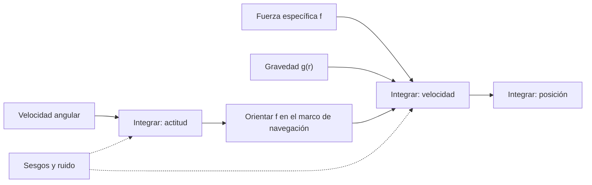

# B80-C01 — Principios de navegación inercial espacial

<!-- nav:top -->
[🏠 Programa](../../../../README.md) · [📚 Bloque B80](../../../tronco-comun/B80-navegacion-inercial-y-fusion-multisensorial.md) · [← Anterior: B79-C16 — Eficiencias termodinámicas de motores](../../B79/B79-C16-eficiencias-termodinamicas-de-motores/CLASE.md) · [Siguiente: B80-C02 — Modelo de error de acelerómetros →](../B80-C02-modelo-de-error-de-acelerometros/CLASE.md)
<!-- /nav -->

## 1. Ubicación, nivel y alcance

Clase 1 del bloque B80 (área A06). Nivel N3. Una unidad de medición inercial (IMU) no mide la posición: mide la fuerza específica y la velocidad angular, y la posición sale de integrarlas, una vez para la velocidad y otra para la posición. Esa doble integración convierte un error pequeño en un error que crece con el cuadrado del tiempo. Aquí calculas cómo crece, por qué la gravedad acopla un error de actitud con uno de posición y qué es el período de Schuler. Abre el bloque y precede a [B80-C02](../B80-C02-modelo-de-error-de-acelerometros/CLASE.md). El caso es sintético.

## 2. Por qué esta clase existe

Una sonda que sale de la cobertura de seguimiento, un lanzador en ascenso o un módulo de aterrizaje en su descenso necesitan saber dónde están sin ayuda externa. B87 trata el giroscopio como sensor de actitud y B74 estima la órbita con observaciones externas; ninguna clase actual enseña cómo se propaga una solución desde una IMU. La decisión central: **¿cuánto tiempo puede confiar un vehículo en su navegación inercial antes de necesitar una corrección externa?**

## 3. Lo que podrás hacer al terminar

1. Explicar qué mide una IMU (fuerza específica y velocidad angular) y qué no mide.
2. Calcular el error de posición y de velocidad producido por un sesgo constante de acelerómetro.
3. Calcular el error de posición producido por un sesgo constante de giroscopio, con y sin realimentación de gravedad.
4. Obtener la frecuencia y el período de Schuler a partir de `g` y del radio.
5. Estimar el tiempo hasta alcanzar un error de posición dado y decidir cuándo se necesita una corrección.
6. Rotular qué datos son consultados, cuáles son sintéticos y cuáles son modelos.

La evidencia es la **ficha de presupuesto de error inercial** del ejercicio 12 (sección 20).

## 4. Con qué llegas y cómo comprobarlo

1. ¿Qué es la integración numérica de una aceleración?
2. ¿Qué es un sesgo de sensor?
3. ¿Qué es la fuerza específica?
4. ¿Qué es un dato sintético?
5. ¿Qué es una frecuencia angular?

<details>
<summary>Ver respuestas</summary>

1. Sumar la aceleración multiplicada por un paso de tiempo para obtener la velocidad, y repetir con la velocidad para la posición. 2. Un error constante que se suma a la medición. 3. La aceleración no gravitacional que mide un acelerómetro: aceleración total menos gravedad. 4. Un valor propuesto para el ejemplo, no medido. 5. Radianes por segundo; el período es `2π` dividido por ella.
</details>

Con cuatro o cinco aciertos, sigue; si no, repasa los prerrequisitos.

## 5. Un caso de contexto y casos de referencia

Un acelerómetro con un sesgo constante `b = 1,0 × 10⁻³ m/s²` (unos `102 µg`) acumula `180,000 m` de error de posición en `600 s` y supera `1 km` a los `1414 s` (`23,6 min`). Un giroscopio con un sesgo de `0,01 °/h` (`4,848 × 10⁻⁸ rad/s`) inclina la plataforma y produce `17,139 m` en `600 s` sin realimentación. El período de Schuler con la gravedad media y el radio ecuatorial terrestres es `5063,7 s` (`84,40 min`). Es el **ejemplo conductor**. Los sesgos son **sintéticos**; la gravedad y el radio son consultados.

## 6. Vocabulario

La **fuerza específica** `f` es lo que mide un acelerómetro: `f = a − g`, aceleración total menos la gravitacional. La **navegación inercial** integra `v̇ = f + g(r)` y `ṙ = v`. El **sesgo** es un error constante de un sensor. La **frecuencia de Schuler** `ω_s = √(g/R)` es la frecuencia propia de un péndulo de longitud igual al radio de la Tierra; su período es `2π/ω_s`. **Deriva** es el crecimiento del error de la solución con el tiempo.

## 7. Modelo mental: caminar con los ojos cerrados contando pasos



*Descripción textual:* la velocidad angular da la actitud; con ella se orienta la fuerza específica en el marco de navegación; sumada a la gravedad se integra para la velocidad y de nuevo para la posición. Los sesgos entran en ambas cadenas.

Analogía: caminar con los ojos cerrados contando pasos: cada paso mal medido se acumula y, si además te desvías un poco de rumbo, el error crece más rápido. Límite: la navegación inercial real corrige el rumbo con modelos y filtros; aquí se estudia solo la acumulación libre del error.

## 8. La explicación, paso a paso

### 8.1 Qué mide una IMU

Un acelerómetro mide la fuerza específica `f`, no la aceleración. En caída libre mide cero aunque el cuerpo acelere a `g`. La navegación necesita por tanto un **modelo de gravedad**: `v̇ = f + g(r)`. Un giroscopio mide la velocidad angular del cuerpo respecto del espacio inercial, de modo que la actitud se obtiene integrándola (se desarrolla en [B80-C03](../B80-C03-mecanizacion-strapdown-e-integracion-de-actitud-y-velocidad/CLASE.md)).

### 8.2 Sesgo de acelerómetro: error cuadrático

Con un sesgo constante `b`, el error de velocidad es `δv = b t` y el de posición `δx = ½ b t²`. Con `b = 1,0 × 10⁻³ m/s²`: `60 s → 1,800 m`, `120 s → 7,200 m`, `300 s → 45,000 m`, `600 s → 180,000 m`. El tiempo para acumular `1 km` es `t = √(2 × 1000 / b) = 1414 s`.

### 8.3 Sesgo de giroscopio: error cúbico (sin realimentación)

Un sesgo `ε` inclina la plataforma `θ = ε t`. La gravedad, mal descompuesta, aparece como una aceleración falsa `g θ`, y se integra dos veces: `δx = g ε t³ / 6`. Con `ε = 4,848 × 10⁻⁸ rad/s` y `t = 600 s`: `17,139 m`. A `300 s` son `2,142 m`: duplicar el tiempo multiplica el error por `8`.

### 8.4 Realimentación de gravedad y período de Schuler

Sobre una Tierra esférica, la gravedad realimenta: al desplazarse el vehículo, la vertical local gira y compensa parte de la inclinación. Las ecuaciones `θ̇ = ε − v/R`, `v̇ = g θ` tienen la solución `δx = ε R (t − sen(ω_s t)/ω_s)` con `ω_s = √(g/R) = 1,2408 × 10⁻³ rad/s` y un período de `5063,7 s = 84,40 min`. Para `t` pequeño recupera el resultado cúbico (`16,670 m` frente a `17,139 m` en `600 s`, diferencia de 2,7 %), pero a largo plazo el error por sesgo de giroscopio crece **linealmente** con pendiente `ε R = 0,3092 m/s`, no con `t³`. Al cabo de un período el error es de `1565,8 m`.

### 8.5 Segunda vía

La integración numérica (Euler semi-implícito, `dt = 0,01 s`) reproduce las fórmulas con una diferencia relativa máxima de `5,00 × 10⁻⁴`, dentro de la tolerancia de 0,5 %.

## 9. Magnitudes, símbolos y unidades

| Símbolo | Qué es | Unidad | Valor / nota |
|---|---|---|---|
| `f` | fuerza específica | m/s² | medida por el acelerómetro |
| `b` | sesgo de acelerómetro | m/s² | 1,0 × 10⁻³ (sintético) |
| `ε` | sesgo de giroscopio | rad/s | 4,848 × 10⁻⁸ = 0,01 °/h (sintético) |
| `g` | gravedad media | m/s² | 9,820 (NASA/NSSDC) |
| `R` | radio ecuatorial | m | 6 378 137 (NASA/NSSDC) |
| `ω_s` | frecuencia de Schuler | rad/s | 1,2408 × 10⁻³ |
| `δx` | error de posición | m | 180,000 a 600 s por `b` |

## 10. Convenciones y referencias

Sistema local de navegación (este-norte-arriba) fijo, sin rotación terrestre; Tierra esférica de radio igual al ecuatorial y gravedad media de la ficha NASA/NSSDC. Unidades SI y ángulos en radianes. Los sesgos y el tiempo son sintéticos. Versión del laboratorio: Python 3.12.9, solo biblioteca estándar; tolerancia 0,5 % frente al caso analítico.

## 11. De dónde sale lo que afirmamos

| ID | Fuente | Localizador | Respalda | Estado |
|---|---|---|---|---|
| S1 | NASA/NSSDC, Earth Fact Sheet — https://nssdc.gsfc.nasa.gov/planetary/factsheet/earthfact.html (consultada 2026-11-10; ficha con fecha de actualización 15 de noviembre de 2024) | ficha completa leída | g media 9,820 m/s²; radio ecuatorial 6378,137 km; período de rotación sideral 23,9345 h | Consultada |
| S2 | NIST, CODATA, aceleración estándar de la gravedad `gₙ` — https://physics.nist.gov/cgi-bin/cuu/Value?gn (consultada 2026-11-10) | página del valor | `gₙ` = 9,806 65 m/s² (exacto por definición) | Consultada |
| — | Relaciones estándar de la navegación inercial (error por sesgo, ecuaciones de Schuler) | — | las verifica el laboratorio con una segunda vía numérica | No consultada en una fuente concreta |

Límites: los sesgos no se consultaron ni proceden de una hoja de datos; no se modelan la rotación terrestre, las desalineaciones ni el ruido; el valor `gₙ` del NIST se usa solo como referencia de conversión a micro-g.

## 12. Cómo ver la deriva

| Magnitud | Valor |
|---|---|
| error por `b` a 600 s | 180,000 m |
| error por `ε` a 600 s, sin realimentación | 17,139 m |
| con realimentación de Schuler a 600 s | 16,674 m (forma cerrada 16,670 m) |
| período de Schuler | 5063,7 s = 84,40 min |
| tiempo hasta 1 km con `b` | 1414 s = 23,6 min |
| diferencia numérico/analítico | 5,00 × 10⁻⁴ |

Descripción larga: el error por sesgo de acelerómetro domina a tiempos cortos; el de giroscopio crece más rápido al principio y se vuelve lineal tras la realimentación de gravedad.

## 13. Ejemplo trabajado: cuándo corregir

**Paso 1 · Requisito.** El vehículo tolera `500 m` de error de posición.

**Paso 2 · Presupuesto.** Con `b = 1,0 × 10⁻³ m/s²`: `t = √(2 × 500 / 10⁻³) = 1000 s`.

**Paso 3 · Giroscopio.** Con `ε` de `0,01 °/h` el error cúbico de `1000 s` es `9,82 × 4,848 × 10⁻⁸ × 10⁹ / 6 = 79,3 m`: es menor que el del acelerómetro.

**Paso 4 · Decisión.** El acelerómetro limita; se necesita una corrección antes de `1000 s` (con margen, cada `~600 s`).

## 14. Distintas formas de describir la deriva inercial

**Por polinomio:** `½ b t²` y `g ε t³/6`. **Por frecuencia:** oscilación de Schuler de `84,4 min`. **Por tiempo de corrección:** `t = √(2 δ/b)`. **Por presupuesto:** suma cuadrática de contribuciones independientes.

## 15. Práctica guiada

**Ejercicio 1 · con los pasos indicados.** Calcula el error de posición por `b = 1,0 × 10⁻³ m/s²` a `120 s`. *Pasos:* `½ × 10⁻³ × 120²`.

<details><summary>Solución comentada</summary>

`½ × 10⁻³ × 14 400 = 7,200 m`.
</details>

**Ejercicio 2 · con una pista.** ¿En cuánto tiempo el sesgo de acelerómetro acumula `1 km`? *Pista:* despeja `t` de `½ b t² = 1000`.

<details><summary>Solución comentada</summary>

`t = √(2000/10⁻³) = 1414 s`.
</details>

**Ejercicio 3 · casi autónomo.** Calcula el período de Schuler con `g = 9,820 m/s²` y `R = 6378,137 km`.

<details><summary>Solución comentada</summary>

`2π √(R/g) = 2π √(6,378137 × 10⁶/9,820) = 5063,7 s = 84,40 min`.
</details>

## 16. Práctica autónoma, transferencia e integrador

**Ejercicio 4 · autónomo.** Error de posición con `b = 1,0 × 10⁻⁴ m/s²` a `600 s`.

<details><summary>Solución comentada</summary>

`½ × 10⁻⁴ × 360 000 = 18,000 m`.
</details>

**Ejercicio 5 · autónomo.** Error por giroscopio (modelo cúbico) a `300 s` con `ε = 4,848 × 10⁻⁸ rad/s`.

<details><summary>Solución comentada</summary>

`9,82 × 4,848 × 10⁻⁸ × 2,7 × 10⁷ / 6 = 2,142 m`.
</details>

**Ejercicio 6 · autónomo.** Error de velocidad por `b = 1,0 × 10⁻³ m/s²` a `600 s`.

<details><summary>Solución comentada</summary>

`b t = 0,600 m/s`.
</details>

**Ejercicio 7 · autónomo.** Si el tiempo se duplica, ¿por cuánto se multiplica el error por acelerómetro y por giroscopio (sin realimentación)?

<details><summary>Solución comentada</summary>

Por `4` (cuadrático) y por `8` (cúbico).
</details>

**Ejercicio 8 · autónomo.** ¿Qué sesgo de giroscopio mantiene el error cúbico bajo `10 m` en `600 s`? Dalo en rad/s y en °/h.

<details><summary>Solución comentada</summary>

`ε = 6 × 10 / (9,82 × 600³) = 2,829 × 10⁻⁸ rad/s ≈ 5,83 × 10⁻³ °/h`.
</details>

**Ejercicio 9 · transferencia.** **Transferencia.** Una sonda en crucero apaga el motor y deja de empujar. ¿Qué miden sus acelerómetros y qué sigue acumulando error?

<details><summary>Solución comentada</summary>

Miden fuerza específica casi nula (solo el sesgo); la gravedad no se mide, se modela. El sesgo sigue integrándose como `½ b t²`, y el error de modelo gravitatorio se suma.
</details>

**Ejercicio 10 · transferencia.** **Transferencia.** Un colega afirma que Schuler «elimina la deriva». Respóndele con las fórmulas de la clase.

<details><summary>Solución comentada</summary>

Acota la oscilación de inclinación y velocidad, pero el error de posición por sesgo de giroscopio sigue creciendo linealmente con `ε R` (`0,3092 m/s`); y no existe un efecto Schuler lejos de un cuerpo con gravedad que realimente.
</details>

**Ejercicio 11 · transferencia.** **Transferencia.** Un lanzador necesita error inferior a `200 m` y su navegación inercial tiene `b = 1,0 × 10⁻³ m/s²`. ¿Hasta cuándo puede volar sin corrección?

<details><summary>Solución comentada</summary>

`t = √(400/10⁻³) = 632 s`; después necesita ayuda externa o un sensor mejor.
</details>

**Ejercicio 12 · integrador.** **Integrador.** Elabora tu *ficha de presupuesto de error inercial*: tabla de error de posición por `b` y por `ε` a cuatro tiempos, período de Schuler, tiempo hasta un error umbral y lista de supuestos.

<details><summary>Solución comentada</summary>

Secciones 8.2–8.5 y la salida del laboratorio.
</details>

## 17. Laboratorio: deriva inercial por sesgos y período de Schuler

El script [inercial.py](inercial.py) calcula el error de posición por sesgo de acelerómetro y de giroscopio, la frecuencia de Schuler y la forma cerrada con realimentación, y contrasta con una integración numérica (**comprueba** diferencia < 0,5 %, período de 84,4 min y coherencia con la forma cerrada).

**Datos:** `g`, `R` y el valor estándar de `gₙ` consultados; sesgos, tiempos y paso **sintéticos**. **Predice antes de ejecutar:** ¿qué error acumula `b` a `600 s`? (180 m.) **Ejecución del 2026-11-10 (Python 3.12.9):**

```text
Python 3.12.9 (biblioteca estandar)
Sesgo acelerometro (SINTETICO) b = 1.0e-03 m/s2 = 102.0 micro-g ; sesgo giroscopio eps = 4.8481e-08 rad/s = 0.01 grados/h
 t [s]   x_acc analitico [m]  x_acc numerico [m]   x_gyro analitico [m]  x_gyro numerico [m]
    60               1.8000               1.8003               0.01714             0.01715
   120               7.2000               7.2006               0.13711             0.13715
   300              45.0000              45.0015               2.14239             2.14261
   600             180.0000             180.0030              17.13913            17.13999
Diferencia relativa maxima numerico frente a analitico = 5.00e-04
Frecuencia de Schuler w_s = sqrt(g/R) = 1.240820e-03 rad/s ; periodo = 5063.7 s = 84.40 min
Con realimentacion de Schuler: x(600 s) = 16.67446 m (sin ella 17.13913 m) ; x(periodo) = 1565.81 m
Forma cerrada x(t) = eps R (t - sin(w_s t)/w_s): x(600 s) = 16.67037 m ; crecimiento lineal eps R = 0.3092 m/s
Tiempo para acumular 1 km de error con b = 1e-3 m/s2: 1414 s = 23.6 min
Pruebas superadas.
```

```bash
python programa/clases/B80/B80-C01-principios-de-navegacion-inercial-espacial/inercial.py
```

**Límites:** plano local, Tierra esférica sin rotación, un solo eje, sin ruido ni desalineación.

## 18. Errores frecuentes y cómo corregirlos

**Creer que la IMU mide posición.** Se corrige con 8.1: mide `f` y `ω`.

**Olvidar la gravedad en `v̇ = f + g`.** Se corrige con 8.1.

**Pensar que Schuler elimina el error de posición.** Se corrige con 8.4: el error pasa a ser lineal.

**Presentar los sesgos como los de un sensor real.** Se corrige con la sección 10.

## 19. Cómo sabrás que vas bien

Tras la sección 8: ¿qué error esperabas por `b` a `600 s` y cuál obtuviste? Si dudas, repasa el ejemplo 13. Tras el laboratorio: ¿qué comprueba? (ver la sección 17).

## 20. Qué entregas y cómo se evalúa

El producto es tu **ficha de presupuesto de error inercial** (ejercicio 12).

| Criterio | Inicial | En desarrollo | Logrado | Destacado |
|---|---|---|---|---|
| Conceptos | Los confunde | Parciales | Calcula errores por sesgo | Explica la fuerza específica y Schuler |
| Cálculo | Sin unidades | Con errores | Tablas con unidades | Calcula casos nuevos |
| Verificación | Sin comprobar | Un caso | Contraste con integración numérica | Interpreta las diferencias |
| Fuentes | Sin fuente | Sin fecha | Fuentes con fecha y estado | Declara lo sintético y lo no consultado |
| Límites | No los nombra | Uno | Nombra tres límites del modelo | Discute qué falta del modelo |

**Condiciones críticas (no se compensan con promedio):** rotular los sesgos como sintéticos; no presentar el error como el de un sensor o un vehículo reales; rotular como sintéticos o ilustrativos los datos y los parámetros; no presentar una simulación como observación; citar solo lo consultado.

## 21. Ética, seguridad y límites

Clase educativa: los modelos son simplificados y sus datos son sintéticos o ilustrativos; ningún resultado describe un vehículo real, un sensor comercial ni una misión, y nada de lo simulado debe presentarse como observado. No sustituye a la verificación, validación y certificación de un sistema de navegación de vuelo. Accesibilidad: tablas equivalentes a las gráficas, fórmulas en texto, ejercicios sin conexión.

## 22. Para cerrar y seguir

El mismo sesgo de `10⁻³ m/s²` produce `180 m` en `10 min` y `1 km` en `24 min`, y el giroscopio inclina la gravedad hacia la posición. Queda una pregunta: ¿cómo se modela con detalle el error del acelerómetro?

**Glosario español–inglés.** unidad de medición inercial · *inertial measurement unit* (IMU); fuerza específica · *specific force*; sesgo · *bias*; deriva · *drift*; frecuencia de Schuler · *Schuler frequency*.

**Continuidad.** [B80-C02](../B80-C02-modelo-de-error-de-acelerometros/CLASE.md) modela el sesgo, el factor de escala y el ruido de los acelerómetros.

**Referencias:** ver sección 11.

<!-- nav:bottom -->
---

[← Anterior: B79-C16 — Eficiencias termodinámicas de motores](../../B79/B79-C16-eficiencias-termodinamicas-de-motores/CLASE.md) · [📚 Bloque B80](../../../tronco-comun/B80-navegacion-inercial-y-fusion-multisensorial.md) · [Siguiente: B80-C02 — Modelo de error de acelerómetros →](../B80-C02-modelo-de-error-de-acelerometros/CLASE.md)
<!-- /nav -->
